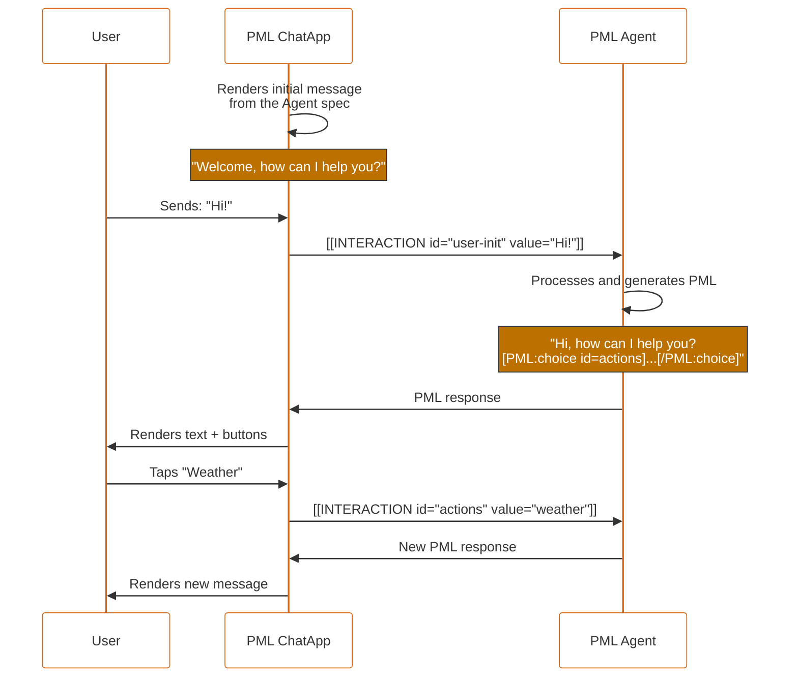

# PML — PEPPO Markup Language

## Complete specification v1.7

**PEPPO** — Platform for Engaging People and Processes via Omni-agents

> **v1.7 (May 2026).** Adds conditional form behavior with the auxiliary `rule` component. `PML:rule` is valid only as a direct child of `form` and can control the effective visibility or enabled state of form children with simple AND conditions. Rules may compare current serialized values via `when-<field-id>="..."` or renderer-owned component correctness via `state-<field-id>="correct|incorrect"`. Validation and `required` apply only to active children (`effective-visible=true` and `effective-enabled=true`). See §6.5.
>
> **v1.6.1 (May 2026).** Adds native cancel action to `form`: `cancel-label` attribute + empty-bracket cancel interaction `[[INTERACTION id="form-id"]]`. When present, the ChatApp renders a secondary cancel button alongside the submit button. Cancelling emits an interaction with only the `id` attribute (no `value`, no `field-*`), allowing the agent to distinguish cancel from submit. See §6.5.
>
> **v1.6 (May 2026).** Cleans up the serialization of the multi-field bracket introduced in v1.5: a `form`'s fields are now serialized with the `field-*` prefix (`field-name="..."`, `field-email="..."`). This eliminates the artificial rule "do not use `id="id"` or `id="value"` in form children" and makes the boundary between bracket metadata and form fields explicit. The declarative IDs of children remain unrestricted (any valid kebab-case). v1.6 is **additive**: v1.6 renderers accept v1.5 brackets without the prefix during the transition; v1.5 renderers that receive a v1.6 bracket ignore the unknown `field-*` attributes and process only `id`. See Appendix E.

---

## Table of contents

- [1. Overview](#1-overview)
    - [1.1 Vocabulary](#11-vocabulary)
    - [1.2 Interaction between components](#12-interaction-between-components)
    - [1.3 Design principles](#13-design-principles)
- [2. PML ChatApp](#2-pml-chatapp)
- [3. PML Agent](#3-pml-agent)
- [4. PML syntax](#4-pml-syntax)
    - [4.1 General format](#41-general-format)
    - [4.2 Self-closing component](#42-self-closing-component)
    - [4.3 Container component](#43-container-component)
    - [4.4 Strict lexical rules](#44-strict-lexical-rules)
    - [4.5 Example of a valid message](#45-example-of-a-valid-message)
    - [4.6 Component types](#46-component-types)
    - [4.7 Global attributes](#47-global-attributes)
- [5. Information components](#5-information-components)
    - [5.1 text](#51-text)
    - [5.2 markdown](#52-markdown)
    - [5.3 facts](#53-facts)
    - [5.4 dtable](#54-dtable)
    - [5.5 image](#55-image)
    - [5.6 media](#56-media)
    - [5.7 divider](#57-divider)
    - [5.8 raw](#58-raw)
- [6. Interaction components](#6-interaction-components)
    - [6.1 input](#61-input)
    - [6.2 toggle](#62-toggle)
    - [6.3 choice](#63-choice)
    - [6.4 confirm](#64-confirm)
    - [6.5 form](#65-form)
- [7. Interaction model](#7-interaction-model)
    - [7.1 Interaction format](#71-interaction-format)
    - [7.2 URL encoding of values](#72-url-encoding-of-values)
    - [7.3 Scalability: multi-field interactions](#73-scalability-multi-field-interactions)
    - [7.4 Conversation flow](#74-conversation-flow)
    - [7.5 Full conversation example](#75-full-conversation-example)
    - [7.6 State update](#76-state-update)
- [8. Composition rules](#8-composition-rules)
- [9. Guidelines for LLMs / Agents](#9-guidelines-for-llms--agents)
- [10. Mobile UX guidelines for the ChatApp](#10-mobile-ux-guidelines-for-the-chatapp)
- [11. Error handling](#11-error-handling)
- [12. Versioning and extensibility](#12-versioning-and-extensibility)
- [Appendix A — Quick reference](#appendix-a--quick-reference)
- [Appendix B — Full EBNF](#appendix-b--full-ebnf)
- [Appendix C — Migration v1.3 → v1.4](#appendix-c--migration-v13--v14)
- [Appendix D — Migration v1.4 → v1.5](#appendix-d--migration-v14--v15)
- [Appendix E — Migration v1.5 → v1.6](#appendix-e--migration-v15--v16)
- [Appendix F — Migration v1.6 → v1.6.1](#appendix-f--migration-v16--v161)
- [Appendix G — Migration v1.6.1 → v1.7](#appendix-g--migration-v161--v17)

---

## 1. Overview

**PML** is a lightweight, LLM-readable, token-efficient language designed so conversational agents can render interactive UI components inside chat interfaces.

PML turns classic ChatBots into **Interaction Agents** rich in functionality: the agent does not only emit text, it also emits components that the user can tap, fill in, confirm or cancel.

### 1.1 Vocabulary

| Term            | Definition                                                                                                                                         |
| --------------- | -------------------------------------------------------------------------------------------------------------------------------------------------- |
| **PML**         | The markup language described in this document.                                                                                                    |
| **Component**   | A syntactic unit of PML, either self-closing (`[PML:type /]`) or container (`[PML:type] ... [/PML:type]`).                                         |
| **PML Agent**   | An LLM configured to produce and consume PML.                                                                                                      |
| **PML ChatApp** | The interface that renders the PML and captures user interactions. Can be a mobile, web or desktop app.                                            |
| **Message**     | A text block produced by the agent or by the user; it may freely mix plain text and PML components.                                                |
| **Interaction** | The serialized result of a user action on an interactive component. It is transmitted as `[[INTERACTION id="..." value="..."]]`.                   |
| **Task**        | The lifecycle of a single interaction: render → capture → close. A conversation contains zero, one or many tasks over time.                        |

### 1.2 Interaction between components

The user starts a conversation with the ChatApp. The ChatApp sends the message to the PML Agent. The PML Agent parses the message and produces a response in PML. The ChatApp renders that PML. The user interacts with the components and the ChatApp captures the interaction, serializes it as `[[INTERACTION]]` and sends it back to the PML Agent. The PML Agent processes the interaction and generates new PML, repeating the cycle.

Illustrative use case:

- User: "Hi!"
- PML Agent: "Hi! How can I help you?" + buttons `Weather`, `News`, `Translator`, `Cancel`.
- User taps `Weather`.
- PML Agent: "The weather in MyCity is 68°F." + the same buttons.
- User taps `Cancel`.
- PML Agent: "Cheers, how else can I help you?"



### 1.3 Design principles

```
- Interaction-first   →  The agent generates UI interactions, not only text
- Token-efficient     →  More compact than JSON, XML, or any alternative
- LLM-friendly        →  Regular, predictable syntax, easy to emit without errors
- Mobile-native       →  Designed for mobile conversational flows
- UILogic-first       →  UI logic lives in the frontend, not in the agent
- Extensible          →  New components and new fields without breaking compatibility
- No-JSON             →  Uniform bracket syntax, no nested object-like structures
```

---

## 2. PML ChatApp

The ChatApp is the interface that allows users to interact with PML Agents. It is responsible for:

- Rendering the PML components received from the agent.
- Capturing user interactions on interactive components.
- Serializing those interactions as `[[INTERACTION ...]]` and sending them to the agent.
- Processing the new responses and continuing the cycle.

**Engine-agnostic.** The PML ChatApp is agnostic to the agent's engine: it does not know which LLM produces the PML, only that it must render it. This allows for ChatApps tailored to Android, iOS, Web, Desktop, etc., each with its own native renderer, without backend coupling.

---

## 3. PML Agent

A **PML Agent** is an LLM (Large Language Model) configured to:

1. Produce responses in PML, not only in plain text.
2. Receive and process interactions (`[[INTERACTION ...]]`) coming from the ChatApp.
3. Decide when to emit interactive components and when to emit only narrative.

**LLM-agnostic.** The PML Agent is agnostic to the LLM engine: it can be implemented with GPT, Claude, Gemini, Llama, etc. The only thing that defines a PML Agent is its ability to produce and consume PML correctly.

**Base prompt.** The agent's prompt must include, at minimum:

- An explanation of PML syntax (the subsection of the spec applicable to its domain).
- Explicit instructions on how to **decode** URL-encoded values arriving in user interactions.
- Representative examples of the agent's domain.

> It is not recommended to include the full PML specification in the base prompt; the subset needed for the agent's domain is enough. Including everything can degrade generation quality.

---

## 4. PML syntax

### 4.1 General format

PML is written as UTF-8 plain text. Plain text and PML components may coexist freely in the same message.

Every PML component has one of two forms:

- **Self-closing:** `[PML:type attr-1="value-1" attr-2="value-2" /]`
- **Container:** `[PML:type attr="value"] child content [/PML:type]`

### 4.2 Self-closing component

Components with no child content. They must end with ` /]` (a space before `/]`).

```
[PML:type attr-1="value-1" attr-2="value-2" /]
```

### 4.3 Container component

Components with child content (other components or text, as allowed by the composition rules in §8).

```
[PML:type attr="value"]
  child content
[/PML:type]
```

### 4.4 Strict lexical rules

| Rule                | Detail                                                                                                                                  |
| ------------------- | --------------------------------------------------------------------------------------------------------------------------------------- |
| **Encoding**        | All content is UTF-8.                                                                                                                   |
| **Case**            | Component and attribute names are in `lowercase` or `kebab-case`. Never `camelCase`, never `snake_case`, never uppercase.               |
| **Attributes**      | Syntax: `name="value"`. Names follow `[a-z][a-z0-9-]*`.                                                                                 |
| **Quotes**          | Values are delimited by `"` (preferred) or `'`. Never mix within the same attribute.                                                    |
| **Nested quotes**   | If a value contains the same quote that delimits it, use HTML entities (`&quot;`, `&#39;`).                                             |
| **Forbidden**       | No JSON, no `< >`, no literal `[` `]` characters outside components or inside attribute values.                                         |
| **IDs**             | Every interactive component **must** declare `id="..."`. Format: `kebab-case`, no spaces or special characters, must not start with a digit. |
| **Uniqueness**      | `id`s are unique within a message.                                                                                                      |
| **Self-closing**    | Must end with a space before the slash: ` /]`.                                                                                          |
| **Closing**         | Containers are closed with `[/PML:type]`. The type name must exactly match the opening tag.                                             |
| **Escaping**        | There are no `\` escape sequences. Use HTML entities or `[PML:raw]` when literals are needed.                                            |

> URL encoding applies to **interaction values**, not to attributes of PML components emitted by the agent. See §7.2.

### 4.5 Example of a valid message

```
Hi Pedro, what would you like to do today?
[PML:choice id="actions"]
  [PML:opt id="book"   value="Book appointment" /]
  [PML:opt id="prices" value="See prices"       /]
[/PML:choice]
```

### 4.6 Component types

**Information components (passive):**

- `text` — Static text with style
- `markdown` — Text with Markdown formatting
- `facts` — Key-value pair list
- `dtable` — Data table
- `image` — Static image
- `media` — Video or audio
- `divider` — Horizontal separator
- `raw` — Unparsed text block (escape)

**Interaction components (interactive):**

- `input` — Input field (text, number, date, file, etc.)
- `toggle` — Binary switch
- `choice` — Selection between options
- `confirm` — Confirmation dialog
- `form` — Field container with single submit, optional cancel, and optional conditional rules

**Auxiliary components (only valid inside their container):**

- `opt` — Option inside `choice`
- `fact` — Entry inside `facts`
- `dtrow`, `dtcol` — Row and cell inside `dtable`
- `rule` — Conditional behavior rule inside `form`

Information components render automatically in the chat flow. Interaction components require special handling: the ChatApp captures the user action and emits `[[INTERACTION]]` to the agent.

### 4.7 Global attributes

These attributes may be applied to any component, except for the restrictions noted:

| Attribute  | Applies to    | Type             | Description                                                              |
| ---------- | ------------- | ---------------- | ------------------------------------------------------------------------ |
| `id`       | All           | string           | Identifier. **Required on interactives**, optional on passives.          |
| `disabled` | Interactives  | `true` / `false` | Disables the interaction. Default: `false`.                              |
| `visible`  | All           | `true` / `false` | If `false`, the component is not rendered. Default: `true`.              |
| `tooltip`  | All           | string           | Help text shown on long-press (mobile) or hover (desktop).               |
| `error`    | Interactives  | string           | Error message associated with the component. Rendered below it.          |

---

## 5. Information components

Use only to show information to the user. They do not emit interactions.

### 5.1 text

Static text block with style.

| Attribute | Required | Type                                                 | Description                            |
| --------- | -------- | ---------------------------------------------------- | -------------------------------------- |
| `type`    | No       | `header` / `title` / `paragraph` / `muted` / `label` | Semantic type. Default: `paragraph`.   |
| `style`   | No       | `bold` / `italic` / `muted` / `normal`               | Visual style. Default: `normal`.       |
| `size`    | No       | `small` / `medium` / `large`                         | Size. Default: `medium`.               |
| `align`   | No       | `left` / `center` / `right`                          | Alignment. Default: `left`.            |

```
[PML:text type="header" size="large" style="bold"]
Your order is on its way
[/PML:text]

[PML:text type="muted" size="small"]
Estimated delivery in 3-5 business days
[/PML:text]
```

### 5.2 markdown

Text block with full Markdown formatting.

| Attribute | Required | Type   | Description |
| --------- | -------- | ------ | ----------- |
| `id`      | No       | string | Identifier  |

```
[PML:markdown]
### Shipping instructions

1. **Pack** the product in its original box
2. **Stick** the shipping label on the outside
3. **Drop off** the package at any shipping center

> Refunds are processed in 5-7 business days.

For more info visit our [shipping guide](https://peppo.com/shipping).
[/PML:markdown]
```

**Supports:** bold, italics, lists, links, inline code, blockquotes, headings.

**Parsing note:** Markdown's own brackets (`[text](url)`) are safe. The parser only activates PML mode when it finds exactly `[PML:`.

### 5.3 facts

Key-value pair table.

| Attribute | Required | Type      | Description                       |
| --------- | -------- | --------- | --------------------------------- |
| `columns` | No       | `1` / `2` | Layout columns. Default: `1`.     |

**Content:** one or more `[PML:fact label="..." value="..." /]` as direct children.

```
[PML:facts]
  [PML:fact label="Product" value="Nike Air Max 90" /]
  [PML:fact label="Size"    value="9"               /]
  [PML:fact label="Price"   value="$129 USD"        /]
  [PML:fact label="Shipping" value="Free"           /]
[/PML:facts]
```

### 5.4 dtable

Generic data table.

| Attribute | Required | Type   | Description                              |
| --------- | -------- | ------ | ---------------------------------------- |
| `columns` | Yes      | string | Comma-separated column names.            |

**Content:** rows wrapped in `[PML:dtrow] ... [/PML:dtrow]`. Each cell is a self-closing `[PML:dtcol value="..." /]`. The number of cells per row must match the declared column count.

```
[PML:dtable columns="Plan,Price,Agents,Messages"]
  [PML:dtrow]
    [PML:dtcol value="Basic" /][PML:dtcol value="$9/mo"  /][PML:dtcol value="1"  /][PML:dtcol value="100/day"  /]
  [/PML:dtrow]
  [PML:dtrow]
    [PML:dtcol value="Pro"   /][PML:dtcol value="$29/mo" /][PML:dtcol value="10" /][PML:dtcol value="Unlimited" /]
  [/PML:dtrow]
[/PML:dtable]
```

### 5.5 image

Static image.

| Attribute | Required | Type                                  | Description                |
| --------- | -------- | ------------------------------------- | -------------------------- |
| `url`     | Yes      | url                                   | Image URL.                 |
| `alt`     | No       | string                                | Alternative text.          |
| `size`    | No       | `small` / `medium` / `large` / `full` | Size. Default: `medium`.   |
| `caption` | No       | string                                | Image caption.             |

```
[PML:image url="https://cdn.peppo.com/product.jpg" alt="Nike Air Max 90"
  size="large" caption="New 2026 model" /]
```

### 5.6 media

Video or audio player.

| Attribute | Required | Type              | Description                       |
| --------- | -------- | ----------------- | --------------------------------- |
| `url`     | Yes      | url               | File URL.                         |
| `type`    | Yes      | `video` / `audio` | Media type.                       |
| `poster`  | No       | url               | Cover image (video only).         |
| `caption` | No       | string            | Media caption.                    |

```
[PML:media url="https://cdn.peppo.com/demo.mp4" type="video"
  poster="https://cdn.peppo.com/demo-poster.jpg" /]
```

### 5.7 divider

Separator line.

| Attribute | Required | Type   | Description                  |
| --------- | -------- | ------ | ---------------------------- |
| `label`   | No       | string | Optional centered text.      |

```
[PML:divider /]
[PML:divider label="Or continue with" /]
```

### 5.8 raw

Plain text block that turns off the PML parser. Allows displaying literal PML syntax without it being interpreted.

```
[PML:raw]
To show bold text, use the text component:
[PML:text style="bold"]Bold text[/PML:text]
[/PML:raw]
```

> Inside `[PML:raw]` no attributes exist. The parser only looks for the exact closing tag `[/PML:raw]`.

---

## 6. Interaction components

Interactive components generate an `[[INTERACTION]]` when the user completes their action (submit, selection, toggle, confirmation). The exact interaction format is specified in §7.

### 6.1 input

Data entry field. The subtype is selected with the `type` attribute.

**Available subtypes:**

- `text` — Text field (single or multi-line)
- `number` — Numeric field
- `currency` — Monetary field
- `contact` — Capture of system contact (phone)
- `date` — Date picker
- `time` — Time picker
- `datetime` — Date and time picker
- `location` — Location / GPS picker
- `file` — File picker

**Attributes common to all `input`s:**

| Attribute  | Required | Type                  | Description                       |
| ---------- | -------- | --------------------- | --------------------------------- |
| `id`       | Yes      | string                | Unique identifier.                |
| `type`     | Yes      | string                | Subtype (see list above).         |
| `label`    | No       | string                | Visible label.                    |
| `required` | No       | `true` / `false`      | Required. Default: `false`.       |
| `readonly` | No       | `true` / `false`      | Read-only. Default: `false`.      |
| `value`    | No       | depends on subtype    | Initial value.                    |

#### 6.1.1 input type="text"

| Attribute       | Required | Type    | Description                                   |
| --------------- | -------- | ------- | --------------------------------------------- |
| `placeholder`   | No       | string  | Help text.                                    |
| `multiline`     | No       | boolean | Multi-line field. Default: `false`.           |
| `validate`      | No       | string  | Regex for local validation.                   |
| `error-message` | No       | string  | Message shown if validation fails.            |
| `max-length`    | No       | number  | Maximum characters.                           |
| `min-length`    | No       | number  | Minimum characters.                           |
| `password`      | No       | boolean | Hides text while typing. Default: `false`.    |

```
[PML:input id="name" type="text" label="Full name"
  placeholder="Enter your name" required="true" /]
```

**Generated interaction:**

```
[[INTERACTION id="name" value="John+Smith"]]
```

With `multiline="true"`:

```
[PML:input id="comments" type="text" label="Comments"
  multiline="true" placeholder="Write your comments" /]
```

```
[[INTERACTION id="comments" value="First+line%0ASecond+line"]]
```

> Line breaks are encoded as `%0A` (see §7.2).

#### 6.1.2 input type="number"

| Attribute     | Required | Type    | Description                       |
| ------------- | -------- | ------- | --------------------------------- |
| `placeholder` | No       | string  | Help text.                        |
| `integer`     | No       | boolean | Integers only. Default: `false`.  |
| `decimals`    | No       | number  | Number of decimals. Default: `0`. |
| `min`         | No       | number  | Minimum value.                    |
| `max`         | No       | number  | Maximum value.                    |

```
[PML:input id="age" type="number" label="Age" integer="true" min="18" max="99" /]
```

```
[[INTERACTION id="age" value="25"]]
```

```
[PML:input id="height" type="number" label="Height"
  placeholder="1.75" decimals="2" /]
```

```
[[INTERACTION id="height" value="1.75"]]
```

#### 6.1.3 input type="currency"

| Attribute     | Required | Type   | Description                                          |
| ------------- | -------- | ------ | ---------------------------------------------------- |
| `placeholder` | No       | string | Help text.                                           |
| `currency`    | No       | string | ISO 4217 code (`USD`, `MXN`, ...). Default: `USD`.   |
| `decimals`    | No       | number | Number of decimals. Default: `2`.                    |
| `min`         | No       | number | Minimum value.                                       |
| `max`         | No       | number | Maximum value.                                       |

```
[PML:input id="amount" type="currency" label="Amount"
  currency="USD" min="1" max="10000" /]
```

**Generated interaction** (raw numeric value, no symbols):

```
[[INTERACTION id="amount" value="1500.50"]]
```

> The interaction value is always the raw number (no currency symbol, no thousands separators, with a decimal point). Visual presentation with symbol and separators is the renderer's responsibility.

#### 6.1.4 input type="contact"

Captures the user's phone number using the ChatApp's native mechanisms (contact picker, autofill, etc.). It has no additional attributes.

```
[PML:input id="phone" type="contact" label="Tap to share your phone" required="true" /]
```

```
[[INTERACTION id="phone" value="%2B15551234567"]]
```

> The leading `+` of an E.164 number is URL-encoded as `%2B`.

#### 6.1.5 input type="date"

Date picker. The interaction value is ISO 8601 (`YYYY-MM-DD`).

| Attribute     | Required | Type   | Description                |
| ------------- | -------- | ------ | -------------------------- |
| `placeholder` | No       | string | Help text.                 |
| `min`         | No       | string | Minimum date `YYYY-MM-DD`. |
| `max`         | No       | string | Maximum date `YYYY-MM-DD`. |

```
[PML:input id="date" type="date" label="Appointment date" /]
```

```
[[INTERACTION id="date" value="2026-06-15"]]
```

#### 6.1.6 input type="time"

Time picker. **The interaction value is always `HH:mm` in 24-hour format, regardless of the presentation mode.** The `am-pm` attribute only affects the UI.

| Attribute     | Required | Type    | Description                                                  |
| ------------- | -------- | ------- | ------------------------------------------------------------ |
| `placeholder` | No       | string  | Help text.                                                   |
| `am-pm`       | No       | boolean | Shows the user an AM/PM selector. Default: `false` (24h).    |

```
[PML:input id="time" type="time" label="Time" am-pm="true" /]
```

```
[[INTERACTION id="time" value="14:45"]]
```

#### 6.1.7 input type="datetime"

Date and time picker. The interaction value is ISO 8601 without timezone: `YYYY-MM-DDTHH:mm` (24h).

| Attribute     | Required | Type   | Description  |
| ------------- | -------- | ------ | ------------ |
| `placeholder` | No       | string | Help text.   |

```
[PML:input id="appointment" type="datetime" label="Date and time" /]
```

```
[[INTERACTION id="appointment" value="2026-06-15T14:45"]]
```

#### 6.1.8 input type="location"

Location picker. The interaction value is `latitude,longitude` (decimals with point). The renderer may offer device GPS, address search or a mini-map with a pin.

```
[PML:input id="location" type="location" label="Your location" /]
```

```
[[INTERACTION id="location" value="40.7128,-74.0060"]]
```

#### 6.1.9 input type="file"

Single file picker. The renderer uploads the file to an endpoint configured by the ChatApp and obtains a URL that is sent as the interaction value.

| Attribute  | Required | Type   | Description                                                |
| ---------- | -------- | ------ | ---------------------------------------------------------- |
| `accept`   | No       | string | Allowed MIME types (e.g.: `image/*`, `application/pdf`).   |
| `max-size` | No       | string | Maximum size (e.g.: `5MB`, `10MB`).                        |

```
[PML:input id="photo" type="file" label="Upload your ID"
  accept="image/*" max-size="5MB" /]
```

```
[[INTERACTION id="photo" value="https://cdn.peppo.com/uploads/abc123.jpg"]]
```

> The returned URL comes from the ChatApp's storage service; it is not URL-encoded because it is already a valid ASCII-safe URL.

---

### 6.2 toggle

Binary switch.

| Attribute   | Required | Type             | Description                                                   |
| ----------- | -------- | ---------------- | ------------------------------------------------------------- |
| `id`        | Yes      | string           | Unique identifier.                                            |
| `label`     | Yes      | string           | Descriptive text of the active state.                         |
| `checked`   | No       | `true` / `false` | Initial state. Default: `false`.                              |
| `value-on`  | No       | string           | Value sent when active. Default: `"true"`.                    |
| `value-off` | No       | string           | Value sent when inactive. Default: `"false"`.                 |
| `required`  | No       | `true` / `false` | Required. Default: `false`.                                   |

```
[PML:toggle id="terms" label="I accept the terms and conditions"
  checked="false" required="true" /]
```

**Generated interaction (active):**

```
[[INTERACTION id="terms" value="true"]]
```

**With custom values:**

```
[PML:toggle id="notif" label="Receive notifications"
  value-on="subscribed" value-off="not-subscribed" /]
```

```
[[INTERACTION id="notif" value="subscribed"]]
```

---

### 6.3 choice

Selection between options (buttons, radio, or dropdown).

| Attribute     | Required | Type                             | Description                            |
| ------------- | -------- | -------------------------------- | -------------------------------------- |
| `id`          | Yes      | string                           | Unique identifier.                     |
| `style`       | No       | `buttons` / `dropdown` / `radio` | Rendering. Default: `buttons`.         |
| `multi`       | No       | `true` / `false`                 | Multiple selection. Default: `false`.  |
| `placeholder` | No       | string                           | Initial text (`dropdown` only).        |
| `required`    | No       | `true` / `false`                 | Required. Default: `false`.            |

**Content:** one or more `[PML:opt /]` as direct children.

#### `opt` attributes

| Attribute | Required    | Type   | Description                                                                                                                                                       |
| --------- | ----------- | ------ | ----------------------------------------------------------------------------------------------------------------------------------------------------------------- |
| `value`   | Yes         | string | Text visible to the user.                                                                                                                                         |
| `id`      | Conditional | string | Identifier. **Required if `value` contains spaces, accents or non-`[a-z0-9-]` characters.** If omitted and `value` is valid as an id, it is used as the id.       |

> **Simplified rule:** always declare explicit `id` on `opt` unless the `value` is a trivial identifier (numbers, short lowercase words without accents). This avoids ambiguity and reduces LLM errors.

#### Single selection

```
[PML:choice id="size" style="buttons"]
  [PML:opt value="7"  /]
  [PML:opt value="8"  /]
  [PML:opt value="9"  /]
  [PML:opt value="10" /]
[/PML:choice]
```

```
[[INTERACTION id="size" value="10"]]
```

#### With explicit ids

```
[PML:choice id="action"]
  [PML:opt id="book"   value="Book appointment" /]
  [PML:opt id="prices" value="See prices"       /]
  [PML:opt id="cancel" value="Cancel"           /]
[/PML:choice]
```

```
[[INTERACTION id="action" value="book"]]
```

#### Multiple selection

When `multi="true"`, the selected ids are concatenated in `value` separated by commas without spaces.

```
[PML:choice id="days" multi="true"]
  [PML:opt id="mon" value="Monday"    /]
  [PML:opt id="tue" value="Tuesday"   /]
  [PML:opt id="wed" value="Wednesday" /]
[/PML:choice]
```

```
[[INTERACTION id="days" value="mon,tue"]]
```

---

### 6.4 confirm

Confirmation dialog. Renders a modal with two actions: accept or cancel.

| Attribute       | Required | Type                             | Description                                              |
| --------------- | -------- | -------------------------------- | -------------------------------------------------------- |
| `id`            | Yes      | string                           | Unique identifier.                                       |
| `title`         | Yes      | string                           | Dialog title.                                            |
| `message`       | No       | string                           | Descriptive message.                                     |
| `confirm-label` | No       | string                           | Confirm button text. Default: `"Confirm"`.               |
| `cancel-label`  | No       | string                           | Cancel button text. Default: `"Cancel"`.                 |
| `style`         | No       | `default` / `danger` / `warning` | Visual style. Default: `default`.                        |

**The value returned in the interaction is semantic and fixed: `confirmed` or `cancelled`**, regardless of the button label language.

```
[PML:confirm id="delete-account" title="Delete your account?"
  message="All your data will be erased."
  confirm-label="Yes, delete" cancel-label="No, keep" style="danger" /]
```

**If the user confirms:**

```
[[INTERACTION id="delete-account" value="confirmed"]]
```

**If the user cancels:**

```
[[INTERACTION id="delete-account" value="cancelled"]]
```

---

### 6.5 form

Field container with **submit, optional cancel, and optional conditional rules**. A valid `form` must contain at least one interactive child (`input`, `toggle`, or `choice`). It is the first PML component to capture multiple values in a single action: when the user presses the submit button and local validation passes, the ChatApp emits **a single** `[[INTERACTION]]` with a `field-<id>` attribute for each active interactive child (multi-field format from §7.3). When `cancel-label` is present, the ChatApp also renders a cancel button that emits an empty interaction (no fields, no value).

#### Attributes

| Attribute      | Required | Type   | Description                                              |
| -------------- | -------- | ------ | -------------------------------------------------------- |
| `id`           | Yes      | string | Unique identifier of the form (kebab-case).              |
| `submit-label` | No       | string | Submit button text. Default: `"Submit"`.                 |
| `cancel-label` | No       | string | Cancel button text. If omitted, no cancel button is rendered. When present, the ChatApp shows a secondary button alongside submit. |

#### Allowed children

| Child                                                                            | Allowed | Notes                                                                                            |
| -------------------------------------------------------------------------------- | ------- | ------------------------------------------------------------------------------------------------ |
| Simple passives: `text`, `markdown`, `divider`, `image`, `media`, `raw`          | Yes     | For labels, instructions, visual separators, narrative sections.                                 |
| Passive container: `facts`                                                       | Yes     | Useful to show readonly summaries before submit (`form > facts > fact` = 3 levels).              |
| Interactives: `input` (all subtypes), `toggle`, `choice` (single and multi)      | Yes     | Each active one contributes **one attribute** `field-<id>` to the final `[[INTERACTION]]` (§7.3). |
| Auxiliary: `rule`                                                                | Yes     | Declares conditional visibility/enabled behavior for direct form children. Does not render or emit interactions. |
| `dtable`                                                                         | **No**  | Would exceed the maximum depth of 3 (`form > dtable > dtrow > dtcol` = 4).                       |
| `confirm`                                                                        | **No**  | Confirm is a self-contained modal action; mixing it with form creates submit ambiguity.          |
| Nested `form`                                                                    | **No**  | v1.5 forbids nested forms; the agent must use separate flows.                                    |

#### Validity condition: at least one interaction

A `form` is valid only if it contains at least one direct interactive child: `input`, `toggle`, or `choice`.

Passive children (`text`, `markdown`, `divider`, `image`, `media`, `raw`, `facts`) may frame, explain, or summarize the form, but they cannot be the only content inside it. A narrative-only form with a submit button is not a form; use a `choice` with one `opt` for a CTA, or `confirm` when the action needs explicit acceptance/cancellation.

#### Conditional behavior: PML:rule

`PML:rule` declares conditional runtime behavior inside a `form`. It is an auxiliary, non-visual, self-closing component: it does not render, does not emit `[[INTERACTION]]`, and is valid only as a direct child of `form`.

`PML:rule` is intended for Peppo Agents and the Agent Creator to author conditional form behavior declaratively, for Peppo Runner to preserve and deliver the rules, and for the ChatApp renderer to evaluate them during `first_rendering` and `live_capture`.

```pml
[PML:rule
  action="visible"
  targets="text-informacion-contacto,contacto"
  when-departamento="rrhh"
  when-aceptar-condiciones="true" /]
```

Interpretation:

```text
text-informacion-contacto and contacto are visible only when:
departamento == rrhh
AND aceptar-condiciones == true
```

##### Attributes

| Attribute              | Required | Type                    | Description |
| ---------------------- | -------- | ----------------------- | ----------- |
| `action`               | Yes      | `visible` / `enabled`   | Effective state controlled by the rule. |
| `targets`              | Yes      | comma-separated IDs     | Direct non-`rule` children of the same `form` affected by the rule. |
| `when-<field-id>`      | No       | string                  | Value condition. The source must be an interactive child of the same `form`. |
| `state-<field-id>`     | No       | `correct` / `incorrect` | Runtime correctness condition. The source must be an interactive child of the same `form`. |

At least one `when-*` or `state-*` condition is required. Multiple conditions are combined with AND. `PML:rule` has no OR, nested expressions, arithmetic, regex, scripts, or custom formulas.

##### Actions

`action="visible"` controls effective visibility. When the rule conditions are true, the targets are visible; when they are false, the targets are hidden. `rule` components themselves cannot be targets.

`action="enabled"` controls effective enabled state. When the rule conditions are true, interactive targets are enabled; when they are false, they are disabled. Passive targets do not have enabled behavior; if an `enabled` rule targets a passive component, the renderer ignores that target and logs a warning.

If multiple rules control the same `target + action`, all of them must evaluate to true for the target to keep that effective state. This keeps conflict resolution deterministic and avoids "last rule wins" ordering.

Rules combine with the component's declared base state. `visible="false"` remains hidden even if a visible rule is true, and `disabled="true"` remains disabled even if an enabled rule is true. If no rule controls a given action for a target, the target keeps its declared/default state.

##### Value conditions: `when-<field-id>`

`when-<field-id>="expected-value"` compares the current serialized value of the source component with the expected value.

- For `choice`, the value is the selected option id. For `choice multi="true"`, the condition is true when the expected option id is selected.
- For `toggle`, the value is `value-on` or `value-off` as appropriate (default `"true"` / `"false"`).
- For `input`, the value is the current serialized input value. For validation-shaped conditions, prefer `state-<field-id>` instead of literal value comparisons.

Example:

```pml
[PML:rule
  action="enabled"
  targets="contacto"
  when-departamento="rrhh"
  when-aceptar-condiciones="true" /]
```

##### Component correctness: `state-<field-id>`

Component correctness is a renderer-owned runtime state. A component is `correct` when its current value satisfies the constraints declared on the component itself; otherwise it is `incorrect`.

Only two correctness states are defined:

```text
correct
incorrect
```

Example:

```pml
[PML:input id="edad" type="number" min="10" max="15" /]

[PML:markdown id="resumen-edad"]Age is in the accepted range.[/PML:markdown]

[PML:rule
  action="visible"
  targets="resumen-edad"
  state-edad="correct" /]
```

If `edad` currently contains `12`, it is `correct` and `resumen-edad` becomes visible. If `edad` contains `8`, it is `incorrect` and `resumen-edad` stays hidden.

Correctness lets rules depend on native component validation without duplicating `min`, `max`, `validate`, date formats, file restrictions, or other component-specific logic inside the rule. A literal value such as `when-code="state:correct"` is always treated as a literal value; runtime correctness must use `state-code="correct"`.

##### Effective state, validation, and serialization

The renderer computes two effective states for every form child:

```text
effective-visible
effective-enabled
```

`effective-visible` starts from the `visible` attribute (default `true`). `effective-enabled` starts from the inverse of `disabled` (default enabled). Matching `rule` components can only narrow these states.

An interactive child is active only when both are true:

```text
active = effective-visible AND effective-enabled
```

Validation applies only to active interactive children. Therefore, a hidden or disabled child does not block submit even if it declares `required="true"` or any other validation attribute.

Submit serialization includes only active interactive children. Inactive children do not contribute `field-*` attributes. The agent must interpret a missing `field-<id>` in a conditional form as "not active in the submitted state", not as an empty answer.

The renderer evaluates rules before the initial form is shown, using declared initial values/defaults, and re-evaluates them whenever a source value changes.

Recommended renderer order:

```text
current values
→ component correctness
→ PML:rule evaluation
→ effective visible/enabled state
→ submit validation
→ interaction serialization
```

#### Submit and cancel behavior

**Submit path:**

1. The user freely edits the form's interactive children. **While the form is active, its children do not emit individual `[[INTERACTION]]`** — their values stay in the ChatApp's local state.
2. The user presses the submit button (text: `submit-label`).
3. The ChatApp evaluates `PML:rule` components and computes the effective state of all form children.
4. The ChatApp runs **local validation** on all active interactive children:
   - `required="true"` → value must not be empty.
   - `validate="<regex>"` → value must match (input text).
   - `min` / `max` → numeric range (input number, currency).
   - `min-length` / `max-length` → length range (input text).
   - The specific type (date, datetime, location, etc.) must be well-formed.
5. **If any validation fails**:
   - The ChatApp injects `error="..."` on each failed child (using the component's `error-message` if defined, or a generic renderer default).
   - **No** `[[INTERACTION]]` is emitted. The form remains in `live_capture`.
   - The user corrects and presses submit again.
6. **If all validations pass**:
   - The ChatApp emits a single `[[INTERACTION]]` with the form's `id` and a `field-<sub-id>` attribute for each active interactive child.
   - The form transitions to `final_rendering`.

**Cancel path** (only when `cancel-label` is present):

1. The user presses the cancel button (text: `cancel-label`).
2. The ChatApp emits an **empty interaction** — only the form's `id`, no `value`, no `field-*` attributes:
   ```
   [[INTERACTION id="form-id"]]
   ```
3. **No validation runs.** The form transitions directly to `final_rendering`.
4. The agent receives the empty bracket and interprets it as cancellation: no data was submitted, the user wants to leave the form.

**How the agent distinguishes submit from cancel:**

| Bracket received | Meaning |
| --- | --- |
| `[[INTERACTION id="X" field-a="..." field-b="..."]]` | Submit: fields present, process the data. |
| `[[INTERACTION id="X"]]` | Cancel when `cancel-label` is present. A submit with no `field-*` attributes is invalid because a valid form must have at least one interactive child. |

#### Interaction serialization

For a form with active interactive children `child-1`, `child-2`, ..., `child-n` with values `v1`, `v2`, ..., `vn`:

```
[[INTERACTION id="form-id" field-child-1="v1" field-child-2="v2" ... field-child-n="vn"]]
```

**Precise rules:**

- **Each active interactive child of the form contributes exactly one attribute** prefixed with `field-` to the bracket. The suffix is the child's declared `id`. The **value** is the captured value, URL-encoded per §7.2 when it comes from free user text.
- **Inactive interactive children are omitted**. A child is inactive when its effective visibility or effective enabled state is false.
- **All active interactive children are always included**, even if they are `readonly` or the user did not touch them (in which case the value is the empty string `""` or the initial `value` declared by the agent).
- For `choice multi="true"`, selected ids are serialized **comma-separated** inside the value (same as a standalone choice): `field-days="mon,tue,wed"`.
- For `toggle`, the value is `value-on` or `value-off` as appropriate (default `"true"` / `"false"`).
- The order of the attributes in the serialization should respect the order of the children in the form (legibility recommendation; not semantic).
- **There are no forbidden IDs in form children.** Declarative IDs live in their own namespace: `id="id"`, `id="value"`, `id="error"` are valid because they serialize to `field-id`, `field-value`, `field-error`, without colliding with the reserved bracket names (`id`, `value`).

#### Bracket namespaces

| Bracket attribute        | Meaning                                                            |
| ------------------------ | ------------------------------------------------------------------ |
| `id`                     | Identifies the root component that originated the interaction.    |
| `value`                  | (Single-value mode) Value captured from an atomic component.      |
| `field-<sub-id>`         | (Multi-field mode) Value captured from the form's active `<sub-id>` child. |
| (no other attributes)    | (Cancel mode) Form was cancelled — `id` only, no data.            |
| Other bare names         | Reserved for future metadata extensions. **Do not use.**          |

> **Why the `field-` prefix.** v1.5 had chosen bare names (`name="..."`) for form fields, which forced marking `id` and `value` as forbidden IDs in children. v1.6 isolates the field space with the `field-` prefix: declarative IDs are free again and the bracket becomes self-describing (any `field-*` attribute is always a form field, regardless of the version of the agent that produced it).

#### Example: user signup

```
[PML:form id="signup" submit-label="Create account" cancel-label="Cancel"]
  [PML:text type="header" style="bold"]Create your account[/PML:text]

  [PML:input id="name" type="text" label="Full name"
    required="true" /]

  [PML:input id="email" type="text" label="Email"
    required="true"
    validate="^[^@]+@[^@]+\.[^@]+$"
    error-message="Invalid email" /]

  [PML:input id="phone" type="contact" label="Phone" /]

  [PML:input id="birth-date" type="date" label="Date of birth"
    required="true" /]

  [PML:choice id="plan" required="true"]
    [PML:opt id="basic" value="Basic" /]
    [PML:opt id="pro"   value="Pro"   /]
  [/PML:choice]

  [PML:toggle id="accept-terms"
    label="I accept the terms and conditions" required="true" /]
[/PML:form]
```

**Valid submit — generated interaction:**

```
[[INTERACTION id="signup"
  field-name="John+Smith"
  field-email="john%40example.com"
  field-phone="%2B15551234567"
  field-birth-date="1990-03-15"
  field-plan="pro"
  field-accept-terms="true"]]
```

#### Server validation: re-render with errors

When the backend rejects the submit (e.g. the email is already registered), the agent applies the state-update rule from §7.6: it re-emits the **same form with the same `id`**, preserves previous values via the `value` attribute on each child and adds `error="..."` on the failed child.

```
[PML:form id="signup" submit-label="Create account"]
  [PML:input id="name" type="text" label="Full name"
    value="John Smith" required="true" /]

  [PML:input id="email" type="text" label="Email"
    value="john@example.com"
    validate="^[^@]+@[^@]+\.[^@]+$"
    error="This email is already registered" required="true" /]

  [PML:input id="phone" type="contact" label="Phone"
    value="+1 555 123 4567" /]

  [PML:input id="birth-date" type="date" label="Date of birth"
    value="1990-03-15" required="true" /]

  [PML:choice id="plan" required="true" value="pro"]
    [PML:opt id="basic" value="Basic" /]
    [PML:opt id="pro"   value="Pro"   /]
  [/PML:choice]

  [PML:toggle id="accept-terms"
    label="I accept the terms and conditions" checked="true" required="true" /]
[/PML:form]
```

The ChatApp detects the same `id` and restores the task to `live_capture` without creating a new block in `shared_history`.

#### MVP layout

```
┌─────────────────────────────┐
│ task_controls               │
│  ┌───────────────────────┐  │
│  │ Create your account   │  │ ← text header
│  │                       │  │
│  │ Full name             │  │ ← label
│  │ ┌───────────────────┐ │  │
│  │ │                   │ │  │ ← input
│  │ └───────────────────┘ │  │
│  │                       │  │
│  │ Email                 │  │
│  │ ┌───────────────────┐ │  │
│  │ │ john@e.com        │ │  │
│  │ └───────────────────┘ │  │
│  │ Invalid email         │  │ ← inline error
│  │                       │  │
│  │ Plan                  │  │
│  │ [Basic] [Pro]         │  │ ← choice
│  │                       │  │
│  │ ◉ Accept terms        │  │ ← toggle
│  │                       │  │
│  │ ┌───────────────────┐ │  │
│  │ │  Create account   │ │  │ ← submit (primary)
│  │ └───────────────────┘ │  │
│  │ ┌───────────────────┐ │  │
│  │ │     Cancel        │ │  │ ← cancel (secondary, if cancel-label)
│  │ └───────────────────┘ │  │
│  └───────────────────────┘  │
└─────────────────────────────┘
```

#### Lifecycle (zones and phases)

The form is **a single task**. It goes through the full lifecycle like any other interactive component:

| Phase             | What happens                                                                                                                                                                                                                  |
| ----------------- | ----------------------------------------------------------------------------------------------------------------------------------------------------------------------------------------------------------------------------- |
| `first_rendering` | The full form appears in `task_controls`. If the message includes narrative **outside** the form, that narrative goes to `task_narrative`. Narrative **inside** the form renders inline.                                       |
| `live_capture`    | The user freely edits any interactive child. Individual components **do not emit** `[[INTERACTION]]`. Validation is inert until submit.                                                                                       |
| `final_rendering` | After a valid submit, the full form (with its resolved values) is snapshotted immutably to `shared_history`. `task_controls` and `task_narrative` are emptied.                                                                |

#### Edge cases

- **Form with no interactive children** (only passive content + submit): invalid. The renderer omits submit/cancel controls, renders the passive content as narrative/plain flow, and logs a warning. Use `choice` for a CTA or `confirm` for explicit acceptance/cancellation.
- **`disabled` child**: is not active; it does not validate, does not block `required`, and does not contribute to submit serialization. Use `readonly` for immutable values that must still be submitted.
- **`readonly` child**: remains active regarding validation and serialization; visually it appears editable but does not accept changes.
- **Optional active child with no initial value**: is included with value `""` in the serialization.
- **Duplicate IDs across children**: the renderer applies the rules from §8.3 (renders the first, ignores the rest; the second does not contribute to the interaction).
- **Forbidden child detected** (e.g. `confirm`, `dtable`, nested `form`): the renderer treats it as plain text and omits it from the interaction. Logs a warning.
- **Submit with zero valid interactive children**: invalid form; no `[[INTERACTION]]` is emitted.
- **Conditional form with zero active interactive children at submit time**: invalid submit state; no `[[INTERACTION]]` is emitted and the renderer shows a generic form-level error.
- **v1.5 ↔ v1.6 compatibility**: a v1.6 renderer accepts brackets without a prefix (v1.5 format) during the transition period and processes them as if they carried an implicit `field-`. A v1.5 agent sent to a v1.6 renderer still works. A v1.6 agent sent to a v1.5 renderer emits `field-*` attributes that the v1.5 renderer silently ignores ("unknown attributes are dropped" rule); the agent receives the degraded interaction without fields. For maximum compatibility, the agent should negotiate version via the envelope metadata before choosing the format to emit.

---

## 7. Interaction model

An **interaction** is the serialized result of a user action on an interactive component. The ChatApp produces the interaction and sends it to the PML Agent, which interprets it and generates the next response.

### 7.1 Interaction format

```
[[INTERACTION id="component-id" value="user-value"]]
```

**Lexical rules:**

- Delimiters: opening double bracket `[[INTERACTION` and closing double bracket `]]`.
- Attributes follow the same syntax as PML attributes: `name="value"`, with double quotes preferred (or single).
- The `id` attribute is **always required** and references the `id` of the component that originated the interaction.
- The `value` attribute contains the user's captured value (URL-encoded per §7.2).
- The bracket `[[INTERACTION ...]]` is treated as an atomic syntactic component: no child content, no closing tag `[[/INTERACTION]]` for the single-value case.

**Full user-side message:** an interaction may appear alone in the message, or interspersed with plain text if the user also typed something (rare; the normal pattern is an isolated interaction).

### 7.2 URL encoding of values

When the ChatApp sends values that come from **free user text**, it applies URL encoding (RFC 3986 + `+` for spaces, `application/x-www-form-urlencoded` style).

| Character | Encoding |
| --------- | -------- |
| space     | `+`      |
| `&`       | `%26`    |
| `=`       | `%3D`    |
| `"`       | `%22`    |
| `'`       | `%27`    |
| `+`       | `%2B`    |
| `%`       | `%25`    |
| `\n`      | `%0A`    |
| `\r`      | `%0D`    |
| `[`       | `%5B`    |
| `]`       | `%5D`    |

**Encoded:** values captured as free user text (`input type="text"`, multi-line, etc.).

**Not encoded:**

- `id` of any attribute in the interaction (always `kebab-case` ASCII).
- `value` values that come from IDs predefined by the agent or ChatApp (`choice` options, `confirmed`/`cancelled` values from `confirm`, `true`/`false` or custom from `toggle`).
- Values generated by sensors or the system (GPS coordinates, ISO 8601 dates, file URLs).
- Numbers (`input type="number"`, `currency`).

**Non-ASCII UTF-8 characters** (accents, ñ, emojis, etc.): encoded as UTF-8 bytes in hexadecimal (`%XX`). E.g.: `María` → `Mar%C3%ADa`.

**Note for the Agent (LLM):** the system prompt must explicitly instruct the agent to **decode** URL-encoded values before processing them semantically.

**Example:**

```
User types:        Pedro & María
ChatApp sends:     [[INTERACTION id="name" value="Pedro+%26+Mar%C3%ADa"]]
Agent decodes:     "Pedro & María"
```

### 7.3 Multi-field interactions

The format `[[INTERACTION id="..." value="..."]]` extends **naturally** to components that capture multiple fields in a single action. The v1.6+ generative rule for submit interactions is:

> The bracket `[[INTERACTION ...]]` admits **one or more `field-<sub-id>` attributes** in addition to `id`. Each `field-*` attribute corresponds to an active field of the compound component: the suffix is the sub-component's `id`, the value is the captured data.

**Canonical form (single value — input, choice, toggle, confirm):**

```
[[INTERACTION id="name" value="Pedro"]]
```

**Multi-field form (form, §6.5):**

```
[[INTERACTION id="form-checkout"
  field-name="John+Smith"
  field-email="john%40e.com"
  field-phone="%2B15551234567"
  field-accept-terms="true"]]
```

**Design properties:**

| Property              | Explanation                                                                                                                                                                                                                                            |
| --------------------- | ------------------------------------------------------------------------------------------------------------------------------------------------------------------------------------------------------------------------------------------------------ |
| **No JSON**           | Only `name="value"` attribute syntax, identical to PML's. No object or array level.                                                                                                                                                                    |
| **No nesting**        | The entire interaction lives on a single logical line. No `[[FIELD ...]]` or closing tags.                                                                                                                                                             |
| **Compatible**        | A parser that only understands `id` + `value` can ignore `field-*` attributes and process the simple case unchanged. v1.6 → v1.5: silent ignore. v1.5 → v1.6: the v1.6 renderer accepts unprefixed attributes as a temporary alias.                    |
| **Deterministic**     | Field names are `field-<sub-id>`, where `<sub-id>` is the sub-component's `id`. There are no positions; order is not semantic.                                                                                                                         |
| **Isolated spaces**   | `id` and `value` are bracket metadata. Fields live exclusively in the `field-*` namespace. This separation eliminates the reserved words that v1.5 imposed on child IDs.                                                                              |

**Rules for the multi-field case:**

1. `id` always points to the root component (e.g. the form).
2. Each active field of the compound component is serialized as `field-<sub-id>="<value>"`. The `<sub-id>` is the declarative `id` of the child, untransformed.
3. Values follow the same URL encoding rules of §7.2.
4. If a sub-component returns multiple selections (an embedded `choice multi="true"`), its value is serialized with commas: `field-days="mon,tue,wed"`.
5. **No forbidden names** for child IDs: the `field-*` namespace isolates data from bracket metadata.
6. **(v1.7)** A valid conditional `form` submit includes at least one `field-*` attribute, because a valid submit state must contain at least one active interactive child.

> **v1.5 ↔ v1.6 compatibility.** v1.5 had introduced the `form` component emitting fields as bare attributes (`name="..."`), reserving the names `id` and `value`. v1.6 isolates them under the `field-*` prefix and removes the reservation. v1.6 renderers accept both formats during the transition; v1.6 agents always emit with the prefix. See Appendix E.

### 7.4 Conversation flow

```
1. The ChatApp renders the initial PML Agent message (obtained from the agent-spec).
2. The user produces input (free text, tap on component, etc.).
3. The ChatApp captures the action, serializes it as [[INTERACTION ...]] and sends it to the agent.
4. The PML Agent processes the interaction and generates a new PML response.
5. The ChatApp parses the response and renders the components.
6. Returns to step 2.
```

This cycle repeats indefinitely and is known as a **conversation**.

### 7.5 Full conversation example

```
USER: [[INTERACTION id="user-init" value="I+want+to+buy+some+shoes"]]

AGENT: Great! We have several models available.

       [PML:image url="https://cdn.peppo.com/catalog.jpg"
         alt="Shoe catalog" size="full" /]

       Which one interests you?

       [PML:choice id="catalog"]
         [PML:opt id="nike"   value="Nike Air Max — $129"      /]
         [PML:opt id="adidas" value="Adidas Ultraboost — $169" /]
       [/PML:choice]

--- The user taps "Nike Air Max ..." ---

USER: [[INTERACTION id="catalog" value="nike"]]

AGENT: Excellent choice. What size do you need?

       [PML:choice id="size" style="buttons"]
         [PML:opt value="7"  /]
         [PML:opt value="8"  /]
         [PML:opt value="9"  /]
         [PML:opt value="10" /]
         [PML:opt value="11" /]
         [PML:opt value="12" /]
       [/PML:choice]

--- The user selects "10" ---

USER: [[INTERACTION id="size" value="10"]]

AGENT: Nike Air Max, size 10. To complete your purchase
       I need your details. When you're ready:

       [PML:choice id="start-checkout"]
         [PML:opt id="start" value="Fill in details" /]
       [/PML:choice]

--- The user taps the button ---

USER: [[INTERACTION id="start-checkout" value="start"]]

AGENT: Done, John! Here's your summary:

       [PML:facts columns="2"]
         [PML:fact label="Product"          value="Nike Air Max 90"         /]
         [PML:fact label="Size"             value="10"                      /]
         [PML:fact label="Price"            value="$129 USD"                /]
         [PML:fact label="Shipping"         value="Free"                    /]
         [PML:fact label="Name"             value="John Smith"              /]
         [PML:fact label="Address"          value="123 Main St, New York"   /]
         [PML:fact label="Phone"            value="+1 555 123 4567"         /]
         [PML:fact label="Estimated delivery" value="3-5 business days"     /]
       [/PML:facts]

       [PML:choice id="post-purchase"]
         [PML:opt id="track"    value="Track order"   /]
         [PML:opt id="continue" value="Keep shopping" /]
       [/PML:choice]
```

### 7.6 State update

When the PML Agent validates an interaction in the backend and determines it is invalid (incorrect discount code, duplicate user, etc.), it can emit a new message containing **the same interactive component with the same `id`** as the immediately previous interaction, adding the `error="Message"` attribute.

In this scenario, the ChatApp **does not create a new block** in the shared history: the renderer detects that this is the same task and restores the capture phase, updating the visual component with the error message. This _state update_ prevents the conversation from filling up with repeated failed attempts.

**Example:**

The agent originally emits:

```
[PML:input id="code" type="text" label="Discount code" /]
```

The user sends:

```
[[INTERACTION id="code" value="ABC123"]]
```

The backend rejects it. The agent emits:

```
[PML:input id="code" type="text" label="Discount code"
  value="ABC123" error="Invalid code. Verify and try again." /]
```

The renderer updates the same component instead of adding a new one.

---

## 8. Composition rules

### 8.1 Permitted nesting table

| Container            | May directly contain                                                                                            |
| -------------------- | --------------------------------------------------------------------------------------------------------------- |
| (message root)       | Any standalone component                                                                                        |
| `form`               | Simple passives (`text`, `markdown`, `divider`, `image`, `media`, `raw`), `facts`, `input`, `toggle`, `choice`, `rule` |
| `choice`             | `opt` (one or more)                                                                                             |
| `facts`              | `fact` (one or more)                                                                                            |
| `dtable`             | `dtrow` (one or more)                                                                                           |
| `dtrow`              | `dtcol` (one or more)                                                                                           |
| `raw`                | Plain text (parser disabled)                                                                                    |
| `text`, `markdown`   | Text (no nested components)                                                                                     |

### 8.2 Nesting rules

1. **Maximum depth: 3 levels**, given by the chains `dtable > dtrow > dtcol`, `choice > opt`, `facts > fact`, `form > choice > opt`, and `form > facts > fact`.
2. Interactive components **do not nest other interactives**, except for `form`, which is the explicit container of interactive children.
3. Passive components do not nest components (except for the container/child pairs in the table above).
4. `form` **does not allow**: `dtable` (would exceed depth 3), `confirm` (modal incompatible with unified submit), or nested `form`.
5. **(v1.6)** There are no forbidden names for the `id`s of form children. The `field-*` prefix of the multi-field bracket (§7.3) isolates the field namespace from the metadata one, so `id="id"`, `id="value"` or `id="error"` on children are valid and serialize to `field-id`, `field-value`, `field-error`. This repeals the v1.5 reserved-IDs rule.
6. **(v1.6.1)** A `form` must contain at least one direct interactive child (`input`, `toggle`, or `choice`). Passive-only forms are invalid.
7. **(v1.7)** `rule` is valid only as a direct child of `form`; it must be self-closing and cannot contain child components.

### 8.3 ID rules

- Unique within a message.
- Format: `kebab-case` (`[a-z][a-z0-9-]*`).
- No spaces, no special characters, must not start with a digit.
- Duplicate IDs: render the first, log a warning, ignore the rest.

---

## 9. Guidelines for LLMs / Agents

### 9.1 Required rules

1. **Always** include `id` on every interactive component.
2. **Always** use quotes on attribute values (`attribute="value"`).
3. **Never** use JSON, `< >`, or HTML for components.
4. **Never** use `camelCase` in attribute names; use `kebab-case` or `lowercase`.
5. **Always** end self-closing components with ` /]` (with space).
6. **Always** close containers with `[/PML:type]`.
7. When receiving `[[INTERACTION ...]]`, decode the URL-encoded values **before** reasoning about them. In multi-field mode, read the `field-<sub-id>` attributes ignoring the `field-` prefix to map to the child's `id` in the form.
8. **In `form`**: include at least one interactive child (`input`, `toggle`, or `choice`) and give a unique `id` to each interactive child (the suffix of the `field-*` attribute in the interaction will be exactly that `id`); never nest `confirm`, `dtable`, or another `form`. **(v1.6)** Child IDs are free: there are no reserved names anymore.
9. **When re-emitting a `form`** after a server error: use the same `id` of the form and populate `value="..."` on each child with the last known user value; add `error="..."` only on failed children (§7.6).
10. **When emitting multi-field interactions (v1.6)**: always use the `field-` prefix in the bracket attribute names (`field-name="..."`, not `name="..."`). The unprefixed v1.5 format is deprecated and v1.6 renderers accept it only as a temporary alias.
11. **When using `rule` inside `form`**: use only `action="visible"` or `action="enabled"`, reference direct children of the same form, and express conditions with `when-<field-id>="..."` or `state-<field-id>="correct|incorrect"`.

### 9.2 Error-tolerant generation

Renderers should apply the following policies when receiving imperfect PML:

| Agent error                   | Renderer behavior                                |
| ----------------------------- | ------------------------------------------------ |
| Missing `id` on interactive   | Generate `auto-{type}-{n}` and log warning       |
| Unknown attribute             | Ignore silently                                  |
| Attribute in `camelCase`      | Accept as alias of the `kebab-case` equivalent   |
| Unclosed tag                  | Try to auto-close; if not possible, truncate     |
| Non-permitted child component | Render as plain text                             |
| Duplicate ID                  | Render the first, ignore the rest                |
| Depth > 3                     | Flatten to level 3                               |

---

## 10. Mobile UX guidelines for the ChatApp

### 10.1 Principles

```
1. THE CHAT INPUT IS SACRED
   The text composer is available at all times, except when an interactive
   PML component requires exclusivity (confirm modal, file picker). It is
   restored immediately when the task closes.

2. NOTHING IS LOST
   Submitted data remains as an inline summary in the shared history.

3. INTERACTION IS PRIORITARY
   The interactive PML component is the protagonist of the screen; it occupies
   the preferred slot in the layout and must be easily interactable.

4. MAXIMUM 1 INTERACTION PER TURN
   There can only be one interactive component active per conversation
   per triggering user at any given moment.

5. MULTI-USER CONVERSATIONS
   Every conversation is designed as potentially group-based. Each participant
   may have their own private task, visible only to them, via differentiated
   ChatApp zones.
```

### 10.2 Renderer zones and phases

This subsection defines the **canonical model** the ChatApp uses to render a PML message on a mobile screen.

The device's screen-space constraint forces optimization of screen usage, to avoid interaction components competing with the chat input and the messages.

#### 10.2.1 Three zones

| Zone             | Visibility           | Persistence           | Interactive | Content                                                       |
| ---------------- | -------------------- | --------------------- | ----------- | ------------------------------------------------------------- |
| `shared_history` | All participants     | Permanent, immutable  | No          | Past messages, narrative, snapshots of resolved tasks         |
| `task_narrative` | Private to triggerer | Ephemeral             | No          | Narrative that frames the current task (passive components)   |
| `task_controls`  | Private to triggerer | Ephemeral             | Yes         | The task's interactive component (single per turn)            |

```
┌──────────────────────────────────────────────────────────────────┐
│  ┌─────────────────────────────────────────────────────────┐    │
│  │   shared_history                                         │    │
│  │   (shared · immutable · scrollable)                      │    │
│  │   Past messages, snapshots of resolved tasks             │    │
│  └─────────────────────────────────────────────────────────┘    │
│  ┌─────────────────────────────────────────────────────────┐    │
│  │   task_narrative                                         │    │
│  │   (private · ephemeral)                                  │    │
│  │   Question, header, context framing the task             │    │
│  │   Passive components (text, markdown, image, ...)        │    │
│  └─────────────────────────────────────────────────────────┘    │
│  ┌─────────────────────────────────────────────────────────┐    │
│  │   task_controls                                          │    │
│  │   (private · ephemeral · interactive · single per turn)  │    │
│  │   The interactive component awaiting response:           │    │
│  │   input, toggle, choice, or confirm                      │    │
│  └─────────────────────────────────────────────────────────┘    │
└──────────────────────────────────────────────────────────────────┘
```

**Rules:**

- Only `shared_history` is persistent and visible to all participants.
- `task_narrative` and `task_controls` are private to the triggerer and ephemeral.
- There can only be **one `task_controls`** active per conversation per triggering user.
- The `task_*` zones do not nest, do not stack, do not allow independent scrolling.

#### 10.2.2 Three lifecycle phases

| Phase             | Who triggers it             | What happens                                                                                                                                          |
| ----------------- | --------------------------- | ----------------------------------------------------------------------------------------------------------------------------------------------------- |
| `first_rendering` | The agent (emits the message) | Narrative paints in `task_narrative`; controls in `task_controls`. Private to the triggerer.                                                          |
| `live_capture`    | The triggering user         | The user interacts with the controls. Visual feedback in `task_controls`. Still private.                                                              |
| `final_rendering` | The ChatApp                 | The task closes. An immutable snapshot of narrative + result is promoted to `shared_history`. `task_narrative` and `task_controls` are emptied.       |

```
   first_rendering        live_capture          final_rendering
   ──────────────         ─────────────         ────────────────
   The agent emits        The user acts         The renderer freezes
   narrative + task       on the controls       the task, promotes
   to zones B and C       in zone C             snapshot to zone A
   (private)              (private)             (shared)
```

#### 10.2.3 Zone × phase matrix

```
                  first_rendering         live_capture            final_rendering
                  ─────────────────       ──────────────────      ──────────────────────────
shared_history    (no changes)            (no changes)            immutable snapshot of the
                                                                  narrative + resolved task

task_narrative    message narrative       message narrative       (empty)
                  (text, image, etc.)     (no changes)

task_controls     live interactive        component + feedback    (empty)
                  component               of the interaction
```

**Edge cases:**

- **Message with no task (only narrative).** Does not enter the lifecycle: the narrative renders directly to `shared_history`.
- **Message with no narrative (only task).** `task_narrative` stays empty during `first_rendering` and `live_capture`. In `final_rendering`, the snapshot contains only the resolved task.
- **Cancelled or expired task.** A sub-case of `final_rendering`: the snapshot records the cancelled state.

**What is NOT in PML:**

**Audience** decisions (who is the triggerer, who sees the private zones, who receives the final snapshot) **are not expressed in PML**. PML only declares what to render. Audience assignment and per-participant visibility is resolved by the agent runner via turn metadata (envelope), before the PML reaches the renderer.

### 10.3 Applying the model to components

- **Passive components** (text, markdown, image, media, facts, divider, dtable, raw) render **directly in `shared_history`**. They do not traverse `task_narrative` or `task_controls`.
- **Interactive components** (input, toggle, choice, confirm, form) traverse the full lifecycle: `first_rendering` → `live_capture` → `final_rendering`.
- In a `form`, the lifecycle applies to the form as **a unit**: children do not have their own lifecycle; they live inside the form's `task_controls` while `live_capture` lasts, and the final snapshot includes the full form with resolved values.

**Characterization of `live_capture` per component:**

| Component  | Manifestation of `live_capture`                                                                                       |
| ---------- | --------------------------------------------------------------------------------------------------------------------- |
| `input`    | Keyboard/picker/GPS/file picker open, capture in progress                                                             |
| `toggle`   | Tappable row, binary state change                                                                                     |
| `choice`   | Selection of one or more options                                                                                      |
| `confirm`  | Explicit modal dialog; the chat input is paused while it lasts                                                        |
| `form`     | The user freely edits any child; none emits `[[INTERACTION]]`. The phase closes only on submit.                       |

### 10.4 Supported gestures

| Gesture                 | Action                                |
| ----------------------- | ------------------------------------- |
| Tap on button / option  | Select / activate                     |
| Tap on toggle / row     | Change state                          |
| Tap on input field      | Open keyboard / picker                |
| Long-press              | Show `tooltip` (if defined)           |

### 10.5 Component guidelines

Practical summary; extensive per-phase diagrams stay out of the main body of this spec to keep it dense. Reference implementations should consult the project's internal UX guide.

**text / markdown:** keep paragraphs short (1-3 visible lines); avoid several large headings in a row.

**facts:** prefer `columns="1"` on mobile unless keys and values are very short; do not use for editable data.

**dtable:** allow horizontal scroll or transform into list rows if the table is wide; avoid long cells (use `facts` or `markdown` instead).

**image:** always respect `alt`; reserve space before loading to prevent layout shifts.

**media:** do not autoplay; show native controls; use `poster` when available.

**divider:** use to separate groups, not after every element.

**input:** open the appropriate keyboard based on `type`; validate as soon as possible without interrupting; show `error` near the field; ask for permissions in context before invoking GPS/camera/files.

**toggle:** describe the active state in the `label`; the whole row must be tappable.

**choice:** `style="buttons"` for 2-5 short options; `style="radio"` when it helps to see all long options; `style="dropdown"` for many options.

**confirm:** `title` that names the decision (not just "Confirm"); `message` with the consequence in one sentence; `style="danger"` only for destructive actions; the cancel button is always visible and emits `[[INTERACTION ...]]` just like the confirm one.

**form:** keep few fields per form (ideally ≤7); clear labels above each field; group narratively with `text` or `divider`; submit button at the end, full-width, with `submit-label` that describes the action ("Create account", "Confirm order"); do not use for destructive actions (that is `confirm`); show validation errors inline right below each failed field; keep `rule` sets small and recalculate conditional state immediately when a source value changes.

---

## 11. Error handling

### 11.1 Agent errors (malformed PML)

| Error                                                  | Severity | Renderer action                                                                                                                       |
| ------------------------------------------------------ | -------- | ------------------------------------------------------------------------------------------------------------------------------------- |
| Missing closing tag                                    | High     | Try to auto-close; if not, truncate                                                                                                   |
| Missing ID                                             | Medium   | Generate automatic ID                                                                                                                 |
| Duplicate ID                                           | Medium   | Render the first                                                                                                                      |
| Unknown attribute                                      | Low      | Ignore                                                                                                                                |
| Attribute in camelCase                                 | Low      | Accept as alias of the kebab-case                                                                                                     |
| Invalid value                                          | Medium   | Use default                                                                                                                           |
| Disallowed child                                       | Medium   | Render as text                                                                                                                        |
| Depth > 3                                              | Medium   | Flatten to level 3                                                                                                                    |
| Unreadable PML                                         | High     | Render as plain text                                                                                                                  |
| Forbidden child inside `form` (`confirm`, `dtable`, `form`) | Medium | Omit from the form; does not contribute to `[[INTERACTION]]`; log warning                                                              |
| `form` without any interactive child (`input`, `toggle`, `choice`) | Medium | Omit submit/cancel controls, render passive content as narrative/plain flow, log warning                                                |
| Malformed `rule` (missing `action`, missing `targets`, no conditions, unsupported action/state) | Medium | Ignore the rule, render the form without that conditional behavior, log warning                                                         |
| `rule` references unknown source or target IDs | Medium | Ignore the missing references; if the rule has no valid targets or no valid conditions left, ignore the rule and log warning             |
| `rule` targets another `rule` | Low | Ignore that target and log warning                                                                                                      |
| `rule action="enabled"` targets passive components | Low | Ignore those passive targets and log warning                                                                                            |
| Multi-field bracket with attributes without `field-` prefix (v1.5 format) | Low | Accept as a temporary alias in v1.6 renderers; log migration warning. v1.6 agents must always emit `field-*`.                          |
| Multi-field bracket with `field-*` attributes sent to a v1.5 parser | Low | The v1.5 parser silently ignores them; the agent receives the degraded interaction (only `id`). Negotiate version via the envelope.   |

### 11.2 Resource errors

| Error                | Action                                                            |
| -------------------- | ----------------------------------------------------------------- |
| Image fails to load  | Show `alt` + placeholder                                          |
| Media fails to load  | Message + retry button                                            |
| File upload fails    | Show error and allow retry; do not emit `[[INTERACTION]]`         |

### 11.3 Validation errors (user)

| Error                                  | Action                                                                                                                  |
| -------------------------------------- | ----------------------------------------------------------------------------------------------------------------------- |
| Required field empty                   | Red border + `error-message`                                                                                            |
| Local validation fails                 | Red border + message                                                                                                    |
| Server validation fails                | The agent sends a state update (§7.6)                                                                                   |
| Local validation fails in `form`       | The ChatApp marks each failed child with `error="..."`, does not emit `[[INTERACTION]]`, keeps the form in `live_capture` |
| Server validation fails in `form`      | The agent re-emits the same form with previous values preserved and `error="..."` on the failed field (§7.6)            |

---

## 12. Versioning and extensibility

### 12.1 Versioning

```
PML v1.7 — May 2026 (this specification)
  - New auxiliary `rule` component inside `form`
  - Conditional effective visibility and enabled state for form children
  - Value conditions with `when-<field-id>="expected-value"`
  - Runtime correctness conditions with `state-<field-id>="correct|incorrect"`
  - Validation and `required` apply only to active children
  - Submit serialization includes only active interactive children
```

```
PML v1.6.1 — May 2026
  - Native cancel action for `form` via the optional `cancel-label` attribute
  - When present, the ChatApp renders a secondary cancel button alongside submit
  - Cancel emits an empty interaction: [[INTERACTION id="form-id"]]
  - Cancel skips validation and transitions the form directly to final_rendering
  - Clarifies valid `form` composition: at least one interactive child is required
  - Submit serialization remains unchanged: fields use the v1.6 `field-*` prefix
```

```
PML v1.6 — May 2026
  - Cleanup of the multi-field bracket: a form's fields are serialized with the `field-*` prefix
  - Repealed the reserved-IDs rule on form children (id, value): IDs are now free
  - Explicit namespace separation in [[INTERACTION]]:
      · metadata: id, value
      · data: field-<sub-id>
  - v1.6 renderers accept the v1.5 format (unprefixed attributes) as a temporary alias
  - v1.5 renderers that receive v1.6 brackets ignore field-* ("unknown attributes" rule)
  - No changes in the declarative syntax: PML components are written exactly the same
```

```
PML v1.5 — May 2026
  - New `form` component (§6.5): field container with single submit
  - `form` emits a single multi-field [[INTERACTION]] (format defined in v1.4 §7.3)
  - Local form validation on submit, server-side via state update
  - Explicit rules: forbidden children (confirm, dtable, nested form), reserved ids (id, value)
  - No syntax changes: v1.4 parsers read PML v1.5 (unknown form → plain text)
```

```
PML v1.4 — May 2026
  - Unified [[INTERACTION]] format with quoted attributes, prepared for multi-field
  - Consistent kebab-case attributes (rename: errorMessage → error-message, etc.)
  - Full and consistent EBNF
  - Maximum depth clarified at 3 levels
  - Ambiguity resolution: confirm labels vs values, am-pm presentation vs interaction
  - URL encoding documented exhaustively
  - Syntax-stable: v1.3 parsers still read PML v1.4 if they accept camelCase as alias
```

```
PML v1.3 — May 2026
  - Component review
  - Term refinement
```

```
PML v1.2 — May 2026
  - 14 standalone components
  - Strict lexical parsing rules (refined EBNF)
```

```
PML v1.1 — April 2026
  - 14 standalone components
  - Responsive layout
```

### 12.2 Extension process

1. **New components** arrive in minor versions (v1.5, v1.6, ...).
2. **Incompatible syntax changes** only in major versions (v2.0).
3. Renderers must **ignore unknown components** or render them as plain text.
4. Agents must **decode** attributes in `kebab-case` even if they were trained with `camelCase`.

### 12.3 Candidates for future versions

**v1.8 — form extensions** (compatible, additive):

| Extension                 | Description                                                                                                       |
| ------------------------- | ----------------------------------------------------------------------------------------------------------------- |
| `form-section`            | Collapsible section inside a form, with `label` and expanded/collapsed state.                                     |
| `form` with `disabled`    | Allows disabling the entire form during backend submission.                                                       |
| Cross-field validation    | `validate-with="other-field-id"` attribute for rules between fields (e.g. password confirmation).                 |

**v1.9+ — new components:**

| Component   | Description                                                              | Priority |
| ----------- | ------------------------------------------------------------------------ | -------- |
| `stepper`   | Multi-step flow with previous/next navigation (chained forms).           | Medium   |
| `signature` | Handwritten signature capture.                                           | Low      |
| `rating`    | Rating selector (stars, numbers).                                        | Low      |

**v2.0 — syntactic changes** (incompatible): no candidates yet. Any proposal must break existing parsers to justify a major bump.

---

## Appendix A — Quick reference

```
┌────────────────┬──────────────────┬─────────────────────────────────────────┐
│ Component      │ Type             │ Main use                                 │
├────────────────┼──────────────────┼─────────────────────────────────────────┤
│ text           │ passive          │ Static text with style                   │
│ markdown       │ passive          │ Text with Markdown formatting            │
│ facts          │ passive          │ Key-value table                          │
│ fact           │ passive·child    │ Individual entry of facts                │
│ dtable         │ passive          │ Data table                               │
│ dtrow          │ passive·child    │ Row of a dtable                          │
│ dtcol          │ passive·child    │ Cell of a dtrow                          │
│ image          │ passive          │ Static image                             │
│ media          │ passive          │ Video or audio                           │
│ divider        │ passive          │ Horizontal separator                     │
│ raw            │ passive          │ Unparsed text block                      │
├────────────────┼──────────────────┼─────────────────────────────────────────┤
│ input          │ interactive      │ Entry field (9 subtypes)                 │
│ toggle         │ interactive      │ Binary switch                            │
│ choice         │ interactive      │ Selection between options                │
│ opt            │ interactive·child│ Individual option of a choice            │
│ confirm        │ interactive      │ Confirmation dialog                      │
│ form           │ interactive      │ Container with submit/rules (multi-field)│
│ rule           │ auxiliary·child  │ Conditional form behavior                │
└────────────────┴──────────────────┴─────────────────────────────────────────┘
```

**Canonical interaction format (single-value):**

```
[[INTERACTION id="component-id" value="user-value"]]
```

**Multi-field interaction format (form, v1.6):**

```
[[INTERACTION id="form-id" field-field-a="val-a" field-field-b="val-b" ...]]
```

---

## Appendix B — Full EBNF

```ebnf
(* ─── Message ──────────────────────────────────────────────────────── *)
message          = { text_chunk | component | interaction } ;

text_chunk       = /[^[]+/ ;   (* any text not starting with "[" *)

(* ─── Components ───────────────────────────────────────────────────── *)
component        = self_closing | container ;

self_closing     = "[PML:" type attr_list " /]" ;
container        = open_tag inner close_tag ;
open_tag         = "[PML:" type attr_list "]" ;
close_tag        = "[/PML:" type "]" ;

inner            = { component | text_chunk } ;   (* except in raw *)

type             = std_component | aux_component ;

std_component    = "text"     | "markdown" | "facts"  | "dtable"
                 | "image"    | "media"    | "divider"| "raw"
                 | "input"    | "toggle"   | "choice" | "confirm"
                 | "form" ;

aux_component    = "opt" | "fact" | "dtrow" | "dtcol" | "rule" ;

(* ─── Attributes ───────────────────────────────────────────────────── *)
attr_list        = { WS attr } ;
attr             = attr_name "=" attr_value ;
attr_name        = /[a-z][a-z0-9-]*/ ;
attr_value       = '"' /[^"]*/ '"' | "'" /[^']*/ "'" ;

(* ─── Interaction (ChatApp → Agent side) ───────────────────────────── *)
interaction      = "[[INTERACTION" WS interaction_attrs "]]" ;
interaction_attrs= id_attr { WS (value_attr | field_attr) } ;
id_attr          = "id" "=" attr_value ;            (* required           *)
value_attr       = "value" "=" attr_value ;         (* single-value mode  *)
field_attr       = "field-" sub_id "=" attr_value ; (* multi-field (v1.6) *)
sub_id           = /[a-z][a-z0-9-]*/ ;
                   (* "id" is required; in single-value, "value" is        *)
                   (* included; in multi-field, one "field-<sub>" is       *)
                   (* included per interactive child of the form.          *)
                   (* id-only interactions are valid only for form cancel. *)
                   (* v1.6 renderers accept bare attributes (v1.5 format)  *)
                   (* as a temporary alias during the transition.          *)

WS               = /\s+/ ;
WS_eq            = "=" ;

(* ─── Nesting restrictions ─────────────────────────────────────────── *)
(* Only these container → direct child relationships are accepted:       *)
(*   choice  → opt                                                       *)
(*   facts   → fact                                                      *)
(*   dtable  → dtrow                                                     *)
(*   dtrow   → dtcol                                                     *)
(*   raw     → plain text (parser disabled)                              *)
(*   form    → text | markdown | divider | image | media | raw           *)
(*             | facts | input | toggle | choice | rule                  *)
(*             (FORBIDDEN: dtable, confirm, nested form)                  *)
(*             (REQUIRES at least one input, toggle, or choice)           *)
(*             (rule is self-closing and only valid directly in form)      *)
(*   rest    → no child components allowed                               *)
(*                                                                       *)
(* Maximum depth: 3 levels from the message root.                        *)
(* Edge cases: form > choice > opt, form > facts > fact,                 *)
(*             dtable > dtrow > dtcol, choice > opt, facts > fact.       *)
```

---

## Appendix C — Migration v1.3 → v1.4

This section lists all normative differences. The intent is that an agent or renderer compatible with v1.3 can be updated with minimal changes.

### C.1 Syntax changes (attributes)

**Renamed to `kebab-case`** (renderers should accept the old forms as aliases during the transition period):

| v1.3 (camelCase) | v1.4 (kebab-case) |
| ---------------- | ----------------- |
| `errorMessage`   | `error-message`   |
| `maxLength`      | `max-length`      |
| `minLength`      | `min-length`      |
| `valueOn`        | `value-on`        |
| `valueOff`       | `value-off`       |
| `confirmLabel`   | `confirm-label`   |
| `cancelLabel`    | `cancel-label`    |
| `amPm`           | `am-pm`           |
| `maxSize`        | `max-size`        |

### C.2 `[[INTERACTION]]` format

**v1.3** (three variants in the document):

```
[[INTERACTION]] id=X value=Y
[[INTERACTION]] id="X" value="Y"
[[INTERACTION id=X value=Y]]
```

**v1.4** (single canonical form):

```
[[INTERACTION id="X" value="Y"]]
```

Attributes go **always inside the bracket**, **always with double quotes** and follow PML's attribute syntax exactly. This enables the multi-field format (§7.3) without parser changes.

### C.3 `confirm` defaults clarified

**v1.3:** ambiguity between "default: confirmed" as label or value.

**v1.4:**

- `confirm-label` default: `"Confirm"` (button text).
- `cancel-label` default: `"Cancel"` (button text).
- Interaction value: **always fixed** `confirmed` or `cancelled`, regardless of the label.

### C.4 `input type="time"` with `am-pm`

**v1.3:** internal contradiction over whether `amPm="true"` changes the interaction format.

**v1.4:** `am-pm` **only affects presentation** to the user. The interaction always returns `HH:mm` in 24-hour format.

### C.5 `input type="currency"` interaction value

**v1.3:** example `value=$1,500.50` with symbol and separator (incoherent with URL-encoding rules).

**v1.4:** the interaction returns a **raw number** with decimal point: `value="1500.50"`. Presentation with symbol and separators is the renderer's responsibility.

### C.6 Maximum depth

**v1.3:** §8.2 says 3, §9.2 says 2 (inconsistency).

**v1.4:** **3 levels** in all references (`dtable > dtrow > dtcol`, `choice > opt`).

### C.7 EBNF

**v1.3:** Appendix B was incomplete (did not list `facts`, `fact`, `choice`, `opt`, `dtable`, `dtrow`, `dtcol`).

**v1.4:** complete EBNF, with explicit production for the `[[INTERACTION ...]]` bracket and enumerated nesting restrictions.

### C.8 `opt` without `id`

**v1.3:** `value` is used as `id` if missing, but IDs cannot have spaces. Edge case unresolved for `value="Extra Large"`.

**v1.4:** explicit rule — `id` is **required on `opt`** when `value` contains any character outside `[a-z0-9-]`. For trivial identifiers (numbers, lowercase ASCII words), the fallback to `value` remains legal.

### C.9 Global attributes

**v1.3:** the list mixed universal attributes with others specific to interactives.

**v1.4:** the table in §4.7 explicitly indicates to which component type each global attribute applies.

### C.10 URL encoding

**v1.3:** the table omitted `\r`, `[`, `]`. The scope of "what is encoded and what is not" was scattered.

**v1.4:** extended table in §7.2, with the consolidated rule: encode free user text, do not encode identifiers or values generated by sensors/system.

---

## Appendix D — Migration v1.4 → v1.5

v1.5 is **purely additive**: there are no syntax changes, no attribute renames, no rebreaking. A v1.4 parser or agent can operate against v1.5 messages with the sole exception that it will render `[PML:form]` as plain text (unknown component). The whole `[[INTERACTION]]` multi-field machinery already existed in v1.4 §7.3.

### D.1 New component: `form` (§6.5)

Field container with a single submit. Attributes:

| Attribute      | Required | Default     |
| -------------- | -------- | ----------- |
| `id`           | Yes      | —           |
| `submit-label` | No       | `"Submit"`  |

**Allowed children:** `text`, `markdown`, `divider`, `image`, `media`, `raw`, `facts`, `input`, `toggle`, `choice`.

**Forbidden children:** `dtable` (depth), `confirm` (incompatible modal), nested `form`.

### D.2 Activation of the `[[INTERACTION]]` multi-field format

v1.4 defined it as a preparatory contract. v1.5 activates it: the form always emits it. The syntax is **identical** to what was documented in v1.4 §7.3.

```
[[INTERACTION id="form-id" field-1="val-1" field-2="val-2" ...]]
```

### D.3 Reservations in form children

A form child **cannot** have `id="id"` or `id="value"` (semantic collision with the bracket). The renderer must reject the entire form if violated.

### D.4 Server validation (§7.6)

State update extends naturally to the form: the agent re-emits the same form with previous values preserved (`value="..."` on each child) and `error="..."` on the failed field. The ChatApp restores the task to `live_capture` without creating a new snapshot.

### D.5 Compatibility

| Scenario                                                  | Behavior                                                                                                                                              |
| --------------------------------------------------------- | ----------------------------------------------------------------------------------------------------------------------------------------------------- |
| v1.4 renderer receives `[PML:form ...]`                   | Unknown component → renders the content as plain text (rule §9.2).                                                                                    |
| v1.5 renderer receives PML without form                   | No changes; operates identically to v1.4.                                                                                                             |
| v1.4 agent receives `[[INTERACTION id="X" a="1" b="2"]]`  | If the agent understands the multi-field contract of §7.3 (v1.4), it processes correctly. If not, it ignores unknown attributes and processes only `id`. |

### D.6 What is NOT in v1.5

To keep the MVP simple, v1.5 **does not include**:

- Cancel button in form (implemented later in v1.6.1).
- Form styles (`style="..."`).
- Collapsible sections (`form-section`).
- Cross-field validation.
- Nested forms or steppers.
- Progressive submit / autosave.
- Multi-screen forms.

After v1.5, `cancel-label` was implemented in v1.6.1. The remaining items stay candidates for future versions (see §12.3).

---

## Appendix E — Migration v1.5 → v1.6

v1.6 is **additive and minimalistic**: it adds no components and does not change PML's declarative syntax. It only refines the serialization of the `[[INTERACTION ...]]` bracket in multi-field mode, introducing the `field-*` prefix for form fields.

### E.1 Motivation

v1.5 had decided that form fields would occupy bare attributes in the bracket (`name="..."`, `email="..."`). This forced marking two identifiers as forbidden in form children (`id="id"` and `id="value"`) to avoid collision with the bracket's reserved names. The rule was artificial: an `id="value"` on an input is semantically legitimate (why not?) and the LLM could emit it without malice.

v1.6 eliminates the collision by construction: fields live in their own namespace (`field-*`), separate from the metadata namespace (`id`, `value`).

### E.2 Serialization change

**v1.5:**

```
[[INTERACTION id="signup"
  name="John+Smith"
  email="john%40e.com"
  plan="pro"]]
```

**v1.6:**

```
[[INTERACTION id="signup"
  field-name="John+Smith"
  field-email="john%40e.com"
  field-plan="pro"]]
```

No changes in the form declaration: `[PML:input id="name" ... /]` is written exactly the same.

### E.3 Reserved IDs: repealed

| v1.5                                                                                                | v1.6                                                                                                                                                                              |
| --------------------------------------------------------------------------------------------------- | --------------------------------------------------------------------------------------------------------------------------------------------------------------------------------- |
| Form children cannot declare `id="id"` or `id="value"`. The renderer rejects the form if it occurs. | **No restriction.** `id="id"`, `id="value"`, `id="error"` are valid in form children; they serialize to `field-id`, `field-value`, `field-error`, without collision.              |

### E.4 Compatibility

| Scenario                                            | Behavior                                                                                                                                                                                                       |
| --------------------------------------------------- | -------------------------------------------------------------------------------------------------------------------------------------------------------------------------------------------------------------- |
| v1.6 agent → v1.6 renderer                          | Expected case: the agent emits `field-*` and the renderer understands them natively.                                                                                                                           |
| v1.5 agent → v1.6 renderer                          | The v1.6 renderer accepts bare attributes (`name="..."`) as a temporary alias and processes them as if they carried an implicit `field-` prefix. Logs a migration warning.                                     |
| v1.6 agent → v1.5 renderer                          | The v1.5 renderer does not understand `field-*` and silently ignores them (rule §9.2 "unknown attributes"). The agent receives the degraded interaction: only the form's `id`, with no fields.                  |
| v1.6 agent with a form with no interactive children | Emits `[[INTERACTION id="form-id"]]` with no `field-*` attributes. Identical to v1.5.                                                                                                                          |
| Version negotiation                                 | The turn envelope must declare the version supported by the renderer (`pml-version: "1.5"` or `"1.6"`) so the agent picks the format to emit.                                                                  |

### E.5 Impact table by section

| Section                            | Change                                                                                                                |
| ---------------------------------- | --------------------------------------------------------------------------------------------------------------------- |
| §6.5 form — serialization          | Bracket fields carry the `field-*` prefix.                                                                            |
| §6.5 form — reserved IDs           | Repealed: no forbidden names on form children anymore.                                                                |
| §6.5 form — namespaces             | New table that distinguishes bracket metadata (`id`, `value`) from form fields (`field-<sub-id>`).                    |
| §7.3 multi-field                   | Generative rule updated to the `field-*` prefix; design properties updated; examples re-prefixed.                     |
| §8.2 nesting rules                 | Rule 5 (`id="id"`, `id="value"` forbidden) **repealed**; text replaced with clarification of the new semantics.       |
| §9.1 rules for LLMs                | Rule 8 updated (no forbidden IDs); new rule 10 about emission with prefix.                                            |
| §11.1 error handling               | Removed the row "Form child with id='id' or 'value'"; added two cross-compatibility rows v1.5 ↔ v1.6.                 |
| §12.1 versioning                   | Added v1.6 entry.                                                                                                     |
| Appendix A                         | Multi-field format example updated with prefix.                                                                       |
| Appendix B EBNF                    | The `interaction` production rewritten with `id_attr`, `value_attr`, `field_attr`.                                    |

### E.6 What does NOT change in v1.6

- The declarative syntax of any PML component (`[PML:type ...]`, `[/PML:type]`).
- Lexical rules (§4.4).
- The component catalog (same 14 from v1.5).
- Global attributes (§4.7).
- URL encoding rules (§7.2).
- Zones/phases model (§10.2).
- The `form` component itself (attributes, allowed children, lifecycle, validation).

### E.7 What is still NOT in v1.6

To keep the v1.5 → v1.6 delta focused solely on cleaning up the multi-field bracket design smell, v1.6 **still does not include**:

- Cancel button in form (implemented later in v1.6.1).
- Form styles (`style="..."`).
- Collapsible sections (`form-section`).
- Cross-field validation.
- Nested forms or steppers.
- Progressive submit / autosave.
- Multi-screen forms.

After v1.6, `cancel-label` was implemented in v1.6.1. The remaining items stay candidates for future versions (see §12.3).

---

## Appendix F — Migration v1.6 → v1.6.1

v1.6.1 is a focused additive release: it keeps the v1.6 multi-field serialization unchanged, adds a native cancel action to `form`, and clarifies that every valid form must contain at least one interactive child.

### F.1 New `form` attribute

| Attribute      | Required | Default | Description |
| -------------- | -------- | ------- | ----------- |
| `cancel-label` | No       | —       | Cancel button text. If omitted, no cancel button is rendered. |

### F.2 Cancel interaction

When the user cancels a form, the ChatApp emits an empty interaction with only the form `id`:

```
[[INTERACTION id="form-id"]]
```

No local validation runs, no `value` is emitted, and no `field-*` attributes are emitted. Because a valid form always has at least one interactive child, a valid submit always includes at least one `field-*` attribute.

### F.3 Form validity condition

A `form` must contain at least one direct interactive child: `input`, `toggle`, or `choice`. Passive-only forms are invalid and must not emit `[[INTERACTION]]`.

This makes the empty bracket unambiguous in v1.6.1: `[[INTERACTION id="form-id"]]` means cancel, not submit.

### F.4 What does NOT change in v1.6.1

- Submit interactions still serialize child values as `field-<sub-id>`.
- The catalog of allowed and forbidden form child types remains unchanged.
- The `field-*` namespace introduced in v1.6 remains canonical.
- v1.6.1 renderers still accept the v1.5 unprefixed multi-field format as a temporary alias.

---

## Appendix G — Migration v1.6.1 → v1.7

v1.7 extends `form` with declarative conditional behavior via the new auxiliary `rule` component.

### G.1 New auxiliary component: `rule`

`rule` is valid only as a direct child of `form`. It is self-closing, non-visual, and does not emit interactions.

```pml
[PML:rule
  action="visible"
  targets="contacto"
  when-departamento="rrhh"
  state-edad="correct" /]
```

### G.2 New effective state model

Renderers compute:

```text
effective-visible
effective-enabled
active = effective-visible AND effective-enabled
```

Validation and `required` apply only to active interactive children.

### G.3 Serialization change for conditional forms

In v1.7, submit serialization includes only active interactive children. Inactive children do not contribute `field-*` attributes.

This means that, in a conditional form, a missing `field-<id>` means the child was not active in the submitted state. It does not mean the user submitted an empty value.

### G.4 Component correctness

Renderers expose two correctness states to `rule` conditions:

```text
correct
incorrect
```

Correctness is derived from the component's own constraints (`required`, `validate`, `min`, `max`, type format, file restrictions, etc.) and is referenced with `state-<field-id>="correct"` or `state-<field-id>="incorrect"`.

### G.5 Compatibility

| Scenario | Behavior |
| -------- | -------- |
| v1.7 agent → v1.7 renderer | Expected case: the renderer evaluates `rule` components and submits only active interactive children. |
| v1.7 agent → v1.6.1 renderer | Not recommended. The older renderer does not understand `rule`; conditional behavior is lost. Agents should negotiate `pml-version` before emitting `rule`. |
| v1.6.1 agent → v1.7 renderer | Works normally for forms that do not rely on disabled children being serialized. In v1.7, disabled/inactive children are omitted; use `readonly` for immutable values that must still be submitted. |

### G.6 What is NOT in v1.7

- OR conditions.
- Nested rule groups.
- Arithmetic expressions.
- Regex inside `rule`.
- Cross-field formulas.
- Custom scripts.
- New standalone interactive components.

---

_PML v1.7 — PEPPO Platform — May 2026_
