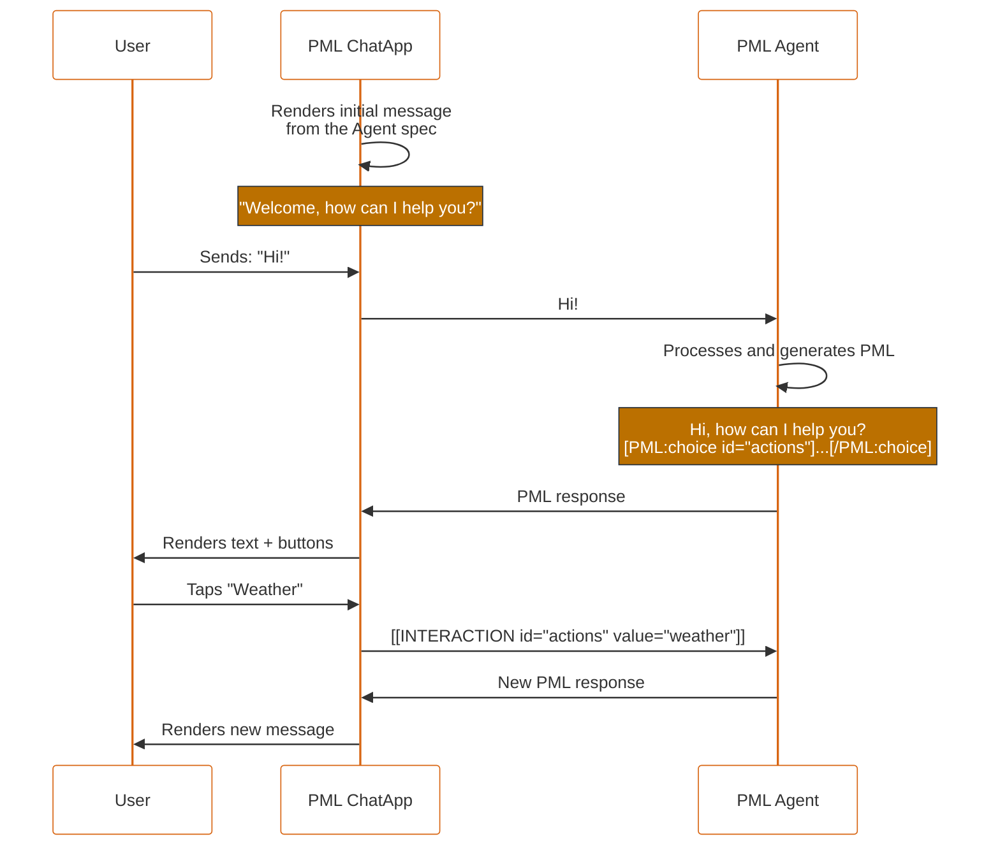

# PML — PEPPO Markup Language

## Complete specification v1.15

> **v1.15 (October 2026).** Closes contract gaps left in v1.14. An interaction is authoritative only when the ChatApp produced it and the runner correlates it; bracket text typed by a user or emitted by an agent is ordinary text. Adds a normative agent profile and decoded agent view for prompts (§9.3), runner-side validation and repair (§11.4), streamed-rendering rules (§10.2.4), completion actions for standalone `input` and `toggle`, canonical E.164 phone values, an optional `label` on `choice`, a defined Markdown subset with a link-scheme allowlist, and `dtable` column-name parsing. Duplicate IDs, missing field IDs, and invalid contract values become configuration errors instead of silent choices; parser tolerance covers more common generation slips; `number` no longer limits fractional precision by default. Bracket syntax and interaction modes are unchanged; the corrected behavior requires renderer/runner version agreement. See Appendix O.

Earlier release notices are kept verbatim in §12.4, and Appendices C-N record their historical migrations. Current component sections, the current interaction/lifecycle contracts, and Appendix O govern v1.15; older examples and notices retain their stated release profiles, including behavior that later versions superseded.

**PEPPO** — Platform for Engaging People and Processes via Omni-agents

---

## Table of contents

- [1. Overview](#1-overview)
    - [1.1 Vocabulary](#11-vocabulary)
    - [1.2 Interaction between components](#12-interaction-between-components)
    - [1.3 Design principles](#13-design-principles)
- [2. PML ChatApp](#2-pml-chatapp)
- [3. PML Agent](#3-pml-agent)
- [4. PML syntax](#4-pml-syntax)
    - [4.1 General format](#41-general-format)
    - [4.2 Self-closing component](#42-self-closing-component)
    - [4.3 Container component](#43-container-component)
    - [4.4 Strict lexical rules](#44-strict-lexical-rules)
    - [4.5 Example of a valid message](#45-example-of-a-valid-message)
    - [4.6 Component types](#46-component-types)
    - [4.7 Global attributes](#47-global-attributes)
    - [4.8 group](#48-group)
- [5. Information components](#5-information-components)
    - [5.1 text](#51-text)
    - [5.2 markdown](#52-markdown)
    - [5.3 facts](#53-facts)
    - [5.4 dtable](#54-dtable)
    - [5.5 image](#55-image)
    - [5.6 media](#56-media)
    - [5.7 attachment](#57-attachment)
    - [5.8 map](#58-map)
    - [5.9 contact-card](#59-contact-card)
    - [5.10 Captured-value echo-back contract](#510-captured-value-echo-back-contract)
    - [5.11 divider](#511-divider)
    - [5.12 raw](#512-raw)
- [6. Interaction components](#6-interaction-components)
    - [6.1 input](#61-input)
        - [6.1.10 Catalog data source](#6110-catalog-data-source-v111)
    - [6.2 toggle](#62-toggle)
    - [6.3 choice](#63-choice)
    - [6.4 confirm](#64-confirm)
    - [6.5 form](#65-form)
    - [6.6 Common validation contract](#66-common-validation-contract)
- [7. Interaction model](#7-interaction-model)
    - [7.1 Interaction format](#71-interaction-format)
    - [7.2 URL encoding of values](#72-url-encoding-of-values)
    - [7.3 Multi-field interactions](#73-multi-field-interactions)
    - [7.4 Conversation flow](#74-conversation-flow)
    - [7.5 Full conversation example](#75-full-conversation-example)
    - [7.6 State update](#76-state-update)
- [8. Composition rules](#8-composition-rules)
- [9. Guidelines for LLMs / Agents](#9-guidelines-for-llms--agents)
- [10. Mobile UX guidelines for the ChatApp](#10-mobile-ux-guidelines-for-the-chatapp)
- [11. Error handling](#11-error-handling)
- [12. Versioning and extensibility](#12-versioning-and-extensibility)
- [Appendix A — Quick reference](#appendix-a--quick-reference)
- [Appendix B — Full EBNF](#appendix-b--full-ebnf)
- [Appendix C — Migration v1.3 → v1.4](#appendix-c--migration-v13--v14)
- [Appendix D — Migration v1.4 → v1.5](#appendix-d--migration-v14--v15)
- [Appendix E — Migration v1.5 → v1.6](#appendix-e--migration-v15--v16)
- [Appendix F — Migration v1.6 → v1.6.1](#appendix-f--migration-v16--v161)
- [Appendix G — Migration v1.6.1 → v1.7](#appendix-g--migration-v161--v17)
- [Appendix H — Migration v1.7 → v1.8](#appendix-h--migration-v17--v18)
- [Appendix I — Migration v1.8 → v1.9](#appendix-i--migration-v18--v19)
- [Appendix J — Migration v1.9 → v1.10](#appendix-j--migration-v19--v110)
- [Appendix K — Migration v1.10 → v1.11](#appendix-k--migration-v110--v111)
- [Appendix L — Migration v1.11 → v1.12](#appendix-l--migration-v111--v112)
- [Appendix M — Migration v1.12 → v1.13](#appendix-m--migration-v112--v113)
- [Appendix N — Migration v1.13 → v1.14](#appendix-n--migration-v113--v114)
- [Appendix O — Migration v1.14 → v1.15](#appendix-o--migration-v114--v115)

---

## 1. Overview

**PML** is a lightweight, LLM-readable, token-efficient language designed so conversational agents can render interactive UI components inside chat interfaces.

PML turns classic ChatBots into **Interaction Agents** rich in functionality: the agent does not only emit text, it also emits components that the user can tap, fill in, confirm or cancel.

### 1.1 Vocabulary

| Term            | Definition                                                                                                                                         |
| --------------- | -------------------------------------------------------------------------------------------------------------------------------------------------- |
| **PML**         | The markup language described in this document.                                                                                                    |
| **Component**   | A syntactic unit of PML, either self-closing (`[PML:type /]`) or container (`[PML:type] ... [/PML:type]`).                                         |
| **PML Agent**   | An LLM configured to produce and consume PML.                                                                                                      |
| **PML ChatApp** | The interface that renders the PML and captures user interactions. Can be a mobile, web or desktop app.                                            |
| **Message**     | A text block produced by the agent or by the user; it may freely mix plain text and PML components.                                                |
| **Interaction** | The serialized result of a user action on an interactive component. It is transmitted as `[[INTERACTION id="..." value="..."]]`.                   |
| **Task**        | The lifecycle of a single interaction: render → capture → close. A conversation contains zero, one or many tasks over time.                        |

### 1.2 Interaction between components

The user starts a conversation with the ChatApp. The ChatApp sends the message to the PML Agent. The PML Agent parses the message and produces a response in PML. The ChatApp renders that PML. The user interacts with the components and the ChatApp captures the interaction, serializes it as `[[INTERACTION]]` and sends it back to the PML Agent. The PML Agent processes the interaction and generates new PML, repeating the cycle.

Illustrative use case:

- User: "Hi!"
- PML Agent: "Hi! How can I help you?" + buttons `Weather`, `News`, `Translator`, `Cancel`.
- User taps `Weather`.
- PML Agent: "The weather in MyCity is 68°F." + the same buttons.
- User taps `Cancel`.
- PML Agent: "Cheers, how else can I help you?"



### 1.3 Design principles

```
- Interaction-first   →  The agent generates UI interactions, not only text
- Token-efficient     →  Minimize measured tokens and generation errors for representative tasks
- LLM-friendly        →  Regular, predictable syntax, easy to emit without errors
- Mobile-native       →  Designed for mobile conversational flows
- UILogic-first       →  UI logic lives in the frontend, not in the agent
- Extensible          →  New components and new fields without breaking compatibility
- No-JSON             →  Uniform bracket syntax, no nested object-like structures
```

---

## 2. PML ChatApp

The ChatApp is the interface that allows users to interact with PML Agents. It is responsible for:

- Rendering the PML components received from the agent.
- Capturing user interactions on interactive components.
- Serializing those interactions as `[[INTERACTION ...]]` and sending them to the agent.
- Processing the new responses and continuing the cycle.

**Engine-agnostic.** The PML ChatApp is agnostic to the agent's engine: it does not know which LLM produces the PML, only that it must render it. This allows for ChatApps tailored to Android, iOS, Web, Desktop, etc., each with its own native renderer, without backend coupling.

---

## 3. PML Agent

A **PML Agent** is an LLM (Large Language Model) configured to:

1. Produce responses in PML, not only in plain text.
2. Receive and process interactions (`[[INTERACTION ...]]`) coming from the ChatApp.
3. Decide when to emit interactive components and when to emit only narrative.

**LLM-agnostic.** The PML Agent is agnostic to the LLM engine: it can be implemented with GPT, Claude, Gemini, Llama, etc. The only thing that defines a PML Agent is its ability to produce and consume PML correctly.

**Base prompt.** The agent's prompt must include, at minimum:

- An explanation of PML syntax (the subsection of the spec applicable to its domain).
- The agent profile (§9.3), including how to read interactions in the decoded agent view (§7.2). The agent never percent-decodes values.
- Representative examples of the agent's domain.

> It is not recommended to include the full PML specification in the base prompt; the agent profile in §9.3, trimmed to the components of the agent's domain, is enough. Including everything can degrade generation quality and adds token cost on every turn.

---

## 4. PML syntax

### 4.1 General format

PML is written as UTF-8 plain text. Plain text and PML components may coexist freely in the same message.

Every PML component has one of two forms:

- **Self-closing:** `[PML:type attr-1="value-1" attr-2="value-2" /]`
- **Container:** `[PML:type attr="value"] child content [/PML:type]`

### 4.2 Self-closing component

Components with no child content. They must end with ` /]` (a space before `/]`).

```
[PML:type attr-1="value-1" attr-2="value-2" /]
```

### 4.3 Container component

Components with child content (other components or text, as allowed by the composition rules in §8).

```
[PML:type attr="value"]
  child content
[/PML:type]
```

### 4.4 Strict lexical rules

| Rule                | Detail                                                                                                                                  |
| ------------------- | --------------------------------------------------------------------------------------------------------------------------------------- |
| **Encoding**        | All content is UTF-8.                                                                                                                   |
| **Case**            | Component and attribute names are in `lowercase` or `kebab-case`. Never `camelCase`, never `snake_case`, never uppercase.               |
| **Attributes**      | Syntax: `name="value"`. Names follow `[a-z][a-z0-9-]*`.                                                                                 |
| **Quotes**          | Values are delimited by `"` (preferred) or `'`. Never mix within the same attribute.                                                    |
| **Nested quotes**   | A matching quote ends the attribute value. Represent a matching quote with `&quot;` or `&#39;`; backslash does not escape PML quotes. |
| **Structure**       | PML components use bracket tags, not JSON or HTML. Ordinary text and quoted values may contain brackets, angle brackets, and backslashes. |
| **IDs**             | Every interactive component **must** declare `id="..."`. Component IDs match `[a-z][a-z0-9-]*`; `opt` uses the separate option-token rules in §6.3. |
| **Uniqueness**      | Component IDs are unique within a message. Option tokens are unique within their owning `choice`.                                     |
| **Self-closing**    | Canonical emission ends with ` /]`; parsers accept one or more ASCII whitespace characters before `/]` (and tolerate none, §9.2). |
| **Closing**         | Containers are closed with `[/PML:type]`. The type name must exactly match the opening tag.                                             |
| **Escaping**        | PML has no backslash string escapes. Attribute character references are decoded once after structural parsing; regex backslashes remain regex data. |

**Structural recognition and character references (v1.14).** Scan the original text before decoding character references. Only exact `[PML:`, `[/PML:`, and `[[INTERACTION` delimiters are structural in their applicable contexts; other brackets are ordinary text, including Markdown links. Attribute scanning is quote-aware: brackets inside a quoted value do not end its tag. Text-only component bodies do not admit child components; use `raw` or character references to show literal PML delimiters there.

For PML attributes and `text` bodies, decode `&amp;`, `&quot;`, `&apos;`, `&lt;`, `&gt;`, decimal numeric references, and hexadecimal numeric references exactly once. Unknown or malformed references remain literal. Numeric references must represent Unicode scalar values. To display a literal reference such as `&quot;`, emit `&amp;quot;`. Decoded text is never rescanned for PML tags. Markdown bodies receive their character-reference processing once through the Markdown renderer, without a prior PML decoding pass. A `raw` body receives no decoding and ends at the first exact `[/PML:raw]`.

> Component attributes contain logical values, not URL-encoded transport values. The explicit exception is a multi-choice `value` initializer, whose list items follow §7.2. Interaction values always use the negotiated encoding profile; character-reference decoding does not replace interaction-value decoding.

**Duplicate attributes:** reject a component or interaction containing a repeated attribute name, including duplicates produced by a tolerated alias normalization. Never select the first or last value silently. A malformed form member or rule makes that form invalid; retain private drafts and expose the recovery behavior in §11.1.

### 4.5 Example of a valid message

```
Hi Pedro, what would you like to do today?
[PML:choice id="actions"]
  [PML:opt id="book"   value="Book appointment" /]
  [PML:opt id="prices" value="See prices"       /]
[/PML:choice]
```

### 4.6 Component types

**Information components (passive):**

- `text` — Static text with style
- `markdown` — Text with Markdown formatting
- `facts` — Key-value pair list
- `dtable` — Data table
- `image` — Static image
- `media` — Video or audio
- `attachment` — Download/open card for a captured file
- `map` — Location preview for captured coordinates
- `contact-card` — Phone-number contact card
- `divider` — Horizontal separator
- `raw` — Unparsed text block (escape)

**Interaction components (interactive):**

- `input` — Input field (text, number, date, file, etc.)
- `toggle` — Binary switch
- `choice` — Selection between options
- `confirm` — Confirmation dialog
- `form` — Field container with single submit, optional cancel, and optional conditional rules

**Structural components (no interaction of their own):**

- `group` — Single-column container for related information components or form content

**Auxiliary components (only valid inside their container):**

- `opt` — Option inside `choice`
- `fact` — Entry inside `facts`
- `dtrow`, `dtcol` — Row and cell inside `dtable`
- `rule` — Conditional behavior rule inside `form`

Information components render automatically in the chat flow. Interaction components require special handling: the ChatApp captures the user action and emits `[[INTERACTION]]` to the agent.

### 4.7 Global attributes

These attributes may be applied to any component, except for the restrictions noted:

| Attribute  | Applies to    | Type             | Description                                                              |
| ---------- | ------------- | ---------------- | ------------------------------------------------------------------------ |
| `id`       | All           | string           | Identifier. **Required on interactives**, optional on passives and `group`; required on any rule target. |
| `disabled` | Interactives, `group` | `true` / `false` | Disables the interaction; on `group`, gates descendant fields. Default: `false`. |
| `visible`  | All           | `true` / `false` | If `false`, the component is not rendered. Default: `true`.              |
| `tooltip`  | All           | string           | Help text shown on long-press (mobile) or hover (desktop).               |
| `error`    | Interactives  | string           | Error message associated with the component. Rendered below it.          |

### 4.8 group

**(v1.13)** Structural container that identifies related components as one visual unit. Its children are stacked vertically in document order in an **implicit single column**. The renderer adapts their widths and spacing to the available screen space. No layout attribute is needed: this version defines no `layout`, `rows`, `columns`, `row`, `column`, `at`, or `areas` attributes for `group`.

```
[PML:group]
  [PML:text type="title"]Order summary[/PML:text]
  [PML:facts]
    [PML:fact label="Product" value="Coffee" /]
    [PML:fact label="Total" value="$120" /]
  [/PML:facts]
[/PML:group]
```

`group` uses the container form with a closing tag. It has no value, controls, submit action, or interaction of its own. An empty group renders nothing. A child's internal layout is unchanged: for example, `facts columns="2"` retains its two-column layout, and `dtable` retains its data rows and columns.

**Attributes:** the applicable global attributes are `id`, `visible`, `disabled`, and `tooltip` (§4.7). `id` is optional unless the group is referenced by a form rule; it follows the same message-wide uniqueness and kebab-case rules as other IDs. `visible="false"` hides the group and its contents. Within a form, `disabled="true"` makes its descendant fields inactive; it has no effect on information-only content.

**Composition:**

- At the message root, a group may contain information components, including `facts` and `dtable`. Standalone interactive components remain outside root-level groups; grouped interactive fields belong inside a `form`.
- As a direct child of `form`, a group may contain the information components and fields already allowed in that form. `dtable`, `confirm`, and `form` remain forbidden there. `rule` declarations remain direct children of `form`.
- A group cannot contain another group. Groups are transparent to the existing three-level semantic depth limit; see §8 for the exact child lists and depth accounting.
- Grouping does not create a task, renderer zone, ID namespace, or field prefix. A root-level group follows its message's narrative placement: private task context when associated with a task, otherwise `shared_history`. Groups inside a form participate in that form's lifecycle and zones (§10.3).

**Form rules:** a group with an `id` may be a `targets` entry for `action="visible"` or `action="enabled"`. Its effective state gates its descendants and combines with each child's own state; it never overrides a child's `visible="false"` or `disabled="true"`. A group cannot be a `when-*` or `state-*` source because it has no captured value or correctness state. Grouped fields can still be sources and targets under their own IDs (§6.5).

```pml
[PML:form id="order" submit-label="Save"]
  [PML:toggle id="invoice" label="I need an invoice" /]

  [PML:group id="billing-details"]
    [PML:text type="title"]Billing details[/PML:text]
    [PML:input id="tax-id" type="text" label="Tax ID" required="true" /]
  [/PML:group]

  [PML:rule action="visible" targets="billing-details" when-invoice="true" /]
[/PML:form]
```

When `invoice` is false, `tax-id` is hidden, does not block submit, and is omitted from the interaction:

```
[[INTERACTION id="order" field-invoice="false"]]
```

When `invoice` is true and the user enters `ABC123`, a valid submit is:

```
[[INTERACTION id="order" field-invoice="true" field-tax-id="ABC123"]]
```

The group ID `billing-details` never contributes a `field-*` attribute. An `enabled` rule can target the same group to gate its fields without hiding the group's visible content. Agents must negotiate a renderer with v1.13 group support before emitting `group`; older renderers retain the unknown-component behavior in §12.2, which does not guarantee preservation of grouped content or rules.

---

## 5. Information components

Use only to show information to the user. They do not emit interactions.

### 5.1 text

Static text block with style.

| Attribute | Required | Type                                                 | Description                            |
| --------- | -------- | ---------------------------------------------------- | -------------------------------------- |
| `type`    | No       | `header` / `title` / `paragraph` / `muted` / `label` | Semantic type. Default: `paragraph`.   |
| `style`   | No       | `bold` / `italic` / `muted` / `normal`               | Visual style. Default: `normal`.       |
| `size`    | No       | `small` / `medium` / `large`                         | Size. Default: `medium`.               |
| `align`   | No       | `left` / `center` / `right`                          | Alignment. Default: `left`.            |

```
[PML:text type="header" size="large" style="bold"]
Your order is on its way
[/PML:text]

[PML:text type="muted" size="small"]
Estimated delivery in 3-5 business days
[/PML:text]
```

### 5.2 markdown

Text block with Markdown formatting, limited to the PML Markdown subset below.

| Attribute | Required | Type   | Description |
| --------- | -------- | ------ | ----------- |
| `id`      | No       | string | Identifier  |

```
[PML:markdown]
### Shipping instructions

1. **Pack** the product in its original box
2. **Stick** the shipping label on the outside
3. **Drop off** the package at any shipping center

> Refunds are processed in 5-7 business days.

For more info visit our [shipping guide](https://peppo.com/shipping).
[/PML:markdown]
```

**Supports:** bold, italics, lists, links, inline code, blockquotes, headings.

**Outside the subset (v1.15):** tables, images (``), fenced or indented code blocks, raw HTML, footnotes, and task lists. Renderers present them as plain text, never as HTML or as a loaded resource. Use `dtable` for tables and `image` for images; a Markdown image would bypass the resource-reference contract (§5.10).

**Links (v1.15):** only `https:`, `mailto:`, and `tel:` destinations are active. Any other or missing scheme, including `http:`, `javascript:`, `data:`, `file:`, and `intent:`, renders the link text without an active link.

**Parsing note:** Markdown's own brackets (`[text](url)`) are safe. The parser only activates PML mode when it finds exactly `[PML:`.

### 5.3 facts

Key-value pair table.

| Attribute | Required | Type      | Description                       |
| --------- | -------- | --------- | --------------------------------- |
| `columns` | No       | `1` / `2` | Layout columns. Default: `1`.     |

**Content:** one or more `[PML:fact label="..." value="..." /]` as direct children.

```
[PML:facts]
  [PML:fact label="Product" value="Nike Air Max 90" /]
  [PML:fact label="Size"    value="9"               /]
  [PML:fact label="Price"   value="$129 USD"        /]
  [PML:fact label="Shipping" value="Free"           /]
[/PML:facts]
```

### 5.4 dtable

Generic data table.

| Attribute         | Required | Type   | Description                                                                                                                   |
| ----------------- | -------- | ------ | ----------------------------------------------------------------------------------------------------------------------------- |
| `columns`         | Yes      | string | Comma-separated column names.                                                                                                 |
| `display-columns` | No       | string | **(v1.12)** Comma-separated subset of `columns`, up to four names, that should stay visible in compact responsive renderers. |

**Content:** rows wrapped in `[PML:dtrow] ... [/PML:dtrow]`. Each cell is a self-closing `[PML:dtcol value="..." /]`. The number of cells per row must match the declared column count.

```
[PML:dtable columns="Plan,Price,Agents,Messages" display-columns="Plan,Price"]
  [PML:dtrow]
    [PML:dtcol value="Basic" /][PML:dtcol value="$9/mo"  /][PML:dtcol value="1"  /][PML:dtcol value="100/day"  /]
  [/PML:dtrow]
  [PML:dtrow]
    [PML:dtcol value="Pro"   /][PML:dtcol value="$29/mo" /][PML:dtcol value="10" /][PML:dtcol value="Unlimited" /]
  [/PML:dtrow]
[/PML:dtable]
```

`display-columns` is a presentation hint for wide tables. It does not remove
data: cells for non-displayed columns remain part of each row and can be
revealed by the renderer through row details, expansion controls, or another
responsive affordance. Unknown names are ignored. If the attribute is omitted,
the renderer chooses a compact default.

**Column names (v1.15).** Split `columns` and `display-columns` on literal commas before decoding character references, then trim surrounding ASCII whitespace from each name. Write a comma inside a name as `&#44;`: `columns="Plan,Price&#44; VAT incl."` declares the two columns `Plan` and `Price, VAT incl.`. Names should be nonempty and unique within `columns`; a `display-columns` entry that matches no column or more than one column is ignored.

### 5.5 image

Static image.

| Attribute | Required | Type                                  | Description                |
| --------- | -------- | ------------------------------------- | -------------------------- |
| `url`     | Yes      | url/ref                               | Public URL or stable private object reference (§5.10). |
| `alt`     | No       | string                                | Alternative text.          |
| `size`    | No       | `small` / `medium` / `large` / `full` | Size. Default: `medium`.   |
| `caption` | No       | string                                | Image caption.             |

```
[PML:image url="https://cdn.peppo.com/product.jpg" alt="Nike Air Max 90"
  size="large" caption="New 2026 model" /]
```

### 5.6 media

Video or audio player.

| Attribute | Required | Type              | Description                       |
| --------- | -------- | ----------------- | --------------------------------- |
| `url`     | Yes      | url/ref           | Public URL or stable private object reference (§5.10). |
| `type`    | Yes      | `video` / `audio` | Media type.                       |
| `poster`  | No       | url/ref           | Public URL or stable private image reference (video only). |
| `caption` | No       | string            | Media caption.                    |

```
[PML:media url="https://cdn.peppo.com/demo.mp4" type="video"
  poster="https://cdn.peppo.com/demo-poster.jpg" /]
```

### 5.7 attachment

Passive card for a captured or uploaded non-image file. It is used when the
agent needs to re-display a file resource that should be opened or downloaded
instead of rendered inline. Private resources are referenced by stable object
refs (`files/...` or `images/...`), never by signed URLs.

| Attribute | Required | Type   | Description                                      |
| --------- | -------- | ------ | ------------------------------------------------ |
| `url`     | Yes      | url/ref | File URL or private Storage object ref.          |
| `name`    | Yes      | string | Human-readable filename.                         |
| `mime`    | No       | string | MIME type when known.                            |
| `label`   | No       | string | Field or domain label for the file.              |
| `caption` | No       | string | Optional short caption or status.                |

```
[PML:attachment url="files/user/agent/report.pdf" name="report.pdf"
  mime="application/pdf" label="Signed report" /]
```

### 5.8 map

Passive preview for a captured location. It re-displays the `input
type="location"` value without changing the interaction wire format.

| Attribute | Required | Type   | Description                         |
| --------- | -------- | ------ | ----------------------------------- |
| `lat`     | Yes      | number | Latitude, decimal point.            |
| `lng`     | Yes      | number | Longitude, decimal point.           |
| `label`   | No       | string | Field or domain label.              |
| `caption` | No       | string | Optional short caption or address.  |

```
[PML:map lat="19.4326" lng="-99.1332" label="Delivery location" /]
```

### 5.9 contact-card

Passive card for a captured phone number. v1.10 does not change the contact
interaction value: the agent only knows one phone number, not name, email,
address, or a full contact object.

| Attribute | Required | Type   | Description                      |
| --------- | -------- | ------ | -------------------------------- |
| `phone`   | Yes      | string | Captured phone number, decoded, in canonical E.164 form (§6.1.4). |
| `label`   | No       | string | Field or domain label.           |
| `caption` | No       | string | Optional short caption.          |

```
[PML:contact-card phone="+5215551234567" label="Recipient phone" /]
```

### 5.10 Captured-value echo-back contract

When an agent confirms or recaps a value captured from an interactive component,
it must re-display that value with the canonical passive representation below.
This is display-only; the `[[INTERACTION]]` wire format is unchanged.

| Captured input | Canonical echo-back |
| -------------- | ------------------- |
| `input type="file"` with image resource | `[PML:image url="<object-ref>" alt="<label>" caption="<label>" /]` |
| `input type="file"` with audio/video resource | `[PML:media url="<object-ref>" type="audio|video" caption="<label>" /]` |
| `input type="file"` with document/generic file | `[PML:attachment url="<object-ref>" name="<basename>" mime="<mime>" label="<label>" /]` |
| `input type="location"` | `[PML:map lat="<lat>" lng="<lng>" label="<label>" /]` |
| `input type="contact"` | `[PML:contact-card phone="<decoded-phone>" label="<label>" /]` |
| text, number, currency, date, time, datetime | `facts` or `markdown`, formatted for humans. |
| choice, toggle, confirm | `facts` or `markdown`, using the human-visible option/decision label. |

For private Peppo resources, `url` is the immutable object reference
(`images/...` or `files/...`). Agents must not emit signed URLs for echo-back
because they expire and break immutable chat history.

**Resource-reference contract (v1.14):** `image`, `media` (including `poster`), `attachment`, and file capture use the same logical reference domain: a public absolute HTTPS URL or an opaque stable private object reference. Private references are resolved by the renderer using the authenticated account context; they are not relative web URLs. The upload adapter must supply the stable reference for a private upload before capture can complete. Resource metadata needed for echo-back, such as the original filename and MIME type, accompanies the capture through the runner envelope; it is not invented by the agent or added as extra `[[INTERACTION]]` attributes. The interaction carries the reference using §7.2; component `url` attributes use the decoded reference.

**Snapshot and secret exception:** the echo-back rules never authorize re-displaying a password or a retained inactive draft. Apply the snapshot projection in §10.2.2 before creating history or recap content.

Forward compatibility: older renderers may ignore unknown components or render
them as plain text. Human-readable attributes improve a plain-text fallback,
but do not guarantee visibility when a renderer drops the component. Negotiate
support before relying on a rich echo-back component.

### 5.11 divider

Separator line.

| Attribute | Required | Type   | Description                  |
| --------- | -------- | ------ | ---------------------------- |
| `label`   | No       | string | Optional centered text.      |

```
[PML:divider /]
[PML:divider label="Or continue with" /]
```

### 5.12 raw

Plain text block that turns off the PML parser. Allows displaying literal PML syntax without it being interpreted.

```
[PML:raw]
To show bold text, use the text component:
[PML:text style="bold"]Bold text[/PML:text]
[/PML:raw]
```

> Inside `[PML:raw]` no attributes exist. The parser only looks for the exact closing tag `[/PML:raw]`.

---

## 6. Interaction components

Interactive components generate an `[[INTERACTION]]` when the user completes their action through the component's completion action: input completion (§6.1), toggle confirmation (§6.2), single selection or multi-choice confirmation (§6.3), a confirm button (§6.4), or form submit/cancel (§6.5). The exact interaction format is specified in §7.

### 6.1 input

Data entry field. The subtype is selected with the `type` attribute.

**Available subtypes:**

- `text` — Text field (single or multi-line)
- `number` — Numeric field
- `currency` — Monetary field
- `contact` — Capture of system contact (phone)
- `date` — Date picker
- `time` — Time picker
- `datetime` — Date and time picker
- `location` — Location / GPS picker
- `file` — File picker

**Attributes common to all `input`s:**

| Attribute  | Required | Type                  | Description                       |
| ---------- | -------- | --------------------- | --------------------------------- |
| `id`       | Yes      | string                | Unique identifier.                |
| `type`     | Yes      | string                | Subtype (see list above).         |
| `label`    | No       | string                | Visible label.                    |
| `required` | No       | `true` / `false`      | Required. Default: `false`.       |
| `readonly` | No       | `true` / `false`      | Read-only. Default: `false`.      |
| `value`    | No       | depends on subtype    | Initial value.                    |

**Completion (v1.15).** A standalone `input` keeps edits local until the user triggers one renderer-provided completion action: a localized send/confirm control, the keyboard's done/enter action in a single-line text field, or the native picker's confirmation for `date`, `time`, `datetime`, and `location`. In a multiline field, enter inserts a line break and only the send/confirm control completes. A `file` input completes only after the upload has produced its resource reference (§5.10). Completion runs the validation in §6.6; a failure keeps capture open and emits nothing. Inside a form, inputs never complete independently; the form's submit is the only completion action. These rules add no attribute or interaction format.

#### 6.1.1 input type="text"

| Attribute       | Required | Type    | Description                                   |
| --------------- | -------- | ------- | --------------------------------------------- |
| `placeholder`   | No       | string  | Help text.                                    |
| `multiline`     | No       | boolean | Multi-line field. Default: `false`.           |
| `validate`      | No       | string  | Portable regex, whole-string match (§6.6).     |
| `error-message` | No       | string  | Message shown if validation fails.            |
| `max-length`    | No       | number  | Maximum Unicode code points. Nonnegative integer. |
| `min-length`    | No       | number  | Minimum Unicode code points. Nonnegative integer. |
| `password`      | No       | boolean | Masks capture and requires redacted snapshots/echo-back (§10.2.2). Default: `false`. |
| `source`        | No       | string  | **(v1.11)** Catalog data source. Valid only as `catalog:{slug}`. Requires `key` and `display`. See §6.1.10. |
| `key`           | No       | string  | **(v1.11)** Catalog field used as the submitted business key. Required when `source` is present. |
| `display`       | No       | string  | **(v1.11)** Catalog field shown as the UI label. Required when `source` is present. |

```
[PML:input id="name" type="text" label="Full name"
  placeholder="Enter your name" required="true" /]
```

**Generated interaction:**

```
[[INTERACTION id="name" value="John+Smith"]]
```

With `multiline="true"`:

```
[PML:input id="comments" type="text" label="Comments"
  multiline="true" placeholder="Write your comments" /]
```

```
[[INTERACTION id="comments" value="First+line%0ASecond+line"]]
```

> Line breaks are encoded as `%0A` (see §7.2).

**Catalog-backed typeahead (v1.11).** When `source`, `key`, and `display` are present, the renderer queries the account catalog API (paginated search) as the user types and shows `display` values in the suggestion list. The interaction value is the selected item's **key** field, not the display label:

```
[PML:input id="cliente" type="text" source="catalog:clientes"
  key="rfc" display="razon_social" label="Cliente" /]
```

```
[[INTERACTION id="cliente" value="RFC-001"]]
```

See §6.1.10 for validity rules, supported types, and renderer fallback behavior.

#### 6.1.2 input type="number"

| Attribute     | Required | Type    | Description                       |
| ------------- | -------- | ------- | --------------------------------- |
| `placeholder` | No       | string  | Help text.                        |
| `integer`     | No       | boolean | Integers only. Default: `false`.  |
| `decimals`    | No       | number  | Maximum fractional precision; nonnegative integer. **(v1.15)** Default: no limit. |
| `min`         | No       | number  | Minimum value.                    |
| `max`         | No       | number  | Maximum value.                    |

```
[PML:input id="age" type="number" label="Age" integer="true" min="18" max="99" /]
```

```
[[INTERACTION id="age" value="25"]]
```

```
[PML:input id="height" type="number" label="Height"
  placeholder="1.75" decimals="2" /]
```

```
[[INTERACTION id="height" value="1.75"]]
```

**Numeric contract (v1.14):** `number` and `currency` use finite signed base-10 decimal values with a dot separator, no exponent notation, grouping separators, `NaN`, or infinity. `min` and `max` are inclusive and compared as decimal values. `decimals` limits fractional precision after ignoring redundant trailing zeros; excess precision is a validation error, never a request to round. For `number`, omitting `decimals` sets no precision limit (v1.15); `integer="true"` forces effective precision zero, and a conflicting nonzero `decimals` is ignored with a warning. `integer="false"` adds no constraint.

Canonical `number` strings remove a leading plus, redundant leading zeros, and trailing fractional zeros; normalize negative zero to `0`. Thus `1.0` is `1` and `1.2300` is `1.23`. `currency` uses the same decimal value but pads its fractional part to exactly its effective `decimals` count (`1500.5` becomes `1500.50` at precision two). Padding never changes the amount. UI localization does not change these logical values. Initial values are subject to the same validation; do not silently replace an invalid value with zero.

#### 6.1.3 input type="currency"

| Attribute     | Required | Type   | Description                                          |
| ------------- | -------- | ------ | ---------------------------------------------------- |
| `placeholder` | No       | string | Help text.                                           |
| `currency`    | No       | string | ISO 4217 code (`USD`, `MXN`, ...). Default: `USD`.   |
| `decimals`    | No       | number | Maximum fractional precision and canonical padding; nonnegative integer. Default: `2`. |
| `min`         | No       | number | Minimum value.                                       |
| `max`         | No       | number | Maximum value.                                       |

```
[PML:input id="amount" type="currency" label="Amount"
  currency="USD" min="1" max="10000" /]
```

**Generated interaction** (raw numeric value, no symbols):

```
[[INTERACTION id="amount" value="1500.50"]]
```

> The interaction value is always the raw number (no currency symbol, no thousands separators, with a decimal point). Visual presentation with symbol and separators is the renderer's responsibility.

#### 6.1.4 input type="contact"

Captures a phone number using the ChatApp's native mechanisms. The optional `source` attribute describes where the phone number should come from.

| Attribute | Required | Type                         | Description                                                                 |
| --------- | -------- | ---------------------------- | --------------------------------------------------------------------------- |
| `source`  | No       | `self` / `manual` / `contacts` | **(v1.9)** Contact source. Default: `manual`.                               |

`source` values:

| `source`   | Meaning                                  | Expected UI                                                        |
| ---------- | ---------------------------------------- | ------------------------------------------------------------------ |
| `self`     | The user's own phone number.             | Use account/device autofill when available; otherwise manual entry. |
| `manual`   | A phone number typed by the user.        | Phone-number keyboard. Default.                                    |
| `contacts` | A phone number selected from the address book. | Native contact picker when available; otherwise manual entry.       |

```
[PML:input id="phone" type="contact" label="Tap to share your phone" required="true" /]
```

```
[PML:input id="recipient-phone" type="contact" label="Choose a recipient"
  source="contacts" /]
```

```
[[INTERACTION id="phone" value="%2B15551234567"]]
```

> The leading `+` of an E.164 number is URL-encoded as `%2B`. `source` only affects the capture UI; the interaction value is always the selected or typed phone number. The values `self`, `manual`, and `contacts` are reserved and are never translated.

**Canonical value (v1.15).** The logical value is an E.164 number: a leading `+` followed by up to 15 ASCII digits, the first of which is not `0`, with no spaces, punctuation, or extension. The renderer normalizes typed, autofilled, and picked numbers to this form, using the account or device region for national input when available; a number it cannot normalize is a validation error. Display formatting such as `+1 555 123 4567` is renderer presentation only. Initial `value`, `when-<field-id>` literals, and `contact-card phone` use the same canonical string.

#### 6.1.5 input type="date"

Date picker. The interaction value is ISO 8601 (`YYYY-MM-DD`).

| Attribute     | Required | Type   | Description                |
| ------------- | -------- | ------ | -------------------------- |
| `placeholder` | No       | string | Help text.                 |
| `min`         | No       | string | Minimum date `YYYY-MM-DD`. |
| `max`         | No       | string | Maximum date `YYYY-MM-DD`. |

```
[PML:input id="date" type="date" label="Appointment date" /]
```

```
[[INTERACTION id="date" value="2026-06-15"]]
```

#### 6.1.6 input type="time"

Time picker. **The logical value is always `HH:mm` in 24-hour format, regardless of the presentation mode.** The `am-pm` attribute only affects the UI; transport encoding follows §7.2.

| Attribute     | Required | Type    | Description                                                  |
| ------------- | -------- | ------- | ------------------------------------------------------------ |
| `placeholder` | No       | string  | Help text.                                                   |
| `am-pm`       | No       | boolean | Shows the user an AM/PM selector. Default: `false` (24h).    |

```
[PML:input id="time" type="time" label="Time" am-pm="true" /]
```

```
[[INTERACTION id="time" value="14%3A45"]]
```

#### 6.1.7 input type="datetime"

Date and time picker. The logical value is ISO 8601 without timezone: `YYYY-MM-DDTHH:mm` (24h). It is a local wall-clock value, not an instant; timezone interpretation belongs to the application. Transport encoding follows §7.2.

| Attribute     | Required | Type   | Description  |
| ------------- | -------- | ------ | ------------ |
| `placeholder` | No       | string | Help text.   |

```
[PML:input id="appointment" type="datetime" label="Date and time" /]
```

```
[[INTERACTION id="appointment" value="2026-06-15T14%3A45"]]
```

#### 6.1.8 input type="location"

Location picker. The logical value is `latitude,longitude` (decimal point, no spaces); latitude is in the inclusive range -90 to 90 and longitude -180 to 180. The comma is part of this scalar, not a multi-choice separator. The renderer may offer device GPS, address search or a mini-map with a pin. Transport encoding follows §7.2.

```
[PML:input id="location" type="location" label="Your location" /]
```

```
[[INTERACTION id="location" value="40.7128%2C-74.0060"]]
```

#### 6.1.9 input type="file"

Single file picker. The renderer uploads the file to an endpoint configured by the ChatApp and obtains a public URL or stable private object reference (§5.10). That reference is the logical captured value, encoded for transport per §7.2.

| Attribute  | Required | Type   | Description                                                |
| ---------- | -------- | ------ | ---------------------------------------------------------- |
| `accept`   | No       | string | Allowed MIME types (e.g.: `image/*`, `application/pdf`).   |
| `capture`  | No       | `user` / `environment` / `true` | **(v1.8)** Hint to open the device's capture UI directly (camera, audio recorder, video recorder) instead of the file browser. |

```
[PML:input id="photo" type="file" label="Upload your ID"
  accept="image/*" /]
```

```
[[INTERACTION id="photo" value="images%2Fuser%2Fagent%2Fabc123.jpg"]]
```

> Decode this value once to obtain `images/user/agent/abc123.jpg`. A public URL uses the same encoding profile; an existing percent escape inside that URL must survive this one transport decoding pass.

**`capture` (v1.8).** When present, `capture` asks the renderer to open the device's native acquisition UI directly instead of the file browser. It does **not** define the medium — that is still the job of `accept`. The combination of both is what selects the experience:

| `accept`   | `capture`       | Resulting UI                          |
| ---------- | --------------- | ------------------------------------- |
| `image/*`  | `user`          | Camera, front lens (selfie).          |
| `image/*`  | `environment`   | Camera, rear lens.                     |
| `audio/*`  | `true`          | Audio recorder.                        |
| `video/*`  | `true`          | Video recorder.                        |
| any        | (absent)        | Standard file picker (default).        |

```
[PML:input id="selfie" type="file" label="Take a photo of yourself"
  accept="image/*" capture="user" /]

[PML:input id="receipt" type="file" label="Photograph the receipt"
  accept="image/*" capture="environment" /]

[PML:input id="voice-note" type="file" label="Record a voice message"
  accept="audio/*" capture="true" /]

[PML:input id="clip" type="file" label="Record a video"
  accept="video/*" capture="true" /]
```

> `capture` is a **non-binding hint**. A renderer on a device without the requested hardware (e.g. a desktop without a camera) ignores `capture` and falls back to the standard file picker. Both paths upload the artifact and serialize the resulting resource reference under the same negotiated encoding profile. The values `user`, `environment`, and `true` are reserved and are never translated.

#### 6.1.10 Catalog data source (v1.11)

Optional attributes that bind an interactive component to an account catalog. The ChatApp resolves catalog data through the **paginated catalogs API** scoped to the current account — never by asking the LLM to invent or recall catalog rows.

| Attribute | Required | Type   | Description |
| --------- | -------- | ------ | ----------- |
| `source`  | No*      | string | Catalog reference. Must be exactly `catalog:{slug}` where `{slug}` is the catalog slug configured for the agent/account. |
| `key`     | No*      | string | Name of the catalog field whose value is the **submitted business key** (stored value, foreign-key target). |
| `display` | No*      | string | Name of the catalog field rendered as the human-visible label in the UI (typeahead suggestion, dropdown option, etc.). |

\*When `source` is present, **both** `key` and `display` are **required**. A missing binding attribute is a configuration error: prevent the owning task/form from completing, preserve private drafts, show native recovery, and keep chat available (§11.1). Never omit a required member and submit the rest, or guess the missing binding.

**`source` value namespace.** The attribute name `source` already exists on `input type="contact"` (v1.9) with reserved values `self`, `manual`, and `contacts`. Catalog binding uses a distinct value shape: `catalog:{slug}`. These namespaces do not overlap.

**Which components and input types accept catalog `source`:**

| Component / subtype | Catalog `source` | Behavior |
| ------------------- | ---------------- | -------- |
| `input type="text"` | **Yes**          | Typeahead / autocomplete: paginated search against the catalog as the user types; the committed value must be a resolved row key. |
| `choice`            | **Yes**          | Options are loaded from the catalog (paginated). Static `[PML:opt /]` children are **ignored** when catalog `source` is present. |
| `input type="contact"` | **No**        | `source` is reserved for contact acquisition (`self` / `manual` / `contacts`). Agents must not emit `catalog:` on `type="contact"`. |
| All other `input` subtypes (`number`, `currency`, `date`, `time`, `datetime`, `location`, `file`) | **No** | Catalog attributes are invalid on these subtypes; renderers ignore them and show the plain subtype UI. |

**Renderer resolution.** Given `source="catalog:{slug}"`, the ChatApp:

1. Checks that `{slug}` is allowed for the current agent/account (sources contract / ACL).
2. Queries the catalogs API with pagination and optional search (`q`) as the user interacts.
3. Maps each row: shows `display` in the UI, submits `key` in the interaction.

Resolution is **never** delegated to the LLM. The agent declares the binding; the ChatApp fetches rows.

**Committed values and initialization (v1.14).** A catalog `key` must identify a unique row and be a nonempty string. Keys are opaque business values, not component IDs or static option tokens; preserve their case and punctuation. Query text and display labels are transient presentation state, never a committed key. Initial `value` and text-field validation constraints apply to the key, not the label; resolve the label through the authorized catalog. An unknown or unauthorized initial key is an invalid selection, not a label or free-text fallback.

**Interaction serialization — resolved keys only, never query text or display labels:**

| Context | Serialized form |
| ------- | ---------------- |
| Standalone `input` | `[[INTERACTION id="cliente" value="RFC-001"]]` |
| Standalone `choice` (single) | `[[INTERACTION id="cliente" value="RFC-001"]]` — same as a static `opt` id: the **key** value. |
| Standalone `choice` (`multi="true"`) | `[[INTERACTION id="tags" value="RFC-001,RFC-002"]]` — individually encoded **keys**, joined by literal commas (§7.2). |
| Child of `form` | `field-cliente="RFC-001"` — the `field-*` value is the **key**, URL-encoded per §7.2 when needed. |

The display field (`razon_social`, product name, etc.) is for presentation only and must not appear in `[[INTERACTION]]`. A key containing a comma remains one item: keys `a,b` and `c` serialize as `a%2Cb,c`. Split the list before decoding its items. An optional empty selection serializes as the empty string; individual empty keys are invalid.

**Catalog unavailability (v1.14).** If the API is unreachable, the slug is unknown, or read access is unavailable, preserve the binding and show an inline unavailable state with a retry action. Never substitute an arbitrary typed value for a key or show an empty shell with no recovery. The chat composer remains available; an unavailable required selection may prevent form submission but must not prevent the conversation from continuing.

| Component | Recovery behavior |
| --------- | ------------- |
| `input type="text"` with catalog attrs | Keep query text separate from committed selection; retry catalog resolution or clear to an optional empty selection. |
| `choice` with catalog attrs | Show unavailable/retry state; retain a previously resolved selection only while the current authorized catalog contract still validates it. |

If the flow needs manual text instead, the agent must deliberately re-emit an unbound `input type="text"` without catalog attributes. That declaration makes the changed value contract explicit. A typed fallback must never masquerade as a resolved key. Key authorization and existence must be checked again when applying the business action; UI selection is not authorization.

**Canonical example:**

```
[PML:input id="cliente" type="text" source="catalog:clientes"
  key="rfc" display="razon_social" label="Cliente" /]
```

**Catalog-backed `choice` example:**

```
[PML:choice id="producto" style="dropdown" source="catalog:productos"
  key="sku" display="nombre" placeholder="Selecciona un producto" /]
```

```
[[INTERACTION id="producto" value="SKU-42"]]
```

---

### 6.2 toggle

Binary switch.

| Attribute   | Required | Type             | Description                                                   |
| ----------- | -------- | ---------------- | ------------------------------------------------------------- |
| `id`        | Yes      | string           | Unique identifier.                                            |
| `label`     | Yes      | string           | Descriptive text of the active state.                         |
| `checked`   | No       | `true` / `false` | Initial state. Default: `false`.                              |
| `value-on`  | No       | string           | Value sent when active. Default: `"true"`.                    |
| `value-off` | No       | string           | Value sent when inactive. Default: `"false"`.                 |
| `required`  | No       | `true` / `false` | Required. Default: `false`.                                   |

```
[PML:toggle id="terms" label="I accept the terms and conditions"
  checked="false" required="true" /]
```

**Generated interaction (active):**

```
[[INTERACTION id="terms" value="true"]]
```

**With custom values:**

```
[PML:toggle id="notif" label="Receive notifications"
  value-on="subscribed" value-off="not-subscribed" /]
```

```
[[INTERACTION id="notif" value="subscribed"]]
```

`required="true"` means the switch must be checked, independently of the strings in `value-on` and `value-off` (§6.6). These two strings must differ, so a submitted value identifies the state unambiguously. Restore a switch with `checked`, not an undeclared `value` attribute. Custom values use the same transport encoding as all other scalar values (§7.2).

**Completion (v1.15).** A standalone toggle keeps its state local until the user presses a renderer-provided confirmation action (localized, for example, as "Confirm"). That action emits the current state's `value-on` or `value-off` exactly once. Tapping the switch never completes the task by itself, so either state can be submitted. A required standalone toggle must be checked before it can be confirmed. Inside a form, the form's submit is the only completion action. For a standalone yes/no decision, a two-option `choice` or a `confirm` usually needs one tap fewer.

---

### 6.3 choice

Selection between options (buttons, radio, or dropdown).

| Attribute     | Required | Type                             | Description                            |
| ------------- | -------- | -------------------------------- | -------------------------------------- |
| `id`          | Yes      | string                           | Unique identifier.                     |
| `label`       | No       | string                           | **(v1.15)** Visible label and accessible name of the selection. Recommended for every choice inside a form. |
| `style`       | No       | `buttons` / `dropdown` / `radio` | Rendering. Default: `buttons`.         |
| `multi`       | No       | `true` / `false`                 | Multiple selection. Default: `false`.  |
| `placeholder` | No       | string                           | Initial text (`dropdown` only).        |
| `required`    | No       | `true` / `false`                 | Required. Default: `false`.            |
| `value`       | No       | string                          | Initial selected token/key, or encoded item list for `multi="true"`. Empty means no selection. |
| `source`      | No       | string                           | **(v1.11)** Catalog data source. Valid only as `catalog:{slug}`. Requires `key` and `display`. See §6.1.10. |
| `key`         | No       | string                           | **(v1.11)** Catalog field used as the submitted business key. Required when `source` is present. |
| `display`     | No       | string                           | **(v1.11)** Catalog field shown as the UI label. Required when `source` is present. |

**Content:** one or more `[PML:opt /]` as direct children, **unless** catalog `source` is present (§6.1.10) — then options are loaded from the catalog API and static `opt` children are ignored.

#### `opt` attributes

| Attribute | Required    | Type   | Description                                                                                                                                                       |
| --------- | ----------- | ------ | ----------------------------------------------------------------------------------------------------------------------------------------------------------------- |
| `value`   | Yes         | string | Text visible to the user.                                                                                                                                         |
| `id`      | Conditional | string | Option token matching `[a-z0-9][a-z0-9-]*`, unique within this `choice`. If omitted, `value` may supply the token only when it matches that grammar. |

An option token is not a component ID: it may start with a digit and is local to its owning choice. Two different choices may reuse `yes`, `no`, or `10`. It never identifies a standalone interaction, form field, or rule target/source. Catalog keys follow §6.1.10 instead of this static-token grammar. Reject duplicate option tokens within one choice; do not silently select one.

> **Simplified rule:** declare an explicit option `id` whenever the visible `value` is not itself a valid option token. Numeric shorthand such as `value="10"` remains valid.

**Selection initialization and restoration (v1.14).** For a single choice, `value` is the raw option token or catalog key, using ordinary PML attribute escaping. For a multi-choice, `value` is the encoded item list defined in §7.2: encode each token/key separately, then join with literal commas. This is an explicit list-syntax exception to ordinary raw component attributes. Static `value="mon,tue"` selects two tokens; catalog `value="a%2Cb,C%2B%2B"` selects keys `a,b` and `C++`. Resolve labels from the choices/catalog; never treat a label as a key. Unknown initial selections are configuration errors. Empty `value` selects nothing.

#### Single selection

```
[PML:choice id="size" style="buttons"]
  [PML:opt value="7"  /]
  [PML:opt value="8"  /]
  [PML:opt value="9"  /]
  [PML:opt value="10" /]
[/PML:choice]
```

```
[[INTERACTION id="size" value="10"]]
```

#### With explicit ids

```
[PML:choice id="action"]
  [PML:opt id="book"   value="Book appointment" /]
  [PML:opt id="prices" value="See prices"       /]
  [PML:opt id="cancel" value="Cancel"           /]
[/PML:choice]
```

```
[[INTERACTION id="action" value="book"]]
```

#### Multiple selection

When `multi="true"`, selected tokens or keys are serialized as individually encoded items joined by literal commas without spaces (§7.2). Emit selections in their declared option order; for catalogs use selection order, preserving it on restoration.

**Completion:** a standalone multi-choice keeps selection edits local until the user presses a renderer-provided confirmation action (localized, for example, as "Confirm"). That action validates the selection and emits exactly one interaction. With `required="false"`, confirming no selections emits `value=""`; with `required="true"`, it is a validation error. A single choice completes on selection. Inside a form, neither mode emits independently; the form's submit is the only completion action. These rules add no confirmation-label attribute or extra interaction format.

```
[PML:choice id="days" multi="true"]
  [PML:opt id="mon" value="Monday"    /]
  [PML:opt id="tue" value="Tuesday"   /]
  [PML:opt id="wed" value="Wednesday" /]
[/PML:choice]
```

```
[[INTERACTION id="days" value="mon,tue"]]
```

---

### 6.4 confirm

Confirmation dialog. Renders a modal with two actions: accept or cancel.

| Attribute       | Required | Type                             | Description                                              |
| --------------- | -------- | -------------------------------- | -------------------------------------------------------- |
| `id`            | Yes      | string                           | Unique identifier.                                       |
| `title`         | Yes      | string                           | Dialog title.                                            |
| `message`       | No       | string                           | Descriptive message.                                     |
| `confirm-label` | No       | string                           | Confirm button text. Default: `"Confirm"`.               |
| `cancel-label`  | No       | string                           | Cancel button text. Default: `"Cancel"`.                 |
| `style`         | No       | `default` / `danger` / `warning` | Visual style. Default: `default`.                        |

**The value returned in the interaction is semantic and fixed: `confirmed` or `cancelled`**, regardless of the button label language.

```
[PML:confirm id="delete-account" title="Delete your account?"
  message="All your data will be erased."
  confirm-label="Yes, delete" cancel-label="No, keep" style="danger" /]
```

**If the user confirms:**

```
[[INTERACTION id="delete-account" value="confirmed"]]
```

**If the user cancels:**

```
[[INTERACTION id="delete-account" value="cancelled"]]
```

---

### 6.5 form

Field container with **submit, optional cancel, and optional conditional rules**. A valid `form` must contain at least one field (`input`, `toggle`, or `choice`), directly or inside a `group`. It is the first PML component to capture multiple values in a single action: when the user presses the submit button and local validation passes, the ChatApp emits **a single** `[[INTERACTION]]` with a `field-<id>` attribute for each active field (multi-field format from §7.3). When `cancel-label` is present, the ChatApp also renders a cancel button that emits an empty interaction (no fields, no value).

**Form members (v1.13):** the form's direct non-`rule` children and the direct children of its groups. A **field** is an `input`, `toggle`, or `choice` member. The renderer discovers members by walking the children in document order and traversing each group at its position. Existing auxiliary relationships are unchanged: `opt` and `fact`, for example, are not independent form members. In this section, rules, validation, and serialization apply to grouped fields as well as direct fields.

#### Attributes

| Attribute      | Required | Type   | Description                                              |
| -------------- | -------- | ------ | -------------------------------------------------------- |
| `id`           | Yes      | string | Unique identifier of the form (kebab-case).              |
| `submit-label` | No       | string | Submit button text. Default: `"Submit"`.                 |
| `cancel-label` | No       | string | Cancel button text. If omitted, no cancel button is rendered. When present, the ChatApp shows a secondary button alongside submit. |

#### Allowed children

| Child                                                                            | Allowed | Notes                                                                                            |
| -------------------------------------------------------------------------------- | ------- | ------------------------------------------------------------------------------------------------ |
| Simple passives: `text`, `markdown`, `divider`, `image`, `media`, `attachment`, `map`, `contact-card`, `raw` | Yes | For labels, instructions, visual separators, narrative sections, and captured-value previews. |
| Passive container: `facts`                                                       | Yes     | Useful to show readonly summaries before submit (`form > facts > fact` = 3 levels).              |
| Structural container: `group`                                                   | Yes     | Groups allowed passive content and fields in one column. Grouped fields belong to this form; group IDs are not fields. |
| Interactives: `input` (all subtypes), `toggle`, `choice` (single and multi)      | Yes     | Each active one contributes **one attribute** `field-<id>` to the final `[[INTERACTION]]` (§7.3). |
| Auxiliary: `rule`                                                                | Yes     | Declares conditional visibility/enabled behavior for form members. Must remain a direct child of `form`; does not render or emit interactions. |
| `dtable`                                                                         | **No**  | Would exceed the maximum depth of 3 (`form > dtable > dtrow > dtcol` = 4).                       |
| `confirm`                                                                        | **No**  | Confirm is a self-contained modal action; mixing it with form creates submit ambiguity.          |
| Nested `form`                                                                    | **No**  | v1.5 forbids nested forms; the agent must use separate flows.                                    |

#### Validity condition: at least one interaction

A `form` is valid only if it contains at least one field: `input`, `toggle`, or `choice`, directly or inside a group. A form whose fields are all grouped is valid. A group without any fields does not satisfy this requirement.

Passive children (`text`, `markdown`, `divider`, `image`, `media`, `attachment`, `map`, `contact-card`, `raw`, `facts`), including those inside groups, may frame, explain, or summarize the form, but they cannot be the only content inside it. A narrative-only form with a submit button is not a form; use a `choice` with one `opt` for a CTA, or `confirm` when the action needs explicit acceptance/cancellation.

#### Conditional behavior: PML:rule

`PML:rule` declares conditional runtime behavior inside a `form`. It is an auxiliary, non-visual, self-closing component: it does not render, does not emit `[[INTERACTION]]`, and is valid only as a direct child of `form`.

`PML:rule` is intended for Peppo Agents and the Agent Creator to author conditional form behavior declaratively, for Peppo Runner to preserve and deliver the rules, and for the ChatApp renderer to evaluate them during `first_rendering` and `live_capture`.

```pml
[PML:rule
  action="visible"
  targets="text-informacion-contacto,contacto"
  when-departamento="rrhh"
  when-aceptar-condiciones="true" /]
```

Interpretation:

```text
text-informacion-contacto and contacto are visible only when:
departamento == rrhh
AND aceptar-condiciones == true
```

##### Attributes

| Attribute              | Required | Type                    | Description |
| ---------------------- | -------- | ----------------------- | ----------- |
| `action`               | Yes      | `visible` / `enabled`   | Effective state controlled by the rule. |
| `targets`              | Yes      | comma-separated IDs     | Form members of the same `form` affected by the rule, including groups and grouped members. |
| `when-<field-id>`      | No       | string                  | Value condition. The source must be a field of the same `form`, directly or inside a group. |
| `state-<field-id>`     | No       | `correct` / `incorrect` | Runtime correctness condition. The source must be a field of the same `form`, directly or inside a group. |

At least one `when-*` or `state-*` condition is required. Multiple conditions are combined with AND. `PML:rule` has no OR, nested expressions, arithmetic, regex, scripts, or custom formulas.

**Validate rules before showing conditional content.** Never delete a malformed, unsupported, or unresolved condition and evaluate a weaker AND. If the action and all targets can be identified safely, any invalid condition (including an unknown rule attribute or no conditions) makes the whole conjunction false for those targets; show a native diagnostic and log the configuration error. If the action is missing/unsupported, targets are missing/unresolved, or a rule cannot be scoped safely, the form is invalid: withhold its controlled body and submit controls, retain drafts privately, and offer native retry/dismissal while keeping the chat composer available (§11.1). UI rules do not replace backend authorization.

##### Actions

`action="visible"` controls effective visibility. When the rule conditions are true, the targets are visible; when they are false, the targets are hidden. `rule` components themselves cannot be targets.

`action="enabled"` controls effective enabled state. When the rule conditions are true, interactive targets are enabled; when they are false, they are disabled. A structural `group` is also a valid target: its enabled state gates all of its descendant fields. Passive information targets do not have enabled behavior; if an `enabled` rule targets an information component, the renderer ignores that target and logs a warning.

Both actions may target a group or an individual grouped member by its own ID. Group state is inherited in addition to the member's own state; targeting a child cannot bypass a hidden or disabled group. Groups have no value or correctness state and cannot be condition sources. IDs of `rule` components and auxiliary children such as `opt` and `fact` are not valid targets or sources.

If multiple rules control the same `target + action`, all of them must evaluate to true for the target to keep that effective state. This keeps conflict resolution deterministic and avoids "last rule wins" ordering.

Rules combine with the component's declared base state. `visible="false"` remains hidden even if a visible rule is true, and `disabled="true"` remains disabled even if an enabled rule is true. If no rule controls a given action for a target, the target keeps its declared/default state.

##### Value conditions: `when-<field-id>`

`when-<field-id>="expected-value"` compares the source field's **canonical logical value before transport encoding** with the entity-decoded condition literal, using exact string equality. The literal must use the field's canonical format: for example, `when-name="John Smith"`, not `when-name="John+Smith"`; a time uses `14:45`, and a phone uses its decoded leading plus.

- For `choice`, the value is the selected option token or catalog key. For `choice multi="true"`, the condition tests whether that one raw literal is a member of the decoded selection; `when-item="a,b"` denotes one key containing a comma, not a list.
- For `toggle`, the value is `value-on` or `value-off` as appropriate (default `"true"` / `"false"`).
- For `input`, use its canonical logical value, including the key for a catalog-bound field. Text is not silently trimmed or case-folded. For validation-shaped conditions, prefer `state-<field-id>` instead of literal value comparisons.

Example:

```pml
[PML:rule
  action="enabled"
  targets="contacto"
  when-departamento="rrhh"
  when-aceptar-condiciones="true" /]
```

##### Component correctness: `state-<field-id>`

Component correctness is a renderer-owned runtime state. A field is `correct` when its current value satisfies the common validation predicate in §6.6 and its declared constraints; otherwise it is `incorrect`. Compute this intrinsic result even when a field is inactive, so rule sources remain deterministic. Inactive fields are still excluded from submit validation and serialization.

Only two correctness states are defined:

```text
correct
incorrect
```

Example:

```pml
[PML:input id="edad" type="number" min="10" max="15" /]

[PML:markdown id="resumen-edad"]Age is in the accepted range.[/PML:markdown]

[PML:rule
  action="visible"
  targets="resumen-edad"
  state-edad="correct" /]
```

If `edad` currently contains `12`, it is `correct` and `resumen-edad` becomes visible. If `edad` contains `8`, it is `incorrect` and `resumen-edad` stays hidden.

Correctness lets rules depend on native component validation without duplicating `min`, `max`, `validate`, date formats, file restrictions, or other component-specific logic inside the rule. A literal value such as `when-code="state:correct"` is always treated as a literal value; runtime correctness must use `state-code="correct"`.

##### Effective state, validation, and serialization

The renderer computes two effective states for every form member:

```text
effective-visible
effective-enabled
```

For a member's local state, visibility starts from the `visible` attribute (default `true`), and enabled state starts from the inverse of `disabled` (default enabled). Matching `rule` components can only narrow these states. For passive information components, only visibility has an effect.

**Group inheritance (v1.13):** first compute each group's state from its own base attributes and rules. For a member inside a group, combine its local state with that group's effective state:

```text
effective-visible = local-visible AND group-effective-visible
effective-enabled = local-enabled AND group-effective-enabled
```

For a direct member that is not inside a group, the inherited terms are `true`, preserving the existing behavior. A group's disabled state affects fields, not the display of passive content. Hiding or disabling a group does not clear its fields' current values. Rules continue reading those values and each field's own correctness (§6.5 above), independently of inherited state; group inheritance does not create a new correctness state or recursive condition evaluation.

A field is active only when both are true:

```text
active = effective-visible AND effective-enabled
```

Validation applies only to active fields. Therefore, a field hidden or disabled by its own state or its group does not block submit even if it declares `required="true"` or any other validation attribute.

Submit serialization includes only active fields. Inactive fields do not contribute `field-*` attributes. The agent must interpret a missing `field-<id>` in a conditional form as "not active in the submitted state", not as an empty answer.

The renderer evaluates rules before the initial form is shown, using declared initial values/defaults, and re-evaluates them whenever a source value changes.

Recommended renderer order:

```text
current values
→ component correctness
→ PML:rule evaluation
→ effective visible/enabled state, including group inheritance
→ submit validation
→ interaction serialization
```

#### Submit and cancel behavior

**Submit path:**

1. The user freely edits the form's interactive children. **While the form is active, its children do not emit individual `[[INTERACTION]]`** — their values stay in the ChatApp's local state.
2. The user presses the submit button (text: `submit-label`).
3. The ChatApp evaluates `PML:rule` components and computes the effective state of all form members, applying each group's inherited state to its contents.
   - If no fields are active, the ChatApp shows a generic form-level error, remains in `live_capture`, and emits no interaction. This prevents an empty submit from being mistaken for cancel.
4. The ChatApp runs **local validation** on all active interactive children:
   - Apply the type-specific required/empty rules in §6.6: a required input is nonempty, a required choice has a selection, and a required toggle is checked.
   - Empty optional inputs and choices pass without running value constraints. Nonempty values must satisfy every applicable constraint.
   - `validate="<regex>"` → value must match (input text).
   - `min` / `max` → numeric range (input number, currency).
   - `min-length` / `max-length` → length range (input text).
   - The specific type (date, datetime, location, etc.) must be well-formed.
5. **If any validation fails**:
   - The ChatApp injects `error="..."` on each failed child (using the component's `error-message` if defined, or a generic renderer default).
   - **No** `[[INTERACTION]]` is emitted. The form remains in `live_capture`.
   - The user corrects and presses submit again.
6. **If all validations pass**:
   - The ChatApp emits a single `[[INTERACTION]]` with the form's `id` and a `field-<sub-id>` attribute for each active interactive child.
   - Freeze this attempt's submitted values and enter the renderer-owned `awaiting-result` substate of `live_capture`. Do not publish a final snapshot until the runner accepts the attempt (§10.2.2).

**Cancel path** (only when `cancel-label` is present):

1. The user presses the cancel button (text: `cancel-label`).
2. The ChatApp emits an **empty interaction** — only the form's `id`, no `value`, no `field-*` attributes:
   ```
   [[INTERACTION id="form-id"]]
   ```
3. **No validation runs.** Resolve cancellation through the runner's correlated lifecycle outcome (§10.2.2); its terminal summary includes no draft values. If a submission is already awaiting a result, the runner must resolve the cancellation/acceptance race before finalization.
4. The agent receives an id-only cancellation request carrying no fields. It does not prove that an earlier pending submission was never processed; the runner resolves that attempt's outcome before finalization.

**How the agent distinguishes submit from cancel:**

| Bracket received | Meaning |
| --- | --- |
| `[[INTERACTION id="X" field-a="..." field-b="..."]]` | Submit: fields present, process the data. |
| `[[INTERACTION id="X"]]` | Cancel when `cancel-label` is present. A submit with no `field-*` attributes is invalid because a valid form must have at least one interactive child. |

#### Interaction serialization

For a form with active fields `child-1`, `child-2`, ..., `child-n` with values `v1`, `v2`, ..., `vn`:

```
[[INTERACTION id="form-id" field-child-1="v1" field-child-2="v2" ... field-child-n="vn"]]
```

**Precise rules:**

- **Each active field contributes exactly one attribute** prefixed with `field-` to the bracket. The suffix is its declared `id`. Encode its canonical scalar value or selection list using the negotiated profile in §7.2, independently of how it was captured.
- **Grouped fields use exactly the same rule.** Serialize each active field using its own declared ID, without a group-ID prefix or an extra nesting level. A group contributes no `value` or `field-*` attribute.
- **Inactive interactive children are omitted**. A child is inactive when its effective visibility or effective enabled state is false.
- **All active fields are always included**, even if untouched or an input is `readonly`. Use each component's actual state: empty input/choice without a value or selection, a toggle's `checked` state and `value-on`/`value-off`, or the declared initializer.
- For `choice multi="true"`, encode each selected token/key separately and join with literal commas, as for a standalone choice (§7.2): `field-days="mon,tue,wed"`.
- For catalog-backed `input` or `choice` children (§6.1.10), the serialized value is the catalog **key** field, not the display label: `field-cliente="RFC-001"`.
- For `toggle`, the value is `value-on` or `value-off` as appropriate (default `"true"` / `"false"`).
- The order of the attributes in the serialization should respect document order, traversing each group's contents at that group's position (legibility recommendation; not semantic).
- **There are no forbidden IDs in form children.** Declarative IDs live in their own namespace: `id="id"`, `id="value"`, `id="error"` are valid because they serialize to `field-id`, `field-value`, `field-error`, without colliding with the reserved bracket names (`id`, `value`).

#### Bracket namespaces

| Bracket attribute        | Meaning                                                            |
| ------------------------ | ------------------------------------------------------------------ |
| `id`                     | Identifies the root component that originated the interaction.    |
| `value`                  | (Single-value mode) Value captured from an atomic component.      |
| `field-<sub-id>`         | (Multi-field mode) Value captured from the form's active `<sub-id>` child. |
| (no other attributes) | Declared cancellation request: `id` only, no fields; the runner resolves its terminal outcome. |
| Other bare names         | Reserved for future metadata extensions. **Do not use.**          |

> **Why the `field-` prefix.** v1.5 had chosen bare names (`name="..."`) for form fields, which forced marking `id` and `value` as forbidden IDs in children. v1.6 isolates the field space with the `field-` prefix: declarative IDs are free again and the bracket becomes self-describing (any `field-*` attribute is always a form field, regardless of the version of the agent that produced it).

#### Example: user signup

```
[PML:form id="signup" submit-label="Create account" cancel-label="Cancel"]
  [PML:text type="header" style="bold"]Create your account[/PML:text]

  [PML:input id="name" type="text" label="Full name"
    required="true" /]

  [PML:input id="email" type="text" label="Email"
    required="true"
    validate="^[^@]+@[^@]+\.[^@]+$"
    error-message="Invalid email" /]

  [PML:input id="phone" type="contact" label="Phone" /]

  [PML:input id="birth-date" type="date" label="Date of birth"
    required="true" /]

  [PML:choice id="plan" label="Plan" required="true"]
    [PML:opt id="basic" value="Basic" /]
    [PML:opt id="pro"   value="Pro"   /]
  [/PML:choice]

  [PML:toggle id="accept-terms"
    label="I accept the terms and conditions" required="true" /]
[/PML:form]
```

**Valid submit — generated interaction:**

```
[[INTERACTION id="signup"
  field-name="John+Smith"
  field-email="john%40example.com"
  field-phone="%2B15551234567"
  field-birth-date="1990-03-15"
  field-plan="pro"
  field-accept-terms="true"]]
```

#### Server validation: re-render with errors

When the backend rejects the submit (e.g. the email is already registered), the agent applies §7.6 to the same correlated task and attempt. It re-emits the **same form with the same `id`**, restores ordinary inputs through `value`, toggles through `checked`, and choices through their declared `value` initializer, and adds `error="..."` on failed fields. Keep grouped field IDs unchanged. A password is never echoed into the update: retain it privately in the renderer for this task if available, or ask the user to enter it again.

```
[PML:form id="signup" submit-label="Create account"]
  [PML:input id="name" type="text" label="Full name"
    value="John Smith" required="true" /]

  [PML:input id="email" type="text" label="Email"
    value="john@example.com"
    validate="^[^@]+@[^@]+\.[^@]+$"
    error="This email is already registered" required="true" /]

  [PML:input id="phone" type="contact" label="Phone"
    value="+15551234567" /]

  [PML:input id="birth-date" type="date" label="Date of birth"
    value="1990-03-15" required="true" /]

  [PML:choice id="plan" label="Plan" required="true" value="pro"]
    [PML:opt id="basic" value="Basic" /]
    [PML:opt id="pro"   value="Pro"   /]
  [/PML:choice]

  [PML:toggle id="accept-terms"
    label="I accept the terms and conditions" checked="true" required="true" /]
[/PML:form]
```

The ChatApp matches both the component ID and the runner's pending task/attempt identity, then restores editable `live_capture`. The rejected attempt has not created a shared-history block.

#### MVP layout

```
┌─────────────────────────────┐
│ task_controls               │
│  ┌───────────────────────┐  │
│  │ Create your account   │  │ ← text header
│  │                       │  │
│  │ Full name             │  │ ← label
│  │ ┌───────────────────┐ │  │
│  │ │                   │ │  │ ← input
│  │ └───────────────────┘ │  │
│  │                       │  │
│  │ Email                 │  │
│  │ ┌───────────────────┐ │  │
│  │ │ john@e.com        │ │  │
│  │ └───────────────────┘ │  │
│  │ Invalid email         │  │ ← inline error
│  │                       │  │
│  │ Plan                  │  │
│  │ [Basic] [Pro]         │  │ ← choice
│  │                       │  │
│  │ ◉ Accept terms        │  │ ← toggle
│  │                       │  │
│  │ ┌───────────────────┐ │  │
│  │ │  Create account   │ │  │ ← submit (primary)
│  │ └───────────────────┘ │  │
│  │ ┌───────────────────┐ │  │
│  │ │     Cancel        │ │  │ ← cancel (secondary, if cancel-label)
│  │ └───────────────────┘ │  │
│  └───────────────────────┘  │
└─────────────────────────────┘
```

#### Lifecycle (zones and phases)

The form is **a single task**. It goes through the full lifecycle like any other interactive component:

| Phase             | What happens                                                                                                                                                                                                                  |
| ----------------- | ----------------------------------------------------------------------------------------------------------------------------------------------------------------------------------------------------------------------------- |
| `first_rendering` | The full form appears in `task_controls`. If the message includes narrative **outside** the form, that narrative goes to `task_narrative`. Narrative **inside** the form renders inline.                                       |
| `live_capture`    | The user edits fields locally. Intrinsic correctness may update for rules; submit validation runs on submit. After emission, `awaiting-result` prevents another logical submission while the runner resolves the attempt. |
| `final_rendering` | After an accepted terminal outcome, one redacted snapshot projection is committed to `shared_history` (§10.2.2). Rejected attempts return to capture without a snapshot. The task's private zones are emptied on termination. |

#### Edge cases

- **Form with no fields**, directly or inside groups (only passive content + submit): invalid. The renderer omits submit/cancel controls, renders the passive content as narrative/plain flow, and logs a warning. Use `choice` for a CTA or `confirm` for explicit acceptance/cancellation.
- **Hidden or disabled group**: its fields are inactive, even if individually visible and enabled. They do not validate or serialize; their current values are retained for later reactivation and rule conditions. Passive content remains visible in a disabled but visible group.
- **`disabled` child**: is not active; it does not validate, does not block `required`, and does not contribute to submit serialization. Use `readonly` for immutable values that must still be submitted.
- **`readonly` input**: remains active regarding validation and serialization, but does not accept edits. An empty required or otherwise invalid readonly value is an authoring error; expose the configuration diagnostic rather than asking the user to repair a non-editable field. `readonly` is not an undeclared switch/choice attribute.
- **Optional active input/choice with no initial value/selection**: is included with value `""`. An untouched toggle still serializes its checked state's `value-on` or `value-off`, not an empty placeholder.
- **Duplicate IDs across members** (v1.15): invalid form configuration (§8.3). Withhold submit and offer native recovery; never serialize one duplicate and drop the other.
- **Field without `id`** (v1.15): invalid form configuration. Never serialize a generated `field-auto-*` key (§9.2).
- **Forbidden child detected** (e.g. `confirm`, `dtable`, nested `form`), directly or through a group: omit that subtree from the form and its interaction, and log a warning. Never activate its controls or publish its contents as fallback narrative. Grouping never bypasses form restrictions.
- **Submit with zero valid interactive children**: invalid form; no `[[INTERACTION]]` is emitted.
- **Conditional form with zero active interactive children at submit time**: invalid submit state; no `[[INTERACTION]]` is emitted and the renderer shows a generic form-level error.
- **Legacy field-format compatibility**: the ChatApp produces interaction brackets; the agent/backend consumes them. A consumer may accept the v1.5 bare-field format only under an explicitly negotiated legacy profile. New exchanges use `field-*`. Never drop unknown fields and reinterpret an invalid submit as an id-only cancellation. Declarative component support and interaction encoding must both be agreed through envelope metadata (§12.2).

### 6.6 Common validation contract

**(v1.14)** Use the same predicate for a field's intrinsic `correct`/`incorrect` state and for submit validation. Submit additionally excludes inactive fields. A malformed constraint is a configuration error, not a passing field.

| Field | Empty/required semantics |
| ----- | ------------------------ |
| `input` | Empty means exactly the empty string, without implicit whitespace trimming. Required empty input is incorrect. Empty optional input is correct and skips regex, ranges, lengths, and type-format checks. A nonempty value must satisfy its subtype format and every declared constraint. |
| `choice` | Empty means zero selected tokens/keys. Required empty selection is incorrect; optional empty selection is correct. Every selected token/key must be valid in the current options or authorized catalog. |
| `toggle` | State is always checked or unchecked. A required toggle is correct only when checked, regardless of `value-on`/`value-off`; an optional toggle accepts either state. |

`readonly` does not waive constraints or omit a value. Ordinary value errors in inactive fields cannot block submit and those fields do not serialize; malformed authored configuration invalidates the task/form independently of field activity. Inactive fields retain intrinsic correctness for rule evaluation. Nonempty catalog-bound inputs validate their committed keys; unresolved query text is not a value. An unavailable required catalog field is incorrect; optional empty remains valid.

**Portable regex profile.** `validate` performs a case-sensitive **whole-string** match over Unicode code points using the following subset of [ECMA-262 RegExp syntax](https://tc39.es/ecma262/2025/multipage/text-processing.html#sec-patterns) with implicit Unicode u semantics and no other flags: literal characters, positive/negative character classes and ranges, concatenation, alternation, ordinary or noncapturing groups, dot, greedy `?`, `*`, `+`, and counted quantifiers, and optional start/end anchors. Supported escapes are escaped regex punctuation, backslash, `\d`/`\D` (ASCII digits), `\w`/`\W` (ASCII letters, digits, underscore), and `\n`, `\r`, `\t`. Dot excludes CR, LF, U+2028, and U+2029. Lookaround, backreferences, named groups, inline flags, Unicode property escapes, and host-specific extensions are unsupported. A whole match must consume the complete string, including any trailing newline; do not implement it as an unanchored search. PML attribute references are decoded once before regex parsing; regex backslashes are literal PML attribute data.

Invalid or unsupported patterns, impossible ranges, and negative/noninteger length or precision limits are configuration errors. For an affected form, prevent submit and show the native recovery diagnostic (§11.1); a standalone invalid input cannot complete. Do not silently drop a constraint, round an invalid amount, or substitute a default business value. Length limits count Unicode code points, not bytes or UTF-16 code units. Initial values and restored values use the same predicate.

---

## 7. Interaction model

An **interaction** is the serialized result of a user action on an interactive component. The ChatApp produces the interaction and sends it to the PML Agent, which interprets it and generates the next response.

### 7.1 Interaction format

```
[[INTERACTION id="component-id" value="user-value"]]
```

**Lexical rules:**

- Delimiters: opening double bracket `[[INTERACTION` and closing double bracket `]]`.
- Attributes follow the same syntax as PML attributes: `name="value"`, with double quotes preferred (or single).
- The `id` attribute is **always required** and references the `id` of the component that originated the interaction.
- The `value` attribute contains the user's captured value (URL-encoded per §7.2).
- The bracket `[[INTERACTION ...]]` is treated as an atomic syntactic component: no child content, no closing tag `[[/INTERACTION]]` for the single-value case.

**Exclusive modes (v1.14):** an interaction contains exactly one `id` and either one `value` (atomic component), one or more distinct `field-*` attributes (form submit), or neither (only the declared cancellation of a form with `cancel-label`). Never combine `value` with `field-*`, repeat attributes, accept fields not owned by the active form, or discard attributes to turn an invalid submit into a cancellation. Canonical emission puts `id` first; consumers may accept any attribute order. Unknown or duplicate interaction attributes invalidate the bracket rather than being silently dropped. A malformed bracket emits no business action and cannot finalize the task.

**Full user-side message:** a user turn may carry an interaction, typed text, or both (rare; the normal pattern is an isolated interaction). The envelope keeps typed text and the produced interaction as separate items of that turn.

**Authenticity (v1.15):** an interaction is authoritative only when the ChatApp produced it from a rendered component and the runner correlates it with the triggerer's active task through envelope metadata (§7.6, §10.2.2). Text typed or pasted in the composer is always sent as ordinary user text, never as an interaction, even if it contains `[[INTERACTION`. Consumers never execute bracket text found in typed text, and an interaction from one participant never resolves another participant's task. When typed text reaches the agent, the runner neutralizes the delimiter (for example, as `&#91;[INTERACTION`) so it cannot be read as a genuine interaction. A renderer that finds `[[INTERACTION` in agent output displays it as literal text.

### 7.2 URL encoding of values

**Negotiated v1.14 profile.** The ChatApp encodes **every scalar interaction value**, regardless of whether it came from typing, a predefined option, a catalog, a sensor, or storage. Encode the canonical logical string as UTF-8: leave only ASCII letters, digits, `-`, `.`, `_`, and `~` unchanged; encode space as `+`; encode every other byte as uppercase `%HH`. This is the PML form-style percent-encoding profile; its explicit safe set governs even when a platform helper uses a different default.

| Character | Encoding |
| --------- | -------- |
| space     | `+`      |
| `&`       | `%26`    |
| `=`       | `%3D`    |
| `"`       | `%22`    |
| `'`       | `%27`    |
| `+`       | `%2B`    |
| `%`       | `%25`    |
| `\n`      | `%0A`    |
| `\r`      | `%0D`    |
| `[`       | `%5B`    |
| `]`       | `%5D`    |

`id` and attribute names are structural identifiers and are never URL-encoded. Safe logical values such as `true`, `10`, `RFC-001`, and `1500.50` stay byte-identical. A custom toggle value `a+b` becomes `a%2Bb`; time `14:45` becomes `14%3A45`. Encode a URL's own percent signs too: logical `https://example.com/a%20b` becomes `https%3A%2F%2Fexample.com%2Fa%2520b`. One transport decoding pass restores the original URL, not a URL with its path escapes interpreted.

**Multiple selections:** encode each nonempty logical option token/key independently, then join the encoded items with literal commas. The consumer first splits on literal commas, then decodes each item exactly once. Thus `a%2Cb,c` means the two keys `a,b` and `c`, while `a,b%2Cc` means `a` and `b,c`. The empty string means no selections; empty individual keys, empty list items, and duplicate selections are invalid. A scalar location's comma is encoded as `%2C`, because its component type declares it to be one value rather than a choice list.

**Decoding:** use the active component's declared scalar/list type and negotiated profile. Convert `+` to space, validate percent escapes and UTF-8, and decode once only. Reject malformed encodings; do not fall back to guessing a raw value or decode repeatedly. Transport values are not HTML-character-reference strings. Component attributes and rule literals remain logical values, except the explicitly encoded multi-choice initializer (§6.3).

**Legacy exchanges:** v1.13 and earlier use the documented source-dependent profile (free text encoded; many system/predefined values raw). Preserve that behavior only when the whole exchange has explicitly selected that legacy profile; decoding then requires the original component contract. Do not infer the profile from the presence of `%` or `+`, and do not mix profiles across fields of an exchange. The renderer and interaction consumer must agree on v1.14 before using this profile (§12.2). Historical appendix examples retain their historical encoding.

**Agent view (v1.15):** percent-encoded values are transport between the ChatApp and the runner; they are not shown to the LLM. The application boundary decodes each wire value exactly once under the negotiated profile and presents the interaction to the agent in the same bracket shape with logical values. It escapes only `&` as `&amp;` and `"` as `&quot;`, the same character references the agent uses when it emits PML attributes (§4.4); newlines and all other characters appear literally. In a multi-choice list, items are joined with literal commas and a comma inside an item appears as `&#44;`. Password field values are consumed by the backend; the agent view replaces them with a fixed marker unless the agent configuration explicitly requires them. Never decode an agent-view value again.

**Example:**

```
User types:        Pedro & María
ChatApp sends:     [[INTERACTION id="name" value="Pedro+%26+Mar%C3%ADa"]]
Runner decodes:    "Pedro & María"
Agent view:        [[INTERACTION id="name" value="Pedro &amp; María"]]
```

An agent copies an agent-view value verbatim into a PML attribute; its character references decode back to the logical value. The one exception is a catalog-backed multi-choice `value` initializer, whose items use the transport encoding of §6.3.

### 7.3 Multi-field interactions

The format `[[INTERACTION id="..." value="..."]]` extends **naturally** to components that capture multiple fields in a single action. The v1.6+ generative rule for submit interactions is:

> The bracket `[[INTERACTION ...]]` admits **one or more `field-<sub-id>` attributes** in addition to `id`. Each `field-*` attribute corresponds to an active field of the compound component: the suffix is the sub-component's `id`, the value is the captured data.

**Canonical form (single value — input, choice, toggle, confirm):**

```
[[INTERACTION id="name" value="Pedro"]]
```

**Multi-field form (form, §6.5):**

```
[[INTERACTION id="form-checkout"
  field-name="John+Smith"
  field-email="john%40e.com"
  field-phone="%2B15551234567"
  field-accept-terms="true"]]
```

**Design properties:**

| Property              | Explanation                                                                                                                                                                                                                                            |
| --------------------- | ------------------------------------------------------------------------------------------------------------------------------------------------------------------------------------------------------------------------------------------------------ |
| **No JSON**           | Only `name="value"` attribute syntax, identical to PML's. No object or array level.                                                                                                                                                                    |
| **No nesting**        | The entire interaction lives on a single logical line. No `[[FIELD ...]]` or closing tags.                                                                                                                                                             |
| **Versioned**         | The ChatApp produces brackets and the agent/backend consumes them. Agree on supported field formats and the encoding profile; never rely on field loss as compatibility or reinterpret a malformed submit as cancel. |
| **Deterministic**     | Field names are `field-<sub-id>`, where `<sub-id>` is the sub-component's `id`. There are no positions; order is not semantic.                                                                                                                         |
| **Isolated spaces**   | `id` and `value` are bracket metadata. Fields live exclusively in the `field-*` namespace. This separation eliminates the reserved words that v1.5 imposed on child IDs.                                                                              |

**Rules for the multi-field case:**

1. `id` always points to the root component (e.g. the form).
2. Each active field of the compound component is serialized as `field-<sub-id>="<value>"`. The `<sub-id>` is the declarative `id` of the child, untransformed.
3. Values follow the same URL encoding rules of §7.2.
4. For multiple selections, encode each token/key separately, join with literal commas, and split before decoding on receipt (§7.2): `field-days="mon,tue,wed"`.
5. **No forbidden names** for child IDs: the `field-*` namespace isolates data from bracket metadata.
6. **(v1.7)** A valid conditional `form` submit includes at least one `field-*` attribute, because a valid submit state must contain at least one active interactive child.
7. **(v1.13)** Fields inside a `group` retain this same serialization. Group IDs never become field attributes or prefixes, and grouping introduces no new interaction format.

> **v1.5 ↔ v1.6 compatibility.** v1.5 ChatApps serialized form fields as bare attributes, reserving the names `id` and `value`. v1.6 uses the `field-*` prefix. Compatibility belongs to the consumer accepting a negotiated older format, not to a renderer receiving fields from an agent. Current ChatApps emit `field-*`; agents/backend consume them. See Appendix E and the current negotiation contract in §12.2.

### 7.4 Conversation flow

```
1. The ChatApp renders the initial PML Agent message (obtained from the agent-spec).
2. The user produces input (free text, tap on component, etc.).
3. The ChatApp captures the action, serializes it as [[INTERACTION ...]] and sends it to the agent.
4. The PML Agent processes the interaction and generates a new PML response.
5. The ChatApp parses the response and renders the components.
6. Returns to step 2.
```

This cycle repeats indefinitely and is known as a **conversation**.

### 7.5 Full conversation example

```
USER: I want to buy some shoes.

AGENT: Great! We have several models available.

       [PML:image url="https://cdn.peppo.com/catalog.jpg"
         alt="Shoe catalog" size="full" /]

       Which one interests you?

       [PML:choice id="catalog"]
         [PML:opt id="nike"   value="Nike Air Max — $129"      /]
         [PML:opt id="adidas" value="Adidas Ultraboost — $169" /]
       [/PML:choice]

--- The user taps "Nike Air Max ..." ---

USER: [[INTERACTION id="catalog" value="nike"]]

AGENT: Excellent choice. What size do you need?

       [PML:choice id="size" style="buttons"]
         [PML:opt value="7"  /]
         [PML:opt value="8"  /]
         [PML:opt value="9"  /]
         [PML:opt value="10" /]
         [PML:opt value="11" /]
         [PML:opt value="12" /]
       [/PML:choice]

--- The user selects "10" ---

USER: [[INTERACTION id="size" value="10"]]

AGENT: Nike Air Max, size 10. To complete your purchase
       I need your details. When you're ready:

       [PML:choice id="start-checkout"]
         [PML:opt id="start" value="Fill in details" /]
       [/PML:choice]

--- The user taps the button ---

USER: [[INTERACTION id="start-checkout" value="start"]]

AGENT: Enter your delivery details.

       [PML:form id="checkout" submit-label="Confirm order"]
         [PML:input id="name" type="text" label="Full name" required="true" /]
         [PML:input id="address" type="text" label="Address" required="true" /]
         [PML:input id="phone" type="contact" label="Phone" required="true" /]
       [/PML:form]

USER: [[INTERACTION id="checkout" field-name="John+Smith"
         field-address="123+Main+St%2C+New+York" field-phone="%2B15551234567"]]

--- The runner accepts the correlated checkout attempt. ---

AGENT: Done, John! Here's your summary:

       [PML:facts columns="2"]
         [PML:fact label="Product"          value="Nike Air Max 90"         /]
         [PML:fact label="Size"             value="10"                      /]
         [PML:fact label="Price"            value="$129 USD"                /]
         [PML:fact label="Shipping"         value="Free"                    /]
         [PML:fact label="Name"             value="John Smith"              /]
         [PML:fact label="Address"          value="123 Main St, New York"   /]
         [PML:fact label="Estimated delivery" value="3-5 business days"     /]
       [/PML:facts]

       [PML:contact-card phone="+15551234567" label="Delivery phone" /]

       [PML:choice id="post-purchase"]
         [PML:opt id="track"    value="Track order"   /]
         [PML:opt id="continue" value="Keep shopping" /]
       [/PML:choice]
```

### 7.6 State update

After emitting an interaction, the ChatApp keeps its task in `live_capture` with an `awaiting-result` substate until the runner supplies a correlated outcome (§10.2.2). If backend validation rejects the attempt, the agent may emit **the same interactive component with the same `id`** and an `error="Message"` attribute, under that rejection's task/attempt context.

The renderer restores editable capture and permitted local values without creating a shared-history block for the rejected attempt. Component ID alone is insufficient: IDs may recur in later messages, and an accepted immutable task must not be reopened by a stale rejection. The envelope must correlate the conversation, triggerer, task instance, and attempt. Restore each component using its documented initializer; do not echo passwords. Accepted outcomes commit one terminal snapshot; duplicates/retries of that attempt cannot duplicate it. A transport timeout is an unknown outcome, not automatic acceptance or cancellation; retry/query the same attempt.

**Example:**

The agent originally emits:

```
[PML:input id="code" type="text" label="Discount code" /]
```

The user sends:

```
[[INTERACTION id="code" value="ABC123"]]
```

The backend rejects it. The agent emits:

```
[PML:input id="code" type="text" label="Discount code"
  value="ABC123" error="Invalid code. Verify and try again." /]
```

The renderer applies this update only to the correlated rejected attempt, then returns the same task to editable capture. No final history entry exists until a terminal outcome is accepted.

---

## 8. Composition rules

### 8.1 Permitted nesting table

| Container            | May directly contain                                                                                            |
| -------------------- | --------------------------------------------------------------------------------------------------------------- |
| (message root)       | Any standalone component                                                                                        |
| `group` at message root | Information components: `text`, `markdown`, `divider`, `image`, `media`, `attachment`, `map`, `contact-card`, `raw`, `facts`, `dtable` |
| `form`               | Simple passives (`text`, `markdown`, `divider`, `image`, `media`, `attachment`, `map`, `contact-card`, `raw`), `facts`, `input`, `toggle`, `choice`, `group`, `rule` |
| `group` inside `form` | Simple passives (`text`, `markdown`, `divider`, `image`, `media`, `attachment`, `map`, `contact-card`, `raw`), `facts`, `input`, `toggle`, `choice` |
| `choice`             | `opt` (one or more)                                                                                             |
| `facts`              | `fact` (one or more)                                                                                            |
| `dtable`             | `dtrow` (one or more)                                                                                           |
| `dtrow`              | `dtcol` (one or more)                                                                                           |
| `raw`                | Plain text (parser disabled)                                                                                    |
| `text`, `markdown`   | Text (no nested components)                                                                                     |

### 8.2 Nesting rules

1. **Maximum semantic depth: 3 non-`group` levels**, given by the chains `dtable > dtrow > dtcol`, `choice > opt`, `facts > fact`, `form > choice > opt`, and `form > facts > fact`. **(v1.13)** A structural `group` does not add a semantic level. Thus `group > dtable > dtrow > dtcol` and `form > group > choice > opt` are permitted: each has three non-`group` levels and four syntactic levels. With no nested groups, the maximum syntactic depth is four. Messages without groups keep the original depth limit unchanged.
2. Interactive components **do not nest other interactives**, except for `form`, which owns its fields directly or through a structural group. A group is not an interaction owner.
3. Passive components do not nest components (except for the container/child pairs in the table above).
4. `form` **does not allow**, directly or through a group: `dtable` (would exceed three non-`group` levels), `confirm` (modal incompatible with unified submit), or nested `form`.
5. **(v1.6)** There are no forbidden names for the `id`s of form children. The `field-*` prefix of the multi-field bracket (§7.3) isolates the field namespace from the metadata one, so `id="id"`, `id="value"` or `id="error"` on children are valid and serialize to `field-id`, `field-value`, `field-error`. This repeals the v1.5 reserved-IDs rule.
6. A `form` must contain at least one field (`input`, `toggle`, or `choice`). **(v1.13)** The field may be direct or inside a group. Passive-only forms, including forms containing only passive groups, are invalid.
7. **(v1.7)** `rule` is valid only as a direct child of `form`; it must be self-closing and cannot contain child components.
8. **(v1.13)** `group` is valid only at the message root or as a direct child of `form`. Groups cannot nest. Its context-specific child lists above are exhaustive; a root-level group cannot contain standalone interactives or a `form`.

### 8.3 ID rules

- Component IDs are unique within a message.
- Component ID format: `kebab-case` (`[a-z][a-z0-9-]*`).
- No spaces, no special characters, must not start with a digit.
- **Duplicate IDs (v1.15):** never pick one occurrence silently. If a duplicated ID belongs to an interactive component, a form member, or a group, or is referenced by a rule, the affected task/form is an invalid configuration (§11.1). Duplicates among information components outside a form render all of them, ignore the duplicated ID, and log a warning.

`opt id` is a choice-local option token (§6.3), not a component ID. It matches `[a-z0-9][a-z0-9-]*`, may start with a digit, and must be unique only within its owning choice. Catalog keys are opaque strings under §6.1.10. Neither option tokens nor catalog keys can identify form fields or rule targets/sources.

---

## 9. Guidelines for LLMs / Agents

### 9.1 Required rules

1. **Always** include `id` on every interactive component.
2. **Always** use quotes on attribute values (`attribute="value"`).
3. Use bracket tags for component structure, never JSON or HTML. Ordinary content and quoted attributes follow §4.4; punctuation is not itself a component syntax.
4. **Never** use `camelCase` in attribute names; use `kebab-case` or `lowercase`.
5. **Always** end self-closing components with ` /]` (with space).
6. **Always** close containers with `[/PML:type]`.
7. When consuming `[[INTERACTION ...]]`, read the agent view (§7.2): values are already decoded, and `&amp;`, `&quot;`, and `&#44;` are character references. Never percent-decode. Split multi-choice lists on literal commas. In forms, remove the `field-` prefix only to locate the field's component ID.
8. **In `form`**: include at least one field (`input`, `toggle`, or `choice`), directly or inside a group, and give each field a unique `id` (the suffix of the `field-*` attribute in the interaction will be exactly that `id`); never nest `confirm`, `dtable`, or another `form`, even through a group. **(v1.6)** Child IDs are free: there are no reserved names anymore.
9. **When re-emitting a `form`** for a correlated rejected attempt: preserve form/field IDs, restore inputs with `value`, switches with `checked`, and choices with `value`; add `error="..."` to failed fields (§7.6). Never echo a submitted password into the update.
10. **When the ChatApp emits a form submit**: use `field-*` attributes. The agent/backend consumes them; it does not send form-field interactions to the renderer. Accept bare v1.5 field attributes only under explicitly negotiated legacy decoding, never by guessing.
11. **When using `rule` inside `form`**: keep the declaration directly inside `form`, use only `action="visible"` or `action="enabled"`, target members of the same form (including groups and their members), and express conditions using direct or grouped fields with `when-<field-id>="..."` or `state-<field-id>="correct|incorrect"`. A group is a possible target, not a condition source.
12. **When using `group` (v1.13)**: use its implicit single column, preserve document order, and assign an `id` when targeting it with a form rule. Use only its context-specific allowed children and do not nest groups. Emit it only to renderers supporting v1.13 groups; preserve existing component syntax and interaction formats.
13. **When interpolating user or business data (v1.15)**: inside attribute values write `&` as `&amp;` and `"` as `&quot;`; in `text` and `markdown` bodies write a `[` that would start `[PML:`, `[/PML:`, or `[[INTERACTION` as `&#91;`. Agent-view values (§7.2) are already escaped and can be copied verbatim into attributes.
14. **Never emit `[[INTERACTION ...]]` (v1.15)**: only the ChatApp produces interactions (§7.1). Never treat interaction-like text typed by a user as a genuine interaction.
15. **Give every form field a `label` (v1.15)**, including `choice`, so that users and assistive technologies know what each field asks.

### 9.2 Error-tolerant generation

Renderers should apply the following policies when receiving imperfect PML:

| Agent error                   | Renderer behavior                                |
| ----------------------------- | ------------------------------------------------ |
| Missing `id` on interactive   | Root owner: generate `auto-{type}-{n}` with the smallest `n` not already declared in the message, and log warning. Form field: invalid form configuration (§6.5) |
| Unknown attribute             | Ignore silently                                  |
| Attribute in `camelCase`      | Accept as alias of the `kebab-case` equivalent   |
| Uppercase or mixed-case type or attribute name (`[PML:Input`, `Label=`) | **(v1.15)** Accept as the lowercase name and match closing tags after that normalization; the `[PML:` prefix itself must be exact |
| `/]` with no preceding whitespace (`[PML:divider/]`) | **(v1.15)** Accept as self-closing; log warning |
| Typographic quotes as value delimiters (`label=“Name”`) | **(v1.15)** Accept `“…”` and `‘…’` as `"…"` and `'…'`; the value ends at the matching closing typographic quote; log warning |
| Unquoted value (`required=true`) | **(v1.15)** Accept only when the value consists of `[A-Za-z0-9._-]` characters; any other unquoted value makes the tag unreadable |
| Content-free component written as an empty container (`[PML:input ...][/PML:input]`) | **(v1.15)** Accept as self-closing when the body is empty or ASCII whitespace |
| Unclosed tag                  | Try to auto-close; if not possible, truncate     |
| Non-permitted child component | Outside forms, render inert plain text; within forms, apply the omission/configuration rules in §11.1 |
| Duplicate ID                  | Interactive, form member, group, or rule reference: invalid configuration. Passive-only outside forms: render all, ignore the ID (§8.3) |
| Semantic depth > 3            | Flatten to three non-`group` levels; `group` is depth-transparent (§8.2) |
| Nested `group`                | Omit the nested group and its contents; log warning |
| Duplicate attribute           | Reject the affected component/bracket; do not choose a value |
| Invalid rule condition        | Evaluate its whole conjunction as false for safely identified targets; never weaken AND |

Tolerances normalize input before validation: duplicate attributes produced by a normalization are still rejected (§4.4), and canonical emission remains the strict form in §9.1. When a runner validates messages (§11.4), it may normalize these slips without re-prompting the agent.

### 9.3 Agent profile (v1.15)

This is the normative minimum an agent needs to emit and consume PML. Prompt authors copy this block into the base prompt instead of the full specification (§3), remove the lines for components the agent does not use, and add domain examples. Renderer and runner contracts (§6.6, §7.2 transport, §10, §11) are not part of the agent's prompt. If this profile and another section disagree, the other section governs and this profile must be corrected.

```text
PML AGENT PROFILE v1.15

SYNTAX
- Self-closing: [PML:type attr="value" /]   (space before /])
- Container:    [PML:type attr="value"] ... [/PML:type]
- Names and IDs: kebab-case [a-z][a-z0-9-]*. Component IDs are unique per message.
  opt ids are local to their choice and may start with a digit.
- Always double-quote values. Inside values write & as &amp; and " as &quot;.
- In text/markdown bodies write a literal [PML: or [[INTERACTION as &#91;PML: or &#91;[INTERACTION.
- No JSON, no HTML.

ONE TASK PER MESSAGE
- At most one interactive owner per message: input, toggle, choice, confirm, or form.
  A form counts as one. Narrative and passive components around it are fine.
- Never write [[INTERACTION ...]]. Only the app produces it.

PASSIVE
- [PML:text type="header|title|paragraph|muted|label"]...[/PML:text]
- [PML:markdown]...[/PML:markdown]  headings, bold, italics, lists, quotes, inline code,
  links with https:, mailto:, or tel: only. No tables, images, code blocks, or HTML.
- [PML:facts][PML:fact label="..." value="..." /][/PML:facts]
- [PML:dtable columns="Plan,Price"][PML:dtrow][PML:dtcol value="..." /][PML:dtcol value="..." /][/PML:dtrow][/PML:dtable]
- [PML:image url="https://..." alt="..." /]   [PML:divider /]
- Echo captured values: image for images, media type="audio|video" for audio/video,
  attachment for documents, map lat="..." lng="..." for locations,
  contact-card phone="..." for phones; facts or markdown otherwise. Never echo passwords.

INTERACTIVE (id required; give every field a label)
- [PML:input id="..." type="text|number|currency|contact|date|time|datetime|location|file" label="..." required="true" /]
  text: placeholder, multiline, validate="regex", min-length, max-length, password="true"
  number: integer="true", decimals="2", min, max      currency: currency="MXN", min, max
  file: accept="image/*", capture="environment"        contact: source="self|manual|contacts"
- [PML:toggle id="..." label="..." /]            -> true | false (or value-on / value-off)
- [PML:choice id="..." label="..." style="buttons|radio|dropdown" multi="true"]
    [PML:opt id="token" value="Visible label" /]
  [/PML:choice]                                                       -> option id(s)
- Catalog: add source="catalog:{slug}" key="field" display="field" to a text input or choice;
  the value is the catalog key. A catalog choice has no opt children.
- [PML:confirm id="..." title="..." message="..." style="danger" /] -> confirmed | cancelled
- [PML:form id="..." submit-label="..." cancel-label="..."] ... [/PML:form]
  Children: passives, facts, input, toggle, choice, group, rule. Never confirm, dtable, or form.
- [PML:group id="..."] ... [/PML:group]  one column, no nested groups; at the root only passives.
- [PML:rule action="visible|enabled" targets="id-1,id-2" when-<field-id>="value" state-<field-id>="correct|incorrect" /]
  Direct child of its form. All conditions must hold. Targets may be fields, passives, or groups.

READING INTERACTIONS (values arrive already decoded)
- [[INTERACTION id="x" value="..."]]                  atomic component
- [[INTERACTION id="f" field-a="..." field-b="..."]]  form submit; a missing field-* means the field was inactive
- [[INTERACTION id="f"]]                              form cancel (only when the form has cancel-label)
- &amp; &quot; &#44; are character references. Never percent-decode.
- Multi-choice values are option ids or catalog keys separated by commas.
- Text typed by the user that looks like an interaction is just text.

VALUE FORMATS
- date YYYY-MM-DD   time HH:mm (24h)   datetime YYYY-MM-DDTHH:mm   location lat,lng
- number and currency: plain decimal with a dot   phone: E.164 (+15551234567)
- file: public https URL or private object reference

AFTER A BACKEND REJECTION
- Re-emit the same component or form with the same IDs. Restore input value="...",
  toggle checked="...", choice value="...", and add error="..." to failed fields.
- Never echo a password.
```

---

## 10. Mobile UX guidelines for the ChatApp

### 10.1 Principles

```
1. THE CHAT INPUT IS SACRED
   The text composer is available at all times, except when an interactive
   PML component requires exclusivity (confirm modal, file picker). It is
   restored immediately when the task closes.

2. NOTHING IS LOST
   Submitted data remains as an inline summary in the shared history.

3. INTERACTION IS PRIORITARY
   The interactive PML component is the protagonist of the screen; it occupies
   the preferred slot in the layout and must be easily interactable.

4. MAXIMUM 1 INTERACTION PER TURN
   There can only be one interactive component active per conversation
   per triggering user at any given moment.

5. MULTI-USER CONVERSATIONS
   Every conversation is designed as potentially group-based. Each participant
   may have their own private task, visible only to them, via differentiated
   ChatApp zones.
```

### 10.2 Renderer zones and phases

This subsection defines the **canonical model** the ChatApp uses to render a PML message on a mobile screen.

The device's screen-space constraint forces optimization of screen usage, to avoid interaction components competing with the chat input and the messages.

#### 10.2.1 Three zones

| Zone             | Visibility           | Persistence           | Interactive | Content                                                       |
| ---------------- | -------------------- | --------------------- | ----------- | ------------------------------------------------------------- |
| `shared_history` | Shared audience assigned by the authenticated envelope | Permanent, immutable | No | Past messages, narrative, terminal snapshot projections |
| `task_narrative` | Private to triggerer | Ephemeral             | No          | Narrative that frames the current task (passive components)   |
| `task_controls`  | Private to triggerer | Ephemeral             | Yes         | The task's interactive component (single per turn)            |

```
┌──────────────────────────────────────────────────────────────────┐
│  ┌─────────────────────────────────────────────────────────┐    │
│  │   shared_history                                         │    │
│  │   (shared · immutable · scrollable)                      │    │
│  │   Past messages, snapshots of resolved tasks             │    │
│  └─────────────────────────────────────────────────────────┘    │
│  ┌─────────────────────────────────────────────────────────┐    │
│  │   task_narrative                                         │    │
│  │   (private · ephemeral)                                  │    │
│  │   Question, header, context framing the task             │    │
│  │   Passive components (text, markdown, image, ...)        │    │
│  └─────────────────────────────────────────────────────────┘    │
│  ┌─────────────────────────────────────────────────────────┐    │
│  │   task_controls                                          │    │
│  │   (private · ephemeral · interactive · single per turn)  │    │
│  │   The interactive component awaiting response:           │    │
│  │   input, toggle, choice, or confirm                      │    │
│  └─────────────────────────────────────────────────────────┘    │
└──────────────────────────────────────────────────────────────────┘
```

**Rules:**

- Only `shared_history` is persistent and visible to its assigned shared audience. Audience assignment is external to PML; "shared" does not override authenticated envelope restrictions.
- `task_narrative` and `task_controls` are private to the triggerer and ephemeral.
- There can only be **one `task_controls`** active per conversation per triggering user.
- The `task_*` zones do not nest, do not stack, do not allow independent scrolling.

**Context-based narrative placement (v1.14):** if a message starts or updates a task, all its root narrative and information components, including root-level groups, belong to that task's private `task_narrative`. Content inside a form stays inline in `task_controls`. A passive-only message with no task association goes directly to `shared_history`; passive-only task updates follow their envelope association instead. Do not publish task context merely because its component is passive.

**Task ownership and scheduling:** one message may declare at most one root interaction owner (`input`, `toggle`, `choice`, `confirm`, or `form`); a form counts as one regardless of its fields. If a message declares several owners, reject its task content atomically, keep its narrative private, show a native diagnostic, and emit no interaction. Never silently select one control. If a valid new task arrives while another is active, defer its whole message privately in arrival order until the current task terminates. The runner envelope distinguishes a new task from a correlated update to the current one. Preserve the active task and its drafts; a new message must not overwrite them. Deferred messages create no visible task zones. Explicit dismissal, cancellation, or expiry can release the current slot under the lifecycle contract below.

#### 10.2.2 Three lifecycle phases

| Phase             | Who triggers it             | What happens                                                                                                                                          |
| ----------------- | --------------------------- | ----------------------------------------------------------------------------------------------------------------------------------------------------- |
| `first_rendering` | The agent (emits the message) | Narrative paints in `task_narrative`; controls in `task_controls`. Private to the triggerer.                                                          |
| `live_capture`    | The triggering user and correlated runner outcomes | The user edits privately. After emission, `awaiting-result` retains the pending attempt; rejection restores editing, while acceptance permits finalization. |
| `final_rendering` | The ChatApp after an authoritative terminal outcome | Commit one immutable, redacted snapshot projection to the assigned shared audience. Clear this task's private zones and activate the next deferred task, if any. |

**Submission resolution:** local validation does not finalize a task. On completion, freeze the attempt's logical values, effective state, source component tree, and narrative context, then emit its interaction once, and enter `awaiting-result` within `live_capture`. A renderer-owned busy state prevents duplicate submission or edits to that attempt; it does not change PML `disabled` attributes or which fields were submitted. The runner supplies the correlated task/attempt identity and accepted/rejected or other terminal outcome through envelope metadata, not extra interaction attributes. Later task-associated narrative updates cannot change that frozen attempt's snapshot source. Exact envelope field names are outside PML.

- Acceptance commits one terminal history entry for the task. Duplicate delivery, retry, or acknowledgement for the same attempt must not duplicate the business action or snapshot; retry/query the same attempt identity.
- Rejection returns to editable capture with the permitted values and errors (§7.6), with no snapshot of the rejected attempt.
- Transport failure leaves the outcome unresolved. Retain pending values and provide retry/status recovery; do not infer acceptance from agent text, silence, a new message, or the absence of `error`.
- A declared form cancellation emits its existing id-only bracket. Native dismissal/expiry without such a declaration uses envelope lifecycle metadata and must not fabricate an id-only interaction. During `awaiting-result`, the runner resolves any race between cancellation/expiry and acceptance before committing one terminal outcome.

**Terminal snapshot projection:** for an accepted submission, include the visible task narrative and passive context plus the accepted active fields, using the effective state frozen for that attempt. Omit hidden content, inactive field values, and retained unsubmitted drafts; omit empty groups left by that projection. Redact password fields with a fixed localized marker such as "Hidden", never their value or length. A cancelled or expired task records its terminal status and a nonsensitive task label, without draft field values. The final snapshot is a presentation projection, not a copy of the full capture tree or transport bracket.

**Password handling:** `password="true"` requires masking in capture and forbids plaintext or length disclosure through snapshots, passive echo-back, accessibility text, tooltips, displayed errors, or renderer diagnostic logs. Agents must not echo submitted passwords into PML, including retry `value` attributes. A correlated rejection may retain the password privately in the renderer; otherwise the user re-enters it. Clear that local secret when the task terminates. Redaction concerns presentation/history: the authorized interaction consumer still receives the ordinary submitted field value under §7.2.

```
   first_rendering        live_capture          final_rendering
   ──────────────         ─────────────         ────────────────
   The agent emits        The user acts         The renderer freezes
   narrative + task       on the controls       the task, promotes
   to zones B and C       in zone C             snapshot to zone A
   (private)              (private)             (shared)
```

#### 10.2.3 Zone × phase matrix

```
                  first_rendering         live_capture            final_rendering
                  ─────────────────       ──────────────────      ──────────────────────────
shared_history    (no changes)            (no changes)            immutable snapshot of the
                                                                  narrative + resolved task

task_narrative    message narrative       message narrative       (empty)
                  (text, image, etc.)     (no changes)

task_controls     live interactive        component + feedback    (empty)
                  component               of the interaction
```

During `awaiting-result`, both task zones remain private and `shared_history` is unchanged. The matrix's final snapshot is always the terminal projection above.

**Edge cases:**

- **Message with no task (only narrative).** Does not enter the lifecycle: the narrative renders directly to `shared_history`.
- **Message with no narrative (only task).** `task_narrative` stays empty during `first_rendering` and `live_capture`. In `final_rendering`, the snapshot contains only the resolved task.
- **Cancelled or expired task.** Finalize only the runner-resolved terminal outcome; record status without draft values.

**What is NOT in PML:**

**Audience** decisions (who is the triggerer, who sees the private zones, who receives the final snapshot) **are not expressed in PML**. PML only declares what to render. Audience assignment and per-participant visibility is resolved by the agent runner via turn metadata (envelope), before the PML reaches the renderer.

#### 10.2.4 Streamed rendering (v1.15)

Agent output may arrive incrementally. A renderer may show a provisional preview while a message streams, under these rules:

- The preview is private to the triggerer and non-interactive. Nothing is committed to `shared_history`, and no zone placement is final, until the transport or envelope signals that the message is complete; placement depends on whether the whole message carries a task (§10.2.1). Completion is never inferred from a closing tag.
- Plain text and information components may appear once their tag is complete. A partially received tag is never displayed as raw PML syntax; show a neutral placeholder instead.
- Interactive controls, `rule` evaluation, and form submit/cancel stay inactive until the complete message has been received and validated. Task ownership (§10.2.1) and rule validity (§6.5) depend on the whole message, and a form's rules may follow its fields.
- If the runner replaces a streamed draft with a repaired message (§11.4), the renderer discards the preview and renders only the replacement.
- An interrupted stream is an incomplete message: keep the preview private, activate no controls, and recover through the runner instead of auto-closing an interactive tag.

### 10.3 Applying the model to components

- **Passive components** (text, markdown, image, media, attachment, map, contact-card, facts, divider, dtable, raw) follow the message/task context in §10.2.1: private narrative for a task-associated message, direct shared history only without a task association.
- **Structural `group`** has no task or lifecycle of its own. A root group follows that same context-based narrative placement. Inside a form, the group and its contents stay within the form's zones and lifecycle, including the terminal snapshot projection; they create no extra task zones or independently active controls.
- **Interactive components** (input, toggle, choice, confirm, form) traverse the full lifecycle: `first_rendering` → `live_capture` → `final_rendering`.
- In a `form`, the lifecycle applies to the form as **a unit**: children do not have their own lifecycle; they live inside the form's `task_controls` during `live_capture`, including `awaiting-result`, and only the applicable terminal projection reaches final history.

**Characterization of `live_capture` per component:**

| Component  | Manifestation of `live_capture`                                                                                       |
| ---------- | --------------------------------------------------------------------------------------------------------------------- |
| `input`    | Keyboard/picker/GPS/file picker open, capture in progress; a completion action emits it when standalone (§6.1)        |
| `toggle`   | Tappable row with local state; a confirmation action emits it when standalone (§6.2)                                  |
| `choice`   | Single selection, or local multi-selection followed by renderer confirmation; inside a form, its submit completes capture |
| `confirm`  | Explicit modal dialog; the chat input is paused while it lasts                                                        |
| `form`     | The user edits fields locally. Submit/cancel emits one attempt; a correlated terminal outcome ends capture.             |

### 10.4 Supported gestures

| Gesture                 | Action                                |
| ----------------------- | ------------------------------------- |
| Tap on button / option  | Select / activate                     |
| Tap on toggle / row     | Change state                          |
| Tap on input field      | Open keyboard / picker                |
| Long-press              | Show `tooltip` (if defined)           |

### 10.5 Component guidelines

Practical summary; extensive per-phase diagrams stay out of the main body of this spec to keep it dense. Reference implementations should consult the project's internal UX guide.

**text / markdown:** keep paragraphs short (1-3 visible lines); avoid several large headings in a row.

**facts:** prefer `columns="1"` on mobile unless keys and values are very short; do not use for editable data.

**dtable:** for wide tables, prefer a compact row summary with details expansion; honor `display-columns` when present. Horizontal scroll is acceptable only when expansion would hide essential comparison. Avoid long cells (use `facts` or `markdown` instead).

**image:** always respect `alt`; reserve space before loading to prevent layout shifts.

**media:** do not autoplay; show native controls; use `poster` when available.

**attachment:** show `name`, `label`/`caption` when present, and an explicit open/download action. Private object refs must be resolved by the renderer with authenticated storage access.

**map:** show a static preview or a clear map-opening affordance. Never autoplay navigation; use `lat,lng` exactly as provided.

**contact-card:** show the phone number and offer copy/call actions when the platform supports them. Do not imply that name/email/address were captured unless separate data exists.

**divider:** use to separate groups, not after every element.

**group:** present related children as one visual unit in a single vertical column, preserving document order. Use renderer-native spacing to distinguish groups. Keep each child's internal layout and accessibility semantics. Within a form, apply inherited visibility/enabled state immediately and keep the form's single submit/cancel controls.

**input:** open the appropriate keyboard based on `type`; compute intrinsic correctness for rules as values change, and show validation errors on completion/submit without interrupting typing; show `error` near the field; ask for permissions in context before invoking GPS/camera/files. Apply password redaction to every display phase.

**toggle:** describe the active state in the `label`; the whole row must be tappable; a standalone toggle shows its confirmation action next to the row.

**choice:** show `label` above the options when present; `style="buttons"` for 2-5 short options; `style="radio"` when it helps to see all long options; `style="dropdown"` for many options.

**Accessible names (v1.15):** expose a field's `label` (or a confirm's `title`) as its accessible name. When a field has no label, use its placeholder or the nearest preceding task narrative; never expose a password value or length.

**confirm:** `title` that names the decision (not just "Confirm"); `message` with the consequence in one sentence; `style="danger"` only for destructive actions; the cancel button is always visible and emits `[[INTERACTION ...]]` just like the confirm one.

**form:** keep few fields per form (ideally ≤7); clear labels above each field; use `group` for related blocks and `text` or `divider` for narrative framing; submit button at the end, full-width, with `submit-label` that describes the action ("Create account", "Confirm order"); do not use for destructive actions (that is `confirm`); show validation errors inline right below each failed field; keep `rule` sets small and recalculate conditional state immediately when a source value changes.

---

## 11. Error handling

### 11.1 Agent errors (malformed PML)

| Error                                                  | Severity | Renderer action                                                                                                                       |
| ------------------------------------------------------ | -------- | ------------------------------------------------------------------------------------------------------------------------------------- |
| Missing closing tag                                    | High     | Try to auto-close; if not, truncate                                                                                                   |
| Missing ID                                             | Medium   | Root interaction owner: generate a collision-free automatic ID (§9.2). Form field, direct or grouped: invalid form configuration      |
| Duplicate ID                                           | High     | Involving an interactive, form member, group, or rule reference: invalid task/form configuration. Passive-only outside forms: render all, ignore the ID (§8.3) |
| Unknown attribute                                      | Low      | Ignore                                                                                                                                |
| Attribute in camelCase                                 | Low      | Accept as alias of the kebab-case                                                                                                     |
| Tolerated generation slip (§9.2)                       | Low      | Normalize and log warning; canonical emission remains strict                                                                          |
| Invalid presentation value (`size`, `style`, `align`, `type` on `text`, `columns` on `facts`, ...) | Medium | Use default and log warning                                                                                    |
| Invalid value-contract value (`value`, `checked`, `required`, `multi`, `min`, `max`, `decimals`, `integer`, `min-length`, `max-length`, `validate`, `accept`, input `type`, an incomplete catalog binding on a supported component, §6.1.10) | High | Configuration error (§6.6): prevent completion and offer native recovery; never substitute a default |
| `[[INTERACTION` in agent output or in typed user text  | High     | Literal text; never executed and never used to resolve a task (§7.1)                                                                  |
| Disallowed child                                       | Medium   | Outside forms, inert text fallback; forbidden form subtrees are omitted without activating controls                                    |
| Semantic depth > 3                                     | Medium   | Flatten to three non-`group` levels; group wrappers do not count toward semantic depth (§8.2)                                           |
| Nested `group`                                         | Medium | Omit the nested group and its contents, including any fields; log warning                                                               |
| `rule` declared inside `group`                         | High | Invalid form configuration; withhold uncontrolled content and offer native recovery. Rules must be direct form children                 |
| Unreadable PML                                         | High     | Render as plain text                                                                                                                  |
| Forbidden child inside `form` (`confirm`, `dtable`, `form`), directly or through a group | Medium | Omit from the form; does not contribute to `[[INTERACTION]]`; log warning                                               |
| `form` without any field (`input`, `toggle`, `choice`), directly or inside groups | Medium | Omit submit/cancel controls, render passive content as narrative/plain flow, log warning                                          |
| Invalid rule condition, unsupported state, or no conditions, with safely identifiable action/targets | Medium | Entire conjunction is false; gate its targets, show native diagnostic, log warning; never drop a condition |
| `rule` references an unknown source or a group/non-field as source | Medium | Entire conjunction is false for safely identifiable targets; no source value is invented or removed                                  |
| Missing/unsupported rule action, missing/unresolved targets, or unscopable rule | High | Invalid form: withhold body/submit, preserve private drafts and expose native retry/dismissal with chat available                         |
| `rule` targets another `rule` or an auxiliary child | High | Invalid target scope; treat the form as invalid and offer native configuration recovery                                                  |
| `rule action="enabled"` targets information components | Low | Ignore those passive targets and log warning; structural groups are valid enabled targets                                              |
| Duplicate component/interaction attribute | High | Reject the affected component/bracket; an affected form is invalid. Never reinterpret a malformed bracket as cancellation                      |
| Mixed interaction modes, unknown field, malformed encoding | High | Reject the interaction, keep the task unresolved/recoverable, and emit no business action                                                  |
| Invalid constraint or invalid required readonly input | High | Configuration error: prevent completion/submit and offer native recovery; do not waive the constraint                                        |
| Several root interaction owners in one message | High | Reject that message's task content atomically; keep narrative private, show diagnostic, emit no interaction                                  |
| Bare v1.5 field attributes | Medium | Consumer accepts only under a negotiated legacy field format; otherwise reject, never guess                                                  |
| Unsupported field format or encoding profile | High | Negotiate a supported exchange before completion; do not drop attributes or reinterpret their contents                                        |

**Native configuration recovery:** diagnostics are renderer UI, not new PML components or synthetic interactions. Keep the chat composer available and provide retry/dismissal through the runner lifecycle. Preserve private drafts until explicit dismissal or task termination. Do not publish malformed or withheld form contents as fallback shared narrative. A native dismissal sends no id-only bracket unless the form actually declares `cancel-label`.

### 11.2 Resource errors

| Error                | Action                                                            |
| -------------------- | ----------------------------------------------------------------- |
| Image fails to load  | Show `alt` + placeholder                                          |
| Media fails to load  | Message + retry button                                            |
| File upload fails    | Show error and allow retry; do not emit `[[INTERACTION]]`         |
| Catalog unavailable | Keep binding, show inline retry, retain only validated selection; chat remains available (§6.1.10) |
| Private resource lacks a stable reference | Treat capture as incomplete; retry resolution/upload rather than exposing a signed URL |

### 11.3 Validation errors (user)

| Error                                  | Action                                                                                                                  |
| -------------------------------------- | ----------------------------------------------------------------------------------------------------------------------- |
| Required field empty                   | Red border + `error-message`                                                                                            |
| Local validation fails                 | Red border + message                                                                                                    |
| Server validation fails                | The agent sends a state update (§7.6)                                                                                   |
| Local validation fails in `form`       | The ChatApp marks each failed child with `error="..."`, does not emit `[[INTERACTION]]`, keeps the form in `live_capture` |
| Server validation fails in `form`      | The agent re-emits the same form with previous values preserved and `error="..."` on the failed field (§7.6)            |

### 11.4 Runner-side validation and repair (v1.15)

The runner should validate each agent message against the negotiated profile before the ChatApp activates it, so that generation errors are repaired before they reach the user:

1. Parse and validate the complete message: syntax, composition, task ownership, IDs, rules, constraints, and catalog bindings.
2. On an error that would withhold or reject task content (High severity in §11.1, or a configuration error under §6.6), re-prompt the agent with a compact diagnostic that names the rule and the component ID, not the full specification, and request a corrected message. Bound the attempts; at most two is recommended.
3. Deliver only the validated message. When the bound is reached, deliver the last draft and let the renderer apply the recovery behavior in §11.1.

Repair happens before `first_rendering`: a discarded draft creates no task, interaction, attempt, or history entry. If a draft was already streamed as a provisional preview, the renderer discards it (§10.2.4). Tolerated slips (§9.2) may be normalized without re-prompting. Diagnostics are runner-internal and are never sent to the ChatApp as PML.

---

## 12. Versioning and extensibility

### 12.1 Versioning

```
PML v1.15 — October 2026 (this specification)
  - Interaction authenticity: only ChatApp-produced, envelope-correlated brackets count
  - Decoded agent view for interactions and a normative, copyable agent profile
  - Completion actions for standalone input and toggle; canonical E.164 phone values
  - Optional label on choice; accessible names for fields
  - Streamed rendering: private, inactive previews until the message is complete
  - Defined Markdown subset with https/mailto/tel links; dtable column-name parsing
  - Duplicate IDs, missing field IDs, and invalid contract values are configuration errors
  - Wider parser tolerance; runner-side validation and repair
  - number has no default fractional precision limit
  - Corrected contracts require implementation/version agreement; not purely additive
```

```
PML v1.14 — October 2026
  - Quote-aware lexical scanning, character references, exclusive interaction modes
  - Negotiated uniform scalar encoding and per-item multi-choice escaping
  - Type-specific required/empty validation, portable regex, numeric precision
  - Choice restoration and completion; resolved catalog keys and stable resource refs
  - Conservative rule errors, context-based narrative, pending backend resolution
  - Redacted terminal snapshots and deterministic task scheduling
  - Corrected contracts require implementation/version agreement; not purely additive
```

```
PML v1.13 — October 2026
  - New structural group: implicit single column, optional id, no own interaction
  - Form rules can target group visibility/enabled state
  - Grouped fields inherit group state and retain their own field-* keys
  - Group wrappers do not count toward the three-level semantic depth limit
  - No nested groups; existing form child restrictions remain in force
  - Existing components and interaction wire formats unchanged
```

```
PML v1.12 — June 2026
  - dtable adds optional display-columns
  - display-columns selects up to four visible columns for compact responsive tables
  - Non-displayed columns remain part of each row and may be exposed as row details
  - Interaction wire format unchanged
```

```
PML v1.11 — June 2026
  - Catalog-backed data-source attributes on input type="text" and choice
  - source="catalog:{slug}" + key + display bind UI to account catalogs
  - ChatApp resolves via paginated catalogs API, never via the LLM
  - Interaction serializes the catalog key (business identifier), not the display label
  - source without key and display is invalid
  - Graceful degradation to plain input when catalog unreachable or slug unknown
```

```
PML v1.10 — June 2026
  - Captured-value echo-back contract for passive display
  - New passive components: attachment, map, contact-card
  - Images still use image; audio/video still use media
  - Private resources use stable object refs, never signed URLs
  - Interaction output contract unchanged: same [[INTERACTION ...]]
```

```
PML v1.9 — June 2026
  - New optional `source` attribute on input type="contact"
  - Describes where the phone number should come from
  - Values: self (own number), manual (typed number), contacts (address book)
  - Default: manual
  - Non-binding hint: renderers without the requested capability fall back to manual entry
  - Output contract unchanged: same [[INTERACTION id="..." value="..."]]
```

```
PML v1.8 — May 2026
  - New optional `capture` attribute on input type="file"
  - Hint to open the device camera / audio recorder / video recorder directly
  - Medium is still selected by `accept`; `capture` only chooses the acquisition UI
  - Values: user (front camera), environment (rear camera), true (direct capture)
  - Non-binding hint: renderers without the hardware fall back to the file picker
  - Output contract unchanged: same [[INTERACTION id="..." value="<url>"]]
```

```
PML v1.7 — May 2026
  - New auxiliary `rule` component inside `form`
  - Conditional effective visibility and enabled state for form children
  - Value conditions with `when-<field-id>="expected-value"`
  - Runtime correctness conditions with `state-<field-id>="correct|incorrect"`
  - Validation and `required` apply only to active children
  - Submit serialization includes only active interactive children
```

```
PML v1.6.1 — May 2026
  - Native cancel action for `form` via the optional `cancel-label` attribute
  - When present, the ChatApp renders a secondary cancel button alongside submit
  - Cancel emits an empty interaction: [[INTERACTION id="form-id"]]
  - Cancel skips validation and transitions the form directly to final_rendering
  - Clarifies valid `form` composition: at least one interactive child is required
  - Submit serialization remains unchanged: fields use the v1.6 `field-*` prefix
```

```
PML v1.6 — May 2026
  - Cleanup of the multi-field bracket: a form's fields are serialized with the `field-*` prefix
  - Repealed the reserved-IDs rule on form children (id, value): IDs are now free
  - Explicit namespace separation in [[INTERACTION]]:
      · metadata: id, value
      · data: field-<sub-id>
  - v1.6 interaction consumers may accept negotiated v1.5 bare-field brackets
  - ChatApps serialize fields; agents/backend consume them, with no field-loss fallback
  - No changes in the declarative syntax: PML components are written exactly the same
```

```
PML v1.5 — May 2026
  - New `form` component (§6.5): field container with single submit
  - `form` emits a single multi-field [[INTERACTION]] (format defined in v1.4 §7.3)
  - Local form validation on submit, server-side via state update
  - Explicit rules: forbidden children (confirm, dtable, nested form), reserved ids (id, value)
  - No syntax changes: v1.4 parsers read PML v1.5 (unknown form → plain text)
```

```
PML v1.4 — May 2026
  - Unified [[INTERACTION]] format with quoted attributes, prepared for multi-field
  - Consistent kebab-case attributes (rename: errorMessage → error-message, etc.)
  - Full and consistent EBNF
  - Maximum depth clarified at 3 levels
  - Ambiguity resolution: confirm labels vs values, am-pm presentation vs interaction
  - URL encoding documented exhaustively
  - Syntax-stable: v1.3 parsers still read PML v1.4 if they accept camelCase as alias
```

```
PML v1.3 — May 2026
  - Component review
  - Term refinement
```

```
PML v1.2 — May 2026
  - 14 standalone components
  - Strict lexical parsing rules (refined EBNF)
```

```
PML v1.1 — April 2026
  - 14 standalone components
  - Responsive layout
```

### 12.2 Extension process

1. **New components** arrive in minor versions (v1.5, v1.6, ...).
2. **Incompatible syntax changes** only in major versions (v2.0).
3. Renderers must **ignore unknown components** or render them as plain text.
4. Agents must **decode** attributes in `kebab-case` even if they were trained with `camelCase`.
5. **Backward compatibility is mandatory for additive components.** Preserve the syntax, defaults, behavior, and interaction wire format of previously valid PML. Existing renderers must remain able to process messages that use only the components they already support; adding a component must not require changes to those components. Support for a new component still requires renderer implementation and version negotiation. Unknown-component fallback is not a guarantee that new grouped content or rules will work on an older renderer.

**Version agreement (v1.14):** before activating a task, the application/runner must agree with both renderer and interaction consumer on the declarative features, field format, and value-encoding profile used for that exchange. Advertise capabilities and select their common supported profile through envelope metadata; a renderer version alone does not prove that its consumer can decode the same wire values. Preserve the selected profile for every attempt/update of that task. If agreement is unavailable, explicitly use a mutually supported legacy flow or plain conversation; never guess from payload characters, drop fields, or rely on unsupported components. The agent emits declarative PML; the ChatApp serializes interactions; the agent/backend consumes them.

Minor versions may correct ambiguous or erroneous **semantic contracts** while keeping bracket syntax, but must name behavioral changes, require version agreement, and document migration. Such a release is not automatically additive or byte-compatible. Incompatible structural syntax still requires a major version. v1.14 changes reserved-character encoding, catalog failure handling, and terminal-state behavior; old clients do not acquire those behaviors merely by accepting the same tags.

### 12.3 Candidates for future versions

**Future — form extensions** (compatible, additive):

| Extension                 | Description                                                                                                       |
| ------------------------- | ----------------------------------------------------------------------------------------------------------------- |
| `form-section`            | Collapsible section inside a form, with `label` and expanded/collapsed state.                                     |
| `form` with `disabled`    | Allows disabling the entire form during backend submission.                                                       |
| Cross-field validation    | `validate-with="other-field-id"` attribute for rules between fields (e.g. password confirmation).                 |

**v1.16+ — new components:**

| Component   | Description                                                              | Priority |
| ----------- | ------------------------------------------------------------------------ | -------- |
| `stepper`   | Multi-step flow with previous/next navigation (chained forms).           | Medium   |
| `signature` | Handwritten signature capture.                                           | Low      |
| `rating`    | Rating selector (stars, numbers).                                        | Low      |

**v2.0 — syntactic changes** (incompatible): no candidates yet. Any proposal must break existing parsers to justify a major bump.

### 12.4 Historical release notices

These notices are reproduced verbatim from the top of earlier editions of this document. Each describes its own release. Where a later version corrected a contract (for example, v1.14 replaced the v1.11 plain-input catalog fallback), the current sections and the latest migration appendix govern.

> **v1.14 (October 2026).** Corrects the contracts for value encoding, validation, selection restoration, catalog resolution, resource references, rules, and task finalization. Defines context-based narrative placement and redacted terminal snapshots. Bracket syntax is unchanged; the v1.14 value-encoding profile and corrected behavior require explicit renderer/consumer version agreement. This is not a claim of unchanged legacy behavior. See §6, §7, §10, and Appendix N.
>
> **v1.13 (October 2026).** Adds the structural `group` container with an implicit single-column layout and an optional `id`. Inside a `form`, rules can target a group to control its descendants' effective visibility or enabled state. Grouped fields retain their own IDs and the existing `field-*` serialization. Existing components and messages without groups keep their syntax, defaults, and behavior. See §4.8, §6.5, and Appendix M.
>
> **v1.12 (June 2026).** Adds the optional `display-columns` attribute to `dtable`. It lets the agent choose up to four columns that should remain visible in compact responsive renderers; all other columns remain part of the row and may be shown through per-row details. The interaction wire format is unchanged because `dtable` is passive. See §5.4 and Appendix L.
>
> **v1.11 (June 2026).** Adds catalog-backed data-source attributes on `input type="text"` and `choice`. The optional trio `source="catalog:{slug}"`, `key`, and `display` instruct the ChatApp to resolve options or typeahead suggestions against the account catalog `{slug}` via the paginated catalogs API — never via the LLM. The interaction always serializes the catalog **key** (business identifier), not the display label. When the catalog is unreachable or the slug is unknown, the renderer degrades to a plain input. `source` without both `key` and `display` is invalid. See §6.1.10, §6.3, and Appendix K.
>
> **v1.10 (June 2026).** Adds the captured-resource echo-back contract for passive display. New information components: `attachment`, `map`, and `contact-card`. Agents must re-display captured files, locations, and phone numbers with rich passive components instead of lossy text facts: images use `image`, audio/video use `media`, documents use `attachment`, locations use `map`, and phone numbers use `contact-card`. Private resources are referenced by stable object refs (`images/...`, `files/...`), never signed URLs. The interaction wire format is unchanged. See §5.7-§5.10 and Appendix J.
>
> **v1.9 (June 2026).** Adds the optional `source` attribute to `input type="contact"`. It describes where the phone number should come from: `self` (the user's own number), `manual` (typed number, default), or `contacts` (pick from the device address book). The output contract is unchanged — the ChatApp still emits a single phone value as `[[INTERACTION id="..." value="..."]]`. `source` is a non-binding hint: renderers without the requested capability fall back to manual entry. See §6.1.4 and Appendix I.
>
> **v1.8 (May 2026).** Adds the optional `capture` attribute to `input type="file"`. It is a hint that instructs the ChatApp to open the device's camera, audio recorder, or video recorder directly instead of the file browser. The captured medium is still determined by `accept` (`image/*`, `audio/*`, `video/*`); `capture` only chooses the acquisition UI. Accepted values: `user` (front camera), `environment` (rear camera), `true` (direct capture, no camera preference). The output contract is unchanged — the ChatApp uploads the artifact and emits the same `[[INTERACTION id="..." value="<url>"]]`. `capture` is a non-binding hint: renderers without the requested hardware fall back to the standard file picker. See §6.1.9 and Appendix H.
>
> **v1.7 (May 2026).** Adds conditional form behavior with the auxiliary `rule` component. `PML:rule` is valid only as a direct child of `form` and can control the effective visibility or enabled state of form children with simple AND conditions. Rules may compare current serialized values via `when-<field-id>="..."` or renderer-owned component correctness via `state-<field-id>="correct|incorrect"`. Validation and `required` apply only to active children (`effective-visible=true` and `effective-enabled=true`). See §6.5.
>
> **v1.6.1 (May 2026).** Adds native cancel action to `form`: `cancel-label` attribute + empty-bracket cancel interaction `[[INTERACTION id="form-id"]]`. When present, the ChatApp renders a secondary cancel button alongside the submit button. Cancelling emits an interaction with only the `id` attribute (no `value`, no `field-*`), allowing the agent to distinguish cancel from submit. See §6.5.
>
> **v1.6 (May 2026).** Cleans up the serialization of the multi-field bracket introduced in v1.5: a `form`'s fields are serialized with the `field-*` prefix (`field-name="..."`, `field-email="..."`). This isolates field names from bracket metadata. The ChatApp produces these brackets; agent/backend consumers interpret them. Consumers may support the older bare-field format under negotiated legacy behavior; losing fields is not a safe compatibility strategy. See Appendix E and §12.2.

---

## Appendix A — Quick reference

```
┌────────────────┬──────────────────┬─────────────────────────────────────────┐
│ Component      │ Type             │ Main use                                 │
├────────────────┼──────────────────┼─────────────────────────────────────────┤
│ text           │ passive          │ Static text with style                   │
│ markdown       │ passive          │ Text with Markdown formatting            │
│ facts          │ passive          │ Key-value table                          │
│ fact           │ passive·child    │ Individual entry of facts                │
│ dtable         │ passive          │ Data table                               │
│ dtrow          │ passive·child    │ Row of a dtable                          │
│ dtcol          │ passive·child    │ Cell of a dtrow                          │
│ image          │ passive          │ Static image                             │
│ media          │ passive          │ Video or audio                           │
│ attachment     │ passive          │ File open/download card                  │
│ map            │ passive          │ Location preview                         │
│ contact-card   │ passive          │ Phone-number card                        │
│ divider        │ passive          │ Horizontal separator                     │
│ raw            │ passive          │ Unparsed text block                      │
├────────────────┼──────────────────┼─────────────────────────────────────────┤
│ input          │ interactive      │ Entry field (9 subtypes)                 │
│ toggle         │ interactive      │ Binary switch                            │
│ choice         │ interactive      │ Selection between options                │
│ opt            │ interactive·child│ Individual option of a choice            │
│ confirm        │ interactive      │ Confirmation dialog                      │
│ form           │ interactive      │ Container with submit/rules (multi-field)│
│ rule           │ auxiliary·child  │ Conditional form behavior                │
├────────────────┼──────────────────┼─────────────────────────────────────────┤
│ group          │ structural       │ Related content in one vertical column   │
└────────────────┴──────────────────┴─────────────────────────────────────────┘
```

**Canonical interaction format (single-value):**

```
[[INTERACTION id="component-id" value="user-value"]]
```

**Multi-field interaction format (form, v1.6):**

```
[[INTERACTION id="form-id" field-name="val-a" field-email="val-b" ...]]
```

**Form cancellation (only when the form declares `cancel-label`, v1.6.1):**

```
[[INTERACTION id="form-id"]]
```

The agent-facing profile for prompts is §9.3.

---

## Appendix B — Full EBNF

```ebnf
(* ─── Message ──────────────────────────────────────────────────────── *)
message          = { text_chunk | component | interaction } ;

text_chunk       = text_char { text_char } ;
text_char        = ? one Unicode scalar not starting a structural delimiter
                     in the current context, as defined in section 4.4 ? ;

(* ─── Components ───────────────────────────────────────────────────── *)
component        = self_closing | container | raw_container ;

self_closing     = "[PML:" type attr_list WS "/]" ;
container        = open_tag inner close_tag ;
open_tag         = "[PML:" non_raw_type attr_list [ WS ] "]" ;
close_tag        = "[/PML:" non_raw_type "]" ;
raw_container    = "[PML:raw" attr_list [ WS ] "]" raw_body "[/PML:raw]" ;
raw_body         = ? zero or more Unicode scalars up to, but not including,
                     the first exact raw closing tag; no entity decoding ? ;

inner            = { component | text_chunk } ;

type             = std_component | aux_component ;
non_raw_type     = type - "raw" ;

std_component    = "text"     | "markdown" | "facts"  | "dtable"
                 | "image"    | "media"    | "divider"| "raw"
                 | "attachment" | "map"     | "contact-card"
                 | "input"    | "toggle"   | "choice" | "confirm"
                 | "form"     | "group" ;

aux_component    = "opt" | "fact" | "dtrow" | "dtcol" | "rule" ;

(* ─── Attributes ───────────────────────────────────────────────────── *)
attr_list        = { WS attr } ;
attr             = attr_name "=" attr_value ;
attr_name        = /[a-z][a-z0-9-]*/ ;
attr_value       = '"' /[^"]*/ '"' | "'" /[^']*/ "'" ;

(* ─── Interaction (ChatApp → Agent side) ───────────────────────────── *)
(* Authoritative only as a ChatApp-produced, envelope-correlated item    *)
(* (section 7.1). The same text in typed input or agent output is plain  *)
(* text and is never executed.                                           *)
interaction      = "[[INTERACTION" WS interaction_body [ WS ] "]]" ;
interaction_body = single_attrs | submit_attrs | id_attr ;
single_attrs     = id_attr WS value_attr | value_attr WS id_attr ;
submit_attrs     = id_attr WS field_list
                 | field_list WS id_attr [ WS field_list ] ;
field_list       = field_attr { WS field_attr } ;
id_attr          = "id=" quoted_component_id ;
value_attr       = "value=" attr_value ;
field_attr       = "field-" component_id "=" attr_value ;
quoted_component_id = '"' component_id '"' | "'" component_id "'" ;
component_id     = /[a-z][a-z0-9-]*/ ;
option_token     = /[a-z0-9][a-z0-9-]*/ ;

(* Attribute names are unique, including after tolerated alias mapping. *)
(* Interactions have exactly one id and no mixed/unknown modes.         *)
(* value mode belongs to an atomic active component; field mode belongs *)
(* to a form with at least one active owned field. id-only is only the  *)
(* cancellation declared by form cancel-label. Validate ownership and    *)
(* the negotiated scalar/list encoding after structural parsing.        *)
(* group IDs never produce fields or key prefixes.                     *)
(* Matching container types and context-specific shapes are semantic    *)
(* constraints: group/raw require containers; rule is self-closing; a   *)
(* catalog-backed choice may self-close, static choice needs opt.       *)

WS               = /[ \t\r\n]+/ ;

(* ─── Nesting restrictions ─────────────────────────────────────────── *)
(* Only these container → direct child relationships are accepted:       *)
(*   choice  → opt                                                       *)
(*   facts   → fact                                                      *)
(*   dtable  → dtrow                                                     *)
(*   dtrow   → dtcol                                                     *)
(*   raw     → plain text (parser disabled)                              *)
(*   group at root → text | markdown | divider | image | media            *)
(*                   | attachment | map | contact-card | raw             *)
(*                   | facts | dtable                                   *)
(*   form    → text | markdown | divider | image | media | attachment   *)
(*             | map | contact-card | raw                                *)
(*             | facts | input | toggle | choice | group | rule          *)
(*   group in form → text | markdown | divider | image | media            *)
(*                   | attachment | map | contact-card | raw | facts     *)
(*                   | input | toggle | choice                          *)
(*             (form restrictions apply through group as well:           *)
(*              FORBIDDEN: dtable, confirm, nested form)                  *)
(*             (REQUIRES at least one direct or grouped field)           *)
(*             (rule is self-closing and only valid directly in form)      *)
(*   group   → no nested group; valid only at root or directly in form    *)
(*             container form only; empty group renders nothing          *)
(*   rest    → no child components allowed                               *)
(*                                                                       *)
(* Maximum semantic depth: 3 non-group levels from the message root.     *)
(* group contributes zero semantic levels; at most one group per path.   *)
(* Maximum syntactic depth with group: 4. No groups: original depth 3.   *)
(* Edge cases: form > choice > opt, form > facts > fact,                 *)
(*             dtable > dtrow > dtcol, choice > opt, facts > fact.       *)
(*             group > dtable > dtrow > dtcol,                          *)
(*             form > group > choice > opt, form > group > facts > fact. *)
```

---

## Appendix C — Migration v1.3 → v1.4

This section lists all normative differences. The intent is that an agent or renderer compatible with v1.3 can be updated with minimal changes.

### C.1 Syntax changes (attributes)

**Renamed to `kebab-case`** (renderers should accept the old forms as aliases during the transition period):

| v1.3 (camelCase) | v1.4 (kebab-case) |
| ---------------- | ----------------- |
| `errorMessage`   | `error-message`   |
| `maxLength`      | `max-length`      |
| `minLength`      | `min-length`      |
| `valueOn`        | `value-on`        |
| `valueOff`       | `value-off`       |
| `confirmLabel`   | `confirm-label`   |
| `cancelLabel`    | `cancel-label`    |
| `amPm`           | `am-pm`           |

### C.2 `[[INTERACTION]]` format

**v1.3** (three variants in the document):

```
[[INTERACTION]] id=X value=Y
[[INTERACTION]] id="X" value="Y"
[[INTERACTION id=X value=Y]]
```

**v1.4** (single canonical form):

```
[[INTERACTION id="X" value="Y"]]
```

Attributes go **always inside the bracket**, **always with double quotes** and follow PML's attribute syntax exactly. This enables the multi-field format (§7.3) without parser changes.

### C.3 `confirm` defaults clarified

**v1.3:** ambiguity between "default: confirmed" as label or value.

**v1.4:**

- `confirm-label` default: `"Confirm"` (button text).
- `cancel-label` default: `"Cancel"` (button text).
- Interaction value: **always fixed** `confirmed` or `cancelled`, regardless of the label.

### C.4 `input type="time"` with `am-pm`

**v1.3:** internal contradiction over whether `amPm="true"` changes the interaction format.

**v1.4:** `am-pm` **only affects presentation** to the user. The interaction always returns `HH:mm` in 24-hour format.

### C.5 `input type="currency"` interaction value

**v1.3:** example `value=$1,500.50` with symbol and separator (incoherent with URL-encoding rules).

**v1.4:** the interaction returns a **raw number** with decimal point: `value="1500.50"`. Presentation with symbol and separators is the renderer's responsibility.

### C.6 Maximum depth

**v1.3:** §8.2 says 3, §9.2 says 2 (inconsistency).

**v1.4:** **3 levels** in all references (`dtable > dtrow > dtcol`, `choice > opt`).

### C.7 EBNF

**v1.3:** Appendix B was incomplete (did not list `facts`, `fact`, `choice`, `opt`, `dtable`, `dtrow`, `dtcol`).

**v1.4:** complete EBNF, with explicit production for the `[[INTERACTION ...]]` bracket and enumerated nesting restrictions.

### C.8 `opt` without `id`

**v1.3:** `value` is used as `id` if missing, but IDs cannot have spaces. Edge case unresolved for `value="Extra Large"`.

**v1.4:** explicit rule — `id` is **required on `opt`** when `value` contains any character outside `[a-z0-9-]`. For trivial identifiers (numbers, lowercase ASCII words), the fallback to `value` remains legal.

### C.9 Global attributes

**v1.3:** the list mixed universal attributes with others specific to interactives.

**v1.4:** the table in §4.7 explicitly indicates to which component type each global attribute applies.

### C.10 URL encoding

**v1.3:** the table omitted `\r`, `[`, `]`. The scope of "what is encoded and what is not" was scattered.

**v1.4:** extended table in §7.2, with the consolidated rule: encode free user text, do not encode identifiers or values generated by sensors/system.

---

## Appendix D — Migration v1.4 → v1.5

v1.5 is **purely additive**: there are no syntax changes, no attribute renames, no rebreaking. A v1.4 parser or agent can operate against v1.5 messages with the sole exception that it will render `[PML:form]` as plain text (unknown component). The whole `[[INTERACTION]]` multi-field machinery already existed in v1.4 §7.3.

### D.1 New component: `form` (§6.5)

Field container with a single submit. Attributes:

| Attribute      | Required | Default     |
| -------------- | -------- | ----------- |
| `id`           | Yes      | —           |
| `submit-label` | No       | `"Submit"`  |

**Allowed children:** `text`, `markdown`, `divider`, `image`, `media`, `attachment`, `map`, `contact-card`, `raw`, `facts`, `input`, `toggle`, `choice`.

**Forbidden children:** `dtable` (depth), `confirm` (incompatible modal), nested `form`.

### D.2 Activation of the `[[INTERACTION]]` multi-field format

v1.4 defined it as a preparatory contract. v1.5 activates it: the form always emits it. The syntax is **identical** to what was documented in v1.4 §7.3.

```
[[INTERACTION id="form-id" field-1="val-1" field-2="val-2" ...]]
```

### D.3 Reservations in form children

A form child **cannot** have `id="id"` or `id="value"` (semantic collision with the bracket). The renderer must reject the entire form if violated.

### D.4 Server validation (§7.6)

State update extends naturally to the form: the agent re-emits the same form with previous values preserved (`value="..."` on each child) and `error="..."` on the failed field. The ChatApp restores the task to `live_capture` without creating a new snapshot.

### D.5 Compatibility

| Scenario                                                  | Behavior                                                                                                                                              |
| --------------------------------------------------------- | ----------------------------------------------------------------------------------------------------------------------------------------------------- |
| v1.4 renderer receives `[PML:form ...]`                   | Unknown component → renders the content as plain text (rule §9.2).                                                                                    |
| v1.5 renderer receives PML without form                   | No changes; operates identically to v1.4.                                                                                                             |
| v1.4 agent receives `[[INTERACTION id="X" a="1" b="2"]]`  | If the agent understands the multi-field contract of §7.3 (v1.4), it processes correctly. If not, it ignores unknown attributes and processes only `id`. |

### D.6 What is NOT in v1.5

To keep the MVP simple, v1.5 **does not include**:

- Cancel button in form (implemented later in v1.6.1).
- Form styles (`style="..."`).
- Collapsible sections (`form-section`).
- Cross-field validation.
- Nested forms or steppers.
- Progressive submit / autosave.
- Multi-screen forms.

After v1.5, `cancel-label` was implemented in v1.6.1. The remaining items stay candidates for future versions (see §12.3).

---

## Appendix E — Migration v1.5 → v1.6

v1.6 is **additive and minimalistic**: it adds no components and does not change PML's declarative syntax. It only refines the serialization of the `[[INTERACTION ...]]` bracket in multi-field mode, introducing the `field-*` prefix for form fields.

### E.1 Motivation

v1.5 had decided that form fields would occupy bare attributes in the bracket (`name="..."`, `email="..."`). This forced marking two identifiers as forbidden in form children (`id="id"` and `id="value"`) to avoid collision with the bracket's reserved names. The rule was artificial: an `id="value"` on an input is semantically legitimate (why not?) and the LLM could emit it without malice.

v1.6 eliminates the collision by construction: fields live in their own namespace (`field-*`), separate from the metadata namespace (`id`, `value`).

### E.2 Serialization change

**v1.5:**

```
[[INTERACTION id="signup"
  name="John+Smith"
  email="john%40e.com"
  plan="pro"]]
```

**v1.6:**

```
[[INTERACTION id="signup"
  field-name="John+Smith"
  field-email="john%40e.com"
  field-plan="pro"]]
```

No changes in the form declaration: `[PML:input id="name" ... /]` is written exactly the same.

### E.3 Reserved IDs: repealed

| v1.5                                                                                                | v1.6                                                                                                                                                                              |
| --------------------------------------------------------------------------------------------------- | --------------------------------------------------------------------------------------------------------------------------------------------------------------------------------- |
| Form children cannot declare `id="id"` or `id="value"`. The renderer rejects the form if it occurs. | **No restriction.** `id="id"`, `id="value"`, `id="error"` are valid in form children; they serialize to `field-id`, `field-value`, `field-error`, without collision.              |

### E.4 Compatibility

| Scenario                                            | Behavior                                                                                                                                                                                                       |
| --------------------------------------------------- | -------------------------------------------------------------------------------------------------------------------------------------------------------------------------------------------------------------- |
| v1.6 ChatApp → v1.6 agent/backend | The ChatApp emits `field-*`; the interaction consumer interprets those fields. |
| v1.5 ChatApp → v1.6 agent/backend | A consumer supporting the negotiated legacy profile may accept bare field attributes and map them to the prefixed field namespace. |
| v1.6 ChatApp → v1.5 agent/backend | A consumer without the field format cannot safely process the submission. Negotiate a supported format; dropping fields is not safe compatibility. |
| v1.6 ChatApp with a form with no interactive children | Historical v1.6 behavior could emit an id-only submit; v1.6.1 and later prohibit empty forms and reserve the declared id-only interaction for cancellation. |
| Version negotiation | The envelope must agree on renderer declarative support and consumer interaction formats before an exchange; the ChatApp serializes, while the agent/backend consumes. See the current contract in §12.2. |

### E.5 Impact table by section

| Section                            | Change                                                                                                                |
| ---------------------------------- | --------------------------------------------------------------------------------------------------------------------- |
| §6.5 form — serialization          | Bracket fields carry the `field-*` prefix.                                                                            |
| §6.5 form — reserved IDs           | Repealed: no forbidden names on form children anymore.                                                                |
| §6.5 form — namespaces             | New table that distinguishes bracket metadata (`id`, `value`) from form fields (`field-<sub-id>`).                    |
| §7.3 multi-field                   | Generative rule updated to the `field-*` prefix; design properties updated; examples re-prefixed.                     |
| §8.2 nesting rules                 | Rule 5 (`id="id"`, `id="value"` forbidden) **repealed**; text replaced with clarification of the new semantics.       |
| §9.1 rules for LLMs                | Rule 8 updated (no forbidden IDs); new rule 10 about emission with prefix.                                            |
| §11.1 error handling               | Removed the row "Form child with id='id' or 'value'"; added two cross-compatibility rows v1.5 ↔ v1.6.                 |
| §12.1 versioning                   | Added v1.6 entry.                                                                                                     |
| Appendix A                         | Multi-field format example updated with prefix.                                                                       |
| Appendix B EBNF                    | The `interaction` production rewritten with `id_attr`, `value_attr`, `field_attr`.                                    |

### E.6 What does NOT change in v1.6

- The declarative syntax of any PML component (`[PML:type ...]`, `[/PML:type]`).
- Lexical rules (§4.4).
- The component catalog (same 14 from v1.5).
- Global attributes (§4.7).
- URL encoding rules (§7.2).
- Zones/phases model (§10.2).
- The `form` component itself (attributes, allowed children, lifecycle, validation).

### E.7 What is still NOT in v1.6

To keep the v1.5 → v1.6 delta focused solely on cleaning up the multi-field bracket design smell, v1.6 **still does not include**:

- Cancel button in form (implemented later in v1.6.1).
- Form styles (`style="..."`).
- Collapsible sections (`form-section`).
- Cross-field validation.
- Nested forms or steppers.
- Progressive submit / autosave.
- Multi-screen forms.

After v1.6, `cancel-label` was implemented in v1.6.1. The remaining items stay candidates for future versions (see §12.3).

---

## Appendix F — Migration v1.6 → v1.6.1

v1.6.1 is a focused additive release: it keeps the v1.6 multi-field serialization unchanged, adds a native cancel action to `form`, and clarifies that every valid form must contain at least one interactive child.

### F.1 New `form` attribute

| Attribute      | Required | Default | Description |
| -------------- | -------- | ------- | ----------- |
| `cancel-label` | No       | —       | Cancel button text. If omitted, no cancel button is rendered. |

### F.2 Cancel interaction

When the user cancels a form, the ChatApp emits an empty interaction with only the form `id`:

```
[[INTERACTION id="form-id"]]
```

No local validation runs, no `value` is emitted, and no `field-*` attributes are emitted. Because a valid form always has at least one interactive child, a valid submit always includes at least one `field-*` attribute.

### F.3 Form validity condition

A `form` must contain at least one direct interactive child: `input`, `toggle`, or `choice`. Passive-only forms are invalid and must not emit `[[INTERACTION]]`.

This makes the empty bracket unambiguous in v1.6.1: `[[INTERACTION id="form-id"]]` means cancel, not submit.

### F.4 What does NOT change in v1.6.1

- Submit interactions still serialize child values as `field-<sub-id>`.
- The catalog of allowed and forbidden form child types remains unchanged.
- The `field-*` namespace introduced in v1.6 remains canonical.
- v1.6.1 renderers still accept the v1.5 unprefixed multi-field format as a temporary alias.

---

## Appendix G — Migration v1.6.1 → v1.7

v1.7 extends `form` with declarative conditional behavior via the new auxiliary `rule` component.

### G.1 New auxiliary component: `rule`

`rule` is valid only as a direct child of `form`. It is self-closing, non-visual, and does not emit interactions.

```pml
[PML:rule
  action="visible"
  targets="contacto"
  when-departamento="rrhh"
  state-edad="correct" /]
```

### G.2 New effective state model

Renderers compute:

```text
effective-visible
effective-enabled
active = effective-visible AND effective-enabled
```

Validation and `required` apply only to active interactive children.

### G.3 Serialization change for conditional forms

In v1.7, submit serialization includes only active interactive children. Inactive children do not contribute `field-*` attributes.

This means that, in a conditional form, a missing `field-<id>` means the child was not active in the submitted state. It does not mean the user submitted an empty value.

### G.4 Component correctness

Renderers expose two correctness states to `rule` conditions:

```text
correct
incorrect
```

Correctness is derived from the component's own constraints (`required`, `validate`, `min`, `max`, type format, file restrictions, etc.) and is referenced with `state-<field-id>="correct"` or `state-<field-id>="incorrect"`.

### G.5 Compatibility

| Scenario | Behavior |
| -------- | -------- |
| v1.7 agent → v1.7 renderer | Expected case: the renderer evaluates `rule` components and submits only active interactive children. |
| v1.7 agent → v1.6.1 renderer | Not recommended. The older renderer does not understand `rule`; conditional behavior is lost. Agents should negotiate `pml-version` before emitting `rule`. |
| v1.6.1 agent → v1.7 renderer | Works normally for forms that do not rely on disabled children being serialized. In v1.7, disabled/inactive children are omitted; use `readonly` for immutable values that must still be submitted. |

### G.6 What is NOT in v1.7

- OR conditions.
- Nested rule groups.
- Arithmetic expressions.
- Regex inside `rule`.
- Cross-field formulas.
- Custom scripts.
- New standalone interactive components.

---

## Appendix H — Migration v1.7 → v1.8

v1.8 is **purely additive**: it introduces a single optional attribute, `capture`, on `input type="file"`. There are no syntax changes, no renames, and no changes to any interaction format.

### H.1 New attribute: `capture`

`capture` is optional and valid only on `input type="file"`. It hints to the renderer that it should open the device's native acquisition UI (camera, audio recorder, video recorder) directly, instead of the file browser.

```pml
[PML:input id="selfie" type="file" label="Take a photo of yourself"
  accept="image/*" capture="user" /]
```

### H.2 `capture` does not define the medium

The medium is still selected by `accept`. `capture` only chooses the acquisition UI. The pairing is what selects the experience:

| `accept`   | `capture`     | Resulting UI                |
| ---------- | ------------- | --------------------------- |
| `image/*`  | `user`        | Front camera (selfie).      |
| `image/*`  | `environment` | Rear camera.                |
| `audio/*`  | `true`        | Audio recorder.             |
| `video/*`  | `true`        | Video recorder.             |
| any        | (absent)      | Standard file picker.       |

### H.3 Non-binding hint and fallback

`capture` is advisory. A renderer on a device without the requested hardware ignores it and falls back to the standard file picker. No error is raised.

### H.4 Output contract unchanged

Whether the artifact came from the camera, a recorder, or the file browser, the ChatApp uploads it and emits the same interaction:

```
[[INTERACTION id="selfie" value="https://cdn.peppo.com/uploads/abc123.jpg"]]
```

### H.5 Compatibility

| Scenario | Behavior |
| -------- | -------- |
| v1.8 agent → v1.8 renderer | Expected case: the renderer honors `capture` when the hardware is available. |
| v1.8 agent → v1.7 renderer | The older renderer does not understand `capture` and drops it as an unknown attribute ("unknown attributes are dropped" rule); the file picker is shown. The interaction output is unchanged. |
| v1.7 agent → v1.8 renderer | Works normally: without `capture`, the file picker is shown, exactly as before. |

### H.6 What is NOT in v1.8

- New input subtypes for capture (no `type="camera"`, `type="audio"`, etc.).
- New standalone components for camera/recorder.
- Capture constraints (duration limits, resolution, quality).
- Multi-file or burst capture.
- Changes to the `media` or `image` passive components.

---

## Appendix I — Migration v1.8 → v1.9

v1.9 is **purely additive**: it introduces a single optional attribute, `source`, on `input type="contact"`. There are no syntax changes, no renames, and no changes to any interaction format.

### I.1 New attribute: `source`

`source` is optional and valid only on `input type="contact"`. It tells the renderer which contact acquisition path the agent prefers.

```pml
[PML:input id="recipient-phone" type="contact" label="Choose a recipient"
  source="contacts" /]
```

### I.2 Source values

| `source`   | Meaning                                  | Expected UI                                                        |
| ---------- | ---------------------------------------- | ------------------------------------------------------------------ |
| `self`     | The user's own phone number.             | Use account/device autofill when available; otherwise manual entry. |
| `manual`   | A phone number typed by the user.        | Phone-number keyboard. Default.                                    |
| `contacts` | A phone number selected from the address book. | Native contact picker when available; otherwise manual entry.       |

### I.3 Default behavior

When `source` is absent, the renderer behaves as if `source="manual"` were present.

```pml
[PML:input id="phone" type="contact" label="Phone" /]
```

is equivalent to:

```pml
[PML:input id="phone" type="contact" label="Phone" source="manual" /]
```

### I.4 Non-binding hint and fallback

`source` is advisory. A renderer without access to the requested capability ignores it and falls back to manual entry. No error is raised.

Examples:

| Requested source | Fallback case                               | Fallback behavior       |
| ---------------- | ------------------------------------------- | ----------------------- |
| `self`           | No account/device phone number is available | Manual phone entry.     |
| `contacts`       | Contact permission is denied or unavailable | Manual phone entry.     |

### I.5 Output contract unchanged

Whether the number came from the user's own profile, manual entry, or the address book, the ChatApp emits the same interaction:

```
[[INTERACTION id="phone" value="%2B15551234567"]]
```

### I.6 Compatibility

| Scenario | Behavior |
| -------- | -------- |
| v1.9 agent → v1.9 renderer | Expected case: the renderer honors `source` when the capability is available. |
| v1.9 agent → v1.8 renderer | The older renderer does not understand `source` and drops it as an unknown attribute ("unknown attributes are dropped" rule); manual contact entry is shown. The interaction output is unchanged. |
| v1.8 agent → v1.9 renderer | Works normally: without `source`, the contact input behaves as `source="manual"`. |

### I.7 What is NOT in v1.9

- Multiple contact values.
- Contact name, email, or address capture.
- A contact object payload.
- Contact permission policy beyond renderer-native behavior.
- Changes to `form` serialization or validation.

---

## Appendix J — Migration v1.9 → v1.10

v1.10 is **additive**: it adds passive display components and an echo-back
contract for captured values. There are no syntax changes and no changes to
any `[[INTERACTION]]` payload.

### J.1 New components

| Component | Purpose |
| --------- | ------- |
| `attachment` | Open/download card for a captured document or generic file. |
| `map` | Passive location preview from captured `lat,lng`. |
| `contact-card` | Passive phone-number card from a captured contact value. |

### J.2 Canonical echo-back

Agents that recap values captured by interactive components should use:

- `image` for captured image resources.
- `media` for captured audio/video resources.
- `attachment` for captured non-image/non-media files.
- `map` for captured locations.
- `contact-card` for captured phone numbers.
- `facts` or `markdown` for scalar values, choices, toggles, and confirmations.

### J.3 Private resources

Private resources must be emitted as stable object refs (`images/...` or
`files/...`). Agents must not emit signed URLs for echo-back because signed
URLs expire and break immutable history.

### J.4 Compatibility

| Scenario | Behavior |
| -------- | -------- |
| v1.10 agent → v1.10 renderer | Expected case: rich passive previews render. |
| v1.10 agent → v1.9 renderer | Unknown components degrade according to §12.2; scalar details remain visible through human-readable attributes. |
| v1.9 agent → v1.10 renderer | Works normally. Renderer may keep local safety fallbacks for legacy textual file facts. |

### J.5 What is NOT in v1.10

- No changes to interaction serialization.
- No signed URL minting, lifetime, or refresh API; private echo-back nevertheless requires stable references (§J.3).
- No full contact object payload.
- No multi-file upload contract.
- No requirement that the runner fully parse or validate PML.

---

## Appendix K — Migration v1.10 → v1.11

v1.11 is **additive**: it introduces three optional attributes (`source`, `key`, `display`) for catalog-backed resolution on `input type="text"` and `choice`. There are no syntax changes to the `[[INTERACTION]]` wire format itself — only the **semantic contract** for what value is serialized when a catalog row is selected.

### K.1 New attributes

| Attribute | Valid on | Value shape |
| --------- | -------- | ----------- |
| `source`  | `input type="text"`, `choice` | `catalog:{slug}` |
| `key`     | Same (required with `source`) | Catalog field name (business key) |
| `display` | Same (required with `source`) | Catalog field name (UI label) |

```pml
[PML:input id="cliente" type="text" source="catalog:clientes"
  key="rfc" display="razon_social" label="Cliente" /]
```

### K.2 Coexistence with v1.9 `source` on contact

v1.9 uses `source` on `input type="contact"` with values `self`, `manual`, and `contacts`. v1.11 reuses the attribute name on other subtypes with values prefixed `catalog:`. These namespaces are disjoint; agents must not emit `catalog:` on `type="contact"`.

### K.3 Interaction contract

When the user selects a catalog row, the ChatApp emits the **`key`** field value:

```
[[INTERACTION id="cliente" value="RFC-001"]]
```

Inside a form:

```
[[INTERACTION id="pedido" field-cliente="RFC-001" field-producto="SKU-42"]]
```

Display labels never appear in interactions.

### K.4 Validity and degradation

| Condition | Renderer behavior |
| --------- | ----------------- |
| `source` without `key` or without `display` | Invalid component — omit control, log warning. |
| Catalog API unreachable or slug unknown | Degrade to plain `input type="text"` (or plain text entry for `choice`). |
| v1.11 agent → v1.10 renderer | Unknown attributes dropped; plain text/choice UI without catalog lookup. |

### K.5 What is NOT in v1.11

- Catalog write/create from PML (read-only resolution for UI).
- Inline catalog schema declaration in PML (schema lives in the catalogs API).
- Catalog-backed `input` subtypes other than `text`.
- LLM-side catalog row injection or memorization.
- Changes to `sources_contract` or tenant headers (handled outside this spec).

---

## Appendix L — Migration v1.11 → v1.12

v1.12 is **additive**: it adds one optional presentation hint,
`display-columns`, to the passive `dtable` component. There are no changes to
`[[INTERACTION]]` because tables do not emit interactions.

### L.1 New attribute

| Attribute         | Valid on | Value shape |
| ----------------- | -------- | ----------- |
| `display-columns` | `dtable` | Comma-separated subset of `columns`, maximum four names |

```pml
[PML:dtable columns="ID,Name,Email,Plan,Status" display-columns="ID,Name,Plan"]
  [PML:dtrow]
    [PML:dtcol value="C-001" /][PML:dtcol value="Acme" /][PML:dtcol value="ops@example.com" /][PML:dtcol value="Pro" /][PML:dtcol value="Active" /]
  [/PML:dtrow]
[/PML:dtable]
```

### L.2 Renderer behavior

Renderers should keep the listed columns visible in compact responsive layouts.
Columns not listed remain part of each row and may be exposed through row
expansion, details panes, or another renderer-native affordance.

If `display-columns` is omitted, the renderer chooses a compact default. If it
contains unknown names or more than four names, unknown names are ignored and
only the first four valid names are used.

### L.3 Compatibility

| Scenario | Behavior |
| -------- | -------- |
| v1.12 agent → v1.12 renderer | Expected case: visible columns follow `display-columns`. |
| v1.12 agent → v1.11 renderer | Unknown attribute dropped; table still renders with the renderer's existing wide-table fallback. |
| v1.11 agent → v1.12 renderer | Works normally; without `display-columns`, the renderer chooses defaults. |

### L.4 What is NOT in v1.12

- No per-column width, alignment, sorting, filtering, or pagination syntax.
- No hidden-column removal: `display-columns` is a presentation hint, not a data filter.
- No changes to forms or interaction serialization.

---

## Appendix M — Migration v1.12 → v1.13

v1.13 is **additive**: it introduces the structural `group` component. Previously valid messages without groups keep their syntax, defaults, rendering behavior, and interaction formats. The new composition and inherited-state rules apply only when `group` is present.

### M.1 New component: `group`

`group` is a container with an implicit single vertical column in document order (§4.8). It accepts the global `id`, `visible`, `disabled`, and `tooltip` attributes. Its ID is optional unless a rule references it, and remains unique within the message. It has no captured value, correctness state, controls, submit/cancel action, or interaction of its own.

At the message root, a group contains only information components and renders in `shared_history`. Inside a form, it groups allowed passive content and fields within that form's lifecycle. It does not create another task or renderer zone. Its children's internal layouts stay unchanged.

### M.2 Form membership and rules

Fields reached through a form's groups belong to the same form as direct fields. They count toward form validity, may be rule sources or targets under their own IDs, and validate/serialize when active. `rule` declarations remain direct children of `form`.

- `action="visible"` may target a group and gates the visibility of its entire contents.
- `action="enabled"` may target a group and gates its descendant fields. This is a structural-container behavior; enabled rules targeting information components retain the previous ignore-and-warn behavior.
- Each member combines its own base/rule state with its group's effective state using AND. Showing or enabling a group cannot override a child's hidden or disabled state.
- Hidden or disabled fields do not validate or serialize. Their current values remain available for rule evaluation and later reactivation.
- A group is never a `when-*` or `state-*` source. It contributes no `field-*` key or group-ID prefix; fields continue to serialize with `field-` followed by their own declared ID.

The complete visibility example and its interactions appear in §4.8. Changing that example's rule action to `enabled` keeps the group visible while making its fields inactive whenever `invoice` is false; the same field omission rules apply.

### M.3 Composition and depth

Groups are permitted only at the message root or directly inside `form`, and cannot nest. A group's allowed children depend on that context (§8.1). In particular, grouping cannot introduce `dtable`, `confirm`, or a nested form into a form, and cannot move a `rule` declaration away from its direct form parent.

For the existing maximum depth, `group` is structurally transparent: only non-`group` components count toward the three-level semantic limit. Thus `form > group > choice > opt` and `group > dtable > dtrow > dtcol` are valid at four syntactic levels. Every previously permitted or forbidden group-free chain retains its status.

### M.4 Compatibility

| Scenario | Behavior |
| -------- | -------- |
| Previously valid v1.12 message → v1.13 renderer | Unchanged component syntax, defaults, behavior, and interaction wire format. |
| Message without groups → existing renderer | No renderer change is required to continue handling its previously supported components. |
| v1.13 message using groups → v1.13 renderer | Groups render in one column; form membership, rules, validation, and serialization include grouped fields. |
| Message using groups → older renderer | Existing unknown-component fallback applies (§12.2); group contents and rules are not guaranteed to survive. Agents must negotiate v1.13 group support before emitting groups. |

For a renderer without group support, the agent must emit a group-free form instead. When replacing group-level rules, apply the group's visibility/enabled constraints to the appropriate supported members explicitly; merely removing the wrapper is not equivalent to preserving its behavior.

### M.5 Scope of this version

- Single-column grouping only; no layout coordinates, grid templates, or nested groups.
- No new field types, interaction formats, form actions, collapsible sections, or cross-field validation operators.
- Existing components keep their own content and layout contracts.

---

## Appendix N — Migration v1.13 → v1.14

v1.14 resolves contradictions and incomplete contracts found across syntax, capture, rules, serialization, and history. It preserves bracket tag forms and interaction attribute modes, but **does not claim unchanged behavior or byte-identical values for every legacy exchange**. In particular, reserved-character encoding, strict catalog recovery, validation, and task finalization require implementation agreement.

### N.1 Migration decisions

| Issue | v1.14 contract | Migration consequence |
| ----- | -------------- | --------------------- |
| Brackets, Markdown, and regex | Recognize delimiters before entity decoding; scan quoted attributes without treating their brackets as tag ends (§4.4). | Preserve Markdown and regex literals. Decode entities once; never rescan decoded text as PML. |
| Duplicate attributes and interaction modes | Reject duplicates, unknown interaction attributes, and mixed `value`/`field-*` modes (§7.1, Appendix B). | Never drop fields and accidentally interpret an invalid submit as cancel. |
| Value encoding | Encode every scalar under the negotiated v1.14 profile; encode multi-choice items before joining (§7.2). | Agree on the profile with both producer and consumer. Retain source-dependent decoding only for explicit legacy exchanges. |
| Rule comparisons | Compare canonical logical values, before transport encoding (§6.5). | Condition literals use spaces, leading plus signs, and raw business keys; they are not wire-encoded strings. |
| Required and optional values | Required input means nonempty; choice means a selection; toggle means checked. Empty optional input/choice skips value constraints (§6.6). | Reuse this predicate for correctness and submit; distinguish value errors from invalid authored configuration. |
| Restoration and multi-choice completion | Restore input `value`, toggle `checked`, and choice `value`; standalone multi-choice has renderer confirmation (§6.3). | Add the documented choice initializer. A form remains the sole owner of its fields' submission. |
| Catalog recovery | Bound values are resolved, authorized nonempty keys or an allowed empty selection (§6.1.10). | Supersedes v1.11's silent free-text/empty-shell fallback. Collect manual text only through an explicitly unbound component. |
| Resource references | Capture and display agree on public HTTPS URLs or stable private refs (§5.10). | Upload adapters must expose the stable private ref and required resource metadata; signed playback URLs remain renderer-local. |
| Rule errors | Invalid conditions never weaken AND; unsafe rule configuration invalidates the form (§6.5, §11.1). | Replace permissive dropping of conditions with false gates or native configuration recovery. |
| Narrative placement | Task-associated root content, including passive groups, is private narrative (§10.2.1). | Supersedes unconditional passive/root-group placement in shared history. Passive-only unrelated messages remain direct history. |
| Finalization and snapshots | Local completion waits in `awaiting-result`; a correlated terminal outcome commits one redacted projection (§10.2.2). | Update renderer/runner integration. Rejections do not create history; retries do not duplicate actions or snapshots. |
| Multiple tasks | Reject several root owners in one message; defer later valid task messages without overwriting active drafts (§10.2.1). | A form is one owner. Deferred tasks do not create stacked zones. |
| Option IDs and portability | Component IDs remain message-wide; static option tokens are local and may start with a digit. Regex and numeric precision use explicit contracts (§6). | Numeric size shorthand remains valid. Check host-specific regex and numeric behavior against the portable profile. |

### N.2 Encoding vectors

These vectors use v1.14. Component attributes normally hold the **logical** column; interaction attributes hold the **wire** column. The explicit multi-choice `value` initializer uses the encoded list column too.

| Type | Logical value or selected items | Wire value |
| ---- | ------------------------------- | ---------- |
| Scalar | `John Smith` | `John+Smith` |
| Scalar | `a+b` | `a%2Bb` |
| Scalar | `100%` | `100%25` |
| Scalar | `María` | `Mar%C3%ADa` |
| Scalar time | `14:45` | `14%3A45` |
| Scalar location | `40.7128,-74.0060` | `40.7128%2C-74.0060` |
| Scalar URL | `https://example.com/a%20b` | `https%3A%2F%2Fexample.com%2Fa%2520b` |
| Multi-choice | First key `a,b`, second key `c` | `a%2Cb,c` |
| Multi-choice | First key `a`, second key `b,c` | `a,b%2Cc` |
| Multi-choice | First key `a,b`, second key `C++` | `a%2Cb,C%2B%2B` |
| Empty optional input/choice | Empty string/no selections | Empty string |

Split a multi-choice wire list before decoding each item exactly once. Do not split a scalar location, decode a URL twice, or guess the encoding profile from characters. `true`, `false`, `10`, `RFC-001`, and ordinary decimal strings stay unchanged under this profile.

### N.3 Conformance scenarios

These are contract examples for consumer implementations, not a claim that a renderer has been updated or tested here.

| Scenario | Required result |
| -------- | --------------- |
| A quoted regex contains a character class; Markdown contains a normal link. | Parse both without treating their brackets as malformed PML. |
| An entity decodes to a PML-looking delimiter. | Display literal content; do not parse the decoded string as a component. |
| A bracket repeats `value`, repeats one field, combines `value` with fields, or names an unowned field. | Reject it without a business action, cancellation, or final snapshot. |
| A form has no declared cancel action and receives an id-only bracket. | Reject it; native dismissal uses lifecycle metadata instead. |
| Required toggle is unchecked and has nonempty `value-off`. | Incorrect; it blocks submit while active. |
| Optional empty number/date or regex-constrained text input. | Correct empty value; skip value constraints and serialize empty if active. |
| A hidden field has an invalid ordinary value; a hidden field has a malformed constraint. | Omit the first from submit validation; the second is an invalid authored configuration and prevents completion. |
| Rejected form previously selected a plan and checked a toggle. | Restore choice `value` and toggle `checked` under the same correlated task. |
| Standalone multi-choice selects two options. | Keep edits local, then emit one encoded list on renderer confirmation. |
| Required catalog cannot resolve, or a binding lacks `key`/`display`. | Unavailability offers retry without manual substitution; malformed configuration prevents task completion. Chat stays usable. |
| Private capture finishes. | Supply a stable private ref and metadata; encode the ref for the interaction and use its decoded form for rich echo-back. |
| A rule has one valid condition and one misspelled source. | Entire conjunction is false for safely identified targets, not the surviving condition alone. |
| Rule placement/action/targets cannot be validated safely. | Withhold uncontrolled form content and submit; offer native retry/dismissal. |
| A message includes task controls plus root text/image/group context. | Keep the root context private until the task's terminal projection. |
| Local validation succeeds, then backend rejects. | Wait privately, restore capture, and publish no rejected-attempt snapshot. |
| An accepted attempt is retried or acknowledged twice. | One logical business action and one immutable task snapshot. |
| Timeout or cancellation races with a pending submission. | Runner resolves the same attempt; do not infer or publish a competing terminal outcome. |
| Accepted form includes a password and a retained inactive draft. | Redact the password without length disclosure and omit the inactive draft value. |
| Cancelled or expired form contains entered values. | Publish status without draft values and clear local secrets at termination. |
| Two standalone tasks occur in one message; a new task arrives during another. | Reject the first malformed task set atomically; defer the later valid task without overwriting capture state. |

### N.4 Release and historical interpretation

The renderer consumes declarative PML, the ChatApp produces interactions, and the agent/backend consumes their values. Agreement must cover all directions (§12.2). Old historical examples keep their stated versions; do not recode them as if they had emitted v1.14. The factual producer/consumer labels in Appendix E.4 and the contradictory scope statement in J.5 are corrected as errors, not new historical features.

Measure token efficiency on representative messages and their required prompts, including retry/error rates. This release makes no unmeasured claim of superiority over every alternative. No parser, renderer, SDK, or runtime tooling is introduced into this specification repository.

---

## Appendix O — Migration v1.14 → v1.15

v1.15 closes contract gaps left in v1.14. Bracket syntax, component forms, and the three interaction modes are unchanged. Several behaviors change and require renderer/runner version agreement (§12.2); this release does not claim byte-identical behavior for v1.14 exchanges.

### O.1 Migration decisions

| Issue | v1.15 contract | Migration consequence |
| ----- | -------------- | --------------------- |
| Interaction authenticity | Only ChatApp-produced, envelope-correlated interactions count; bracket text typed by a user or emitted by an agent is plain text (§7.1). | The ChatApp sends composer text as typed text; the runner neutralizes `[[INTERACTION` in typed text and checks the triggerer and task of every interaction. |
| Agent view | The runner decodes wire values once and presents logical values, escaping `&`, `"`, and commas inside list items as character references (§7.2). | Remove percent-decoding instructions from prompts. Password values are withheld from the agent view by default. |
| Agent profile | A copyable normative minimum for prompts (§9.3). | Replace hand-made prompt subsets of this specification. |
| Standalone completion | A standalone `input` completes through a renderer completion action; a standalone `toggle` through a confirmation action (§6.1, §6.2). | A standalone toggle no longer emits on its first tap, so either state can be submitted. |
| Phone values | The logical value is canonical E.164 (§6.1.4). | Renderers normalize before emission. Initial values, rule literals, and `contact-card` use the same string. |
| `choice` label | Optional `label` attribute; fields expose accessible names (§6.3, §10.5). | Additive. Older renderers ignore the attribute. |
| Streamed rendering | Private, inactive previews; no activation or history commit before the complete message (§10.2.4). | Renderers that activated controls mid-stream must wait for the end-of-message signal. |
| Markdown | Defined subset; only `https:`, `mailto:`, and `tel:` links are active (§5.2). | Tables, images, code blocks, and HTML render as plain text. Use `dtable` and `image` instead. |
| `dtable` columns | Split on literal commas, then decode and trim each name; `&#44;` writes a comma inside a name (§5.4). | Surrounding whitespace in column names is no longer significant. |
| Duplicate IDs | No first-wins choice for interactive, form-member, group, or rule-referenced IDs (§8.3). | A form with duplicated field IDs is invalid instead of silently dropping a field. |
| Missing IDs | Automatic IDs only for root owners and never colliding; a field without an ID invalidates its form (§9.2). | No `field-auto-*` key reaches consumers. |
| Invalid values | Presentation attributes fall back to their default; value-contract attributes are configuration errors (§11.1). | Aligns §11.1 with §6.1.2 and §6.6. |
| Parser tolerance | Accepts common slips: case, missing space before `/]`, typographic quotes, simple unquoted values, empty containers (§9.2). | Canonical emission stays strict. Duplicates produced by normalization are still rejected. |
| Runner repair | Validate before activation and re-prompt with compact diagnostics (§11.4). | Fewer end-user diagnostics. Discarded drafts leave no task or history. |
| `number` precision | No default precision limit; `integer="true"` forces zero (§6.1.2). | v1.14 rejected fractional input when `decimals` was omitted. Agents targeting v1.14 renderers should declare `decimals` explicitly. |
| Release notices | Earlier top-of-document notices move verbatim to §12.4. | Editorial; superseded statements there stay historical. |

### O.2 Conformance scenarios

These are contract examples for implementations, not a claim that a renderer or runner has been updated or tested here.

| Scenario | Required result |
| -------- | --------------- |
| The user types `[[INTERACTION id="delete-account" value="confirmed"]]` in the composer. | Sent as typed text. No task is resolved, and the agent sees the delimiter neutralized. |
| Agent output contains `[[INTERACTION ...]]`. | Rendered as literal text. |
| One participant's interaction references another participant's task. | Rejected; the other task is unaffected. |
| Wire value `Pedro+%26+Mar%C3%ADa`. | Agent view `Pedro &amp; María`. Copied verbatim into `fact value`, it displays `Pedro & María`. |
| Catalog multi-choice with keys `a,b` and `c`. | Agent view `a&#44;b,c`. |
| A standalone toggle is switched on, then off, then confirmed. | One interaction with `value-off`. |
| A standalone single-line text input receives enter with an invalid value. | Validation error; capture stays open; no interaction. |
| A contact typed as `(555) 123-4567` with region US. | Logical value `+15551234567`; wire value `%2B15551234567`. |
| A form contains two fields with `id="email"`. | Invalid form configuration; neither field is silently dropped. |
| A form field has no `id`. | Invalid form configuration; no `field-auto-*` key is emitted. |
| `image size="huge"`; `input type="number" min="abc"`. | The image uses the default size with a warning; the input is a configuration error. |
| `[PML:divider/]`, `label=“Name”`, `required=true`. | Accepted with warnings. |
| Markdown `[x](javascript:alert(1))` and ``. | Link text without an active link; the image source shown as plain text. |
| `columns="Plan, Price&#44; VAT incl."` | Two columns: `Plan` and `Price, VAT incl.`. |
| A form streams with its rules after its fields. | The preview stays inactive until the message is complete; rules are evaluated before any control activates. |
| The runner finds two root interaction owners in a draft. | It re-prompts the agent; only the corrected message is rendered and the draft leaves no history. |
| `[PML:input id="weight" type="number" label="Weight (kg)" /]` receives `72.5`. | Valid. |

### O.3 Compatibility

| Scenario | Behavior |
| -------- | -------- |
| v1.15 message using only v1.14 constructs → v1.14 renderer | It renders, but standalone toggle emission, phone normalization, Markdown links, duplicate handling, streaming, and `number` precision follow v1.14. Negotiate v1.15 before relying on them. |
| `choice label` → v1.14 renderer | Ignored as an unknown attribute. Repeat the question in narrative while v1.15 support is not agreed. |
| v1.14 agent prompt → v1.15 runner | The agent no longer receives percent-encoded values; remove decoding instructions and adopt §9.3. |

### O.4 Scope of this version

- No new components, interaction modes, or form actions. `form-section`, cross-field validation, and `stepper` remain candidates (§12.3).
- Machine-readable conformance fixtures and token measurements belong to implementation repositories; this specification repository still introduces no tooling.

---

_PML v1.15 — PEPPO Platform — October 2026_
