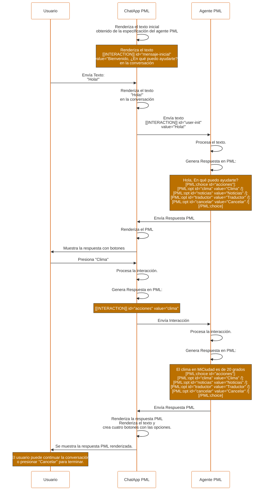

# PML — PEPPO Markup Language

## Especificación completa v1.3

**PEPPO** — Platform for Engaging People and Processes via Omni-agents

Mayo 2026

---

## Índice

- [1. Visión general](#1-visión-general)
  - [1.1 Interacción entre los componentes](#11-interacción-entre-los-componentes)
  - [1.2 Principios de diseño](#12-principios-de-diseño)
- [2. ChatApp](#2-chatapp)
  - [2.1 Agnosticidad del motor](#21-agnosticidad-del-motor)
- [3. Agente PML](#3-agente-pml)
  - [3.1 Agnosticidad del LLM](#31-agnosticidad-del-llm)
- [4. PML](#4-pml)
  - [4.1 Formato general](#41-formato-general)
  - [4.2 Componente autofinalizado](#42-componente-autofinalizado)
  - [4.3 Componente contenedor](#43-componente-contenedor)
  - [4.4 Reglas estrictas generales de PML](#44-reglas-estrictas-generales-de-pml)
  - [4.5 Encoding de interacciones](#45-encoding-de-interacciones)
  - [4.6 Ejemplo de mensaje válido](#46-ejemplo-de-mensaje-válido)
  - [4.7 Tipos de componentes PML](#47-tipos-de-componentes-pml)
  - [4.8 Atributos globales de los componentes PML](#48-atributos-globales-de-los-componentes-pml)
- [5. Componentes PML de Información](#5-componentes-pml-de-información)
  - [5.1 Text](#51-text)
  - [5.2 Markdown](#52-markdown)
  - [5.3 Facts](#53-facts)
  - [5.4 DTable](#54-dtable)
  - [5.5 Image](#55-image)
  - [5.6 Media](#56-media)
  - [5.7 Divider](#57-divider)
  - [5.8 Raw](#58-raw)
- [6. Componentes PML de Interacción](#6-componentes-pml-de-interacción)
  - [6.1 Input](#61-input)
    - [6.1.1 Input text](#611-input-text)
    - [6.1.2 Input number](#612-input-number)
    - [6.1.3 Input currency](#613-input-currency)
    - [6.1.4 Input contact](#614-input-contact)
    - [6.1.5 Input date](#615-input-date)
    - [6.1.6 Input time](#616-input-time)
    - [6.1.7 Input datetime](#617-input-datetime)
    - [6.1.8 Input location](#618-input-location)
    - [6.1.9 Input file](#619-input-file)
  - [6.2 Toggle](#62-toggle)
  - [6.3 Choice](#63-choice)
    - [6.3.1 Opciones](#631-opciones)
  - [6.4 Confirm](#64-confirm)
- [7. Modelo de interacción](#7-modelo-de-interacción)
  - [7.1 Formato de interacción](#71-formato-de-interacción)
  - [7.2 Flujo completo](#72-flujo-completo)
  - [7.3 Ejemplo de conversación completa](#73-ejemplo-de-conversación-completa)
  - [7.4 Actualización de Estado (State Update)](#74-actualización-de-estado-state-update)
- [8. Reglas de Composición](#8-reglas-de-composición)
  - [8.1 Tabla de nesting permitido](#81-tabla-de-nesting-permitido)
  - [8.2 Reglas de anidación](#82-reglas-de-anidación)
  - [8.3 Reglas de IDs](#83-reglas-de-ids)
- [9. Guías para LLMs / Agentes](#9-guías-para-llms--agentes)
  - [9.1 Reglas obligatorias](#91-reglas-obligatorias)
  - [9.2 Generación tolerante a errores](#92-generación-tolerante-a-errores)
- [10. Guías de UX para móviles del ChatApp](#10-guías-de-ux-para-móviles-del-chatapp)
  - [10.1 Principios](#101-principios)
  - [10.2 Zonas y fases del renderer del ChatApp en dispositivos móviles](#102-zonas-y-fases-del-renderer-del-chatapp-en-dispositivos-móviles)
    - [10.2.1 Las tres zonas del renderer en dispositivos móviles](#1021-las-tres-zonas-del-renderer-en-dispositivos-móviles)
    - [10.2.2 Las tres fases del ciclo de vida de una tarea](#1022-las-tres-fases-del-ciclo-de-vida-de-una-tarea)
    - [10.2.3 Matriz zona × fase](#1023-matriz-zona--fase)
      - [10.2.3.1 Casos borde](#10231-casos-borde)
      - [10.2.3.2 Lo que NO está en PML](#10232-lo-que-no-está-en-pml)
  - [10.3 Aplicación del modelo de zonas y fases a los diagramas](#103-aplicación-del-modelo-de-zonas-y-fases-a-los-diagramas)
  - [10.4 Gestos soportados](#104-gestos-soportados)
  - [10.5 Componentes de información / Pasivos](#105-componentes-de-información--pasivos)
    - [10.5.1 Text](#1051-text)
    - [10.5.2 Markdown](#1052-markdown)
    - [10.5.3 Facts](#1053-facts)
    - [10.5.4 DTable](#1054-dtable)
    - [10.5.5 Image](#1055-image)
    - [10.5.6 Media](#1056-media)
    - [10.5.7 Divider](#1057-divider)
  - [10.6 Componentes de interacción / interactivos](#106-componentes-de-interacción--interactivos)
    - [10.6.1 Input](#1061-input)
    - [10.6.2 Toggle](#1062-toggle)
    - [10.6.3 Choice](#1063-choice)
    - [10.6.4 Confirm](#1064-confirm)
- [11. Manejo de errores](#11-manejo-de-errores)
  - [11.1 Errores del agente (PML malformado)](#111-errores-del-agente-pml-malformado)
  - [11.2 Errores de recursos](#112-errores-de-recursos)
  - [11.3 Errores de validación (usuario)](#113-errores-de-validación-usuario)
- [12. Versionado y extensibilidad](#12-versionado-y-extensibilidad)
  - [12.1 Versionado](#121-versionado)
  - [12.2 Proceso de extensión](#122-proceso-de-extensión)
  - [12.3 Candidatos para v2.0](#123-candidatos-para-v20)
- [Apéndice A — Referencia rápida](#apéndice-a--referencia-rápida)
- [Apéndice B — EBNF simplificado](#apéndice-b--ebnf-simplificado)

---

## 1. Visión general

**PML** es un lenguaje **ligero, legible para LLMs y eficiente en tokens** diseñado para que los agentes conversacionales rendericen componentes UI interactivos dentro de interfaces de chat.

Cuando un agente conversacional usa el lenguaje PML para comunicarse con los usuarios, se dice que el agente es un **agente PML**.

La **ChatApp PML** es la interfaz que renderiza el PML, y puede ser una aplicación móvil, una aplicación web o una aplicación de escritorio.

Un **Mensaje** es un bloque de texto que la ChatApp renderiza. Un mensaje puede contener texto plano, PML o ambos.

### 1.1 Interacción entre los componentes

La interacción entre estos componentes se ejemplifica en el siguiente diagrama de secuencia:

Un usuario inicia una conversación con la ChatApp, por ejemplo enviando un mensaje de texto. La ChatApp envía el mensaje al agente PML. El agente PML analiza el mensaje y genera una respuesta en PML. La ChatApp renderiza el PML. El usuario interactúa con el PML y la ChatApp captura la interacción, la procesa y la envía al agente PML. El agente PML procesa la interacción y genera nuevo PML, y asi sucesivamente.

En especifico un caso de uso para esto es:
El usuario pregunta "Hola!"
El agente PML responde "Hola! En qué puedo ayudarte?" y muestra dos botones: "Clima", "Noticias", "Traductor" y "Cancelar"
Si el usuario presiona "Clima", el agente PML procesa la interacción y genera un PML con un mensaje: "El clima en MiCiudad es de 20 grados" y muestra los botones "Clima", "Noticias", "Traductor" y "Cancelar"
Si el usuario presiona "Cancelar" en cualquier momento, el agente PML procesa la interacción y genera nuevo PML con un mensaje de despedida: "Saludos, en que más puedo ayudarte?".

El diagrama que representa este caso de uso es el siguiente:



En este ejemplo se muestra la secuencia de eventos que ocurren cuando un usuario interactúa con un agente PML. Es importante notar que la respuesta del agente PML es una respuesta en PML, no una respuesta en texto plano. Tambien hay que notar que el Agente PML puede recibir interacciones de la ChatApp PML, o cualquier otro Mensaje PML. Por esta razon el Agente PML debe estar configurado para entender el PML. Por esta razon se le llama "PML Agents" a los agentes que usan PML.

**Filosofía:**

PML está diseñado para ser usado en interfaces de chat. La idea central es que el usuario interactue con el Agente PML de manera simple y natural, y que el Agente PML le responda de la misma manera.

PML convierte los clásicos ChatBots en Agentes de Interacción complejos y ricos en funcionalidades.

### 1.2 Principios de diseño

```
- Interection-first  →  El agente genera interacciones con la UI en vez de solo texto
- Token-efficient    →  Más compacto que JSON, XML o cualquier alternativa
- LLM-friendly       →  Sintaxis regular y predecible, fácil de generar sin errores
- Mobile-native      →  Diseñado para flujos conversacionales en móvil
- UILogic-first      →  La lógica de la UI se define en el frontend, no en el agente
- Extensible         →  Nuevos componentes sin romper compatibilidad
```

---

## 2. ChatApp

La ChatApp es la interfaz que permite a los usuarios interactuar con los agentes PML.

La ChatApp es la encargada de:

- Renderizar los componentes PML
- Capturar las interacciones de los usuarios
- Enviar las interacciones al agente
- Procesar las respuestas de los agentes

### 2.1 Agnosticidad del motor

La ChatApp PML es agnóstica al motor PML. Esto significa que no sabe qué está renderizando, solo sabe que debe renderizarlo. Esto permite que la ChatApp PML sea reutilizada en diferentes contextos.

La ChatApp PML no define el motor. Esto permite que diferentes ChatApp PML sean creadas para diferentes plataformas. Por ejemplo, existe la ChatApp PML para Android, para iOS, para Web, etc.

Para cada plataforma existe un renderizador PML que se encarga de renderizar los componentes PML. Por ejemplo, existe el renderizador PML para Android, para iOS, para Web, etc.

## 3. Agente PML

El Agente PML es un LLM (Large Language Model) que es capaz de generar respuestas en PML. El Agente PML tambien es capaz de recibir interacciones de la ChatApp PML y generar nuevas respuestas en PML.

Por esta razon, el Agente PML debe ser entrenado con la especificación de PML y con ejemplos de interacciones con usuarios.

### 3.1 Agnosticidad del LLM

El Agente PML es agnóstico al LLM. Esto significa que puede ser implementado con diferentes LLMs. Por ejemplo, existe el Agente PML implementado con GPT-5, Gemini, Llama, etc.

Lo más basico es incluir en el prompt algo como esto:

"Debes usar PML para generar respuestas. PML es un lenguaje de marcado que permite generar respuestas en formato de texto plano con componentes PML.
Los componentes PML son de la forma [PML:tipo atributo1="valor1" atributo2="valor2" /] o [PML:tipo atributo="valor"] contenido hijo [/PML:tipo].
Las reglas de sintaxis son las siguientes: ..." (Aqui se incluye SÓLO la especificación de PML necesaria para la tarea o para el contexto del agente PML).

Por supuesto hay que definir un prompt base para el agente PML. Este prompt base debe incluir la especificación de PML necesaria para la tarea o para el contexto del agente PML y con ejemplos de interacciones con usuarios.

No es recomendable incluir la especificación completa de PML en el prompt base, ya que esto puede reducir la capacidad del agente PML para generar respuestas en PML.

## 4. PML

### 4.1 Formato general

- PML se escribe como texto plano.
- Se pueden mezclar libremente **texto** y **componentes PML** en un mismo mensaje.

Todos los componentes PML son de la forma:

- Componente autofinalizado: `[PML:tipo atributo1="valor1" atributo2="valor2" /]`
- Componente contenedor: `[PML:tipo atributo="valor"] contenido hijo [/PML:tipo]`

### 4.2 Componente autofinalizado

Los componentes autofinalizados son aquellos que no tienen contenido hijo.

Ejemplo:

```
[PML:tipo atributo1="valor1" atributo2="valor2" /]
```

### 4.3 Componente contenedor

Los componentes contenedores son aquellos que tienen contenido hijo.

Ejemplo:

```
[PML:tipo atributo="valor"]
  contenido hijo
[/PML:tipo]
```

### 4.4 Reglas estrictas generales de PML

| Regla             | Detalle                                                                                                                        |
| ----------------- | ------------------------------------------------------------------------------------------------------------------------------ |
| Comillas          | Los valores de atributos se delimitan con `" "` (preferido) o `' '`. Nunca mezclar en el mismo atributo.                       |
| Comillas Anidadas | Si un valor requiere ambas comillas, usar entidades HTML (`&quot;`, `&#39;`) **exclusivamente** dentro del valor del atributo. |
| Prohibido         | Nunca usar JSON, `< >`, ni caracteres especiales fuera de los atributos.                                                       |
| IDs               | Todo componente interactivo **debe** tener `id="identificador-unico"`.                                                         |
| Unicidad          | Los `id` deben ser únicos dentro de un mensaje.                                                                                |
| Escapado          | No existen secuencias de escape con `\`.                                                                                       |
| Autofinalizados   | **Siempre** terminan con ` /]` — el espacio antes de `/]` es obligatorio.                                                      |
| Cierre            | Los contenedores **siempre** se cierran con `[/PML:tipo]`.                                                                     |
| Case-sensitive    | Los nombres de componentes y atributos son en minúsculas.                                                                      |
| Encoding          | Todo el contenido es UTF-8.                                                                                                    |

### 4.5 Encoding de interacciones

Cuando la ChatApp envía un mensaje de interacción al agente, **siempre** aplica URL encoding a los valores que provienen de texto libre del usuario. El agente **siempre** espera recibir valores codificados.

| Carácter | Codificación |
| -------- | ------------ |
| espacio  | `+`          |
| `&`      | `%26`        |
| `=`      | `%3D`        |
| `"`      | `%22`        |
| `'`      | `%27`        |
| `+`      | `%2B`        |
| `%`      | `%25`        |
| `\n`     | `%0A`        |

**Se codifica:** texto libre del usuario (input, textarea, etc.)

**No se codifica:** `id`, `value` de botones/choice/toggle, referencias de file, coordenadas de location — todos definidos por el agente o por la ChatApp, sin caracteres especiales. En el caso de opciones múltiples (`choice` con `multi="true"`), los valores se separan por comas sin espacios (ej. `value=opcion1,opcion2`).

**Nota para el Agente (LLM):** El prompt del sistema del agente debe instruirlo explícitamente para que procese (decodifique) estos valores URL-encoded generados por el usuario.

**Ejemplo:**

```
Usuario escribe:     Pedro & María
ChatApp envía:      [[INTERACTION]] id=nombre value=Pedro+%26+María
```

### 4.6 Ejemplo de mensaje válido

```
Hola Pedro, ¿qué deseas hacer hoy?
[PML:choice id="acciones"]
  [PML:opt id="book" value="Reservar cita" /]
  [PML:opt id="prices" value="Ver precios" /]
[/PML:choice]
```

**Ejemplo con comillas simples (valor contiene comillas dobles):**

```
[[INTERACTION id=acciones value="book"]]
```

### 4.7 Tipos de componentes PML

Los componentes PML pueden agruparse de la siguiente manera:

**Componentes de información / Pasivos**

- text: Texto estático con estilo.
- markdown: Texto con formato Markdown.
- facts: Tabla de datos.
- dtable: Tabla de datos.
- image: Imagen estática.
- media: Video o audio.
- divider: Separador.
- raw: Bloque de texto sin procesar (escape).

**Componentes de interacción / interactivos:**

- input: Input de texto.
- toggle: Toggle de activación.
- choice: Elección múltiple.
- confirm: Diálogo de confirmación.

**Componentes auxiliares:**

- opt: Opción de elección múltiple.

Los componentes de información se renderizan de manera automatica en el flujo del chat, mientras que los componentes de interacción requieren un manejo especial por parte de la ChatApp, puesto que deben ser renderizados de manera especial y enviar las interacciones al agente PML.

---

### 4.8 Atributos globales de los componentes PML

Los atributos globales aplican a todos los componentes PML, según se muestra en la siguiente tabla:

| Atributo   | Requerido            | Tipo             | Descripción                                     |
| ---------- | -------------------- | ---------------- | ----------------------------------------------- |
| `id`       | Sí (en interactivos) | string           | Identificador único. Formato: `kebab-case`.     |
| `disabled` | No                   | `true` / `false` | Deshabilita interacción. Default: `false`.      |
| `tooltip`  | No                   | string           | Texto de ayuda al mantener presionado (mobile). |
| `visible`  | No                   | `true` / `false` | Controla visibilidad. Default: `true`.          |
| `error`    | No                   | string           | Mensaje de error asociado. Se renderiza debajo. |

---

## 5. Componentes PML de Información

Los componentes PML de información se renderizan de manera automatica en el flujo del chat. Solo deben ser usados para mostrar información al usuario.

### 5.1 Text

Bloque de texto estático con estilo.

| Atributo | Requerido | Tipo                                                 | Descripción                           |
| -------- | --------- | ---------------------------------------------------- | ------------------------------------- |
| `type`   | No        | `header` / `title` / `paragraph` / `muted` / `label` | Tipo semántico. Default: `paragraph`. |
| `style`  | No        | `bold` / `italic` / `muted` / `normal`               | Estilo visual. Default: `normal`.     |
| `size`   | No        | `small` / `medium` / `large`                         | Tamaño. Default: `medium`.            |
| `align`  | No        | `left` / `center` / `right`                          | Alineación. Default: `left`.          |

**Ejemplo:**

```
[PML:text type="header" size="large" style="bold"]
Tu pedido está en camino
[/PML:text]

[PML:text type="muted" size="small"]
Estimamos entrega en 3-5 días hábiles
[/PML:text]
```

---

### 5.2 Markdown

Bloque de texto con formato Markdown completo.

| Atributo | Requerido | Tipo   | Descripción   |
| -------- | --------- | ------ | ------------- |
| `id`     | No        | string | Identificador |

**Ejemplo:**

```
[PML:markdown]
### Instrucciones de envío

1. **Empaca** el producto en su caja original
2. **Pega** la etiqueta de envío en la parte exterior
3. **Lleva** el paquete a cualquier centro de envío

> El reembolso se procesa en 5-7 días hábiles.

Para más info visita nuestra [guía de envíos](https://peppo.com/envios).
[/PML:markdown]
```

**Soporta:** Negritas, cursivas, listas, enlaces, código inline, blockquotes, encabezados.

**Nota de parsing:** El uso normal de corchetes en Markdown (ej. enlaces `[texto](url)`) es completamente seguro. El parser del renderer solo procesa aquellos corchetes que inician estrictamente con `[PML:`.

---

### 5.3 Facts

Tabla de pares clave-valor.

| Atributo  | Requerido | Tipo      | Descripción                       |
| --------- | --------- | --------- | --------------------------------- |
| `columns` | No        | `1` / `2` | Columnas de layout. Default: `1`. |

**Formato del contenido:** Cada entrada es un componente autofinalizado `[PML:fact label="Clave" value="valor" /]`.

**Ejemplo:**

```
[PML:facts]
  [PML:fact label="Producto" value="Nike Air Max 90" /]
  [PML:fact label="Talla" value="42" /]
  [PML:fact label="Precio" value="$2,499 MXN" /]
  [PML:fact label="Envío" value="Gratis" /]
[/PML:facts]
```

---

### 5.4 DTable

Tabla de datos

| Atributo  | Requerido | Tipo   | Descripción                            |
| --------- | --------- | ------ | -------------------------------------- |
| `columns` | Sí        | string | Nombres de columnas separados por "\|" |

**Formato del contenido:** Las columnas en el atributo `columns` se separan por comas. Cada fila va envuelta en `[PML:dtrow]` y contiene componentes autofinalizados `[PML:dtcol value="valor" /]`. Este formato es obligatorio y funciona tanto en una sola línea como en múltiples líneas.

**Ejemplo:**

```
[PML:dtable columns="Plan,Precio,Agentes,Mensajes"]
  [PML:dtrow]
    [PML:dtcol value="Básico" /][PML:dtcol value="$9/mes" /][PML:dtcol value="1" /][PML:dtcol value="100/día" /]
  [/PML:dtrow]
  [PML:dtrow]
    [PML:dtcol value="Pro" /][PML:dtcol value="$29/mes" /][PML:dtcol value="10" /][PML:dtcol value="Ilimitado" /]
  [/PML:dtrow]
[/PML:dtable]
```

---

### 5.5 Image

Imagen estática.

| Atributo  | Requerido | Tipo                                  | Descripción                |
| --------- | --------- | ------------------------------------- | -------------------------- |
| `url`     | Sí        | url                                   | URL de la imagen           |
| `alt`     | No        | string                                | Texto alternativo          |
| `size`    | No        | `small` / `medium` / `large` / `full` | Tamaño. Default: `medium`. |
| `caption` | No        | string                                | Pie de imagen              |

**Ejemplo:**

```
[PML:image url="https://cdn.peppo.com/producto.jpg" alt="Nike Air Max 90"
  size="large" caption="Nuevo modelo 2026" /]
```

---

### 5.6 Media

Reproductor de video o audio.

| Atributo  | Requerido | Tipo              | Descripción                    |
| --------- | --------- | ----------------- | ------------------------------ |
| `url`     | Sí        | url               | URL del archivo                |
| `type`    | Sí        | `video` / `audio` | Tipo de medio                  |
| `poster`  | No        | url               | Imagen de portada (solo video) |
| `caption` | No        | string            | Pie de medio                   |

**Ejemplo:**

```
[PML:media url="https://cdn.peppo.com/demo.mp4" type="video"
  poster="https://cdn.peppo.com/demo-poster.jpg" /]
```

---

### 5.7 Divider

Línea separadora.

```
[PML:divider /]
```

Con texto:

```
[PML:divider label="O continúa con" /]
```

### 5.8 Raw

Bloque de texto plano que desactiva el parser de PML. Permite incluir sintaxis PML literal sin que sea interpretada como componentes.

**Ejemplo:**

```
[PML:raw]
Para mostrar un texto en negritas, utiliza el componente text:
[PML:text style="bold"]Texto en negritas[/PML:text]
[/PML:raw]
```

---

## 6. Componentes PML de Interacción

Los componentes PML de interacción se renderizan en el flujo del chat cuando el agente considera necesario interactuar con el usuario. Solo deben ser usados para mostrar información al usuario y recibir una interacción a cambio. El componente por excelencia para recibir interacciones es el input tipo texto. Sin embargo, existen otros componentes que permiten recibir interacciones de diferentes tipos. Todos los componentes de interacción comparten atributos comunes y específicos, los cuales se detallan a continuación.

### 6.1 Input

Campo de entrada de datos.

**Tipos de inputs disponibles:**

- `text`: Campo de texto
- `number`: Campo numérico
- `currency`: Campo de moneda
- `contact`: Campo de contacto
- `date`: Campo de fecha
- `time`: Campo de hora
- `datetime`: Campo de fecha y hora
- `location`: Campo de ubicación
- `file`: Campo de archivo

#### Atributos generales de los inputs

| Atributo   | Requerido | Tipo               | Descripción                     |
| ---------- | --------- | ------------------ | ------------------------------- |
| `id`       | Sí        | string             | Identificador único             |
| `type`     | Sí        | string             | Tipo de campo                   |
| `label`    | No        | string             | Etiqueta visible                |
| `required` | No        | `true` / `false`   | Obligatorio. Default: `false`.  |
| `readonly` | No        | `true` / `false`   | Solo lectura. Default: `false`. |
| `value`    | No        | <depende del tipo> | Valor inicial                   |

#### 6.1.1 Input text

El input tipo text recaba texto del usuario, y se representa con un campo de texto.

Además de los atributos generales, el input tipo text tiene los siguientes atributos:

| Atributo adicional | Requerido | Tipo    | Descripción                                           |
| ------------------ | --------- | ------- | ----------------------------------------------------- |
| `placeholder`      | No        | string  | Texto de ayuda                                        |
| `multiline`        | No        | boolean | Si es un campo de texto multilínea. Default: `false`. |
| `validate`         | No        | string  | Expresión regular                                     |
| `errorMessage`     | No        | string  | Mensaje si validación falla                           |
| `maxLength`        | No        | number  | Máximo de caracteres                                  |
| `minLength`        | No        | number  | Mínimo de caracteres                                  |
| `password`         | No        | boolean | Si es un campo de contraseña. Default: `false`.       |

###### Ejemplos de uso

```
[PML:input id="nombre" type="text" label="Nombre completo"
  placeholder="Ingresa tu nombre" required="true" /
```

Este input se muestra al usuario como un campo de texto con la etiqueta "Nombre completo" y placeholder "Ingresa tu nombre". Cuando el usuario ingrese un valor y oprima el botón de enviar, la ChatApp tomará el control y generará una interacción con el id "nombre" y el valor ingresado por el usuario. La interacción generada se muestra a continuación:

**Interacción generada:**

```
[[INTERACTION]] id=nombre value=Juan+Perez
```

Si en cambio se hubiera declarado el atributo multiline como true, el campo se mostraría como un campo de texto multilínea y el agente recibiría una interacción con el id "comentarios" y el valor ingresado por el usuario.

```
[PML:input id="comentarios" type="text" label="Comentarios"
  multiline="true" placeholder="Escribe tus comentarios" /
```

En este caso, la interacción generada sería la siguiente:

**Interacción generada:**

```
[[INTERACTION]] id=comentarios value=Comentarios+del+usuario
```

Cuando se describen los componentes de interacción, se muestra un ejemplo de uso y la interacción que genera. Es importante recalcar que la interacción es generada por la ChatApp cuando el usuario ejecuta un Call to Action, ya sea oprimiendo el botón de enviar, seleccionando una opción, etc. dependiendo del componente de interacción.

#### 6.1.2 Input number

El input tipo number recaba números del usuario, y se representa con un campo numérico.

| Atributo adicional | Requerido | Tipo    | Descripción                                          |
| ------------------ | --------- | ------- | ---------------------------------------------------- |
| `placeholder`      | No        | string  | Texto de ayuda                                       |
| `integer`          | No        | boolean | Si es un campo de números enteros. Default: `false`. |
| `decimals`         | No        | number  | Número de decimales. Default: `0`.                   |
| `min`              | No        | number  | Valor mínimo.                                        |
| `max`              | No        | number  | Valor máximo.                                        |

##### Ejemplos de uso

```
[PML:input id="edad" type="number" label="Edad" min="18" max="99" /]
```

**Interacción generada:**

```
[[INTERACTION]] id=edad value=25
```

```
[PML:input id="estatura" type="number" label="Estatura" placeholder="1.75" decimals="2" /]
```

**Interacción generada:**

```
[[INTERACTION]] id=estatura value=1.75
```

#### 6.1.3 Input currency

El input tipo currency recaba valores monetarios del usuario, y se representa con un campo de moneda.

| Atributo adicional | Requerido | Tipo   | Descripción                        |
| ------------------ | --------- | ------ | ---------------------------------- |
| `placeholder`      | No        | string | Texto de ayuda                     |
| `currency`         | No        | string | Símbolo de moneda. Default: `MXN`. |
| `decimals`         | No        | number | Número de decimales. Default: `2`. |
| `min`              | No        | number | Valor mínimo.                      |
| `max`              | No        | number | Valor máximo.                      |

##### Ejemplos de uso

```
[PML:input id="monto" type="currency" label="Monto" min="1" max="10000" currency="MXN" /]
```

**Interacción generada:**

```
[[INTERACTION]] id=monto value=$1,500.50
```

El valor de la interacción debe ser siempre con formato dependiente del atributo `currency`, en este ejemplo es MXN, por lo que el valor debe ser siempre con formato:

- Si tiene decimales: `$1,500.50`
- Si es un número entero: `$1500`

#### 6.1.4 Input contact

El input tipo contact recaba información del número de teléfono del usuario, usando los mecanismos de interacción del ChatApp.

##### Ejemplos de uso

```
[PML:input id="telefono" type="contact" label="Toca para compartir tu teléfono" required="true" /]
```

**Interacción generada:**

```
[[INTERACTION]] id=telefono value=+5215512345678
```

#### 6.1.5 Input date

El input tipo date recaba información de fecha, y se representa con un selector de fecha. Siempre usar ISO 8601 para la fecha: YYYY-MM-DD

| Atributo adicional | Requerido | Tipo   | Descripción    |
| ------------------ | --------- | ------ | -------------- |
| `placeholder`      | No        | string | Texto de ayuda |

##### Ejemplos de uso

```
[PML:input id="fecha" type="date" label="Fecha" /]
```

**Interacción generada:**

```
[[INTERACTION]] id=fecha value=2026-01-01
```

#### 6.1.6 Input time

El input tipo time recaba información de tiempo, y se representa con un selector de tiempo. El formato de la interacción siempre será HH:mm, con el formato de 24 horas.
El atributo `amPm` no afecta el formato de la interacción, únicamente la forma de presentarlo al usuario.

| Atributo adicional | Requerido | Tipo    | Descripción                                                                                                           |
| ------------------ | --------- | ------- | --------------------------------------------------------------------------------------------------------------------- |
| `placeholder`      | No        | string  | Texto de ayuda                                                                                                        |
| `amPm`             | No        | boolean | Formato AM/PM. Default: `false`. Si es `true` el formato de la interacción será HH:mm am/pm, en caso contrario HH:mm. |

##### Ejemplos de uso

```
[PML:input id="hora" type="time" label="Hora" amPm="true" /]
```

**Interacción generada:**

```
[[INTERACTION]] id=hora value=14:45
```

```
[PML:input id="hora" type="time" label="Hora" /]
```

**Interacción generada:**

```
[[INTERACTION]] id=hora value=14:45
```

#### 6.1.7 Input datetime

El input tipo datetime recaba información de fecha y hora, y se representa con un selector de fecha y hora.
El valor de la interacción es en formato ISO 8601: YYYY-MM-DDTHH:mm (hora en formato 24 horas)

| Atributo adicional | Requerido | Tipo   | Descripción    |
| ------------------ | --------- | ------ | -------------- |
| `placeholder`      | No        | string | Texto de ayuda |

##### Ejemplos de uso

```
[PML:input id="fecha" type="datetime" label="Fecha y hora" /]
```

**Interacción generada:**

```
[[INTERACTION]] id=fecha value=2026-01-01T14:45
```

#### 6.1.8 Input location

El input tipo location recaba información de ubicación, y se representa con un selector de ubicación. El valor de la interacción es siempre con formato: latitud,longitud.

##### Ejemplos de uso

```
[PML:input id="ubicacion" type="location" label="Tu ubicación" /]
```

Renderiza un selector de ubicación que puede:

- Obtener coordenadas GPS del dispositivo
- Permitir buscar una dirección
- Mostrar un mini mapa con pin

**Interacción generada:**

```
[[INTERACTION]] id=ubicacion value=19.4326,-99.1332
```

#### 6.1.9 Input file

El input tipo file permite subir UN archivo, y se representa con un selector de archivos. El valor de la interacción es siempre una referencia al archivo.
La referencia siempre es una url

| Atributo adicional | Tipo   | Descripción                                              |
| ------------------ | ------ | -------------------------------------------------------- |
| `accept`           | string | Tipos MIME permitidos (ej: `image/*`, `application/pdf`) |
| `maxSize`          | string | Tamaño máximo (ej: `5MB`, `10MB`)                        |

##### Ejemplos de uso

```
[PML:input id="foto" type="file" label="Sube tu identificación"
  accept="image/*" maxSize="5MB" /]
```

Renderiza un selector de archivos con las siguientes características:

- Botón para subir archivo
- Muestra el nombre del archivo seleccionado
- Muestra el tamaño del archivo seleccionado
- Muestra una previsualización del archivo seleccionado
- una vez oprimido el boton de subir archivo se sube el archivo a un servidor y se obtiene una url de referencia

**Interacción generada:**

```
[[INTERACTION]] id=foto value=https://ejemplo.com/archivo.pdf
```

---

### 6.2 Toggle

Interruptor sí/no.

| Atributo   | Requerido | Tipo             | Descripción                                |
| ---------- | --------- | ---------------- | ------------------------------------------ |
| `id`       | Sí        | string           | Identificador único                        |
| `label`    | Sí        | string           | Texto descriptivo                          |
| `checked`  | No        | `true` / `false` | Estado inicial. Default: `false`.          |
| `valueOn`  | No        | string           | Valor cuando activo. Default: `"true"`.    |
| `valueOff` | No        | string           | Valor cuando inactivo. Default: `"false"`. |
| `required` | No        | `true` / `false` | Obligatorio. Default: `false`.             |

**Ejemplo:**

```
[PML:toggle id="terminos" label="Acepto los términos y condiciones"
  checked="false" required="true" /]
```

**Interacción generada:**

```
[[INTERACTION]] id=terminos value=true
```

---

### 6.3 Choice

Selección entre opciones.

| Atributo      | Requerido | Tipo                             | Descripción                           |
| ------------- | --------- | -------------------------------- | ------------------------------------- |
| `id`          | Sí        | string                           | Identificador único                   |
| `style`       | No        | `buttons` / `dropdown` / `radio` | Renderizado. Default: `buttons`.      |
| `multi`       | No        | `true` / `false`                 | Selección múltiple. Default: `false`. |
| `placeholder` | No        | string                           | Texto por defecto (solo dropdown)     |
| `required`    | No        | `true` / `false`                 | Obligatorio. Default: `false`.        |

Cuando `multi="true"`, la interacción generada separará los valores seleccionados usando comas (`value=opcion1,opcion2`).

#### 6.3.1 Opciones

Las opciones tienen el formato **[PML:opt value="valor" /]** y son hijos directos de la etiqueta `choice`. El `value` es el texto visible para el usuario.

**Atributos de `opt`:**

| Atributo | Requerido | Tipo   | Descripción                                                                                                                      |
| -------- | --------- | ------ | -------------------------------------------------------------------------------------------------------------------------------- |
| `value`  | Sí        | string | Texto visible al usuario                                                                                                         |
| `id`     | No        | string | Identificador único de la opción. Si falta, el value sera usado como id, este valor será el que se utilice en las interacciones. |

**Ejemplo:**

```
[PML:choice id="talla" style="buttons"]
  [PML:opt value="Pequeña" /]
  [PML:opt value="Mediana" /]
  [PML:opt value="Grande" /]
  [PML:opt value="Extra Grande" /]
[/PML:choice]
```

**Interacción generada:**

```
[[INTERACTION]] id=talla value=Mediana
```

---

### 6.4 Confirm

Diálogo de confirmación.

| Atributo       | Requerido | Tipo                             | Descripción                                    |
| -------------- | --------- | -------------------------------- | ---------------------------------------------- |
| `id`           | Sí        | string                           | Identificador único                            |
| `title`        | Sí        | string                           | Título del diálogo                             |
| `message`      | No        | string                           | Mensaje descriptivo                            |
| `confirmLabel` | No        | string                           | Texto de confirmación. Default: `"confirmed"`. |
| `cancelLabel`  | No        | string                           | Texto de cancelación. Default: `"cancelled"`.  |
| `style`        | No        | `default` / `danger` / `warning` | Estilo. Default: `default`.                    |

**Ejemplo:**

```
[PML:confirm id="eliminar-cuenta" title="¿Eliminar tu cuenta?"
  message="Se borrarán todos tus datos."
  confirmLabel="Sí, eliminar" cancelLabel="No, conservar" style="danger" /]
```

**Interacciones generadas:**

Si el usuario confirma:

```
[[INTERACTION]] id=eliminar-cuenta value=confirmed
```

Si el usuario cancela:

```
[[INTERACTION]] id=eliminar-cuenta value=cancelled
```

---

## 7. Modelo de interacción

Una interacción es el resultado de una acción realizada por el usuario en la ChatApp sobre un componente de PML de tipo interactivo. El agente interpreta las interacciones y genera una respuesta adecuada. Por lo tanto, cuando el usuario interactúa con un componente de PML, la ChatApp genera una interacción y se la envía al agente.

### 7.1 Formato de interacción

Ya hemos visto el formato de interación para cada componente de PML en las secciones anteriores, no es necesario repetirlo aquí. Sin embargo, es importante señalar que la interacción solo se genera cuando el usuario interactúa con un componente de PML de tipo interactivo.

De manera general, el formato de interacción es el siguiente:

| Formato                        | Cuándo se usa                  |
| ------------------------------ | ------------------------------ |
| `[[INTERACTION]] id=X value=Y` | input, choice, toggle, confirm |

### 7.2 Flujo completo

Cuando el usuario por abre el ChatApp, para interactuar con un Agente PML

```
1. EL ChatApp renderiza el primer mensaje del agente PML, lo obtiene de su configuiacion inicial, del "agent-spec". El agent-spec es un archivo que contiene la configuración del agente PML.
Este primer mensaje en general es un input de tipo texto donde el usuario escribe su consulta.
2. El usuario escribe su consulta y presiona el botón de enviar.
3. ChatApp captura acción y se la envía como una interacción al agente PML.
4. Agente recibe, procesa, genera una nueva respuesta, esta respuesta del Agente contiene un campo de respuesta PML.
5. ChatApp parsea la respuesta PML y renderiza los componentes.
6. ChatApp espera la interacción del usuario con los componentes PML.
7. El usuario interactúa con los componentes PML.
...
```

Esta logica de interacción se repite indefinidamente, esta logica es llamada **conversación**.

### 7.3 Ejemplo de conversación completa

En este ejemplo se muestra una conversación completa entre un usuario y un agente PML donde se utilizan diferentes componentes de PML. Se omite el ChatApp por simplicidad.

```
USUARIO: [[INTERACTION]] id=mensaje-inicial value=Quiero+comprar+unos+zapatos

AGENTE: ¡Perfecto! Tenemos varios modelos disponibles.

        [PML:image url="https://cdn.peppo.com/catalogo.jpg"
          alt="Catálogo de zapatos" size="full" /]

        ¿Cuál te interesa?

        [PML:choice id="catalogo"]
          [PML:opt id="nike" value="Nike Air Max — $2,499" /]
          [PML:opt id="adidas" value="Adidas Ultraboost — $3,199" /]
        [/PML:choice]

--- El usuario toca "Nike Air Max ..." ---

USUARIO: [[INTERACTION]] id=catalogo value=nike

AGENTE: Excelente elección. ¿Qué talla necesitas?

        [PML:choice id="talla" style="buttons"]
          [PML:opt value="38" /]
          [PML:opt value="39" /]
          [PML:opt value="40" /]
          [PML:opt value="41" /]
          [PML:opt value="42" /]
          [PML:opt value="43" /]
        [/PML:choice]

--- El usuario selecciona "42" ---

USUARIO: [[INTERACTION]] id=talla value=42

AGENTE: Nike Air Max, talla 42. Para completar tu compra
        necesito tus datos de envío. Toca el botón cuando estés listo.

        [PML:choice id="start-checkout"]
          [PML:opt id="start" value="Completar datos" /]
        [/PML:choice]

--- El usuario toca el botón ---

USUARIO: [[INTERACTION]] id=start-checkout value=start

AGENTE: ¡Listo, Pedro! Aquí está tu resumen:

        [PML:facts columns="2"]
          [PML:fact label="Producto" value="Nike Air Max 90" /]
          [PML:fact label="Talla" value="42" /]
          [PML:fact label="Precio" value="$2,499 MXN" /]
          [PML:fact label="Envío" value="Gratis" /]
          [PML:fact label="Nombre" value="Pedro García" /]
          [PML:fact label="Dirección" value="Reforma 123, CDMX, 06600" /]
          [PML:fact label="Teléfono" value="+52 555 123 4567" /]
          [PML:fact label="Entrega estimada" value="3-5 días hábiles" /]
        [/PML:facts]

        [PML:choice id="post-compra"]
          [PML:opt id="track" value="Rastrear pedido" /]
          [PML:opt id="continue" value="Seguir comprando" /]
        [/PML:choice]
```

### 7.4 Actualización de Estado (State Update)

Cuando el Agente PML valida una interacción en el backend y determina que es inválida (por ejemplo, un código de descuento incorrecto o un nombre de usuario ya existente), puede emitir un nuevo mensaje conteniendo el **mismo componente interactivo con el mismo `id`** de la interacción inmediata anterior, e incluyendo el atributo `error="Mensaje de error"`.

En este escenario, la ChatApp **no creará** un nuevo bloque de mensaje en el `shared_history`. En su lugar, el renderer identificará que se trata de la misma tarea y la restaurará a la fase `live_capture`, actualizando el componente visual con el mensaje de error. Esta *Actualización de Estado* previene que la conversación se llene de intentos fallidos repetidos, manteniendo el contexto intacto.

---

## 8. Reglas de Composición

### 8.1 Tabla de nesting permitido

```
┌──────────────────┬─────────────────────────────────────────────────┐
│ Contenedor        │ Puede contener                                   │
├──────────────────┼─────────────────────────────────────────────────┤
│ (raíz del mensaje)│ Todos los componentes standalone                 │
│ choice            │ opt (uno o más)                                  │
│ facts             │ fact (uno o más)                                 │
│ dtable            │ dtrow (uno o más)                                │
│ dtrow             │ dtcol (uno o más)                                │
└──────────────────┴─────────────────────────────────────────────────┘
```

### 8.2 Reglas de anidación

1. **Profundidad máxima** 3 niveles (`dtable` > `dtrow` > `dtcol` y `choice` > `opt`)

### 8.3 Reglas de IDs

- Únicos dentro de un mensaje
- Formato: `kebab-case`
- No espacios, no caracteres especiales, no empezar con números
- IDs duplicados: renderizar solo el primero, loggear warning

---

## 9. Guías para LLMs / Agentes

### 9.1 Reglas obligatorias

1. **Siempre** incluir `id` en todo componente interactivo
2. **Nunca** usar JSON, `< >` ni HTML para componentes

### 9.2 Generación tolerante a errores

| Error del agente             | Comportamiento del renderer         |
| ---------------------------- | ----------------------------------- |
| Falta `id` en interactivo    | Generar `auto-{tipo}-{n}`           |
| Atributo desconocido         | Ignorar silenciosamente             |
| Tag sin cerrar               | Intentar autocerrar; si no, truncar |
| Componente hijo no permitido | Renderizar como texto plano         |
| ID duplicado                 | Renderizar el primero               |
| Profundidad > 2              | Aplanar al nivel 2                  |

---

## 10. Guías de UX para móviles del ChatApp

### 10.1 Principios

```
1. EL CHAT INPUT ES SAGRADO,
   El chat input es un input de tipo texto y esta disponible en todo momento.
   Solo desaparece cuando no hay un elemento PML de interacción presente en el chat.
   Se restaura inmediatamente después del envío o cancelación.

2. NADA SE PIERDE
   Los datos enviados quedan como resumen inline en el historial.

3. LA INTERACCIÓN ES PRIORITARIA
   El componente PML de interacción es el protagonista de la pantalla.
   Debe ocupar un lugar preferente en el layout.
   Debe ser facilmente interactuable.

4. MÁXIMO 1 INTERACCIÓN POR TURNO
   Solo puede haber un componente PML de interacción activo por conversación por usuario disparador en un momento dado.

5. TODA conversación está pensada como una conversación grupal, en donde hay multiples participantes, y en un momento dado, cada uno de los participantes puede ejecutar una tarea que requiere interacción. Por lo tanto, el ChatApp debe permitir que cada participante tenga su propia interacción privada, que solo sea visible para él. Esta renderización se logra mediante el uso de diferentes zonas del ChatApp. La renderización privada se llama tarea.
```

### 10.2 Zonas y fases del renderer del ChatApp en dispositivos móviles

Esta subsección define el **modelo canónico** que el ChatApp usa para renderizar un mensaje PML en una pantalla de móvil.

La principal restricción de espacio del dispositivo obliga a optimizar el uso de la pantalla, para evitar que elementos de interacción no compitan con el input del chat y con los mensajes.

La filosofia del PML es que la interacción con los Agentes no sea sólo a través de texto. La intención es que el usuario pueda interatuar con los Agentes de forma más rica y natural, utilizando diferentes tipos de elementos de interacción. Por eso el ChatApp debe adaptarse al contenido del mensaje PML, para mostrarlo de la mejor manera posible.

#### 10.2.1 Las tres zonas del renderer en dispositivos móviles

El renderer divide la superficie del chat en tres zonas con propiedades distintas:

| Zona             | Visibilidad             | Persistencia          | Interactiva | Contenido                                                              |
| ---------------- | ----------------------- | --------------------- | ----------- | ---------------------------------------------------------------------- |
| `shared_history` | Todos los participantes | Permanente, inmutable | No          | Mensajes pasados, narrativa, snapshots de tareas resueltas             |
| `task_narrative` | Privada al disparador   | Efímera               | No          | Narrativa que enmarca la tarea en curso (componentes PML informativos) |
| `task_controls`  | Privada al disparador   | Efímera               | Sí          | El componente PML interactivo de la tarea (único por turno)            |

```
┌──────────────────────────────────────────────────────────────────┐
│  ┌─────────────────────────────────────────────────────────┐    │
│  │   shared_history                                         │    │
│  │   (compartido · inmutable · scrollable)                  │    │
│  │                                                          │    │
│  │   Mensajes pasados, snapshots de tareas resueltas          │    │
│  └─────────────────────────────────────────────────────────┘    │
│  ┌─────────────────────────────────────────────────────────┐    │
│  │   task_narrative                                         │    │
│  │   (privado · efímero)                                    │    │
│  │                                                          │    │
│  │   Pregunta, encabezado, contexto que enmarca la tarea    │    │
│  │   Todos los componentes PML informativos (text, mrkdn,    │    │
│  │   image, facts, dtable, divider, media)                  │    │
│  └─────────────────────────────────────────────────────────┘    │
│  ┌─────────────────────────────────────────────────────────┐    │
│  │   task_controls                                          │    │
│  │   (privado · efímero · interactivo · único por turno)    │    │
│  │                                                          │    │
│  │   El componente PML de interacción que espera respuesta:           │    │
│  │   (input, toggle, choice, confirm)                         │    │
│  └─────────────────────────────────────────────────────────┘    │
└──────────────────────────────────────────────────────────────────┘
```

**Reglas de las zonas:**

- Solo `shared_history` es persistente y visible para todos los participantes. `task_narrative` y `task_controls` son siempre privados al usuario disparador y efímeros (existen mientras la tarea no ha resuelto).
- Solo puede haber **un `task_controls` activo** por conversación por usuario disparador en un momento dado. Esto se deriva de la invariante "0 o 1 tarea por mensaje".
- Las zonas `task_*` no se anidan, no se apilan, no permiten scroll independiente. Son un overlay efímero sobre `shared_history`.

#### 10.2.2 Las tres fases del ciclo de vida de una tarea

Toda tarea PML atraviesa el mismo lifecycle de renderización. Los nombres son canónicos:

| Fase              | Quién la dispara             | Qué ocurre                                                                                                                                      |
| ----------------- | ---------------------------- | ----------------------------------------------------------------------------------------------------------------------------------------------- |
| `first_rendering` | El agente (emite el mensaje) | El mensaje llega. Narrativa pinta en `task_narrative`. Controles pintan en `task_controls`. Privado al disparador.                              |
| `live_capture`    | El usuario disparador        | El usuario interactúa con los controles. Feedback visual en `task_controls`. Sigue privado.                                                     |
| `final_rendering` | La ChatApp                   | La tarea cierra. Snapshot inmutable de narrativa + tarea resuelta se promueve a `shared_history`. `task_narrative` y `task_controls` se vacían. |

```
   first_rendering        live_capture          final_rendering
   ──────────────         ─────────────         ────────────────
   El agente emite        El usuario actúa      El renderer congela
   narrativa + tarea      sobre los controles   la tarea, promueve
   a las zonas B y C      en zona C             snapshot a zona A
   (privado)              (privado)             (compartido)
```

#### 10.2.3 Matriz zona × fase

Resumen operativo de qué hay en cada zona en cada fase:

```
                  first_rendering         live_capture            final_rendering
                  ─────────────────       ──────────────────      ──────────────────────────
shared_history    (sin cambios)           (sin cambios)           snapshot inmutable de la
                                                                  narrativa + tarea resuelta

task_narrative    narrativa del mensaje   narrativa del mensaje   (vacío)
                  (texto, imagen, etc.)   (sin cambios)

task_controls     componente interactivo  componente + feedback   (vacío)
                  vivo                    de la interacción
```

#### 10.2.3.1 Casos borde

- **Mensaje sin tarea (solo narrativa).** No entra al lifecycle de tarea: la narrativa se renderiza directo en `shared_history` y es visible para todos los participantes desde el primer momento. `task_narrative` y `task_controls` no se usan. Esto refleja la convención universal de chat: un mensaje sin acción pendiente aparece inmediatamente en el historial común.
- **Mensaje sin narrativa (solo tarea).** `task_narrative` queda vacía durante `first_rendering` y `live_capture`. En `final_rendering`, el snapshot en `shared_history` contiene solo la tarea resuelta.
- **Tarea cancelada o expirada.** Subcaso de `final_rendering`: las zonas `task_*` se vacían, pero el snapshot en `shared_history` registra el estado cancelado (no la tarea como si se hubiera resuelto). El renderer decide la apariencia visual del snapshot cancelado.

#### 10.2.3.2 Lo que NO está en PML

Las decisiones de **audiencia** (quién es el "disparador", quién ve las zonas privadas, quién recibe el snapshot final) **no se expresan en PML**. PML solo declara qué renderizar. La asignación de audiencia y visibilidad por participante la resuelve el runner del agente vía metadata del turno (envelope), antes de que el PML llegue al renderer.

Esto implica que un mismo bloque PML puede renderizarse simultáneamente como "tarea viva" para un usuario y como "placeholder" o nada para otros participantes, sin que el contenido PML cambie. El renderer lee el envelope del turno para saber qué pintar a quién.

> **Implementación de referencia:** ver `Peppo-runner.md` (sección de routing multiusuario) para el modelo de envelope y la política por tipo de conversación. PML asume que esa capa está resuelta cuando el mensaje llega al renderer.

### 10.3 Aplicación del modelo de zonas y fases a los diagramas

Los diagramas por componente (§10.5–§10.6) usan el modelo canónico definido en §10.2.1:

- **Componentes de información / pasivos** (text, markdown, image, media, facts, divider, dtable) se renderizan **directo en `shared_history`**. Un único diagrama; no atraviesan `task_narrative` ni `task_controls`.
- **Componentes interactivos / interactivos** (input, toggle, choice, confirm) atraviesan el lifecycle completo: `first_rendering` → `live_capture` → `final_rendering`. Se diagraman tres bloques, uno por fase, mostrando las tres zonas separadas con líneas horizontales.

**Convención visual de las zonas en los diagramas:**

```
┌─────────────────────────┐
│ shared_history          │ ← compartido, inmutable
│   ...                   │
├─────────────────────────┤
│ task_narrative          │ ← privado al disparador, narrativa
│   ...                   │
├─────────────────────────┤
│ task_controls           │ ← privado al disparador, control vivo
│   ...                   │
└─────────────────────────┘
```

La línea horizontal `├──┤` separa las tres zonas. En `final_rendering`, las zonas `task_narrative` y `task_controls` aparecen vacías; el snapshot resuelto vive en `shared_history`.

**Caracterización de `live_capture` por componente:**

La fase `live_capture` se manifiesta visualmente distinto según el componente. Cuando un diagrama quiera enfatizar qué clase de actividad ocurre, puede etiquetarla así:

| Componente | Manifestación de `live_capture`                                    |
| ---------- | ------------------------------------------------------------------ |
| `input`    | Teclado/selector/GPS/archivo abierto, captura en curso             |
| `toggle`   | Fila táctil, cambio de estado binario                              |
| `choice`   | Selección de una o varias opciones                                 |
| `confirm`  | Diálogo modal explícito; el chat input queda pausado mientras dura |

**Lo que pierde el chat input durante `live_capture`:**

El chat input persistente (composer global de la ChatApp) sigue activo durante `live_capture` excepto cuando la tarea exige interacción exclusiva: `confirm` modal, `input type="file"` con selector abierto. En esos casos, el chat input se restaura tras `final_rendering`.

**Multiusuario:**

Las zonas `task_narrative` y `task_controls` que aparecen en los diagramas son **privadas al disparador**. Los demás participantes ven `shared_history` igual, pero las dos zonas inferiores pueden mostrar un placeholder (_"Pedro está respondiendo…"_) o quedar ocultas, según la política del runner. La asignación de quién es el disparador no se expresa en PML.

### 10.4 Gestos soportados

| Gesto               | Acción                |
| ------------------- | --------------------- |
| Tap en botón/opción | Seleccionar / activar |

### 10.5 Componentes de información / Pasivos

Los componentes de información son piezas pasivas del UI: texto, imágenes, tablas, separadores. No capturan input ni tienen estado vivo propio. En los diagramas se representan como un único bloque de snapshot en `shared_history`.

Render directo a `shared_history`.

#### 10.5.1 Text

- Usar `type="header"` o `type="title"` solo para iniciar bloques importantes; evitar varios títulos grandes consecutivos.
- Mantener párrafos cortos en móvil: idealmente 1-3 líneas visibles.
- Usar `muted` para contexto secundario, no para información crítica.
- Evitar centrar texto largo; `align="center"` funciona mejor en mensajes breves o estados vacíos.

```
render directo a shared_history
┌─────────────────────────┐
│ shared_history          │
│   turnos previos...     │
│   ┌───────────────────┐ │
│   │ Pedido en camino  │ │ ← header/title
│   │ Entrega estimada  │ │
│   │ 3-5 días hábiles  │ │ ← paragraph
│   │ Última act.       │ │ ← muted
│   └───────────────────┘ │
│   (visible para todos)  │
└─────────────────────────┘
```

#### 10.5.2 Markdown

- Usar Markdown cuando el contenido necesite estructura real: pasos, listas, citas, enlaces o énfasis.
- Nunca usar tablas Markdown; preferir `facts` o `dtable` según el caso.
- Los encabezados dentro de Markdown no deben competir visualmente con el mensaje principal del agente.
- Mantener bloques de código y citas suficientemente cortos para no forzar scroll horizontal.

```
render directo a shared_history
┌─────────────────────────┐
│ shared_history          │
│   turnos previos...     │
│   ┌───────────────────┐ │
│   │ Instrucciones     │ │ ← encabezado
│   │ 1. Empaca         │ │
│   │ 2. Pega etiqueta  │ │ ← lista
│   │ > Reembolso...    │ │ ← cita breve
│   │ Ver guía          │ │ ← enlace
│   └───────────────────┘ │
│   (visible para todos)  │
└─────────────────────────┘
```

#### 10.5.3 Facts

- Usar `facts` para resúmenes, confirmaciones y datos de solo lectura.
- En móvil, preferir `columns="1"` salvo que las claves y valores sean muy cortos.
- Mantener claves consistentes y breves.
- No usar `facts` para datos editables; usar `input` o `choice`.

```
render directo a shared_history
┌─────────────────────────┐
│ shared_history          │
│   turnos previos...     │
│   Resumen               │
│   ┌───────────────────┐ │
│   │ Producto  Nike    │ │
│   │ Talla     42      │ │ ← clave-valor
│   │ Precio    $2,499  │ │
│   └───────────────────┘ │
│   (visible para todos)  │
└─────────────────────────┘
```

#### 10.5.4 DTable

El scroll horizontal es interacción interna del componente; no produce `[[INTERACTION]]` ni cambia el estado de la tarea.

- Usar `dtable` solo cuando la comparación por filas y columnas sea esencial.
- En móvil, permitir scroll horizontal o transformar a filas tipo lista si la tabla es ancha.
- Mantener encabezados cortos y valores escaneables.
- Evitar celdas con párrafos largos; si el contenido crece, preferir `facts` o Markdown estructurado.

```
render directo a shared_history
┌─────────────────────────┐
│ shared_history          │
│   turnos previos...     │
│   Comparativa       →   │ ← scroll horizontal
│   ┌───────────────────┐ │
│   │ Plan │ Precio │... │
│   │ Basic│ $9     │... │
│   │ Pro  │ $29    │... │
│   └───────────────────┘ │
│   Desliza para ver más  │
│   (visible para todos)  │
└─────────────────────────┘
```

#### 10.5.5 Image

Componente **pasivo** (narrativa). Render directo a `shared_history`.

- Siempre respetar `alt` cuando exista; si falta, el renderer debe tratar la imagen como decorativa o inferir un texto mínimo seguro.
- Usar `size="full"` solo cuando la imagen sea el contenido principal del mensaje.
- Mantener proporción de aspecto y evitar recortes que oculten información relevante.
- Mostrar `caption` debajo de la imagen con estilo secundario.
- Mientras carga, reservar espacio para evitar saltos en el historial.

```
render directo a shared_history
┌─────────────────────────┐
│ shared_history          │
│   turnos previos...     │
│   ┌───────────────────┐ │
│   │                   │ │
│   │      IMAGEN       │ │ ← proporción estable
│   │                   │ │
│   └───────────────────┘ │
│   Nuevo modelo 2026     │ ← caption
│   (visible para todos)  │
└─────────────────────────┘
```

#### 10.5.6 Media

La reproducción es interacción interna del componente (no emite `[[INTERACTION]]` al agente), por lo que no atraviesa el lifecycle de tarea.

- No reproducir audio o video automáticamente.
- Mostrar controles nativos o equivalentes accesibles para reproducir, pausar y controlar volumen.
- En video, usar `poster` cuando esté disponible para evitar un bloque vacío.
- Mantener el reproductor dentro del ancho del chat y con proporción estable.
- Si falla la carga, mostrar una acción alternativa para abrir o descargar el recurso.

```
render directo a shared_history
┌─────────────────────────┐
│ shared_history          │
│   turnos previos...     │
│   ┌───────────────────┐ │
│   │    POSTER VIDEO   │ │
│   │        ▶          │ │ ← play explícito
│   └───────────────────┘ │
│   0:00 ━━━━━━━ 2:30     │ ← controles media
│   (visible para todos;  │
│    reproducción local)  │
└─────────────────────────┘
```

#### 10.5.7 Divider

Suele aparecer dentro de un mensaje que también contiene una tarea, en cuyo caso el divider acompaña a la narrativa en el snapshot final.

- Usar `divider` para separar grupos de contenido, no después de cada elemento.
- Si tiene `label`, el texto debe ser corto y secundario.
- Mantener contraste bajo para que no compita con acciones o información principal.
- Evitar varios divisores consecutivos dentro del mismo mensaje.

```
render directo a shared_history (ejemplo con narrativa adyacente)
┌─────────────────────────┐
│ shared_history          │
│   turnos previos...     │
│   Hay una opción        │
│   principal y otras     │
│   alternativas.         │
│   ─── O continúa con ───│ ← divider
│   (visible para todos)  │
└─────────────────────────┘
```

### 10.6 Componentes de interacción / interactivos

Los componentes interactivos son elementos del UI que pueden capturar entrada del usuario (input, toggle, choice,confirm)

#### 10.6.1 Input

Componente **interactivo** (tarea). Lifecycle completo. `live_capture` abre teclado, selector, GPS o picker de archivo según `type`.

- En móvil, enfocar un campo solo cuando el usuario lo activa explícitamente.
- Usar teclado adecuado según `type`: text, number, currency y mostrat CTA "enviar"
- Usar boton para compartir contacto si el type es contact
- Usar Date Picker para type date
- Usar Date picker para type datetime
- Usar Time Picker para type time
- Mostrar `label` persistente cuando el valor pueda quedar ambiguo; no depender solo de `placeholder`.
- Validar lo antes posible sin interrumpir la escritura; mostrar `errorMessage` cerca del campo.
- Para `location`, pedir permiso con contexto claro antes de invocar GPS.
- Para `file`, mostrar restricciones de tipo y tamaño antes de abrir el selector.

```
first_rendering (privado al disparador)
┌─────────────────────────┐
│ shared_history          │
│   ...                   │
├─────────────────────────┤
│ task_narrative          │
│   Necesito tu correo    │
│   para continuar.       │
├─────────────────────────┤
│ task_controls           │
│   Email                 │ ← label
│  ┌───────────────────┐  │
│  │                   │  │ ← campo vacío
│  └───────────────────┘  │
│                   ┌───┐ │
│                   │ > │ │ Botón enviar (deshabilitado)
│                   └───┘ │
└─────────────────────────┘

live_capture (teclado activo)
┌─────────────────────────┐
│ shared_history          │
│   ...                   │
├─────────────────────────┤
│ task_narrative          │
│   Necesito tu correo    │
│   para continuar.       │
├─────────────────────────┤
│ task_controls           │
│   Email                 │
│  ┌───────────────────┐  │
│  │                   │  │ ← campo vacío
│  └───────────────────┘  │
│                   ┌───┐ │
│                   │ > │ │ Botón enviar  (deshabilitado)
│                   └───┘ │
│   Usa un correo válido  │ ← help inline
└─────────────────────────┘
Cuando el usuario escribe en el campo, el componente debe actualizar el valor del campo y mostrar el valor en el campo con el cursor en la posición actual. Además debe habilitar el botón de enviar. Si el valor del campo es inválido, el componente debe mostrar un mensaje de error inline y deshabilitar el botón de enviar.

┌─────────────────────────┐
│  ┌───────────────────┐  │
│  │ pedro@email.com▏ │  │ ← cursor + teclado
│  └───────────────────┘  │
│                   ┌───┐ │
│                   │ > │ │ Botón enviar (habilitado)
│                   └───┘ │
└─────────────────────────┘


final_rendering (snapshot compartido)
┌─────────────────────────┐
│ shared_history          │
│   ...                   │
│   Necesito tu correo    │
│   para continuar.       │
│   Usuario:              │ ← snapshot
│   pedro@email.com       │
│   Agente: Correo        │
│   recibido.             │
├─────────────────────────┤
│ task_narrative   (vacío)│
├─────────────────────────┤
│ task_controls    (vacío)│
└─────────────────────────┘
```

#### 10.6.2 Toggle

Componente **interactivo** (tarea). Lifecycle completo. `live_capture` es un tap binario que cambia el estado.

- Usar toggle para estados binarios claros, no para elegir entre varias opciones.
- El `label` debe describir el estado activado de forma inequívoca.
- Mantener toda la fila como área táctil, no solo el switch visual.
- Si `required="true"`, explicar con `error` o texto cercano qué condición debe cumplirse.

```
first_rendering (privado al disparador)
┌─────────────────────────┐
│ shared_history          │
│   ...                   │
├─────────────────────────┤
│ task_narrative          │
│   Confirma si aceptas   │
│   los términos.         │
├─────────────────────────┤
│ task_controls           │
│  ┌───────────────────┐  │
│  │ Acepto términos ○ │  │ ← off
│  └───────────────────┘  │
└─────────────────────────┘

live_capture (tap en la fila)
┌─────────────────────────┐
│ shared_history          │
│   ...                   │
├─────────────────────────┤
│ task_narrative          │
│   Confirma si aceptas   │
│   los términos.         │
├─────────────────────────┤
│ task_controls           │
│  ┌───────────────────┐  │
│  │ Acepto términos ● │  │ ← on
│  └───────────────────┘  │
└─────────────────────────┘

final_rendering (snapshot compartido)
┌─────────────────────────┐
│ shared_history          │
│   ...                   │
│   Confirma si aceptas   │
│   los términos.         │
│   Usuario: true         │ ← snapshot
│   Agente: Gracias,      │
│   continuamos.          │
├─────────────────────────┤
│ task_narrative   (vacío)│
├─────────────────────────┤
│ task_controls    (vacío)│
└─────────────────────────┘
```

#### 10.6.3 Choice

Componente **interactivo** (tarea). Lifecycle completo. En `multi="true"`, `live_capture` puede extenderse mientras el usuario marca/desmarca opciones; cierra en submit explícito.

- Usar `style="buttons"` para 2-5 opciones cortas.
- Usar `style="radio"` cuando convenga ver todas las opciones con más texto.
- Usar `style="dropdown"` cuando haya muchas opciones o el espacio sea limitado.
- Para `multi="true"`, mostrar claramente las opciones seleccionadas y permitir deseleccionar. Las selecciones se enviarán separadas por comas.
- Evitar opciones con textos demasiado parecidos; el usuario debe poder decidir rápido.

```
first_rendering (privado al disparador)
┌─────────────────────────┐
│ shared_history          │
│   ...                   │
├─────────────────────────┤
│ task_narrative          │
│   Elige una talla       │
│   disponible.           │
├─────────────────────────┤
│ task_controls           │
│  ┌────┐ ┌────┐ ┌────┐   │
│  │ 40 │ │ 41 │ │ 42 │   │
│  └────┘ └────┘ └────┘   │
└─────────────────────────┘

live_capture (selección)
┌─────────────────────────┐
│ shared_history          │
│   ...                   │
├─────────────────────────┤
│ task_narrative          │
│   Elige una talla       │
│   disponible.           │
├─────────────────────────┤
│ task_controls           │
│  ┌────┐ ┌────┐ ┌────┐   │
│  │ 40 │ │ 41 │ │ 42●│   │ ← seleccionada
│  └────┘ └────┘ └────┘   │
│   Seleccionada: 42      │
└─────────────────────────┘

final_rendering (snapshot compartido)
┌─────────────────────────┐
│ shared_history          │
│   ...                   │
│   Elige una talla       │
│   disponible.           │
│   Usuario: talla 42     │ ← snapshot
│   Agente: Perfecto,     │
│   aparto talla 42.      │
├─────────────────────────┤
│ task_narrative   (vacío)│
├─────────────────────────┤
│ task_controls    (vacío)│
└─────────────────────────┘
```

#### 10.6.4 Confirm

Componente **interactivo** (tarea). Lifecycle completo. `live_capture` se materializa como un diálogo modal explícito; el chat input persistente queda pausado mientras dura.

- Usar `confirm` para decisiones explícitas que puedan tener consecuencia clara.
- El `title` debe nombrar la decisión, no solo decir "Confirmar".
- El `message` debe explicar la consecuencia en una frase breve.
- Usar `style="danger"` solo para acciones destructivas.
- La acción de cancelar debe estar siempre visible y emitir `[[INTERACTION]]` igual que la confirmación.

```
first_rendering (privado al disparador)
┌─────────────────────────┐
│ shared_history          │
│   ...                   │
├─────────────────────────┤
│ task_narrative          │
│   Esta acción requiere  │
│   confirmación.         │
├─────────────────────────┤
│ task_controls           │
│  ╔═══════════════════╗  │
│  ║ ¿Eliminar cuenta? ║  │
│  ║ Se borrarán tus   ║  │
│  ║ datos.            ║  │
│  ║ Sí, eliminar      ║  │ ← confirmed
│  ║ Cancelar          ║  │ ← cancelled
│  ╚═══════════════════╝  │
└─────────────────────────┘

live_capture (modal activo, chat input pausado)
┌─────────────────────────┐
│ shared_history          │
│   ...                   │
├─────────────────────────┤
│ task_narrative          │
│   Esta acción requiere  │
│   confirmación.         │
├─────────────────────────┤
│ task_controls           │
│  ╔═══════════════════╗  │
│  ║ ¿Eliminar cuenta? ║  │
│  ║ ...               ║  │
│  ║ Sí, eliminar      ║  │
│  ║ Cancelar      [●] ║  │ ← foco/tap
│  ╚═══════════════════╝  │
└─────────────────────────┘

final_rendering (snapshot compartido, chat input restaurado)
┌─────────────────────────┐
│ shared_history          │
│   ...                   │
│   Esta acción requiere  │
│   confirmación.         │
│   Usuario: cancelled    │ ← snapshot
│   Agente: No eliminé la │
│   cuenta.               │
├─────────────────────────┤
│ task_narrative   (vacío)│
├─────────────────────────┤
│ task_controls    (vacío)│
└─────────────────────────┘
```

---

## 11. Manejo de errores

### 11.1 Errores del agente (PML malformado)

| Error                  | Severidad | Acción del renderer                 |
| ---------------------- | --------- | ----------------------------------- |
| Tag de cierre faltante | Alta      | Intentar autocerrar, si no, truncar |
| ID faltante            | Media     | Generar ID automático               |
| ID duplicado           | Media     | Renderizar el primero               |
| Atributo desconocido   | Baja      | Ignorar                             |
| Valor inválido         | Media     | Usar default                        |
| Hijo no permitido      | Media     | Renderizar como texto               |
| Más de 5 botones       | Media     | Renderizar 5                        |
| Profundidad > 3        | Media     | Aplanar                             |
| PML ilegible           | Alta      | Renderizar como texto plano         |

### 11.2 Errores de recursos

| Error           | Acción                      |
| --------------- | --------------------------- |
| Imagen no carga | Mostrar `alt` + placeholder |
| Media no carga  | Mensaje + botón reintentar  |

### 11.3 Errores de validación (usuario)

| Error                 | Acción                      |
| --------------------- | --------------------------- |
| Campo requerido vacío | Borde rojo + `errorMessage` |
| Validación falla local | Borde rojo + mensaje        |
| Validación falla servidor | El agente envía Actualización de Estado (sección 7.4) |

---

## 12. Versionado y extensibilidad

### 12.1 Versionado

```
PML v1.3 — Mayo 2026
  - Revisión de componentes
  - Refinamiento de terminos
```

```
PML v1.2 — Mayo 2026
  - 14 componentes standalone
  - Reglas estrictas de parseo léxico (EBNF refinado)
```

```
PML v1.1 — Abril 2026
  - 14 componentes standalone
  - Layout responsivo
```

### 12.2 Proceso de extensión

1. Componentes nuevos en versiones minor (v1.1, v1.2...)
2. Cambios de sintaxis solo en major (v2.0)
3. Renderers deben ignorar componentes desconocidos y renderizar como texto

### 12.3 Candidatos para v2.0

| Componente | Descripción | Prioridad |
| ---------- | ----------- | --------- |
| `form`     | Formulario  | Alta      |

---

## Apéndice A — Referencia rápida

```
┌────────────────┬───────────┬────────────────────────────────────────┐
│ Componente      │ Tipo      │ Uso principal                          │
├────────────────┼───────────┼────────────────────────────────────────┤
│ text            │ Pasivo│ Texto estático con estilo              │
│ markdown        │ Pasivo│ Texto con formato Markdown             │
│ facts           │ Pasivo│ Tabla clave-valor                      │
│ fact            │ Pasivo│ Entrada individual de un facts         │
│ dtable          │ Pasivo│ Tabla de datos                         │
│ dtrow           │ Pasivo│ Fila de un dtable                      │
│ dtcol           │ Pasivo│ Celda de un dtrow                      │
│ image           │ Pasivo│ Imagen estática                        │
│ media           │ Pasivo│ Video o audio                          │
│ divider         │ Pasivo     │ Separador horizontal                   │
│ raw             │ Pasivo     │ Bloque de texto sin procesar           │
├────────────────┼───────────┼────────────────────────────────────────┤
│ input           │ interactivo│ Campo de entrada para datos             │
│ toggle          │ interactivo│ Interruptor sí/no                      │
│ choice          │ interactivo│ Selección múltiple                     │
│ opt             │ interactivo│ Opción individual de un choice        │
│ confirm         │ interactivo│ Diálogo de confirmación                │
└────────────────┴───────────┴────────────────────────────────────────┘
```

---

## Apéndice B — EBNF simplificado

```ebnf
message         = { text | markdown | component } ;

component       = self_closing | container ;

self_closing    = "[PML:" TYPE attr_list " /]" ;

container       = choice_cnt | facts_cnt | dtable_cnt | raw_cnt ;

(* Contenedores específicos para forzar regla de anidación máxima nivel 3 *)
choice_cnt      = "[PML:choice" attr_list "]" { opt } "[/PML:choice]" ;
facts_cnt       = "[PML:facts" attr_list "]" { fact } "[/PML:facts]" ;
dtable_cnt      = "[PML:dtable" attr_list "]" { dtrow } "[/PML:dtable]" ;
raw_cnt         = "[PML:raw]" { /./ } "[/PML:raw]" ;

opt             = "[PML:opt" attr_list " /]" ;
fact            = "[PML:fact" attr_list " /]" ;
dtrow           = "[PML:dtrow]" { dtcol } "[/PML:dtrow]" ;
dtcol           = "[PML:dtcol" attr_list " /]" ;

attr_list       = { ATTR_NAME "=" ( "\"" ATTR_VAL_DQ "\"" | "'" ATTR_VAL_SQ "'" ) } ;

TYPE            = "text" | "markdown" | "image" | "media" | "input" | "toggle"
                | "divider" | "confirm" | "raw" ;

ATTR_NAME       = /[a-z]+/ ;
ATTR_VAL_DQ     = /[^"]/ ; (* Cualquier caracter excepto comilla doble *)
ATTR_VAL_SQ     = /[^']/ ; (* Cualquier caracter excepto comilla simple *)
```

---

_PML v1.3 — PEPPO Platform — Mayo 2026_
