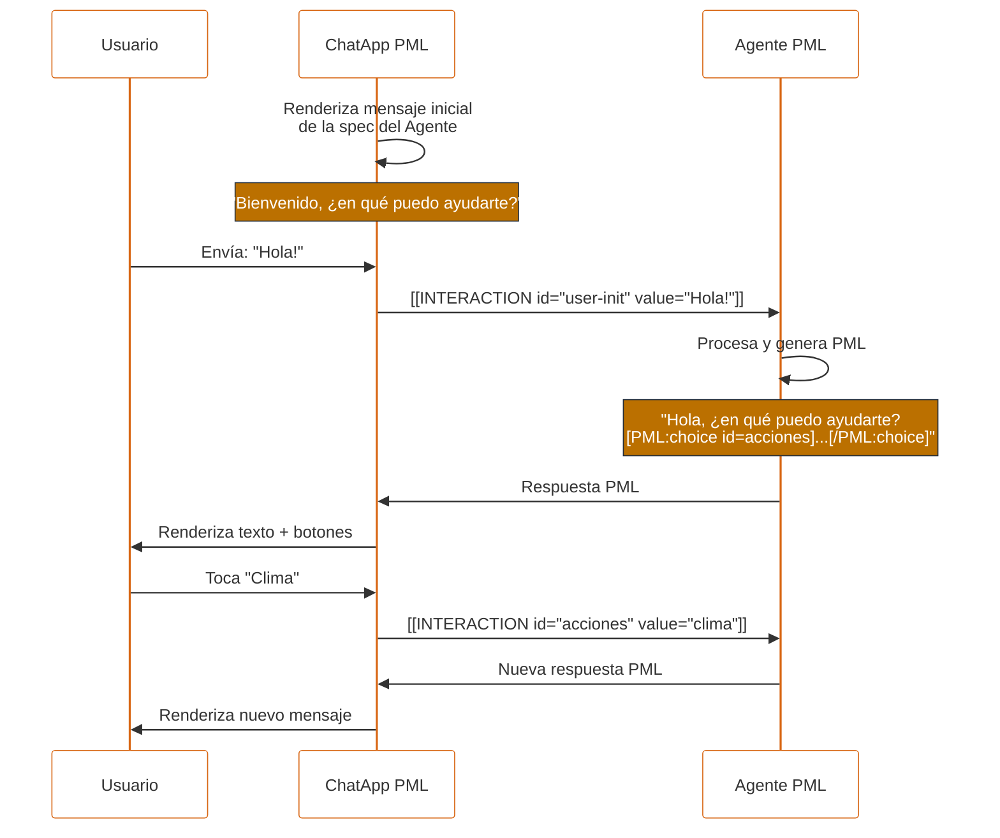

# PML — PEPPO Markup Language

## Especificación completa v1.6.1

**PEPPO** — Platform for Engaging People and Processes via Omni-agents

> **v1.6.1 (Mayo 2026).** Agrega accion cancel nativa al `form`: atributo `cancel-label` + interaccion de cancelacion con bracket vacio `[[INTERACTION id="form-id"]]`. Cuando esta presente, la ChatApp renderiza un boton secundario de cancelacion junto al submit. Cancelar emite una interaccion con solo el atributo `id` (sin `value`, sin `field-*`), permitiendo al agente distinguir cancelacion de envio. Ver §6.5.
>
> **v1.6 (Mayo 2026).** Limpia la serialización del bracket multi-campo introducido en v1.5: los campos de un `form` se serializan con prefijo `field-*` (`field-nombre="..."`, `field-email="..."`). Esto elimina la regla artificial "no usar `id="id"` ni `id="value"` en hijos del form" y hace explícita la frontera entre metadata del bracket y campos del form. Los IDs declarativos de los hijos siguen siendo libres (cualquier kebab-case válido). v1.6 es **aditivo**: los renderers v1.6 aceptan brackets v1.5 sin prefijo durante la transición; los renderers v1.5 que reciban un bracket v1.6 ignoran los `field-*` desconocidos y procesan solo `id`. Ver Apéndice E.

---

## Índice

- [1. Visión general](#1-visión-general)
    - [1.1 Vocabulario](#11-vocabulario)
    - [1.2 Interacción entre los componentes](#12-interacción-entre-los-componentes)
    - [1.3 Principios de diseño](#13-principios-de-diseño)
- [2. ChatApp PML](#2-chatapp-pml)
- [3. Agente PML](#3-agente-pml)
- [4. Sintaxis de PML](#4-sintaxis-de-pml)
    - [4.1 Formato general](#41-formato-general)
    - [4.2 Componente autofinalizado](#42-componente-autofinalizado)
    - [4.3 Componente contenedor](#43-componente-contenedor)
    - [4.4 Reglas léxicas estrictas](#44-reglas-léxicas-estrictas)
    - [4.5 Ejemplo de mensaje válido](#45-ejemplo-de-mensaje-válido)
    - [4.6 Tipos de componentes](#46-tipos-de-componentes)
    - [4.7 Atributos globales](#47-atributos-globales)
- [5. Componentes de información](#5-componentes-de-información)
    - [5.1 text](#51-text)
    - [5.2 markdown](#52-markdown)
    - [5.3 facts](#53-facts)
    - [5.4 dtable](#54-dtable)
    - [5.5 image](#55-image)
    - [5.6 media](#56-media)
    - [5.7 divider](#57-divider)
    - [5.8 raw](#58-raw)
- [6. Componentes de interacción](#6-componentes-de-interacción)
    - [6.1 input](#61-input)
    - [6.2 toggle](#62-toggle)
    - [6.3 choice](#63-choice)
    - [6.4 confirm](#64-confirm)
    - [6.5 form](#65-form)
- [7. Modelo de interacción](#7-modelo-de-interacción)
    - [7.1 Formato de la interacción](#71-formato-de-la-interacción)
    - [7.2 URL encoding de valores](#72-url-encoding-de-valores)
    - [7.3 Escalabilidad: interacciones multi-campo](#73-escalabilidad-interacciones-multi-campo)
    - [7.4 Flujo de conversación](#74-flujo-de-conversación)
    - [7.5 Ejemplo de conversación completa](#75-ejemplo-de-conversación-completa)
    - [7.6 Actualización de estado](#76-actualización-de-estado)
- [8. Reglas de composición](#8-reglas-de-composición)
- [9. Guías para LLMs / Agentes](#9-guías-para-llms--agentes)
- [10. Guías de UX para móviles del ChatApp](#10-guías-de-ux-para-móviles-del-chatapp)
- [11. Manejo de errores](#11-manejo-de-errores)
- [12. Versionado y extensibilidad](#12-versionado-y-extensibilidad)
- [Apéndice A — Referencia rápida](#apéndice-a--referencia-rápida)
- [Apéndice B — EBNF completo](#apéndice-b--ebnf-completo)
- [Apéndice C — Migración v1.3 → v1.4](#apéndice-c--migración-v13--v14)
- [Apéndice D — Migración v1.4 → v1.5](#apéndice-d--migración-v14--v15)
- [Apéndice E — Migración v1.5 → v1.6](#apéndice-e--migración-v15--v16)
- [Apéndice F — Migración v1.6 → v1.6.1](#apéndice-f--migración-v16--v161)

---

## 1. Visión general

**PML** es un lenguaje ligero, legible para LLMs y eficiente en tokens, diseñado para que los agentes conversacionales rendericen componentes UI interactivos dentro de interfaces de chat.

PML convierte los clásicos ChatBots en **Agentes de Interacción** ricos en funcionalidades: el agente no solo emite texto, también emite componentes que el usuario puede tocar, llenar, confirmar o cancelar.

### 1.1 Vocabulario

| Término         | Definición                                                                                                                                         |
| --------------- | -------------------------------------------------------------------------------------------------------------------------------------------------- |
| **PML**         | El lenguaje de marcado descrito en este documento.                                                                                                 |
| **Componente**  | Una unidad sintáctica de PML, ya sea autofinalizada (`[PML:tipo /]`) o contenedora (`[PML:tipo] ... [/PML:tipo]`).                                 |
| **Agente PML**  | Un LLM configurado para generar y consumir PML.                                                                                                    |
| **ChatApp PML** | La interfaz que renderiza el PML y captura interacciones del usuario. Puede ser app móvil, web o escritorio.                                       |
| **Mensaje**     | Un bloque de texto producido por el agente o por el usuario; puede mezclar libremente texto plano y componentes PML.                               |
| **Interacción** | El resultado serializado de una acción del usuario sobre un componente interactivo. Se transmite como `[[INTERACTION id="..." value="..."]]`.      |
| **Tarea**       | Ciclo de vida de una interacción individual: render → captura → cierre. Una conversación contiene cero, una o muchas tareas a lo largo del tiempo. |

### 1.2 Interacción entre los componentes

El usuario inicia una conversación con la ChatApp. La ChatApp envía el mensaje al Agente PML. El Agente PML analiza el mensaje y genera una respuesta en PML. La ChatApp renderiza ese PML. El usuario interactúa con los componentes y la ChatApp captura la interacción, la serializa como `[[INTERACTION]]` y la envía de vuelta al Agente PML. El Agente PML procesa la interacción y genera nuevo PML, repitiendo el ciclo.

Caso de uso ilustrativo:

- Usuario: "Hola!"
- Agente PML: "Hola! ¿En qué puedo ayudarte?" + botones `Clima`, `Noticias`, `Traductor`, `Cancelar`.
- Usuario toca `Clima`.
- Agente PML: "El clima en MiCiudad es de 20 grados." + los mismos botones.
- Usuario toca `Cancelar`.
- Agente PML: "Saludos, ¿en qué más puedo ayudarte?"



### 1.3 Principios de diseño

```
- Interaction-first   →  El agente genera interacciones con la UI, no solo texto
- Token-efficient     →  Más compacto que JSON, XML o cualquier alternativa
- LLM-friendly        →  Sintaxis regular y predecible, fácil de generar sin errores
- Mobile-native       →  Diseñado para flujos conversacionales en móvil
- UILogic-first       →  La lógica de la UI vive en el frontend, no en el agente
- Extensible          →  Nuevos componentes y nuevos campos sin romper compatibilidad
- No-JSON             →  Bracket syntax homogénea, sin estructuras anidadas tipo objeto
```

---

## 2. ChatApp PML

La ChatApp es la interfaz que permite a los usuarios interactuar con los Agentes PML. Es responsable de:

- Renderizar los componentes PML que recibe del agente.
- Capturar las interacciones del usuario sobre componentes interactivos.
- Serializar esas interacciones como `[[INTERACTION ...]]` y enviarlas al agente.
- Procesar las nuevas respuestas y continuar el ciclo.

**Agnosticidad del motor.** La ChatApp PML es agnóstica al motor del agente: no sabe qué LLM produce el PML, solo sabe que debe renderizarlo. Esto permite implementar ChatApps específicas para Android, iOS, Web, Desktop, etc., cada una con su propio renderizador nativo, sin acoplamiento al backend.

---

## 3. Agente PML

Un **Agente PML** es un LLM (Large Language Model) configurado para:

1. Generar respuestas en PML, no solo en texto plano.
2. Recibir y procesar interacciones (`[[INTERACTION ...]]`) provenientes de la ChatApp.
3. Decidir cuándo emitir componentes interactivos y cuándo solo narrativa.

**Agnosticidad del LLM.** El Agente PML es agnóstico al motor LLM: puede implementarse con GPT, Claude, Gemini, Llama, etc. Lo único que define a un Agente PML es su capacidad de producir y consumir PML correctamente.

**Prompt base.** El prompt del agente debe incluir, como mínimo:

- Una explicación de la sintaxis de PML (la subsección de la spec aplicable a su dominio).
- Instrucciones explícitas sobre cómo **decodificar** los valores URL-encoded que llegan en las interacciones del usuario.
- Ejemplos representativos del dominio del agente.

> No es recomendable incluir la especificación completa de PML en el prompt base; basta con el subconjunto necesario para el dominio del agente. Incluir todo puede degradar la calidad de generación.

---

## 4. Sintaxis de PML

### 4.1 Formato general

PML se escribe como texto plano UTF-8. En un mismo mensaje pueden coexistir libremente texto plano y componentes PML.

Todo componente PML tiene una de dos formas:

- **Autofinalizado:** `[PML:tipo atributo-1="valor-1" atributo-2="valor-2" /]`
- **Contenedor:** `[PML:tipo atributo="valor"] contenido hijo [/PML:tipo]`

### 4.2 Componente autofinalizado

Componentes sin contenido hijo. Terminan obligatoriamente con ` /]` (con espacio antes de `/]`).

```
[PML:tipo atributo-1="valor-1" atributo-2="valor-2" /]
```

### 4.3 Componente contenedor

Componentes con contenido hijo (otros componentes o texto, según las reglas de composición de §8).

```
[PML:tipo atributo="valor"]
  contenido hijo
[/PML:tipo]
```

### 4.4 Reglas léxicas estrictas

| Regla                 | Detalle                                                                                                                                       |
| --------------------- | --------------------------------------------------------------------------------------------------------------------------------------------- |
| **Encoding**          | Todo el contenido es UTF-8.                                                                                                                   |
| **Case**              | Los nombres de componentes y atributos van en `lowercase` o `kebab-case`. Nunca `camelCase`, nunca `snake_case`, nunca mayúsculas.            |
| **Atributos**         | Sintaxis: `nombre="valor"`. Los nombres siguen `[a-z][a-z0-9-]*`.                                                                             |
| **Comillas**          | Los valores se delimitan con `"` (preferido) o `'`. Nunca mezclar el mismo atributo.                                                          |
| **Comillas anidadas** | Si un valor contiene la misma comilla que lo delimita, usar entidades HTML (`&quot;`, `&#39;`).                                               |
| **Prohibido**         | No JSON, no `< >`, no caracteres `[` `]` literales fuera de los componentes ni dentro de los valores de atributo.                             |
| **IDs**               | Todo componente interactivo **debe** declarar `id="..."`. Formato: `kebab-case`, sin espacios ni caracteres especiales, no inicia con dígito. |
| **Unicidad**          | Los `id` son únicos dentro de un mensaje.                                                                                                     |
| **Autofinalizado**    | Termina obligatoriamente con un espacio antes del slash: ` /]`.                                                                               |
| **Cierre**            | Los contenedores se cierran con `[/PML:tipo]`. El nombre del tipo debe coincidir exactamente con el de apertura.                              |
| **Escapado**          | No existen secuencias de escape con `\`. Use entidades HTML o `[PML:raw]` cuando necesite literales.                                          |

> El URL encoding aplica a **valores de interacciones**, no a atributos de componentes PML emitidos por el agente. Ver §7.2.

### 4.5 Ejemplo de mensaje válido

```
Hola Pedro, ¿qué deseas hacer hoy?
[PML:choice id="acciones"]
  [PML:opt id="book"   value="Reservar cita" /]
  [PML:opt id="prices" value="Ver precios"   /]
[/PML:choice]
```

### 4.6 Tipos de componentes

**Componentes de información (pasivos):**

- `text` — Texto estático con estilo
- `markdown` — Texto con formato Markdown
- `facts` — Lista de pares clave-valor
- `dtable` — Tabla de datos
- `image` — Imagen estática
- `media` — Video o audio
- `divider` — Separador horizontal
- `raw` — Bloque de texto sin procesar (escape)

**Componentes de interacción (interactivos):**

- `input` — Campo de entrada (texto, número, fecha, archivo, etc.)
- `toggle` — Interruptor binario
- `choice` — Selección entre opciones
- `confirm` — Diálogo de confirmación
- `form` — Contenedor de campos con submit único (emite una sola `[[INTERACTION]]` multi-campo)

**Componentes auxiliares (solo válidos dentro de su contenedor):**

- `opt` — Opción dentro de `choice`
- `fact` — Entrada dentro de `facts`
- `dtrow`, `dtcol` — Fila y celda dentro de `dtable`

Los componentes de información se renderizan automáticamente en el flujo del chat. Los componentes de interacción requieren manejo especial: la ChatApp captura la acción del usuario y emite `[[INTERACTION]]` al agente.

### 4.7 Atributos globales

Estos atributos pueden aplicarse a cualquier componente, salvo las restricciones notadas:

| Atributo   | Aplicable a  | Tipo             | Descripción                                                          |
| ---------- | ------------ | ---------------- | -------------------------------------------------------------------- |
| `id`       | Todos        | string           | Identificador. **Obligatorio en interactivos**, opcional en pasivos. |
| `disabled` | Interactivos | `true` / `false` | Deshabilita la interacción. Default: `false`.                        |
| `visible`  | Todos        | `true` / `false` | Si es `false`, el componente no se renderiza. Default: `true`.       |
| `tooltip`  | Todos        | string           | Texto de ayuda al mantener presionado (mobile) o hover (desktop).    |
| `error`    | Interactivos | string           | Mensaje de error asociado. Se renderiza debajo del componente.       |

---

## 5. Componentes de información

Solo deben usarse para mostrar información al usuario. No emiten interacciones.

### 5.1 text

Bloque de texto estático con estilo.

| Atributo | Requerido | Tipo                                                 | Descripción                           |
| -------- | --------- | ---------------------------------------------------- | ------------------------------------- |
| `type`   | No        | `header` / `title` / `paragraph` / `muted` / `label` | Tipo semántico. Default: `paragraph`. |
| `style`  | No        | `bold` / `italic` / `muted` / `normal`               | Estilo visual. Default: `normal`.     |
| `size`   | No        | `small` / `medium` / `large`                         | Tamaño. Default: `medium`.            |
| `align`  | No        | `left` / `center` / `right`                          | Alineación. Default: `left`.          |

```
[PML:text type="header" size="large" style="bold"]
Tu pedido está en camino
[/PML:text]

[PML:text type="muted" size="small"]
Estimamos entrega en 3-5 días hábiles
[/PML:text]
```

### 5.2 markdown

Bloque de texto con formato Markdown completo.

| Atributo | Requerido | Tipo   | Descripción   |
| -------- | --------- | ------ | ------------- |
| `id`     | No        | string | Identificador |

```
[PML:markdown]
### Instrucciones de envío

1. **Empaca** el producto en su caja original
2. **Pega** la etiqueta de envío en la parte exterior
3. **Lleva** el paquete a cualquier centro de envío

> El reembolso se procesa en 5-7 días hábiles.

Para más info visita nuestra [guía de envíos](https://peppo.com/envios).
[/PML:markdown]
```

**Soporta:** negritas, cursivas, listas, enlaces, código inline, blockquotes, encabezados.

**Nota de parsing:** los corchetes propios de Markdown (`[texto](url)`) son seguros. El parser solo activa el modo PML cuando encuentra exactamente `[PML:`.

### 5.3 facts

Tabla de pares clave-valor.

| Atributo  | Requerido | Tipo      | Descripción                       |
| --------- | --------- | --------- | --------------------------------- |
| `columns` | No        | `1` / `2` | Columnas de layout. Default: `1`. |

**Contenido:** uno o más `[PML:fact label="..." value="..." /]` como hijos directos.

```
[PML:facts]
  [PML:fact label="Producto" value="Nike Air Max 90" /]
  [PML:fact label="Talla"    value="42"              /]
  [PML:fact label="Precio"   value="$2,499 MXN"      /]
  [PML:fact label="Envío"    value="Gratis"          /]
[/PML:facts]
```

### 5.4 dtable

Tabla de datos genérica.

| Atributo  | Requerido | Tipo   | Descripción                              |
| --------- | --------- | ------ | ---------------------------------------- |
| `columns` | Sí        | string | Nombres de columnas separados por comas. |

**Contenido:** filas envueltas en `[PML:dtrow] ... [/PML:dtrow]`. Cada celda es un `[PML:dtcol value="..." /]` autofinalizado. El número de celdas por fila debe coincidir con el número de columnas declaradas.

```
[PML:dtable columns="Plan,Precio,Agentes,Mensajes"]
  [PML:dtrow]
    [PML:dtcol value="Básico" /][PML:dtcol value="$9/mes"  /][PML:dtcol value="1"  /][PML:dtcol value="100/día"   /]
  [/PML:dtrow]
  [PML:dtrow]
    [PML:dtcol value="Pro"    /][PML:dtcol value="$29/mes" /][PML:dtcol value="10" /][PML:dtcol value="Ilimitado" /]
  [/PML:dtrow]
[/PML:dtable]
```

### 5.5 image

Imagen estática.

| Atributo  | Requerido | Tipo                                  | Descripción                |
| --------- | --------- | ------------------------------------- | -------------------------- |
| `url`     | Sí        | url                                   | URL de la imagen.          |
| `alt`     | No        | string                                | Texto alternativo.         |
| `size`    | No        | `small` / `medium` / `large` / `full` | Tamaño. Default: `medium`. |
| `caption` | No        | string                                | Pie de imagen.             |

```
[PML:image url="https://cdn.peppo.com/producto.jpg" alt="Nike Air Max 90"
  size="large" caption="Nuevo modelo 2026" /]
```

### 5.6 media

Reproductor de video o audio.

| Atributo  | Requerido | Tipo              | Descripción                     |
| --------- | --------- | ----------------- | ------------------------------- |
| `url`     | Sí        | url               | URL del archivo.                |
| `type`    | Sí        | `video` / `audio` | Tipo de medio.                  |
| `poster`  | No        | url               | Imagen de portada (solo video). |
| `caption` | No        | string            | Pie de medio.                   |

```
[PML:media url="https://cdn.peppo.com/demo.mp4" type="video"
  poster="https://cdn.peppo.com/demo-poster.jpg" /]
```

### 5.7 divider

Línea separadora.

| Atributo | Requerido | Tipo   | Descripción              |
| -------- | --------- | ------ | ------------------------ |
| `label`  | No        | string | Texto centrado opcional. |

```
[PML:divider /]
[PML:divider label="O continúa con" /]
```

### 5.8 raw

Bloque de texto plano que desactiva el parser de PML. Permite mostrar sintaxis PML literal sin que sea interpretada.

```
[PML:raw]
Para mostrar un texto en negritas, utiliza el componente text:
[PML:text style="bold"]Texto en negritas[/PML:text]
[/PML:raw]
```

> Dentro de `[PML:raw]` no existen atributos. El parser solo busca el cierre exacto `[/PML:raw]`.

---

## 6. Componentes de interacción

Los componentes interactivos generan una `[[INTERACTION]]` cuando el usuario completa su acción (envío, selección, toggle, confirmación). El formato exacto de la interacción se especifica en §7.

### 6.1 input

Campo de entrada de datos. El subtipo se selecciona con el atributo `type`.

**Subtipos disponibles:**

- `text` — Campo de texto (single o multilínea)
- `number` — Campo numérico
- `currency` — Campo monetario
- `contact` — Captura de contacto (teléfono) del sistema
- `date` — Selector de fecha
- `time` — Selector de hora
- `datetime` — Selector de fecha y hora
- `location` — Selector de ubicación / GPS
- `file` — Selector de archivo

**Atributos comunes a todos los `input`:**

| Atributo   | Requerido | Tipo                | Descripción                     |
| ---------- | --------- | ------------------- | ------------------------------- |
| `id`       | Sí        | string              | Identificador único.            |
| `type`     | Sí        | string              | Subtipo (ver lista arriba).     |
| `label`    | No        | string              | Etiqueta visible.               |
| `required` | No        | `true` / `false`    | Obligatorio. Default: `false`.  |
| `readonly` | No        | `true` / `false`    | Solo lectura. Default: `false`. |
| `value`    | No        | depende del subtipo | Valor inicial.                  |

#### 6.1.1 input type="text"

| Atributo        | Requerido | Tipo    | Descripción                                   |
| --------------- | --------- | ------- | --------------------------------------------- |
| `placeholder`   | No        | string  | Texto de ayuda.                               |
| `multiline`     | No        | boolean | Campo multilínea. Default: `false`.           |
| `validate`      | No        | string  | Expresión regular de validación local.        |
| `error-message` | No        | string  | Mensaje a mostrar si la validación falla.     |
| `max-length`    | No        | number  | Máximo de caracteres.                         |
| `min-length`    | No        | number  | Mínimo de caracteres.                         |
| `password`      | No        | boolean | Oculta el texto al teclear. Default: `false`. |

```
[PML:input id="nombre" type="text" label="Nombre completo"
  placeholder="Ingresa tu nombre" required="true" /]
```

**Interacción generada:**

```
[[INTERACTION id="nombre" value="Juan+Perez"]]
```

Con `multiline="true"`:

```
[PML:input id="comentarios" type="text" label="Comentarios"
  multiline="true" placeholder="Escribe tus comentarios" /]
```

```
[[INTERACTION id="comentarios" value="Primera+l%C3%ADnea%0ASegunda+l%C3%ADnea"]]
```

> Los saltos de línea se codifican como `%0A` (ver §7.2).

#### 6.1.2 input type="number"

| Atributo      | Requerido | Tipo    | Descripción                        |
| ------------- | --------- | ------- | ---------------------------------- |
| `placeholder` | No        | string  | Texto de ayuda.                    |
| `integer`     | No        | boolean | Solo enteros. Default: `false`.    |
| `decimals`    | No        | number  | Número de decimales. Default: `0`. |
| `min`         | No        | number  | Valor mínimo.                      |
| `max`         | No        | number  | Valor máximo.                      |

```
[PML:input id="edad" type="number" label="Edad" integer="true" min="18" max="99" /]
```

```
[[INTERACTION id="edad" value="25"]]
```

```
[PML:input id="estatura" type="number" label="Estatura"
  placeholder="1.75" decimals="2" /]
```

```
[[INTERACTION id="estatura" value="1.75"]]
```

#### 6.1.3 input type="currency"

| Atributo      | Requerido | Tipo   | Descripción                                          |
| ------------- | --------- | ------ | ---------------------------------------------------- |
| `placeholder` | No        | string | Texto de ayuda.                                      |
| `currency`    | No        | string | Código ISO 4217 (`MXN`, `USD`, ...). Default: `MXN`. |
| `decimals`    | No        | number | Número de decimales. Default: `2`.                   |
| `min`         | No        | number | Valor mínimo.                                        |
| `max`         | No        | number | Valor máximo.                                        |

```
[PML:input id="monto" type="currency" label="Monto"
  currency="MXN" min="1" max="10000" /]
```

**Interacción generada** (valor numérico crudo, sin símbolos):

```
[[INTERACTION id="monto" value="1500.50"]]
```

> El valor de la interacción es siempre el número crudo (sin símbolo de moneda, sin separadores de miles, con punto decimal). La presentación visual con símbolo y separadores es responsabilidad del renderer.

#### 6.1.4 input type="contact"

Recaba el número de teléfono del usuario usando los mecanismos nativos de la ChatApp (selector de contactos, autorrelleno, etc.). No tiene atributos adicionales.

```
[PML:input id="telefono" type="contact" label="Toca para compartir tu teléfono" required="true" /]
```

```
[[INTERACTION id="telefono" value="%2B5215512345678"]]
```

> El `+` inicial del E.164 se URL-codifica como `%2B`.

#### 6.1.5 input type="date"

Selector de fecha. El valor de la interacción es ISO 8601 (`YYYY-MM-DD`).

| Atributo      | Requerido | Tipo   | Descripción                |
| ------------- | --------- | ------ | -------------------------- |
| `placeholder` | No        | string | Texto de ayuda.            |
| `min`         | No        | string | Fecha mínima `YYYY-MM-DD`. |
| `max`         | No        | string | Fecha máxima `YYYY-MM-DD`. |

```
[PML:input id="fecha" type="date" label="Fecha de la cita" /]
```

```
[[INTERACTION id="fecha" value="2026-06-15"]]
```

#### 6.1.6 input type="time"

Selector de hora. **El valor de la interacción es siempre `HH:mm` en formato 24 horas, independientemente del modo de presentación.** El atributo `am-pm` solo afecta la UI.

| Atributo      | Requerido | Tipo    | Descripción                                                 |
| ------------- | --------- | ------- | ----------------------------------------------------------- |
| `placeholder` | No        | string  | Texto de ayuda.                                             |
| `am-pm`       | No        | boolean | Presenta selector AM/PM al usuario. Default: `false` (24h). |

```
[PML:input id="hora" type="time" label="Hora" am-pm="true" /]
```

```
[[INTERACTION id="hora" value="14:45"]]
```

#### 6.1.7 input type="datetime"

Selector de fecha y hora. El valor de la interacción es ISO 8601 sin zona horaria: `YYYY-MM-DDTHH:mm` (24h).

| Atributo      | Requerido | Tipo   | Descripción     |
| ------------- | --------- | ------ | --------------- |
| `placeholder` | No        | string | Texto de ayuda. |

```
[PML:input id="cita" type="datetime" label="Fecha y hora" /]
```

```
[[INTERACTION id="cita" value="2026-06-15T14:45"]]
```

#### 6.1.8 input type="location"

Selector de ubicación. El valor de la interacción es `latitud,longitud` (decimales con punto). El renderer puede ofrecer GPS del dispositivo, búsqueda de dirección o mini-mapa con pin.

```
[PML:input id="ubicacion" type="location" label="Tu ubicación" /]
```

```
[[INTERACTION id="ubicacion" value="19.4326,-99.1332"]]
```

#### 6.1.9 input type="file"

Selector de archivo único. El renderer sube el archivo a un endpoint configurado por la ChatApp y obtiene una URL que se envía como valor de la interacción.

| Atributo   | Requerido | Tipo   | Descripción                                               |
| ---------- | --------- | ------ | --------------------------------------------------------- |
| `accept`   | No        | string | Tipos MIME permitidos (ej: `image/*`, `application/pdf`). |
| `max-size` | No        | string | Tamaño máximo (ej: `5MB`, `10MB`).                        |

```
[PML:input id="foto" type="file" label="Sube tu identificación"
  accept="image/*" max-size="5MB" /]
```

```
[[INTERACTION id="foto" value="https://cdn.peppo.com/uploads/abc123.jpg"]]
```

> La URL devuelta proviene del servicio de almacenamiento de la ChatApp; no se URL-codifica porque ya es una URL válida ASCII-safe.

---

### 6.2 toggle

Interruptor binario.

| Atributo    | Requerido | Tipo             | Descripción                                                  |
| ----------- | --------- | ---------------- | ------------------------------------------------------------ |
| `id`        | Sí        | string           | Identificador único.                                         |
| `label`     | Sí        | string           | Texto descriptivo del estado activo.                         |
| `checked`   | No        | `true` / `false` | Estado inicial. Default: `false`.                            |
| `value-on`  | No        | string           | Valor que se envía cuando está activo. Default: `"true"`.    |
| `value-off` | No        | string           | Valor que se envía cuando está inactivo. Default: `"false"`. |
| `required`  | No        | `true` / `false` | Obligatorio. Default: `false`.                               |

```
[PML:toggle id="terminos" label="Acepto los términos y condiciones"
  checked="false" required="true" /]
```

**Interacción generada (activado):**

```
[[INTERACTION id="terminos" value="true"]]
```

**Con valores custom:**

```
[PML:toggle id="notif" label="Recibir notificaciones"
  value-on="suscrito" value-off="no-suscrito" /]
```

```
[[INTERACTION id="notif" value="suscrito"]]
```

---

### 6.3 choice

Selección entre opciones (botones, radio o dropdown).

| Atributo      | Requerido | Tipo                             | Descripción                           |
| ------------- | --------- | -------------------------------- | ------------------------------------- |
| `id`          | Sí        | string                           | Identificador único.                  |
| `style`       | No        | `buttons` / `dropdown` / `radio` | Renderizado. Default: `buttons`.      |
| `multi`       | No        | `true` / `false`                 | Selección múltiple. Default: `false`. |
| `placeholder` | No        | string                           | Texto inicial (solo `dropdown`).      |
| `required`    | No        | `true` / `false`                 | Obligatorio. Default: `false`.        |

**Contenido:** uno o más `[PML:opt /]` como hijos directos.

#### Atributos de `opt`

| Atributo | Requerido   | Tipo   | Descripción                                                                                                                                                     |
| -------- | ----------- | ------ | --------------------------------------------------------------------------------------------------------------------------------------------------------------- |
| `value`  | Sí          | string | Texto visible al usuario.                                                                                                                                       |
| `id`     | Condicional | string | Identificador. **Obligatorio si `value` contiene espacios, acentos o caracteres no `[a-z0-9-]`.** Si se omite y `value` es válido como id, este se usa como id. |

> **Regla simplificada:** declara siempre `id` explícito en `opt` salvo cuando el `value` sea un identificador trivial (números, palabras cortas en minúsculas sin acentos). Esto evita ambigüedad y reduce errores del LLM.

#### Selección simple

```
[PML:choice id="talla" style="buttons"]
  [PML:opt value="38" /]
  [PML:opt value="39" /]
  [PML:opt value="40" /]
  [PML:opt value="42" /]
[/PML:choice]
```

```
[[INTERACTION id="talla" value="42"]]
```

#### Con ids explícitos

```
[PML:choice id="accion"]
  [PML:opt id="reservar" value="Reservar cita" /]
  [PML:opt id="precios"  value="Ver precios"   /]
  [PML:opt id="cancelar" value="Cancelar"      /]
[/PML:choice]
```

```
[[INTERACTION id="accion" value="reservar"]]
```

#### Selección múltiple

Cuando `multi="true"`, los ids seleccionados se concatenan en `value` separados por coma sin espacios.

```
[PML:choice id="dias" multi="true"]
  [PML:opt id="lun" value="Lunes"     /]
  [PML:opt id="mar" value="Martes"    /]
  [PML:opt id="mie" value="Miércoles" /]
[/PML:choice]
```

```
[[INTERACTION id="dias" value="lun,mar"]]
```

---

### 6.4 confirm

Diálogo de confirmación. Renderiza un modal con dos acciones: aceptar o cancelar.

| Atributo        | Requerido | Tipo                             | Descripción                                              |
| --------------- | --------- | -------------------------------- | -------------------------------------------------------- |
| `id`            | Sí        | string                           | Identificador único.                                     |
| `title`         | Sí        | string                           | Título del diálogo.                                      |
| `message`       | No        | string                           | Mensaje descriptivo.                                     |
| `confirm-label` | No        | string                           | Texto del botón de confirmación. Default: `"Confirmar"`. |
| `cancel-label`  | No        | string                           | Texto del botón de cancelación. Default: `"Cancelar"`.   |
| `style`         | No        | `default` / `danger` / `warning` | Estilo visual. Default: `default`.                       |

**El valor devuelto en la interacción es semántico y fijo: `confirmed` o `cancelled`**, independientemente del idioma del texto del botón.

```
[PML:confirm id="eliminar-cuenta" title="¿Eliminar tu cuenta?"
  message="Se borrarán todos tus datos."
  confirm-label="Sí, eliminar" cancel-label="No, conservar" style="danger" /]
```

**Si el usuario confirma:**

```
[[INTERACTION id="eliminar-cuenta" value="confirmed"]]
```

**Si el usuario cancela:**

```
[[INTERACTION id="eliminar-cuenta" value="cancelled"]]
```

---

### 6.5 form

Contenedor de campos con **submit y cancel opcional**. Un `form` válido debe contener al menos un hijo interactivo (`input`, `toggle` o `choice`). Es el primer componente PML que captura múltiples valores en una sola acción: cuando el usuario presiona el botón submit y la validación local pasa, la ChatApp emite **una sola** `[[INTERACTION]]` con un atributo `field-<id>` por cada hijo interactivo (formato multi-campo de §7.3). Cuando `cancel-label` está presente, la ChatApp también renderiza un botón de cancelación que emite una interacción vacía (sin campos, sin value).

#### Atributos

| Atributo       | Requerido | Tipo   | Descripción                                            |
| -------------- | --------- | ------ | ------------------------------------------------------ |
| `id`           | Sí        | string | Identificador único del formulario (kebab-case).       |
| `submit-label` | No        | string | Texto del botón de envío. Default: `"Enviar"`.         |
| `cancel-label` | No        | string | Texto del botón de cancelación. Si se omite, no se renderiza botón de cancel. Cuando está presente, la ChatApp muestra un botón secundario junto al submit. |

#### Hijos permitidos

| Hijo                                                                          | Permitido | Notas                                                                                       |
| ----------------------------------------------------------------------------- | --------- | ------------------------------------------------------------------------------------------- |
| Pasivos simples: `text`, `markdown`, `divider`, `image`, `media`, `raw`       | Sí        | Para etiquetas, instrucciones, separadores visuales, secciones narrativas.                  |
| Pasivo contenedor: `facts`                                                    | Sí        | Útil para mostrar resúmenes readonly antes del submit (`form > facts > fact` = 3 niveles).  |
| Interactivos: `input` (todos los subtipos), `toggle`, `choice` (single y multi) | Sí      | Cada uno contribuye **un atributo** `field-<id>` al `[[INTERACTION]]` final (§7.3). |
| `dtable`                                                                      | **No**    | Excedería la profundidad máxima de 3 (`form > dtable > dtrow > dtcol` = 4).                |
| `confirm`                                                                     | **No**    | Confirm es una acción modal autocontenida; mezclarlo con form crea ambigüedad de submit.    |
| `form` anidado                                                                | **No**    | v1.5 prohíbe forms anidados; el agente debe usar flujos separados.                          |

#### Condición de validez: al menos una interacción

Un `form` es válido solo si contiene al menos un hijo interactivo directo: `input`, `toggle` o `choice`.

Los hijos pasivos (`text`, `markdown`, `divider`, `image`, `media`, `raw`, `facts`) pueden enmarcar, explicar o resumir el form, pero no pueden ser el único contenido dentro de él. Un form solo narrativo con botón submit no es un form; usa un `choice` con un `opt` para un CTA, o `confirm` cuando la acción necesita aceptación/cancelación explícita.

#### Comportamiento de submit y cancel

**Ruta de submit:**

1. El usuario edita libremente los hijos interactivos del form. **Mientras el form está activo, sus hijos no emiten `[[INTERACTION]]` individuales** — sus valores quedan en estado local de la ChatApp.
2. El usuario presiona el botón submit (texto: `submit-label`).
3. La ChatApp ejecuta **validación local** en todos los hijos interactivos:
   - `required="true"` → el valor no debe estar vacío.
   - `validate="<regex>"` → el valor debe hacer match (input text).
   - `min` / `max` → rango numérico (input number, currency).
   - `min-length` / `max-length` → rango de longitud (input text).
   - El tipo específico (date, datetime, location, etc.) debe estar bien formado.
4. **Si alguna validación falla**:
   - La ChatApp inyecta `error="..."` en cada hijo fallido (usando el `error-message` del componente si está definido, o un default genérico del renderer).
   - **No** se emite `[[INTERACTION]]`. El form permanece en `live_capture`.
   - El usuario corrige y vuelve a pulsar submit.
5. **Si todas las validaciones pasan**:
   - La ChatApp emite una sola `[[INTERACTION]]` con el `id` del form y un atributo `field-<sub-id>` por cada hijo interactivo.
   - El form transiciona a `final_rendering`.

**Ruta de cancel** (solo cuando `cancel-label` está presente):

1. El usuario presiona el botón de cancelación (texto: `cancel-label`).
2. La ChatApp emite una **interacción vacía** — solo el `id` del form, sin `value`, sin atributos `field-*`:
   ```
   [[INTERACTION id="form-id"]]
   ```
3. **No se ejecuta validación.** El form transiciona directamente a `final_rendering`.
4. El agente recibe el bracket vacío y lo interpreta como cancelación: no se envió data, el usuario quiere salir del formulario.

**Cómo distingue el agente submit de cancel:**

| Bracket recibido | Significado |
| --- | --- |
| `[[INTERACTION id="X" field-a="..." field-b="..."]]` | Submit: campos presentes, procesar los datos. |
| `[[INTERACTION id="X"]]` | Cancel cuando `cancel-label` está presente. Un submit sin atributos `field-*` es inválido porque un form válido debe tener al menos un hijo interactivo. |

#### Serialización de la interacción

Para un form con hijos interactivos `child-1`, `child-2`, ..., `child-n` con valores `v1`, `v2`, ..., `vn`:

```
[[INTERACTION id="form-id" field-child-1="v1" field-child-2="v2" ... field-child-n="vn"]]
```

**Reglas precisas:**

- **Cada hijo interactivo del form contribuye exactamente un atributo** prefijado con `field-` al bracket. El sufijo es el `id` declarado del hijo. El **valor** es el valor capturado, URL-codificado según §7.2 cuando provenga de texto libre del usuario.
- **Siempre se incluyen todos** los hijos interactivos del form, incluso si están `disabled`, `readonly`, o el usuario no los tocó (en cuyo caso el valor es la cadena vacía `""` o el `value` inicial declarado por el agente).
- Para `choice multi="true"`, los ids seleccionados se serializan **separados por coma** dentro del valor (igual que un choice standalone): `field-dias="lun,mar,mie"`.
- Para `toggle`, el valor es `value-on` o `value-off` según corresponda (default `"true"` / `"false"`).
- El orden de los atributos en la serialización debe respetar el orden de los hijos en el form (recomendación de legibilidad; no es semántico).
- **No hay IDs prohibidos en los hijos del form.** Los IDs declarativos viven en su propio espacio de nombres: `id="id"`, `id="value"`, `id="error"` son válidos porque al serializar se vuelven `field-id`, `field-value`, `field-error`, sin colisión con los nombres reservados del bracket (`id`, `value`).

#### Espacios de nombres del bracket

| Atributo del bracket    | Significado                                                      |
| ----------------------- | ---------------------------------------------------------------- |
| `id`                    | Identifica el componente raíz que originó la interacción.        |
| `value`                 | (Modo single-value) Valor capturado de un componente atómico.    |
| `field-<sub-id>`        | (Modo multi-campo) Valor capturado del hijo `<sub-id>` del form. |
| (sin otros atributos)   | (Modo cancel) El form fue cancelado — solo `id`, sin datos.      |
| Otros nombres pelados   | Reservados a futuras extensiones de metadata. **No usar.**       |

> **Por qué el prefijo `field-`.** v1.5 había escogido nombres pelados (`nombre="..."`) para los campos del form, obligando a marcar `id` y `value` como IDs prohibidos en hijos. v1.6 aísla el espacio de campos con el prefijo `field-`: los IDs declarativos vuelven a ser libres y el bracket queda auto-descriptivo (cualquier atributo `field-*` es siempre un campo del form, sin importar la versión del agente que lo generó).

#### Ejemplo: registro de usuario

```
[PML:form id="registro" submit-label="Crear cuenta" cancel-label="Cancelar"]
  [PML:text type="header" style="bold"]Crea tu cuenta[/PML:text]

  [PML:input id="nombre" type="text" label="Nombre completo"
    required="true" /]

  [PML:input id="email" type="text" label="Email"
    required="true"
    validate="^[^@]+@[^@]+\.[^@]+$"
    error-message="Email inválido" /]

  [PML:input id="telefono" type="contact" label="Teléfono" /]

  [PML:input id="fecha-nacimiento" type="date" label="Fecha de nacimiento"
    required="true" /]

  [PML:choice id="plan" required="true"]
    [PML:opt id="basico" value="Básico" /]
    [PML:opt id="pro"    value="Pro"    /]
  [/PML:choice]

  [PML:toggle id="acepta-terminos"
    label="Acepto términos y condiciones" required="true" /]
[/PML:form]
```

**Submit válido — interacción generada:**

```
[[INTERACTION id="registro"
  field-nombre="Pedro+Garc%C3%ADa"
  field-email="pedro%40ejemplo.com"
  field-telefono="%2B5215512345678"
  field-fecha-nacimiento="1990-03-15"
  field-plan="pro"
  field-acepta-terminos="true"]]
```

#### Validación servidor: re-render con errores

Cuando el backend rechaza el submit (p.ej. el email ya está registrado), el agente aplica la regla de actualización de estado de §7.6: re-emite el **mismo form con el mismo `id`**, preserva los valores previos vía el atributo `value` de cada hijo y añade `error="..."` al hijo fallido.

```
[PML:form id="registro" submit-label="Crear cuenta"]
  [PML:input id="nombre" type="text" label="Nombre completo"
    value="Pedro García" required="true" /]

  [PML:input id="email" type="text" label="Email"
    value="pedro@ejemplo.com"
    validate="^[^@]+@[^@]+\.[^@]+$"
    error="Este email ya está registrado" required="true" /]

  [PML:input id="telefono" type="contact" label="Teléfono"
    value="+52 555 123 4567" /]

  [PML:input id="fecha-nacimiento" type="date" label="Fecha de nacimiento"
    value="1990-03-15" required="true" /]

  [PML:choice id="plan" required="true" value="pro"]
    [PML:opt id="basico" value="Básico" /]
    [PML:opt id="pro"    value="Pro"    /]
  [/PML:choice]

  [PML:toggle id="acepta-terminos"
    label="Acepto términos y condiciones" checked="true" required="true" /]
[/PML:form]
```

La ChatApp detecta el mismo `id` y restaura la tarea a `live_capture` sin crear un nuevo bloque en `shared_history`.

#### Layout MVP

```
┌─────────────────────────────┐
│ task_controls               │
│  ┌───────────────────────┐  │
│  │ Crea tu cuenta        │  │ ← text header
│  │                       │  │
│  │ Nombre completo       │  │ ← label
│  │ ┌───────────────────┐ │  │
│  │ │                   │ │  │ ← input
│  │ └───────────────────┘ │  │
│  │                       │  │
│  │ Email                 │  │
│  │ ┌───────────────────┐ │  │
│  │ │ pedro@e.com       │ │  │
│  │ └───────────────────┘ │  │
│  │ Email inválido        │  │ ← error inline
│  │                       │  │
│  │ Plan                  │  │
│  │ [Básico] [Pro]        │  │ ← choice
│  │                       │  │
│  │ ◉ Acepto términos     │  │ ← toggle
│  │                       │  │
│  │ ┌───────────────────┐ │  │
│  │ │   Crear cuenta    │ │  │ ← submit (primario)
│  │ └───────────────────┘ │  │
│  │                       │  │
│  │ ┌───────────────────┐ │  │
│  │ │     Cancelar      │ │  │ ← cancel (secundario, si cancel-label)
│  │ └───────────────────┘ │  │
│  └───────────────────────┘  │
└─────────────────────────────┘
```

#### Lifecycle (zonas y fases)

El form es **una sola tarea**. Atraviesa el lifecycle completo igual que cualquier otro componente interactivo:

| Fase              | Qué ocurre                                                                                                                                                                |
| ----------------- | ------------------------------------------------------------------------------------------------------------------------------------------------------------------------- |
| `first_rendering` | El form completo aparece en `task_controls`. Si el mensaje incluye narrativa **fuera** del form, esa narrativa va a `task_narrative`. Narrativa **dentro** del form se renderiza inline. |
| `live_capture`    | El usuario edita libremente cualquier hijo interactivo. Los componentes individuales **no emiten** `[[INTERACTION]]`. La validación es inerte hasta el submit.            |
| `final_rendering` | Tras submit válido, el form completo (con sus valores resueltos) se snapshotea inmutable en `shared_history`. `task_controls` y `task_narrative` se vacían.               |

#### Casos borde

- **Form sin hijos interactivos** (solo contenido pasivo + submit): inválido. El renderer omite los controles submit/cancel, renderiza el contenido pasivo como narrativa/flujo plano y loggea warning. Usa `choice` para un CTA o `confirm` para aceptación/cancelación explícita.
- **Hijo `disabled`**: se incluye en la interacción con su valor actual (el `value` inicial o vacío). El usuario no puede modificarlo, pero el agente recibe el valor para coherencia de campos.
- **Hijo `readonly`**: igual que disabled en cuanto a serialización; visualmente se muestra editable pero no acepta cambios.
- **Hijo sin valor inicial y opcional**: se incluye con valor `""` en la serialización.
- **IDs duplicados entre hijos**: el renderer aplica las reglas de §8.3 (renderiza el primero, ignora los demás; el segundo no contribuye a la interacción).
- **Hijo prohibido detectado** (ej. `confirm`, `dtable`, `form` anidado): el renderer lo trata como texto plano y lo omite de la interacción. Loggea warning.
- **Submit con cero hijos interactivos válidos**: form inválido; no se emite `[[INTERACTION]]`.
- **Compatibilidad v1.5 ↔ v1.6**: un renderer v1.6 acepta brackets sin prefijo (formato v1.5) durante el periodo de transición y los procesa como si llevaran `field-` implícito. Un agente v1.5 enviado a un renderer v1.6 sigue funcionando. Un agente v1.6 enviado a un renderer v1.5 emite atributos `field-*` que el renderer v1.5 ignora silenciosamente (regla de "atributos desconocidos se descartan"); el agente recibe la interacción degradada sin campos. Para máxima compatibilidad, el agente debe negociar versión vía la metadata del envelope antes de elegir el formato a emitir.

---

## 7. Modelo de interacción

Una **interacción** es el resultado serializado de una acción del usuario sobre un componente interactivo. La ChatApp produce la interacción y la envía al Agente PML, que la interpreta y genera la siguiente respuesta.

### 7.1 Formato de la interacción

```
[[INTERACTION id="component-id" value="user-value"]]
```

**Reglas léxicas:**

- Delimitadores: doble corchete de apertura `[[INTERACTION` y doble corchete de cierre `]]`.
- Los atributos siguen la misma sintaxis que los atributos de PML: `nombre="valor"`, con comillas dobles preferidas (o simples).
- El atributo `id` es **siempre obligatorio** y referencia el `id` del componente que originó la interacción.
- El atributo `value` contiene el valor capturado del usuario (URL-codificado según §7.2).
- El bracket `[[INTERACTION ...]]` se trata como un componente sintáctico atómico: sin contenido hijo, sin etiqueta de cierre `[[/INTERACTION]]` para el caso de un único valor.

**Mensaje completo del lado del usuario:** una interacción puede aparecer sola en el mensaje, o intercalada con texto plano si el usuario también escribió algo (caso poco frecuente; el patrón normal es una interacción aislada).

### 7.2 URL encoding de valores

Cuando la ChatApp envía valores que provienen de **texto libre del usuario**, aplica URL encoding (RFC 3986 + `+` para espacios, estilo `application/x-www-form-urlencoded`).

| Carácter | Codificación |
| -------- | ------------ |
| espacio  | `+`          |
| `&`      | `%26`        |
| `=`      | `%3D`        |
| `"`      | `%22`        |
| `'`      | `%27`        |
| `+`      | `%2B`        |
| `%`      | `%25`        |
| `\n`     | `%0A`        |
| `\r`     | `%0D`        |
| `[`      | `%5B`        |
| `]`      | `%5D`        |

**Se codifica:** valores capturados como texto libre del usuario (`input type="text"`, multilínea, etc.).

**No se codifica:**

- `id` de cualquier atributo en la interacción (siempre `kebab-case` ASCII).
- Valores `value` que provienen de IDs predefinidos por el agente o la ChatApp (opciones de `choice`, valores `confirmed`/`cancelled` de `confirm`, `true`/`false` o custom de `toggle`).
- Valores generados por sensores o el sistema (coordenadas GPS, ISO 8601 de fechas, URLs de archivos).
- Números (`input type="number"`, `currency`).

**Caracteres UTF-8 no-ASCII** (acentos, ñ, emojis, etc.): se codifican como bytes UTF-8 en hexadecimal (`%XX`). Ej: `María` → `Mar%C3%ADa`.

**Nota para el Agente (LLM):** el prompt del sistema debe instruir explícitamente al agente para **decodificar** los valores URL-encoded antes de procesarlos semánticamente.

**Ejemplo:**

```
Usuario escribe:  Pedro & María
ChatApp envía:    [[INTERACTION id="nombre" value="Pedro+%26+Mar%C3%ADa"]]
Agente decodifica: "Pedro & María"
```

### 7.3 Interacciones multi-campo

El formato `[[INTERACTION id="..." value="..."]]` se extiende **de forma natural** a componentes que capturan múltiples campos en una sola acción. La regla generativa v1.6+ para interacciones submit es:

> El bracket `[[INTERACTION ...]]` admite **uno o más atributos `field-<sub-id>`** además de `id`. Cada atributo `field-*` corresponde a un campo del componente compuesto: el sufijo es el `id` del sub-componente, el valor es el dato capturado.

**Forma canónica (un solo valor — input, choice, toggle, confirm):**

```
[[INTERACTION id="nombre" value="Pedro"]]
```

**Forma multi-campo (form, §6.5):**

```
[[INTERACTION id="form-checkout"
  field-nombre="Pedro+Garc%C3%ADa"
  field-email="pedro%40e.com"
  field-telefono="%2B5215512345678"
  field-acepta-terminos="true"]]
```

**Propiedades del diseño:**

| Propiedad             | Explicación                                                                                                                                                                                                                          |
| --------------------- | ------------------------------------------------------------------------------------------------------------------------------------------------------------------------------------------------------------------------------------ |
| **Sin JSON**          | Solo la sintaxis de atributos `nombre="valor"`, idéntica a la de PML. Ningún nivel de objeto ni array.                                                                                                                               |
| **Sin anidación**     | Toda la interacción vive en una sola línea lógica. No hay `[[FIELD ...]]` ni etiquetas de cierre.                                                                                                                                    |
| **Compatible**        | Un parser que solo entienda `id` + `value` puede ignorar atributos `field-*` y procesar el caso simple sin cambios. v1.6 → v1.5: ignora silencioso. v1.5 → v1.6: el renderer v1.6 acepta atributos sin prefijo como alias temporal. |
| **Determinista**      | Los nombres de los campos son `field-<sub-id>`, donde `<sub-id>` es el `id` del sub-componente. No hay posiciones; el orden no es semántico.                                                                                         |
| **Espacios aislados** | `id` y `value` son metadata del bracket. Los campos viven exclusivamente en el namespace `field-*`. Esta separación elimina las palabras reservadas que v1.5 imponía a los IDs de hijos.                                            |

**Reglas para el caso multi-campo:**

1. `id` siempre apunta al componente raíz (ej. el formulario).
2. Cada campo del componente compuesto se serializa como `field-<sub-id>="<valor>"`. El `<sub-id>` es el `id` declarativo del hijo, sin transformación.
3. Los valores siguen las mismas reglas de URL encoding de §7.2.
4. Si un sub-componente devuelve múltiples selecciones (un `choice multi="true"` embebido), su valor se serializa con coma: `field-dias="lun,mar,mie"`.
5. **No hay nombres prohibidos** para los IDs de hijos: el namespace `field-*` aísla los datos de la metadata del bracket.
6. **(v1.6.1)** Un submit válido de `form` incluye al menos un atributo `field-*`, porque un `form` válido debe contener al menos un hijo interactivo.

> **Compatibilidad v1.5 ↔ v1.6.** v1.5 había introducido el componente `form` emitiendo los campos como atributos pelados (`nombre="..."`), reservando los nombres `id` y `value`. v1.6 los aísla bajo el prefijo `field-*` y elimina la reserva. Los renderers v1.6 aceptan ambos formatos durante la transición; los agentes v1.6 emiten siempre con prefijo. Ver Apéndice E.

### 7.4 Flujo de conversación

```
1. La ChatApp renderiza el mensaje inicial del Agente PML (obtenido del agent-spec).
2. El usuario produce input (texto libre, toque en componente, etc.).
3. La ChatApp captura la acción, la serializa como [[INTERACTION ...]] y la envía al agente.
4. El Agente PML procesa la interacción y genera una nueva respuesta PML.
5. La ChatApp parsea la respuesta y renderiza los componentes.
6. Vuelve al paso 2.
```

Este ciclo se repite indefinidamente y se conoce como **conversación**.

### 7.5 Ejemplo de conversación completa

```
USUARIO: [[INTERACTION id="user-init" value="Quiero+comprar+unos+zapatos"]]

AGENTE: ¡Perfecto! Tenemos varios modelos disponibles.

        [PML:image url="https://cdn.peppo.com/catalogo.jpg"
          alt="Catálogo de zapatos" size="full" /]

        ¿Cuál te interesa?

        [PML:choice id="catalogo"]
          [PML:opt id="nike"   value="Nike Air Max — $2,499"      /]
          [PML:opt id="adidas" value="Adidas Ultraboost — $3,199" /]
        [/PML:choice]

--- El usuario toca "Nike Air Max ..." ---

USUARIO: [[INTERACTION id="catalogo" value="nike"]]

AGENTE: Excelente elección. ¿Qué talla necesitas?

        [PML:choice id="talla" style="buttons"]
          [PML:opt value="38" /]
          [PML:opt value="39" /]
          [PML:opt value="40" /]
          [PML:opt value="41" /]
          [PML:opt value="42" /]
          [PML:opt value="43" /]
        [/PML:choice]

--- El usuario selecciona "42" ---

USUARIO: [[INTERACTION id="talla" value="42"]]

AGENTE: Nike Air Max, talla 42. Para completar tu compra
        necesito tus datos. Cuando estés listo:

        [PML:choice id="start-checkout"]
          [PML:opt id="start" value="Completar datos" /]
        [/PML:choice]

--- El usuario toca el botón ---

USUARIO: [[INTERACTION id="start-checkout" value="start"]]

AGENTE: ¡Listo, Pedro! Aquí está tu resumen:

        [PML:facts columns="2"]
          [PML:fact label="Producto"         value="Nike Air Max 90"        /]
          [PML:fact label="Talla"            value="42"                     /]
          [PML:fact label="Precio"           value="$2,499 MXN"             /]
          [PML:fact label="Envío"            value="Gratis"                 /]
          [PML:fact label="Nombre"           value="Pedro García"           /]
          [PML:fact label="Dirección"        value="Reforma 123, CDMX"      /]
          [PML:fact label="Teléfono"         value="+52 555 123 4567"       /]
          [PML:fact label="Entrega estimada" value="3-5 días hábiles"       /]
        [/PML:facts]

        [PML:choice id="post-compra"]
          [PML:opt id="track"    value="Rastrear pedido"  /]
          [PML:opt id="continue" value="Seguir comprando" /]
        [/PML:choice]
```

### 7.6 Actualización de estado

Cuando el Agente PML valida una interacción en el backend y determina que es inválida (código de descuento incorrecto, usuario duplicado, etc.), puede emitir un nuevo mensaje conteniendo **el mismo componente interactivo con el mismo `id`** que la interacción inmediata anterior, agregando el atributo `error="Mensaje"`.

En este escenario, la ChatApp **no crea un nuevo bloque** en el historial compartido: el renderer detecta que se trata de la misma tarea y restaura la fase de captura, actualizando el componente visual con el mensaje de error. Esta _actualización de estado_ previene que la conversación se llene de intentos fallidos repetidos.

**Ejemplo:**

Agente emite originalmente:

```
[PML:input id="codigo" type="text" label="Código de descuento" /]
```

Usuario envía:

```
[[INTERACTION id="codigo" value="ABC123"]]
```

Backend rechaza. Agente emite:

```
[PML:input id="codigo" type="text" label="Código de descuento"
  value="ABC123" error="Código inválido. Verifica e intenta de nuevo." /]
```

El renderer actualiza el mismo componente en lugar de agregar uno nuevo.

---

## 8. Reglas de composición

### 8.1 Tabla de anidación permitida

| Contenedor         | Puede contener directamente                                                                                |
| ------------------ | ---------------------------------------------------------------------------------------------------------- |
| (raíz del mensaje) | Cualquier componente standalone                                                                            |
| `form`             | Pasivos simples (`text`, `markdown`, `divider`, `image`, `media`, `raw`), `facts`, `input`, `toggle`, `choice` |
| `choice`           | `opt` (uno o más)                                                                                          |
| `facts`            | `fact` (uno o más)                                                                                         |
| `dtable`           | `dtrow` (uno o más)                                                                                        |
| `dtrow`            | `dtcol` (uno o más)                                                                                        |
| `raw`              | Texto plano (parser desactivado)                                                                           |
| `text`, `markdown` | Texto (sin componentes anidados)                                                                           |

### 8.2 Reglas de anidación

1. **Profundidad máxima: 3 niveles**, dada por las cadenas `dtable > dtrow > dtcol`, `choice > opt`, `facts > fact`, `form > choice > opt` y `form > facts > fact`.
2. Los componentes interactivos **no anidan otros interactivos**, salvo `form`, que es contenedor explícito de interactivos hijos.
3. Los componentes pasivos no anidan componentes (excepto los pares contenedor/hijo del cuadro de arriba).
4. `form` **no admite**: `dtable` (excedería profundidad 3), `confirm` (modal incompatible con submit unificado) ni `form` anidado.
5. **(v1.6)** No hay nombres prohibidos para los `id` de hijos del form. El prefijo `field-*` del bracket multi-campo (§7.3) aísla el namespace de campos del de metadata, así que `id="id"`, `id="value"` o `id="error"` en hijos son válidos y se serializan como `field-id`, `field-value`, `field-error`. Esto deroga la regla v1.5 de IDs reservados.
6. **(v1.6.1)** Un `form` debe contener al menos un hijo interactivo directo (`input`, `toggle` o `choice`). Los forms solo pasivos son inválidos.

### 8.3 Reglas de IDs

- Únicos dentro de un mensaje.
- Formato: `kebab-case` (`[a-z][a-z0-9-]*`).
- No espacios, no caracteres especiales, no inician con dígito.
- IDs duplicados: renderizar el primero, loggear warning, ignorar los demás.

---

## 9. Guías para LLMs / Agentes

### 9.1 Reglas obligatorias

1. **Siempre** incluir `id` en todo componente interactivo.
2. **Siempre** usar comillas en los valores de atributos (`atributo="valor"`).
3. **Nunca** usar JSON, `< >`, ni HTML para componentes.
4. **Nunca** usar `camelCase` en nombres de atributos; usar `kebab-case` o `lowercase`.
5. **Siempre** terminar autofinalizados con ` /]` (con espacio).
6. **Siempre** cerrar contenedores con `[/PML:tipo]`.
7. Al recibir `[[INTERACTION ...]]`, decodificar los valores URL-encoded **antes** de razonar sobre ellos. En modo multi-campo, leer los atributos `field-<sub-id>` ignorando el prefijo `field-` para mapear al `id` del hijo del form.
8. **En `form`**: incluir al menos un hijo interactivo (`input`, `toggle` o `choice`) y dar `id` único a cada hijo interactivo (el sufijo del atributo `field-*` en la interacción será exactamente ese `id`); nunca anidar `confirm`, `dtable` ni otro `form`. **(v1.6)** Los IDs de los hijos son libres: ya no hay nombres reservados.
9. **Al re-emitir un `form`** tras error de servidor: usar el mismo `id` del form y poblar `value="..."` en cada hijo con el último valor conocido del usuario; añadir `error="..."` solo en los hijos fallidos (§7.6).
10. **Al emitir interacciones multi-campo (v1.6)**: usar siempre el prefijo `field-` en los nombres de atributos del bracket (`field-nombre="..."`, no `nombre="..."`). El formato sin prefijo de v1.5 está deprecado y los renderers v1.6 lo aceptan solo como alias temporal.

### 9.2 Generación tolerante a errores

Los renderers deben aplicar las siguientes políticas cuando reciban PML imperfecto:

| Error del agente             | Comportamiento del renderer                     |
| ---------------------------- | ----------------------------------------------- |
| Falta `id` en interactivo    | Generar `auto-{tipo}-{n}` y loggear warning     |
| Atributo desconocido         | Ignorar silenciosamente                         |
| Atributo en `camelCase`      | Aceptar como alias del `kebab-case` equivalente |
| Tag sin cerrar               | Intentar autocerrar; si no es posible, truncar  |
| Componente hijo no permitido | Renderizar como texto plano                     |
| ID duplicado                 | Renderizar el primero, ignorar los demás        |
| Profundidad > 3              | Aplanar al nivel 3                              |

---

## 10. Guías de UX para móviles del ChatApp

### 10.1 Principios

```
1. EL CHAT INPUT ES SAGRADO
   El composer de texto está disponible en todo momento, salvo cuando un componente
   PML interactivo exige exclusividad (confirm modal, file picker). Se restaura
   inmediatamente al cerrar la tarea.

2. NADA SE PIERDE
   Los datos enviados quedan como resumen inline en el historial compartido.

3. LA INTERACCIÓN ES PRIORITARIA
   El componente PML de interacción es el protagonista de la pantalla; ocupa el
   lugar preferente del layout y debe ser fácilmente interactuable.

4. MÁXIMO 1 INTERACCIÓN POR TURNO
   Solo puede haber un componente interactivo activo por conversación
   por usuario disparador en un momento dado.

5. CONVERSACIONES MULTIUSUARIO
   Toda conversación se diseña como potencialmente grupal. Cada participante puede
   tener su propia tarea privada, visible solo para él, mediante zonas
   diferenciadas del ChatApp.
```

### 10.2 Zonas y fases del renderer

Esta subsección define el **modelo canónico** que el ChatApp usa para renderizar un mensaje PML en una pantalla de móvil.

La restricción de espacio del dispositivo obliga a optimizar el uso de la pantalla, para evitar que los componentes de interacción compitan con el chat input y con los mensajes.

#### 10.2.1 Tres zonas

| Zona             | Visibilidad             | Persistencia          | Interactiva | Contenido                                                     |
| ---------------- | ----------------------- | --------------------- | ----------- | ------------------------------------------------------------- |
| `shared_history` | Todos los participantes | Permanente, inmutable | No          | Mensajes pasados, narrativa, snapshots de tareas resueltas    |
| `task_narrative` | Privada al disparador   | Efímera               | No          | Narrativa que enmarca la tarea en curso (componentes pasivos) |
| `task_controls`  | Privada al disparador   | Efímera               | Sí          | El componente interactivo de la tarea (único por turno)       |

```
┌──────────────────────────────────────────────────────────────────┐
│  ┌─────────────────────────────────────────────────────────┐    │
│  │   shared_history                                         │    │
│  │   (compartido · inmutable · scrollable)                  │    │
│  │   Mensajes pasados, snapshots de tareas resueltas        │    │
│  └─────────────────────────────────────────────────────────┘    │
│  ┌─────────────────────────────────────────────────────────┐    │
│  │   task_narrative                                         │    │
│  │   (privado · efímero)                                    │    │
│  │   Pregunta, encabezado, contexto que enmarca la tarea    │    │
│  │   Componentes pasivos (text, markdown, image, ...)       │    │
│  └─────────────────────────────────────────────────────────┘    │
│  ┌─────────────────────────────────────────────────────────┐    │
│  │   task_controls                                          │    │
│  │   (privado · efímero · interactivo · único por turno)    │    │
│  │   El componente interactivo que espera respuesta:        │    │
│  │   input, toggle, choice o confirm                        │    │
│  └─────────────────────────────────────────────────────────┘    │
└──────────────────────────────────────────────────────────────────┘
```

**Reglas:**

- Solo `shared_history` es persistente y visible para todos los participantes.
- `task_narrative` y `task_controls` son privados al disparador y efímeros.
- Solo puede haber **un `task_controls`** activo por conversación por usuario disparador.
- Las zonas `task_*` no se anidan, no se apilan, no permiten scroll independiente.

#### 10.2.2 Tres fases del ciclo de vida

| Fase              | Quién la dispara             | Qué ocurre                                                                                                                                 |
| ----------------- | ---------------------------- | ------------------------------------------------------------------------------------------------------------------------------------------ |
| `first_rendering` | El agente (emite el mensaje) | La narrativa pinta en `task_narrative`; los controles en `task_controls`. Privado al disparador.                                           |
| `live_capture`    | El usuario disparador        | El usuario interactúa con los controles. Feedback visual en `task_controls`. Sigue privado.                                                |
| `final_rendering` | La ChatApp                   | La tarea cierra. Snapshot inmutable de narrativa + resultado se promueve a `shared_history`. `task_narrative` y `task_controls` se vacían. |

```
   first_rendering        live_capture          final_rendering
   ──────────────         ─────────────         ────────────────
   El agente emite        El usuario actúa      El renderer congela
   narrativa + tarea      sobre los controles   la tarea, promueve
   a las zonas B y C      en zona C             snapshot a zona A
   (privado)              (privado)             (compartido)
```

#### 10.2.3 Matriz zona × fase

```
                  first_rendering         live_capture            final_rendering
                  ─────────────────       ──────────────────      ──────────────────────────
shared_history    (sin cambios)           (sin cambios)           snapshot inmutable de la
                                                                  narrativa + tarea resuelta

task_narrative    narrativa del mensaje   narrativa del mensaje   (vacío)
                  (texto, imagen, etc.)   (sin cambios)

task_controls     componente interactivo  componente + feedback   (vacío)
                  vivo                    de la interacción
```

**Casos borde:**

- **Mensaje sin tarea (solo narrativa).** No entra al lifecycle: la narrativa se renderiza directo en `shared_history`.
- **Mensaje sin narrativa (solo tarea).** `task_narrative` queda vacía durante `first_rendering` y `live_capture`. En `final_rendering`, el snapshot solo contiene la tarea resuelta.
- **Tarea cancelada o expirada.** Subcaso de `final_rendering`: el snapshot registra el estado cancelado.

**Lo que NO está en PML:**

Las decisiones de **audiencia** (quién es el disparador, quién ve las zonas privadas, quién recibe el snapshot final) **no se expresan en PML**. PML solo declara qué renderizar. La asignación de audiencia y visibilidad por participante la resuelve el runner del agente vía metadata del turno (envelope), antes de que el PML llegue al renderer.

### 10.3 Aplicación del modelo a los componentes

- **Componentes pasivos** (text, markdown, image, media, facts, divider, dtable, raw) se renderizan **directo en `shared_history`**. No atraviesan `task_narrative` ni `task_controls`.
- **Componentes interactivos** (input, toggle, choice, confirm, form) atraviesan el lifecycle completo: `first_rendering` → `live_capture` → `final_rendering`.
- En un `form`, el lifecycle se aplica al form como **una unidad**: los hijos no tienen lifecycle propio; viven dentro del `task_controls` del form mientras dura `live_capture`, y el snapshot final incluye al form completo con los valores resueltos.

**Caracterización de `live_capture` por componente:**

| Componente | Manifestación de `live_capture`                                                                              |
| ---------- | ------------------------------------------------------------------------------------------------------------ |
| `input`    | Teclado/selector/GPS/picker abierto, captura en curso                                                        |
| `toggle`   | Fila táctil, cambio de estado binario                                                                        |
| `choice`   | Selección de una o varias opciones                                                                           |
| `confirm`  | Diálogo modal explícito; el chat input queda pausado mientras dura                                           |
| `form`     | El usuario edita libremente cualquier hijo; ninguno emite `[[INTERACTION]]`. La fase cierra solo con submit. |

### 10.4 Gestos soportados

| Gesto                 | Acción                               |
| --------------------- | ------------------------------------ |
| Tap en botón / opción | Seleccionar / activar                |
| Tap en toggle / fila  | Cambiar estado                       |
| Tap en campo de input | Abrir teclado / picker               |
| Long-press            | Mostrar `tooltip` (si está definido) |

### 10.5 Lineamientos por componente

Resumen práctico; los diagramas extensos por fase quedan fuera del cuerpo principal de esta spec para mantenerla densa. Implementaciones de referencia deben consultar la guía interna de UX del proyecto.

**text / markdown:** mantener párrafos cortos (1-3 líneas visibles); evitar varios títulos grandes consecutivos.

**facts:** preferir `columns="1"` en móvil salvo que claves y valores sean muy cortos; no usar para datos editables.

**dtable:** permitir scroll horizontal o transformar a filas-lista si la tabla es ancha; evitar celdas largas (usar `facts` o `markdown` en su lugar).

**image:** siempre respetar `alt`; reservar espacio antes de cargar para evitar saltos.

**media:** no autoreproducir; mostrar controles nativos; usar `poster` cuando esté disponible.

**divider:** usar para separar grupos, no después de cada elemento.

**input:** abrir teclado adecuado según `type`; validar tan pronto como sea posible sin interrumpir; mostrar `error` cerca del campo; pedir permisos con contexto antes de invocar GPS/cámara/archivos.

**toggle:** describir el estado activado en el `label`; toda la fila debe ser tappable.

**choice:** `style="buttons"` para 2-5 opciones cortas; `style="radio"` cuando convenga ver todas las opciones largas; `style="dropdown"` para muchas opciones.

**confirm:** `title` que nombre la decisión (no solo "Confirmar"); `message` con la consecuencia en una frase; `style="danger"` solo para acciones destructivas; el botón de cancelar siempre visible y emite `[[INTERACTION ...]]` igual que el de confirmar.

**form:** mantener pocos campos por form (idealmente ≤7); etiquetas claras encima de cada campo; agrupar narrativamente con `text` o `divider`; submit button al final, full-width, con `submit-label` que describa la acción ("Crear cuenta", "Confirmar pedido"); no usar para acciones destructivas (eso es `confirm`); mostrar los errores de validación inline justo bajo cada campo fallido.

---

## 11. Manejo de errores

### 11.1 Errores del agente (PML malformado)

| Error                                                  | Severidad | Acción del renderer                                            |
| ------------------------------------------------------ | --------- | -------------------------------------------------------------- |
| Tag de cierre faltante                                 | Alta      | Intentar autocerrar; si no, truncar                            |
| ID faltante                                            | Media     | Generar ID automático                                          |
| ID duplicado                                           | Media     | Renderizar el primero                                          |
| Atributo desconocido                                   | Baja      | Ignorar                                                        |
| Atributo en camelCase                                  | Baja      | Aceptar como alias del kebab-case                              |
| Valor inválido                                         | Media     | Usar default                                                   |
| Hijo no permitido                                      | Media     | Renderizar como texto                                          |
| Profundidad > 3                                        | Media     | Aplanar al nivel 3                                             |
| PML ilegible                                           | Alta      | Renderizar como texto plano                                    |
| Hijo prohibido dentro de `form` (`confirm`, `dtable`, `form`) | Media | Omitir del form; no contribuye a `[[INTERACTION]]`; loggear warning |
| `form` sin ningún hijo interactivo (`input`, `toggle`, `choice`) | Media | Omitir controles submit/cancel, renderizar contenido pasivo como narrativa/flujo plano, loggear warning |
| Bracket multi-campo con atributos sin prefijo `field-` (formato v1.5) | Baja      | Aceptar como alias temporal en renderers v1.6; loggear warning de migración. Agentes v1.6 deben emitir `field-*` siempre. |
| Bracket multi-campo con atributos `field-*` enviados a parser v1.5 | Baja | El parser v1.5 los ignora silenciosamente; el agente recibe la interacción degradada (solo `id`). Negociar versión vía envelope. |

### 11.2 Errores de recursos

| Error                | Acción                                                           |
| -------------------- | ---------------------------------------------------------------- |
| Imagen no carga      | Mostrar `alt` + placeholder                                      |
| Media no carga       | Mensaje + botón reintentar                                       |
| Upload de file falla | Mostrar error y permitir reintentar; no emitir `[[INTERACTION]]` |

### 11.3 Errores de validación (usuario)

| Error                              | Acción                                                                                                              |
| ---------------------------------- | ------------------------------------------------------------------------------------------------------------------- |
| Campo requerido vacío              | Borde rojo + `error-message`                                                                                        |
| Validación falla local             | Borde rojo + mensaje                                                                                                |
| Validación falla servidor          | El agente envía actualización de estado (§7.6)                                                                      |
| Validación local falla en `form`   | La ChatApp marca cada hijo fallido con `error="..."`, no emite `[[INTERACTION]]`, mantiene el form en `live_capture` |
| Validación servidor falla en `form` | El agente re-emite el mismo form con valores previos preservados y `error="..."` en el campo fallido (§7.6)        |

---

## 12. Versionado y extensibilidad

### 12.1 Versionado

```
PML v1.6.1 — Mayo 2026 (esta especificación)
  - Acción cancel nativa para `form` mediante el atributo opcional `cancel-label`
  - Cuando está presente, la ChatApp renderiza un botón secundario de cancelación junto al submit
  - Cancel emite una interacción vacía: [[INTERACTION id="form-id"]]
  - Cancel omite validación y transiciona el form directamente a final_rendering
  - Clarifica la composición válida de `form`: se requiere al menos un hijo interactivo
  - La serialización de submit no cambia: los campos usan el prefijo `field-*` de v1.6
```

```
PML v1.6 — Mayo 2026
  - Limpieza del bracket multi-campo: los campos de un form se serializan con prefijo `field-*`
  - Derogada la regla de IDs reservados en hijos del form (id, value): los IDs ahora son libres
  - Separación explícita de namespaces en [[INTERACTION]]:
      · metadata: id, value
      · datos: field-<sub-id>
  - Renderers v1.6 aceptan el formato v1.5 (atributos sin prefijo) como alias temporal
  - Renderers v1.5 que reciben brackets v1.6 ignoran field-* (regla "atributos desconocidos")
  - Sin cambios en la sintaxis declarativa: los componentes PML se escriben exactamente igual
```

```
PML v1.5 — Mayo 2026
  - Nuevo componente `form` (§6.5): contenedor de campos con submit único
  - `form` emite una sola [[INTERACTION]] multi-campo (formato definido en v1.4 §7.3)
  - Validación local del form en submit, server-side via actualización de estado
  - Reglas explícitas: hijos prohibidos (confirm, dtable, form anidado), ids reservados (id, value)
  - Sin cambios de sintaxis: parsers v1.4 leen PML v1.5 (form desconocido → texto plano)
```

```
PML v1.4 — Mayo 2026
  - Formato [[INTERACTION]] unificado con atributos quoted, preparado para multi-campo
  - Atributos en kebab-case consistente (rename: errorMessage → error-message, etc.)
  - EBNF completo y consistente
  - Profundidad máxima clarificada en 3 niveles
  - Resolución de ambigüedades: confirm labels vs values, am-pm presentación vs interacción
  - URL encoding documentado de forma exhaustiva
  - Sintaxis-stable: parsers v1.3 siguen leyendo PML v1.4 si aceptan camelCase como alias
```

```
PML v1.3 — Mayo 2026
  - Revisión de componentes
  - Refinamiento de términos
```

```
PML v1.2 — Mayo 2026
  - 14 componentes standalone
  - Reglas estrictas de parseo léxico (EBNF refinado)
```

```
PML v1.1 — Abril 2026
  - 14 componentes standalone
  - Layout responsivo
```

### 12.2 Proceso de extensión

1. **Componentes nuevos** llegan en versiones minor (v1.5, v1.6, ...).
2. **Cambios incompatibles de sintaxis** solo en versiones major (v2.0).
3. Los renderers deben **ignorar componentes desconocidos** o renderizarlos como texto plano.
4. Los agentes deben **decodificar** atributos en `kebab-case` aunque hayan sido entrenados con `camelCase`.

### 12.3 Candidatos para versiones futuras

**v1.7 — extensiones del form** (compatibles, aditivas):

| Extensión                 | Descripción                                                                                                       |
| ------------------------- | ----------------------------------------------------------------------------------------------------------------- |
| `form-section`            | Sección colapsable dentro de un form, con `label` y estado expanded/collapsed.                                    |
| `form` con `disabled`     | Permite deshabilitar el form entero durante envío al backend.                                                    |
| Validación cruzada        | Atributo `validate-with="other-field-id"` para reglas entre campos (ej. confirmación de contraseña).             |

**v1.8+ — nuevos componentes:**

| Componente  | Descripción                                                              | Prioridad |
| ----------- | ------------------------------------------------------------------------ | --------- |
| `stepper`   | Flujo multi-paso con navegación previa/siguiente (forms encadenados).    | Media     |
| `signature` | Captura de firma manuscrita.                                             | Baja      |
| `rating`    | Selector de calificación (estrellas, números).                           | Baja      |

**v2.0 — cambios sintácticos** (incompatibles): aún sin candidatos. Cualquier propuesta debe romper parsers existentes para justificar el bump major.

---

## Apéndice A — Referencia rápida

```
┌────────────────┬──────────────────┬─────────────────────────────────────────┐
│ Componente     │ Tipo             │ Uso principal                            │
├────────────────┼──────────────────┼─────────────────────────────────────────┤
│ text           │ pasivo           │ Texto estático con estilo                │
│ markdown       │ pasivo           │ Texto con formato Markdown               │
│ facts          │ pasivo           │ Tabla clave-valor                        │
│ fact           │ pasivo·hijo      │ Entrada individual de facts              │
│ dtable         │ pasivo           │ Tabla de datos                           │
│ dtrow          │ pasivo·hijo      │ Fila de un dtable                        │
│ dtcol          │ pasivo·hijo      │ Celda de un dtrow                        │
│ image          │ pasivo           │ Imagen estática                          │
│ media          │ pasivo           │ Video o audio                            │
│ divider        │ pasivo           │ Separador horizontal                     │
│ raw            │ pasivo           │ Bloque de texto sin procesar             │
├────────────────┼──────────────────┼─────────────────────────────────────────┤
│ input          │ interactivo      │ Campo de entrada (9 subtipos)            │
│ toggle         │ interactivo      │ Interruptor binario                      │
│ choice         │ interactivo      │ Selección entre opciones                 │
│ opt            │ interactivo·hijo │ Opción individual de un choice           │
│ confirm        │ interactivo      │ Diálogo de confirmación                  │
│ form           │ interactivo      │ Contenedor con submit único (multi-campo)│
└────────────────┴──────────────────┴─────────────────────────────────────────┘
```

**Formato de interacción canónico (single-value):**

```
[[INTERACTION id="component-id" value="user-value"]]
```

**Formato de interacción multi-campo (form, v1.6):**

```
[[INTERACTION id="form-id" field-campo-a="val-a" field-campo-b="val-b" ...]]
```

---

## Apéndice B — EBNF completo

```ebnf
(* ─── Mensaje ───────────────────────────────────────────────────────── *)
message          = { text_chunk | component | interaction } ;

text_chunk       = /[^[]+/ ;   (* cualquier texto que no inicia con "[" *)

(* ─── Componentes ──────────────────────────────────────────────────── *)
component        = self_closing | container ;

self_closing     = "[PML:" type attr_list " /]" ;
container        = open_tag inner close_tag ;
open_tag         = "[PML:" type attr_list "]" ;
close_tag        = "[/PML:" type "]" ;

inner            = { component | text_chunk } ;   (* salvo en raw *)

type             = std_component | aux_component ;

std_component    = "text"     | "markdown" | "facts"  | "dtable"
                 | "image"    | "media"    | "divider"| "raw"
                 | "input"    | "toggle"   | "choice" | "confirm"
                 | "form" ;

aux_component    = "opt" | "fact" | "dtrow" | "dtcol" ;

(* ─── Atributos ────────────────────────────────────────────────────── *)
attr_list        = { WS attr } ;
attr             = attr_name "=" attr_value ;
attr_name        = /[a-z][a-z0-9-]*/ ;
attr_value       = '"' /[^"]*/ '"' | "'" /[^']*/ "'" ;

(* ─── Interacción (lado ChatApp → Agente) ──────────────────────────── *)
interaction      = "[[INTERACTION" WS interaction_attrs "]]" ;
interaction_attrs= id_attr { WS (value_attr | field_attr) } ;
id_attr          = "id" "=" attr_value ;            (* obligatorio        *)
value_attr       = "value" "=" attr_value ;         (* single-value mode  *)
field_attr       = "field-" sub_id "=" attr_value ; (* multi-field (v1.6) *)
sub_id           = /[a-z][a-z0-9-]*/ ;
                   (* "id" es obligatorio; en single-value se incluye      *)
                   (* "value"; en multi-campo se incluye un "field-<sub>"  *)
                   (* por cada hijo interactivo del form. Interacciones    *)
                   (* solo-id son validas solo para cancel de form.         *)
                   (* Renderers v1.6                                       *)
                   (* aceptan atributos pelados (formato v1.5) como alias  *)
                   (* temporal durante la transición.                       *)

WS               = /\s+/ ;
WS_eq            = "=" ;

(* ─── Restricciones de anidación ───────────────────────────────────── *)
(* Solo se aceptan estas relaciones contenedor → hijo directo:           *)
(*   choice  → opt                                                       *)
(*   facts   → fact                                                      *)
(*   dtable  → dtrow                                                     *)
(*   dtrow   → dtcol                                                     *)
(*   raw     → texto plano (parser desactivado)                          *)
(*   form    → text | markdown | divider | image | media | raw           *)
(*             | facts | input | toggle | choice                         *)
(*             (PROHIBIDO: dtable, confirm, form anidado)                 *)
(*             (REQUIERE al menos un input, toggle o choice)              *)
(*   resto   → no admite componentes hijos                               *)
(*                                                                       *)
(* Profundidad máxima: 3 niveles desde la raíz del mensaje.              *)
(* Casos al límite: form > choice > opt, form > facts > fact,            *)
(*                  dtable > dtrow > dtcol, choice > opt, facts > fact.  *)
```

---

## Apéndice C — Migración v1.3 → v1.4

Esta sección lista todas las diferencias normativas. La intención es que un agente o renderer compatible con v1.3 pueda actualizarse con cambios mínimos.

### C.1 Cambios de sintaxis (atributos)

**Renombrado a `kebab-case`** (los renderers deben aceptar las formas antiguas como alias durante el periodo de transición):

| v1.3 (camelCase) | v1.4 (kebab-case) |
| ---------------- | ----------------- |
| `errorMessage`   | `error-message`   |
| `maxLength`      | `max-length`      |
| `minLength`      | `min-length`      |
| `valueOn`        | `value-on`        |
| `valueOff`       | `value-off`       |
| `confirmLabel`   | `confirm-label`   |
| `cancelLabel`    | `cancel-label`    |
| `amPm`           | `am-pm`           |
| `maxSize`        | `max-size`        |

### C.2 Formato de `[[INTERACTION]]`

**v1.3** (tres variantes en el documento):

```
[[INTERACTION]] id=X value=Y
[[INTERACTION]] id="X" value="Y"
[[INTERACTION id=X value=Y]]
```

**v1.4** (forma única canónica):

```
[[INTERACTION id="X" value="Y"]]
```

Los atributos van **siempre dentro del bracket**, **siempre con comillas dobles** y siguen exactamente la sintaxis de atributos PML. Esto habilita el formato multi-campo (§7.3) sin cambios de parser.

### C.3 Defaults de `confirm` clarificados

**v1.3:** ambigüedad entre "default: confirmed" como label o como value.

**v1.4:**

- `confirm-label` default: `"Confirmar"` (texto del botón).
- `cancel-label` default: `"Cancelar"` (texto del botón).
- Valor de la interacción: **siempre fijo** `confirmed` o `cancelled`, independiente del label.

### C.4 `input type="time"` con `am-pm`

**v1.3:** contradicción interna sobre si `amPm="true"` cambia el formato de la interacción.

**v1.4:** `am-pm` **solo afecta la presentación** al usuario. La interacción siempre devuelve `HH:mm` en formato 24 horas.

### C.5 `input type="currency"` valor de interacción

**v1.3:** ejemplo `value=$1,500.50` con símbolo y separador (incoherente con las reglas de URL encoding).

**v1.4:** la interacción devuelve **número crudo** con punto decimal: `value="1500.50"`. La presentación con símbolo y separadores la realiza el renderer.

### C.6 Profundidad máxima

**v1.3:** §8.2 dice 3, §9.2 dice 2 (inconsistencia).

**v1.4:** **3 niveles** en todas las referencias (`dtable > dtrow > dtcol`, `choice > opt`).

### C.7 EBNF

**v1.3:** apéndice B incompleto (no listaba `facts`, `fact`, `choice`, `opt`, `dtable`, `dtrow`, `dtcol`).

**v1.4:** EBNF completo, con producción explícita para el bracket `[[INTERACTION ...]]` y restricciones de anidación enumeradas.

### C.8 `opt` sin `id`

**v1.3:** el `value` se usa como `id` si falta, pero los IDs no pueden tener espacios. Edge case sin resolver para `value="Extra Grande"`.

**v1.4:** regla explícita — `id` es **obligatorio en `opt`** cuando `value` contiene cualquier carácter fuera de `[a-z0-9-]`. Para identificadores triviales (números, palabras lowercase ASCII), el fallback al `value` sigue siendo legal.

### C.9 Atributos globales

**v1.3:** lista mezclaba atributos universales con otros específicos de interactivos.

**v1.4:** tabla de §4.7 indica explícitamente a qué tipo de componente aplica cada atributo global.

### C.10 Encoding URL

**v1.3:** la tabla omitía `\r`, `[`, `]`. El alcance de "qué se codifica y qué no" estaba disperso.

**v1.4:** tabla extendida en §7.2, con la regla consolidada: codificar texto libre del usuario, no codificar identificadores ni valores generados por sensores/sistema.

---

## Apéndice D — Migración v1.4 → v1.5

v1.5 es **puramente aditivo**: no hay cambios de sintaxis, no hay renombrado de atributos, no hay rebreaking. Un parser o agente v1.4 puede operar contra mensajes v1.5 con la única salvedad de que renderizará `[PML:form]` como texto plano (componente desconocido). Toda la maquinaria del bracket multi-campo `[[INTERACTION]]` ya existía en v1.4 §7.3.

### D.1 Nuevo componente: `form` (§6.5)

Contenedor de campos con un solo submit. Atributos:

| Atributo       | Requerido | Default     |
| -------------- | --------- | ----------- |
| `id`           | Sí        | —           |
| `submit-label` | No        | `"Enviar"`  |

**Hijos permitidos:** `text`, `markdown`, `divider`, `image`, `media`, `raw`, `facts`, `input`, `toggle`, `choice`.

**Hijos prohibidos:** `dtable` (profundidad), `confirm` (modal incompatible), `form` anidado.

### D.2 Activación del formato multi-campo de `[[INTERACTION]]`

v1.4 lo definió como contrato preparatorio. v1.5 lo activa: el form lo emite siempre. La sintaxis es **idéntica** a lo documentado en §7.3 de v1.4.

```
[[INTERACTION id="form-id" campo-1="val-1" campo-2="val-2" ...]]
```

### D.3 Reservas en hijos del form

Un hijo del form **no puede** tener `id="id"` ni `id="value"` (colisión semántica con el bracket). El renderer debe rechazar el form completo si se viola.

### D.4 Validación servidor (§7.6)

La actualización de estado se extiende naturalmente al form: el agente re-emite el mismo form con valores previos preservados (`value="..."` en cada hijo) y `error="..."` en el campo fallido. La ChatApp restaura la tarea a `live_capture` sin crear nuevo snapshot.

### D.5 Compatibilidad

| Escenario                                | Comportamiento                                                                        |
| ---------------------------------------- | ------------------------------------------------------------------------------------- |
| Renderer v1.4 recibe `[PML:form ...]`    | Componente desconocido → renderiza el contenido como texto plano (regla §9.2).        |
| Renderer v1.5 recibe PML sin form        | Sin cambios; opera idéntico a v1.4.                                                   |
| Agente v1.4 recibe `[[INTERACTION id="X" a="1" b="2"]]` | Si el agente entiende el contrato multi-campo de §7.3 (v1.4), lo procesa correctamente. Si no, ignora atributos desconocidos y procesa solo `id`. |

### D.6 Lo que NO está en v1.5

Para mantener el MVP simple, v1.5 **no incluye**:

- Botón de cancelación en form (implementado después en v1.6.1).
- Estilos del form (`style="..."`).
- Secciones colapsables (`form-section`).
- Validación cruzada entre campos.
- Forms anidados o steppers.
- Submit progresivo / autosave.
- Forms multi-pantalla.

Después de v1.5, `cancel-label` se implementó en v1.6.1. Los elementos restantes siguen siendo candidatos para versiones futuras (ver §12.3).

---

## Apéndice E — Migración v1.5 → v1.6

v1.6 es **aditivo y minimalista**: no añade componentes ni cambia la sintaxis declarativa de PML. Solo refina la serialización del bracket `[[INTERACTION ...]]` en modo multi-campo, introduciendo el prefijo `field-*` para los campos de un form.

### E.1 Motivación

v1.5 había decidido que los campos del form ocuparan atributos pelados en el bracket (`nombre="..."`, `email="..."`). Esto obligaba a marcar dos identificadores como prohibidos en los hijos del form (`id="id"` y `id="value"`) para evitar colisión con los nombres reservados del bracket. La regla era artificial: un `id="value"` en un input es semánticamente legítimo (¿por qué no?) y el LLM podía emitirlo sin malicia.

v1.6 elimina la colisión por construcción: los campos viven en un namespace propio (`field-*`), separado del namespace de metadata (`id`, `value`).

### E.2 Cambio de serialización

**v1.5:**

```
[[INTERACTION id="registro"
  nombre="Pedro+Garc%C3%ADa"
  email="pedro%40e.com"
  plan="pro"]]
```

**v1.6:**

```
[[INTERACTION id="registro"
  field-nombre="Pedro+Garc%C3%ADa"
  field-email="pedro%40e.com"
  field-plan="pro"]]
```

Sin cambios en la declaración del form: los `[PML:input id="nombre" ... /]` se escriben exactamente igual.

### E.3 IDs reservados: derogados

| v1.5                                                                                            | v1.6                                                                  |
| ----------------------------------------------------------------------------------------------- | --------------------------------------------------------------------- |
| Los hijos del form no pueden declarar `id="id"` ni `id="value"`. El renderer rechaza el form si ocurre. | **Sin restricción.** `id="id"`, `id="value"`, `id="error"` son válidos en hijos del form; al serializar se vuelven `field-id`, `field-value`, `field-error`, sin colisión. |

### E.4 Compatibilidad

| Escenario                                                          | Comportamiento                                                                                                                                                                |
| ------------------------------------------------------------------ | ----------------------------------------------------------------------------------------------------------------------------------------------------------------------------- |
| Agente v1.6 → renderer v1.6                                        | Caso esperado: el agente emite `field-*` y el renderer los entiende nativamente.                                                                                              |
| Agente v1.5 → renderer v1.6                                        | El renderer v1.6 acepta atributos pelados (`nombre="..."`) como alias temporal y los procesa como si llevaran prefijo `field-` implícito. Loggea warning de migración.        |
| Agente v1.6 → renderer v1.5                                        | El renderer v1.5 no entiende `field-*` y los ignora silenciosamente (regla §9.2 "atributos desconocidos"). El agente recibe la interacción degradada: solo el `id` del form, sin campos. |
| Agente v1.6 con form sin hijos interactivos                        | Emite `[[INTERACTION id="form-id"]]` sin atributos `field-*`. Idéntico a v1.5.                                                                                                |
| Negociación de versión                                             | El envelope del turno debe declarar la versión soportada por el renderer (`pml-version: "1.5"` o `"1.6"`) para que el agente elija el formato a emitir.                       |

### E.5 Tabla de impacto por sección

| Sección                       | Cambio                                                                                                                |
| ----------------------------- | --------------------------------------------------------------------------------------------------------------------- |
| §6.5 form — serialización     | Los campos del bracket llevan prefijo `field-*`.                                                                      |
| §6.5 form — IDs reservados    | Derogado: ya no hay nombres prohibidos en hijos del form.                                                             |
| §6.5 form — espacios de nombres | Nueva tabla que distingue metadata del bracket (`id`, `value`) de campos del form (`field-<sub-id>`).                |
| §7.3 multi-campo              | Regla generativa actualizada al prefijo `field-*`; propiedades de diseño actualizadas; ejemplos re-prefijados.        |
| §8.2 reglas de anidación      | Regla 5 (`id="id"`, `id="value"` prohibidos) **derogada**; texto reemplazado por aclaración de la nueva semántica.    |
| §9.1 reglas para LLMs         | Regla 8 actualizada (sin IDs prohibidos); nueva regla 10 sobre emisión con prefijo.                                   |
| §11.1 manejo de errores       | Eliminada la fila "Hijo de form con id='id' o 'value'"; añadidas dos filas de compatibilidad cruzada v1.5 ↔ v1.6.    |
| §12.1 versionado              | Añadida entrada v1.6.                                                                                                 |
| Apéndice A                    | Ejemplo del formato multi-campo actualizado con prefijo.                                                              |
| Apéndice B EBNF               | Producción de `interaction` reescrita con `id_attr`, `value_attr`, `field_attr`.                                      |

### E.6 Lo que NO cambia en v1.6

- La sintaxis declarativa de cualquier componente PML (`[PML:tipo ...]`, `[/PML:tipo]`).
- Las reglas léxicas (§4.4).
- El catálogo de componentes (mismos 14 de v1.5).
- Los atributos globales (§4.7).
- Las reglas de URL encoding (§7.2).
- El modelo de zonas/fases (§10.2).
- El componente `form` mismo (atributos, hijos permitidos, lifecycle, validación).

### E.7 Lo que NO está aún en v1.6

Para mantener el delta de v1.5 → v1.6 enfocado únicamente en limpiar el smell de diseño del bracket multi-campo, v1.6 **sigue sin incluir**:

- Botón de cancelación en form (implementado después en v1.6.1).
- Estilos del form (`style="..."`).
- Secciones colapsables (`form-section`).
- Validación cruzada entre campos.
- Forms anidados o steppers.
- Submit progresivo / autosave.
- Forms multi-pantalla.

Después de v1.6, `cancel-label` se implementó en v1.6.1. Los elementos restantes siguen siendo candidatos para versiones futuras (ver §12.3).

---

## Apéndice F — Migración v1.6 → v1.6.1

v1.6.1 es una release aditiva y enfocada: mantiene sin cambios la serialización multi-campo de v1.6, agrega una acción cancel nativa a `form` y clarifica que todo form válido debe contener al menos un hijo interactivo.

### F.1 Nuevo atributo de `form`

| Atributo       | Requerido | Default | Descripción |
| -------------- | --------- | ------- | ----------- |
| `cancel-label` | No        | —       | Texto del botón de cancelación. Si se omite, no se renderiza botón de cancelación. |

### F.2 Interacción de cancelación

Cuando el usuario cancela un form, la ChatApp emite una interacción vacía con solo el `id` del form:

```
[[INTERACTION id="form-id"]]
```

No se ejecuta validación local, no se emite `value` y no se emiten atributos `field-*`. Como un form válido siempre tiene al menos un hijo interactivo, un submit válido siempre incluye al menos un atributo `field-*`.

### F.3 Condición de validez del form

Un `form` debe contener al menos un hijo interactivo directo: `input`, `toggle` o `choice`. Los forms solo pasivos son inválidos y no deben emitir `[[INTERACTION]]`.

Esto vuelve inequívoco el bracket vacío en v1.6.1: `[[INTERACTION id="form-id"]]` significa cancelación, no submit.

### F.4 Lo que NO cambia en v1.6.1

- Las interacciones submit siguen serializando valores de hijos como `field-<sub-id>`.
- El catálogo de tipos de hijos permitidos y prohibidos en form no cambia.
- El namespace `field-*` introducido en v1.6 sigue siendo canónico.
- Los renderers v1.6.1 siguen aceptando el formato multi-campo sin prefijo de v1.5 como alias temporal.

---

_PML v1.6.1 — PEPPO Platform — Mayo 2026_
