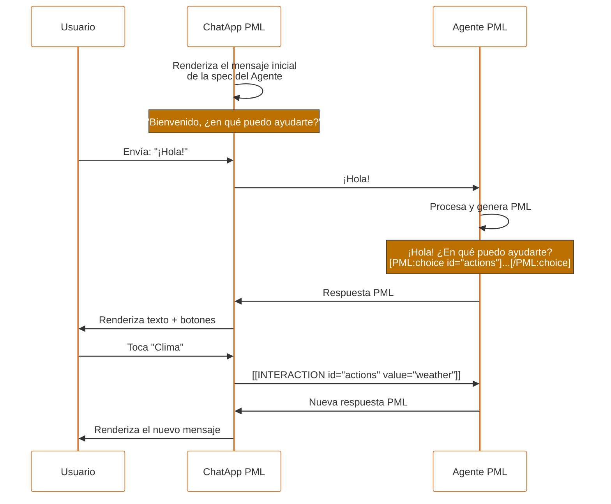

# PML — PEPPO Markup Language

## Especificación completa v1.15

> **v1.15 (Octubre 2026).** Cierra huecos de contrato que quedaron en v1.14. Una interacción solo es autoritativa cuando la ChatApp la produjo y el runner la correlaciona; el texto con brackets que escribe un usuario o emite un agente es texto ordinario. Agrega un perfil normativo del agente y una vista decodificada para el agente en los prompts (§9.3), validación y reparación del lado del runner (§11.4), reglas de renderizado en streaming (§10.2.4), acciones de completion para `input` y `toggle` standalone, valores telefónicos canónicos E.164, un `label` opcional en `choice`, un subconjunto de Markdown definido con una allowlist de esquemas de links, y el parseo de nombres de columna de `dtable`. Los IDs duplicados, los IDs de campo faltantes y los valores de contrato inválidos pasan a ser errores de configuración en lugar de elecciones silenciosas; la tolerancia del parser cubre más deslices comunes de generación; `number` ya no limita la precisión fraccionaria por default. La sintaxis de brackets y los modos de interacción no cambian; el comportamiento corregido requiere acuerdo de versión entre renderer y runner. Ver Apéndice O.

Los avisos de releases anteriores se conservan textualmente en §12.4, y los Apéndices C-N registran sus migraciones históricas. Las secciones actuales de componentes, los contratos actuales de interacción y de ciclo de vida, y el Apéndice O rigen v1.15; los ejemplos y avisos anteriores conservan el perfil de su release, incluido el comportamiento que versiones posteriores reemplazaron.

**PEPPO** — Platform for Engaging People and Processes via Omni-agents

---

## Índice

- [1. Visión general](#1-visión-general)
    - [1.1 Vocabulario](#11-vocabulario)
    - [1.2 Interacción entre los componentes](#12-interacción-entre-los-componentes)
    - [1.3 Principios de diseño](#13-principios-de-diseño)
- [2. ChatApp PML](#2-chatapp-pml)
- [3. Agente PML](#3-agente-pml)
- [4. Sintaxis de PML](#4-sintaxis-de-pml)
    - [4.1 Formato general](#41-formato-general)
    - [4.2 Componente autofinalizado](#42-componente-autofinalizado)
    - [4.3 Componente contenedor](#43-componente-contenedor)
    - [4.4 Reglas léxicas estrictas](#44-reglas-léxicas-estrictas)
    - [4.5 Ejemplo de mensaje válido](#45-ejemplo-de-mensaje-válido)
    - [4.6 Tipos de componentes](#46-tipos-de-componentes)
    - [4.7 Atributos globales](#47-atributos-globales)
    - [4.8 group](#48-group)
- [5. Componentes de información](#5-componentes-de-información)
    - [5.1 text](#51-text)
    - [5.2 markdown](#52-markdown)
    - [5.3 facts](#53-facts)
    - [5.4 dtable](#54-dtable)
    - [5.5 image](#55-image)
    - [5.6 media](#56-media)
    - [5.7 attachment](#57-attachment)
    - [5.8 map](#58-map)
    - [5.9 contact-card](#59-contact-card)
    - [5.10 Contrato de echo-back de valores capturados](#510-contrato-de-echo-back-de-valores-capturados)
    - [5.11 divider](#511-divider)
    - [5.12 raw](#512-raw)
- [6. Componentes de interacción](#6-componentes-de-interacción)
    - [6.1 input](#61-input)
        - [6.1.10 Fuente de datos de catálogo](#6110-fuente-de-datos-de-catálogo-v111)
    - [6.2 toggle](#62-toggle)
    - [6.3 choice](#63-choice)
    - [6.4 confirm](#64-confirm)
    - [6.5 form](#65-form)
    - [6.6 Contrato común de validación](#66-contrato-común-de-validación)
- [7. Modelo de interacción](#7-modelo-de-interacción)
    - [7.1 Formato de la interacción](#71-formato-de-la-interacción)
    - [7.2 URL encoding de valores](#72-url-encoding-de-valores)
    - [7.3 Interacciones multi-campo](#73-interacciones-multi-campo)
    - [7.4 Flujo de conversación](#74-flujo-de-conversación)
    - [7.5 Ejemplo de conversación completa](#75-ejemplo-de-conversación-completa)
    - [7.6 Actualización de estado](#76-actualización-de-estado)
- [8. Reglas de composición](#8-reglas-de-composición)
- [9. Guías para LLMs / Agentes](#9-guías-para-llms--agentes)
- [10. Guías de UX para móviles del ChatApp](#10-guías-de-ux-para-móviles-del-chatapp)
- [11. Manejo de errores](#11-manejo-de-errores)
- [12. Versionado y extensibilidad](#12-versionado-y-extensibilidad)
- [Apéndice A — Referencia rápida](#apéndice-a--referencia-rápida)
- [Apéndice B — EBNF completo](#apéndice-b--ebnf-completo)
- [Apéndice C — Migración v1.3 → v1.4](#apéndice-c--migración-v13--v14)
- [Apéndice D — Migración v1.4 → v1.5](#apéndice-d--migración-v14--v15)
- [Apéndice E — Migración v1.5 → v1.6](#apéndice-e--migración-v15--v16)
- [Apéndice F — Migración v1.6 → v1.6.1](#apéndice-f--migración-v16--v161)
- [Apéndice G — Migración v1.6.1 → v1.7](#apéndice-g--migración-v161--v17)
- [Apéndice H — Migración v1.7 → v1.8](#apéndice-h--migración-v17--v18)
- [Apéndice I — Migración v1.8 → v1.9](#apéndice-i--migración-v18--v19)
- [Apéndice J — Migración v1.9 → v1.10](#apéndice-j--migración-v19--v110)
- [Apéndice K — Migración v1.10 → v1.11](#apéndice-k--migración-v110--v111)
- [Apéndice L — Migración v1.11 → v1.12](#apéndice-l--migración-v111--v112)
- [Apéndice M — Migración v1.12 → v1.13](#apéndice-m--migración-v112--v113)
- [Apéndice N — Migración v1.13 → v1.14](#apéndice-n--migración-v113--v114)
- [Apéndice O — Migración v1.14 → v1.15](#apéndice-o--migración-v114--v115)

---

## 1. Visión general

**PML** es un lenguaje ligero, legible para LLMs y eficiente en tokens, diseñado para que los agentes conversacionales rendericen componentes UI interactivos dentro de interfaces de chat.

PML convierte los clásicos ChatBots en **Agentes de Interacción** ricos en funcionalidades: el agente no solo emite texto, también emite componentes que el usuario puede tocar, llenar, confirmar o cancelar.

### 1.1 Vocabulario

| Término         | Definición                                                                                                                                         |
| --------------- | -------------------------------------------------------------------------------------------------------------------------------------------------- |
| **PML**         | El lenguaje de marcado descrito en este documento.                                                                                                 |
| **Componente**  | Una unidad sintáctica de PML, ya sea autofinalizada (`[PML:type /]`) o contenedora (`[PML:type] ... [/PML:type]`).                                 |
| **Agente PML**  | Un LLM configurado para generar y consumir PML.                                                                                                    |
| **ChatApp PML** | La interfaz que renderiza el PML y captura interacciones del usuario. Puede ser app móvil, web o escritorio.                                       |
| **Mensaje**     | Un bloque de texto producido por el agente o por el usuario; puede mezclar libremente texto plano y componentes PML.                               |
| **Interacción** | El resultado serializado de una acción del usuario sobre un componente interactivo. Se transmite como `[[INTERACTION id="..." value="..."]]`.      |
| **Tarea**       | Ciclo de vida de una interacción individual: render → captura → cierre. Una conversación contiene cero, una o muchas tareas a lo largo del tiempo. |

### 1.2 Interacción entre los componentes

El usuario inicia una conversación con la ChatApp. La ChatApp envía el mensaje al Agente PML. El Agente PML analiza el mensaje y genera una respuesta en PML. La ChatApp renderiza ese PML. El usuario interactúa con los componentes y la ChatApp captura la interacción, la serializa como `[[INTERACTION]]` y la envía de vuelta al Agente PML. El Agente PML procesa la interacción y genera nuevo PML, repitiendo el ciclo.

Caso de uso ilustrativo:

- Usuario: "¡Hola!"
- Agente PML: "¡Hola! ¿En qué puedo ayudarte?" + botones `Clima`, `Noticias`, `Traductor`, `Cancelar`.
- Usuario toca `Clima`.
- Agente PML: "El clima en MiCiudad es de 20 °C." + los mismos botones.
- Usuario toca `Cancelar`.
- Agente PML: "Saludos, ¿en qué más puedo ayudarte?"



### 1.3 Principios de diseño

```
- Interaction-first   →  El agente genera interacciones con la UI, no solo texto
- Token-efficient     →  Minimizar tokens medidos y errores de generación en tareas representativas
- LLM-friendly        →  Sintaxis regular y predecible, fácil de generar sin errores
- Mobile-native       →  Diseñado para flujos conversacionales en móvil
- UILogic-first       →  La lógica de la UI vive en el frontend, no en el agente
- Extensible          →  Nuevos componentes y nuevos campos sin romper compatibilidad
- No-JSON             →  Sintaxis de brackets uniforme, sin estructuras anidadas tipo objeto
```

---

## 2. ChatApp PML

La ChatApp es la interfaz que permite a los usuarios interactuar con los Agentes PML. Es responsable de:

- Renderizar los componentes PML que recibe del agente.
- Capturar las interacciones del usuario sobre componentes interactivos.
- Serializar esas interacciones como `[[INTERACTION ...]]` y enviarlas al agente.
- Procesar las nuevas respuestas y continuar el ciclo.

**Agnosticidad del motor.** La ChatApp PML es agnóstica al motor del agente: no sabe qué LLM produce el PML, solo sabe que debe renderizarlo. Esto permite implementar ChatApps específicas para Android, iOS, Web, Desktop, etc., cada una con su propio renderer nativo, sin acoplamiento al backend.

---

## 3. Agente PML

Un **Agente PML** es un LLM (Large Language Model) configurado para:

1. Generar respuestas en PML, no solo en texto plano.
2. Recibir y procesar interacciones (`[[INTERACTION ...]]`) provenientes de la ChatApp.
3. Decidir cuándo emitir componentes interactivos y cuándo solo narrativa.

**Agnosticidad del LLM.** El Agente PML es agnóstico al motor LLM: puede implementarse con GPT, Claude, Gemini, Llama, etc. Lo único que define a un Agente PML es su capacidad de producir y consumir PML correctamente.

**Prompt base.** El prompt del agente debe incluir, como mínimo:

- Una explicación de la sintaxis de PML (la subsección de la spec aplicable a su dominio).
- El perfil del agente (§9.3), incluida la forma de leer las interacciones en la vista decodificada del agente (§7.2). El agente nunca decodifica valores con percent-encoding.
- Ejemplos representativos del dominio del agente.

> No es recomendable incluir la especificación completa de PML en el prompt base; basta con el perfil del agente de §9.3, recortado a los componentes del dominio del agente. Incluir todo puede degradar la calidad de generación y agrega costo de tokens en cada turno.

---

## 4. Sintaxis de PML

### 4.1 Formato general

PML se escribe como texto plano UTF-8. En un mismo mensaje pueden coexistir libremente texto plano y componentes PML.

Todo componente PML tiene una de dos formas:

- **Autofinalizado:** `[PML:type attr-1="value-1" attr-2="value-2" /]`
- **Contenedor:** `[PML:type attr="value"] contenido hijo [/PML:type]`

### 4.2 Componente autofinalizado

Componentes sin contenido hijo. Deben terminar con ` /]` (un espacio antes de `/]`).

```
[PML:type attr-1="value-1" attr-2="value-2" /]
```

### 4.3 Componente contenedor

Componentes con contenido hijo (otros componentes o texto, según las reglas de composición de §8).

```
[PML:type attr="value"]
  child content
[/PML:type]
```

### 4.4 Reglas léxicas estrictas

| Regla                 | Detalle                                                                                                                                       |
| --------------------- | --------------------------------------------------------------------------------------------------------------------------------------------- |
| **Encoding**          | Todo el contenido es UTF-8.                                                                                                                   |
| **Case**              | Los nombres de componentes y atributos van en `lowercase` o `kebab-case`. Nunca `camelCase`, nunca `snake_case`, nunca mayúsculas.            |
| **Atributos**         | Sintaxis: `name="value"`. Los nombres siguen `[a-z][a-z0-9-]*`.                                                                               |
| **Comillas**          | Los valores se delimitan con `"` (preferido) o `'`. Nunca mezclar en el mismo atributo.                                                       |
| **Comillas anidadas** | Una comilla igual a la delimitadora termina el valor del atributo. Represéntala con `&quot;` o `&#39;`; la barra invertida no escapa comillas PML. |
| **Estructura**        | Los componentes PML usan tags con brackets, no JSON ni HTML. El texto ordinario y los valores entre comillas pueden contener brackets, signos `< >` y barras invertidas. |
| **IDs**               | Todo componente interactivo **debe** declarar `id="..."`. Los IDs de componente siguen `[a-z][a-z0-9-]*`; `opt` usa las reglas propias de tokens de opción de §6.3. |
| **Unicidad**          | Los IDs de componente son únicos dentro de un mensaje. Los tokens de opción son únicos dentro de su `choice`.                                 |
| **Autofinalizado**    | La emisión canónica termina con ` /]`; los parsers aceptan uno o más caracteres de espacio ASCII antes de `/]` (y toleran ninguno, §9.2).      |
| **Cierre**            | Los contenedores se cierran con `[/PML:type]`. El nombre del tipo debe coincidir exactamente con el de apertura.                              |
| **Escapado**          | PML no tiene secuencias de escape con barra invertida. Las referencias de caracteres en atributos se decodifican una vez después del parseo estructural; las barras invertidas de un regex siguen siendo datos del regex. |

**Reconocimiento estructural y referencias de caracteres (v1.14).** Escanea el texto original antes de decodificar referencias de caracteres. Solo los delimitadores exactos `[PML:`, `[/PML:` y `[[INTERACTION` son estructurales en sus contextos aplicables; los demás brackets son texto ordinario, incluidos los links de Markdown. El escaneo de atributos respeta las comillas: los brackets dentro de un valor entre comillas no terminan su tag. Los cuerpos de componentes de solo texto no admiten componentes hijos; usa `raw` o referencias de caracteres para mostrar ahí delimitadores PML literales.

En atributos PML y cuerpos de `text`, decodifica exactamente una vez `&amp;`, `&quot;`, `&apos;`, `&lt;`, `&gt;`, las referencias numéricas decimales y las hexadecimales. Las referencias desconocidas o mal formadas quedan literales. Las referencias numéricas deben representar valores escalares Unicode. Para mostrar una referencia literal como `&quot;`, emite `&amp;quot;`. El texto decodificado nunca se vuelve a escanear en busca de tags PML. Los cuerpos `markdown` reciben su procesamiento de referencias de caracteres una sola vez a través del renderer de Markdown, sin una pasada previa de decodificación PML. Un cuerpo `raw` no recibe ninguna decodificación y termina en el primer `[/PML:raw]` exacto.

> Los atributos de componentes contienen valores lógicos, no valores de transporte URL-encoded. La excepción explícita es el inicializador `value` de un multi-choice, cuyos elementos de lista siguen §7.2. Los valores de interacción siempre usan el perfil de encoding negociado; la decodificación de referencias de caracteres no reemplaza la decodificación de valores de interacción.

**Atributos duplicados:** rechaza un componente o una interacción que contenga un nombre de atributo repetido, incluidos los duplicados producidos por una normalización de alias tolerada. Nunca selecciones en silencio el primer o el último valor. Un miembro de form o una regla mal formados invalidan ese form; conserva los borradores privados y expón el comportamiento de recuperación de §11.1.

### 4.5 Ejemplo de mensaje válido

```
Hi Pedro, what would you like to do today?
[PML:choice id="actions"]
  [PML:opt id="book"   value="Book appointment" /]
  [PML:opt id="prices" value="See prices"       /]
[/PML:choice]
```

### 4.6 Tipos de componentes

**Componentes de información (pasivos):**

- `text` — Texto estático con estilo
- `markdown` — Texto con formato Markdown
- `facts` — Lista de pares clave-valor
- `dtable` — Tabla de datos
- `image` — Imagen estática
- `media` — Video o audio
- `attachment` — Tarjeta para abrir/descargar un archivo capturado
- `map` — Vista previa de ubicación para coordenadas capturadas
- `contact-card` — Tarjeta de contacto con un número telefónico
- `divider` — Separador horizontal
- `raw` — Bloque de texto sin procesar (escape)

**Componentes de interacción (interactivos):**

- `input` — Campo de entrada (texto, número, fecha, archivo, etc.)
- `toggle` — Interruptor binario
- `choice` — Selección entre opciones
- `confirm` — Diálogo de confirmación
- `form` — Contenedor de campos con submit único, cancel opcional y reglas condicionales opcionales

**Componentes estructurales (sin interacción propia):**

- `group` — Contenedor de una sola columna para componentes de información relacionados o contenido de form

**Componentes auxiliares (solo válidos dentro de su contenedor):**

- `opt` — Opción dentro de `choice`
- `fact` — Entrada dentro de `facts`
- `dtrow`, `dtcol` — Fila y celda dentro de `dtable`
- `rule` — Regla de comportamiento condicional dentro de `form`

Los componentes de información se renderizan automáticamente en el flujo del chat. Los componentes de interacción requieren manejo especial: la ChatApp captura la acción del usuario y emite `[[INTERACTION]]` al agente.

### 4.7 Atributos globales

Estos atributos pueden aplicarse a cualquier componente, salvo las restricciones indicadas:

| Atributo   | Aplicable a           | Tipo             | Descripción                                                                                   |
| ---------- | --------------------- | ---------------- | --------------------------------------------------------------------------------------------- |
| `id`       | Todos                 | string           | Identificador. **Obligatorio en interactivos**, opcional en pasivos y en `group`; obligatorio en cualquier target de una regla. |
| `disabled` | Interactivos, `group` | `true` / `false` | Deshabilita la interacción; en `group`, condiciona los campos descendientes. Default: `false`. |
| `visible`  | Todos                 | `true` / `false` | Si es `false`, el componente no se renderiza. Default: `true`.                                |
| `tooltip`  | Todos                 | string           | Texto de ayuda al mantener presionado (móvil) o al hacer hover (escritorio).                  |
| `error`    | Interactivos          | string           | Mensaje de error asociado al componente. Se renderiza debajo de él.                           |

### 4.8 group

**(v1.13)** Contenedor estructural que identifica componentes relacionados como una unidad visual. Sus hijos se apilan verticalmente en orden de documento en una **columna única implícita**. El renderer adapta su ancho y espaciado al espacio de pantalla disponible. No se necesita ningún atributo de layout: esta versión no define atributos `layout`, `rows`, `columns`, `row`, `column`, `at` ni `areas` para `group`.

```
[PML:group]
  [PML:text type="title"]Order summary[/PML:text]
  [PML:facts]
    [PML:fact label="Product" value="Coffee" /]
    [PML:fact label="Total" value="$120" /]
  [/PML:facts]
[/PML:group]
```

`group` usa la forma contenedora con tag de cierre. No tiene valor, controles, acción de submit ni interacción propia. Un group vacío no renderiza nada. El layout interno de cada hijo no cambia: por ejemplo, `facts columns="2"` conserva su layout de dos columnas y `dtable` conserva sus filas y columnas de datos.

**Atributos:** los atributos globales aplicables son `id`, `visible`, `disabled` y `tooltip` (§4.7). `id` es opcional, salvo que una regla del form referencie al group; sigue las mismas reglas de unicidad en el mensaje y de kebab-case que los demás IDs. `visible="false"` oculta el group y su contenido. Dentro de un form, `disabled="true"` vuelve inactivos sus campos descendientes; no tiene efecto sobre el contenido solo informativo.

**Composición:**

- En la raíz del mensaje, un group puede contener componentes de información, incluidos `facts` y `dtable`. Los componentes interactivos standalone quedan fuera de los groups de raíz; los campos interactivos agrupados pertenecen a un `form`.
- Como hijo directo de `form`, un group puede contener los componentes de información y los campos ya permitidos en ese form. `dtable`, `confirm` y `form` siguen prohibidos ahí. Las declaraciones `rule` siguen siendo hijos directos de `form`.
- Un group no puede contener otro group. Los groups son transparentes para el límite existente de tres niveles de profundidad semántica; ver §8 para las listas exactas de hijos y el cómputo de profundidad.
- Agrupar no crea una tarea, una zona del renderer, un espacio de nombres de IDs ni un prefijo de campo. Un group de raíz sigue la ubicación narrativa de su mensaje: contexto privado de la tarea cuando está asociado a una tarea; si no, `shared_history`. Los groups dentro de un form participan del ciclo de vida y las zonas de ese form (§10.3).

**Reglas del form:** un group con `id` puede ser una entrada de `targets` para `action="visible"` o `action="enabled"`. Su estado efectivo condiciona a sus descendientes y se combina con el estado propio de cada hijo; nunca anula un `visible="false"` o `disabled="true"` del hijo. Un group no puede ser fuente de `when-*` ni `state-*` porque no tiene valor capturado ni estado de correctness. Los campos agrupados pueden seguir siendo fuentes y targets con sus propios IDs (§6.5).

```pml
[PML:form id="order" submit-label="Save"]
  [PML:toggle id="invoice" label="I need an invoice" /]

  [PML:group id="billing-details"]
    [PML:text type="title"]Billing details[/PML:text]
    [PML:input id="tax-id" type="text" label="Tax ID" required="true" /]
  [/PML:group]

  [PML:rule action="visible" targets="billing-details" when-invoice="true" /]
[/PML:form]
```

Cuando `invoice` es false, `tax-id` está oculto, no bloquea el submit y se omite de la interacción:

```
[[INTERACTION id="order" field-invoice="false"]]
```

Cuando `invoice` es true y el usuario captura `ABC123`, un submit válido es:

```
[[INTERACTION id="order" field-invoice="true" field-tax-id="ABC123"]]
```

El ID de group `billing-details` nunca aporta un atributo `field-*`. Una regla `enabled` puede apuntar al mismo group para condicionar sus campos sin ocultar su contenido visible. Los agentes deben negociar un renderer con soporte de `group` de v1.13 antes de emitir `group`; los renderers anteriores conservan el comportamiento de componente desconocido de §12.2, que no garantiza que se preserven el contenido agrupado ni las reglas.

---

## 5. Componentes de información

Solo deben usarse para mostrar información al usuario. No emiten interacciones.

### 5.1 text

Bloque de texto estático con estilo.

| Atributo | Requerido | Tipo                                                 | Descripción                           |
| -------- | --------- | ---------------------------------------------------- | ------------------------------------- |
| `type`   | No        | `header` / `title` / `paragraph` / `muted` / `label` | Tipo semántico. Default: `paragraph`. |
| `style`  | No        | `bold` / `italic` / `muted` / `normal`               | Estilo visual. Default: `normal`.     |
| `size`   | No        | `small` / `medium` / `large`                         | Tamaño. Default: `medium`.            |
| `align`  | No        | `left` / `center` / `right`                          | Alineación. Default: `left`.          |

```
[PML:text type="header" size="large" style="bold"]
Your order is on its way
[/PML:text]

[PML:text type="muted" size="small"]
Estimated delivery in 3-5 business days
[/PML:text]
```

### 5.2 markdown

Bloque de texto con formato Markdown, limitado al subconjunto de Markdown de PML que se describe abajo.

| Atributo | Requerido | Tipo   | Descripción    |
| -------- | --------- | ------ | -------------- |
| `id`     | No        | string | Identificador  |

```
[PML:markdown]
### Shipping instructions

1. **Pack** the product in its original box
2. **Stick** the shipping label on the outside
3. **Drop off** the package at any shipping center

> Refunds are processed in 5-7 business days.

For more info visit our [shipping guide](https://peppo.com/shipping).
[/PML:markdown]
```

**Soporta:** negritas, itálicas, listas, links, código inline, citas (blockquotes), encabezados.

**Fuera del subconjunto (v1.15):** tablas, imágenes (``), bloques de código delimitados o indentados, HTML crudo, notas al pie y listas de tareas. Los renderers los presentan como texto plano, nunca como HTML ni como un recurso cargado. Usa `dtable` para tablas e `image` para imágenes; una imagen Markdown se saltaría el contrato de referencias de recursos (§5.10).

**Links (v1.15):** solo están activos los destinos `https:`, `mailto:` y `tel:`. Cualquier otro esquema o la falta de esquema, incluidos `http:`, `javascript:`, `data:`, `file:` e `intent:`, renderiza el texto del link sin un link activo.

**Nota de parseo:** los brackets propios de Markdown (`[texto](url)`) son seguros. El parser solo activa el modo PML cuando encuentra exactamente `[PML:`.

### 5.3 facts

Tabla de pares clave-valor.

| Atributo  | Requerido | Tipo      | Descripción                          |
| --------- | --------- | --------- | ------------------------------------ |
| `columns` | No        | `1` / `2` | Columnas del layout. Default: `1`.   |

**Contenido:** uno o más `[PML:fact label="..." value="..." /]` como hijos directos.

```
[PML:facts]
  [PML:fact label="Product" value="Nike Air Max 90" /]
  [PML:fact label="Size"    value="9"               /]
  [PML:fact label="Price"   value="$129 USD"        /]
  [PML:fact label="Shipping" value="Free"           /]
[/PML:facts]
```

### 5.4 dtable

Tabla de datos genérica.

| Atributo          | Requerido | Tipo   | Descripción                                                                                                                      |
| ----------------- | --------- | ------ | -------------------------------------------------------------------------------------------------------------------------------- |
| `columns`         | Sí        | string | Nombres de columna separados por comas.                                                                                          |
| `display-columns` | No        | string | **(v1.12)** Subconjunto de `columns` separado por comas, de hasta cuatro nombres, que debe seguir visible en renderers responsivos compactos. |

**Contenido:** filas envueltas en `[PML:dtrow] ... [/PML:dtrow]`. Cada celda es un `[PML:dtcol value="..." /]` autofinalizado. El número de celdas por fila debe coincidir con el número de columnas declarado.

```
[PML:dtable columns="Plan,Price,Agents,Messages" display-columns="Plan,Price"]
  [PML:dtrow]
    [PML:dtcol value="Basic" /][PML:dtcol value="$9/mo"  /][PML:dtcol value="1"  /][PML:dtcol value="100/day"  /]
  [/PML:dtrow]
  [PML:dtrow]
    [PML:dtcol value="Pro"   /][PML:dtcol value="$29/mo" /][PML:dtcol value="10" /][PML:dtcol value="Unlimited" /]
  [/PML:dtrow]
[/PML:dtable]
```

`display-columns` es una pista de presentación para tablas anchas. No elimina datos: las celdas de las columnas no mostradas siguen siendo parte de cada fila y el renderer puede revelarlas mediante detalles por fila, controles de expansión u otra affordance responsiva. Los nombres desconocidos se ignoran. Si el atributo se omite, el renderer elige un default compacto.

**Nombres de columna (v1.15).** Divide `columns` y `display-columns` en las comas literales antes de decodificar referencias de caracteres; después recorta los espacios ASCII alrededor de cada nombre. Escribe una coma dentro de un nombre como `&#44;`: `columns="Plan,Price&#44; VAT incl."` declara las dos columnas `Plan` y `Price, VAT incl.`. Los nombres deben ser no vacíos y únicos dentro de `columns`; una entrada de `display-columns` que no coincide con ninguna columna, o que coincide con más de una, se ignora.

### 5.5 image

Imagen estática.

| Atributo  | Requerido | Tipo                                  | Descripción                  |
| --------- | --------- | ------------------------------------- | ---------------------------- |
| `url`     | Sí        | url/ref                               | URL pública o referencia de objeto privada y estable (§5.10). |
| `alt`     | No        | string                                | Texto alternativo.           |
| `size`    | No        | `small` / `medium` / `large` / `full` | Tamaño. Default: `medium`.   |
| `caption` | No        | string                                | Pie de imagen.               |

```
[PML:image url="https://cdn.peppo.com/product.jpg" alt="Nike Air Max 90"
  size="large" caption="New 2026 model" /]
```

### 5.6 media

Reproductor de video o audio.

| Atributo  | Requerido | Tipo              | Descripción                          |
| --------- | --------- | ----------------- | ------------------------------------ |
| `url`     | Sí        | url/ref           | URL pública o referencia de objeto privada y estable (§5.10). |
| `type`    | Sí        | `video` / `audio` | Tipo de medio.                       |
| `poster`  | No        | url/ref           | URL pública o referencia de imagen privada y estable (solo video). |
| `caption` | No        | string            | Pie del medio.                       |

```
[PML:media url="https://cdn.peppo.com/demo.mp4" type="video"
  poster="https://cdn.peppo.com/demo-poster.jpg" /]
```

### 5.7 attachment

Tarjeta pasiva para un archivo capturado o subido que no es imagen. Se usa cuando el agente necesita volver a mostrar un recurso de archivo que debe abrirse o descargarse en lugar de renderizarse inline. Los recursos privados se referencian con object refs estables (`files/...` o `images/...`), nunca con URLs firmadas.

| Atributo  | Requerido | Tipo    | Descripción                                        |
| --------- | --------- | ------- | -------------------------------------------------- |
| `url`     | Sí        | url/ref | URL del archivo o object ref privado de Storage.   |
| `name`    | Sí        | string  | Nombre de archivo legible para humanos.            |
| `mime`    | No        | string  | Tipo MIME cuando se conoce.                        |
| `label`   | No        | string  | Etiqueta del campo o del dominio para el archivo.  |
| `caption` | No        | string  | Pie o estado breve opcional.                       |

```
[PML:attachment url="files/user/agent/report.pdf" name="report.pdf"
  mime="application/pdf" label="Signed report" /]
```

### 5.8 map

Vista previa pasiva de una ubicación capturada. Vuelve a mostrar el valor de `input type="location"` sin cambiar el formato de interacción en el cable.

| Atributo  | Requerido | Tipo   | Descripción                            |
| --------- | --------- | ------ | -------------------------------------- |
| `lat`     | Sí        | number | Latitud, con punto decimal.            |
| `lng`     | Sí        | number | Longitud, con punto decimal.           |
| `label`   | No        | string | Etiqueta del campo o del dominio.      |
| `caption` | No        | string | Pie breve opcional o dirección.        |

```
[PML:map lat="19.4326" lng="-99.1332" label="Delivery location" /]
```

### 5.9 contact-card

Tarjeta pasiva para un número telefónico capturado. v1.10 no cambia el valor de la interacción de contacto: el agente solo conoce un número telefónico, no el nombre, el email, la dirección ni un objeto de contacto completo.

| Atributo  | Requerido | Tipo   | Descripción                        |
| --------- | --------- | ------ | ---------------------------------- |
| `phone`   | Sí        | string | Número telefónico capturado, decodificado, en forma canónica E.164 (§6.1.4). |
| `label`   | No        | string | Etiqueta del campo o del dominio.  |
| `caption` | No        | string | Pie breve opcional.                |

```
[PML:contact-card phone="+5215551234567" label="Recipient phone" /]
```

### 5.10 Contrato de echo-back de valores capturados

Cuando un agente confirma o resume un valor capturado desde un componente interactivo, debe volver a mostrarlo con la representación pasiva canónica de abajo. Esto es solo de presentación; el formato `[[INTERACTION]]` en el cable no cambia.

| Input capturado | Echo-back canónico |
| --------------- | ------------------ |
| `input type="file"` con recurso de imagen | `[PML:image url="<object-ref>" alt="<label>" caption="<label>" /]` |
| `input type="file"` con recurso de audio/video | `[PML:media url="<object-ref>" type="audio|video" caption="<label>" /]` |
| `input type="file"` con documento/archivo genérico | `[PML:attachment url="<object-ref>" name="<basename>" mime="<mime>" label="<label>" /]` |
| `input type="location"` | `[PML:map lat="<lat>" lng="<lng>" label="<label>" /]` |
| `input type="contact"` | `[PML:contact-card phone="<decoded-phone>" label="<label>" /]` |
| text, number, currency, date, time, datetime | `facts` o `markdown`, con formato para humanos. |
| choice, toggle, confirm | `facts` o `markdown`, usando la etiqueta visible de la opción o decisión. |

Para recursos privados de Peppo, `url` es la referencia de objeto inmutable (`images/...` o `files/...`). Los agentes no deben emitir URLs firmadas en el echo-back porque expiran y rompen el historial inmutable del chat.

**Contrato de referencias de recursos (v1.14):** `image`, `media` (incluido `poster`), `attachment` y la captura de archivos usan el mismo dominio lógico de referencias: una URL HTTPS pública y absoluta o una referencia de objeto privada, opaca y estable. El renderer resuelve las referencias privadas con el contexto autenticado de la cuenta; no son URLs web relativas. El adaptador de subida debe proporcionar la referencia estable de una subida privada antes de que la captura pueda completarse. Los metadatos del recurso necesarios para el echo-back, como el nombre de archivo original y el tipo MIME, acompañan a la captura a través del envelope del runner; el agente no los inventa ni se agregan como atributos extra de `[[INTERACTION]]`. La interacción transporta la referencia según §7.2; los atributos `url` de los componentes usan la referencia decodificada.

**Excepción de snapshot y secretos:** las reglas de echo-back nunca autorizan volver a mostrar una contraseña ni un borrador inactivo retenido. Aplica la proyección de snapshot de §10.2.2 antes de crear contenido de historial o de resumen.

Compatibilidad futura: los renderers anteriores pueden ignorar componentes desconocidos o renderizarlos como texto plano. Los atributos legibles para humanos mejoran el fallback en texto plano, pero no garantizan visibilidad cuando un renderer descarta el componente. Negocia el soporte antes de depender de un componente de echo-back rico.

### 5.11 divider

Línea separadora.

| Atributo | Requerido | Tipo   | Descripción                  |
| -------- | --------- | ------ | ---------------------------- |
| `label`  | No        | string | Texto centrado opcional.     |

```
[PML:divider /]
[PML:divider label="Or continue with" /]
```

### 5.12 raw

Bloque de texto plano que desactiva el parser PML. Permite mostrar sintaxis PML literal sin que se interprete.

```
[PML:raw]
To show bold text, use the text component:
[PML:text style="bold"]Bold text[/PML:text]
[/PML:raw]
```

> Dentro de `[PML:raw]` no existen atributos. El parser solo busca el tag de cierre exacto `[/PML:raw]`.

---

## 6. Componentes de interacción

Los componentes interactivos generan un `[[INTERACTION]]` cuando el usuario completa su acción mediante la acción de completion del componente: la completion del input (§6.1), la confirmación del toggle (§6.2), la selección simple o la confirmación del multi-choice (§6.3), un botón del confirm (§6.4) o el submit/cancel del form (§6.5). El formato exacto de la interacción se especifica en §7.

### 6.1 input

Campo de entrada de datos. El subtipo se elige con el atributo `type`.

**Subtipos disponibles:**

- `text` — Campo de texto (una línea o multilínea)
- `number` — Campo numérico
- `currency` — Campo monetario
- `contact` — Captura de contacto del sistema (teléfono)
- `date` — Selector de fecha
- `time` — Selector de hora
- `datetime` — Selector de fecha y hora
- `location` — Selector de ubicación / GPS
- `file` — Selector de archivo

**Atributos comunes a todos los `input`:**

| Atributo   | Requerido | Tipo                  | Descripción                       |
| ---------- | --------- | --------------------- | --------------------------------- |
| `id`       | Sí        | string                | Identificador único.              |
| `type`     | Sí        | string                | Subtipo (ver la lista de arriba). |
| `label`    | No        | string                | Etiqueta visible.                 |
| `required` | No        | `true` / `false`      | Obligatorio. Default: `false`.    |
| `readonly` | No        | `true` / `false`      | Solo lectura. Default: `false`.   |
| `value`    | No        | depende del subtipo   | Valor inicial.                    |

**Completion (v1.15).** Un `input` standalone mantiene las ediciones en local hasta que el usuario dispara una acción de completion provista por el renderer: un control localizado de enviar/confirmar, la acción done/enter del teclado en un campo de texto de una línea, o la confirmación del selector nativo en `date`, `time`, `datetime` y `location`. En un campo multilínea, enter inserta un salto de línea y solo el control de enviar/confirmar completa. Un input `file` solo se completa cuando la subida ya produjo su referencia de recurso (§5.10). La completion ejecuta la validación de §6.6; si falla, la captura sigue abierta y no se emite nada. Dentro de un form, los inputs nunca se completan por separado; el submit del form es la única acción de completion. Estas reglas no agregan atributos ni formatos de interacción.

#### 6.1.1 input type="text"

| Atributo        | Requerido | Tipo    | Descripción                                   |
| --------------- | --------- | ------- | --------------------------------------------- |
| `placeholder`   | No        | string  | Texto de ayuda.                               |
| `multiline`     | No        | boolean | Campo multilínea. Default: `false`.           |
| `validate`      | No        | string  | Regex portable, coincidencia con la cadena completa (§6.6). |
| `error-message` | No        | string  | Mensaje que se muestra si la validación falla. |
| `max-length`    | No        | number  | Máximo de code points Unicode. Entero no negativo. |
| `min-length`    | No        | number  | Mínimo de code points Unicode. Entero no negativo. |
| `password`      | No        | boolean | Enmascara la captura y exige snapshots/echo-back redactados (§10.2.2). Default: `false`. |
| `source`        | No        | string  | **(v1.11)** Fuente de datos de catálogo. Solo válido como `catalog:{slug}`. Requiere `key` y `display`. Ver §6.1.10. |
| `key`           | No        | string  | **(v1.11)** Campo del catálogo usado como key de negocio enviado. Obligatorio cuando hay `source`. |
| `display`       | No        | string  | **(v1.11)** Campo del catálogo que se muestra como etiqueta en la UI. Obligatorio cuando hay `source`. |

```
[PML:input id="name" type="text" label="Full name"
  placeholder="Enter your name" required="true" /]
```

**Interacción generada:**

```
[[INTERACTION id="name" value="John+Smith"]]
```

Con `multiline="true"`:

```
[PML:input id="comments" type="text" label="Comments"
  multiline="true" placeholder="Write your comments" /]
```

```
[[INTERACTION id="comments" value="First+line%0ASecond+line"]]
```

> Los saltos de línea se codifican como `%0A` (ver §7.2).

**Typeahead respaldado por catálogo (v1.11).** Cuando hay `source`, `key` y `display`, el renderer consulta la API de catálogos de la cuenta (búsqueda paginada) mientras el usuario escribe y muestra los valores de `display` en la lista de sugerencias. El valor de la interacción es el campo **key** del elemento elegido, no la etiqueta visible:

```
[PML:input id="cliente" type="text" source="catalog:clientes"
  key="rfc" display="razon_social" label="Cliente" /]
```

```
[[INTERACTION id="cliente" value="RFC-001"]]
```

Ver §6.1.10 para las reglas de validez, los tipos soportados y el comportamiento de fallback del renderer.

#### 6.1.2 input type="number"

| Atributo      | Requerido | Tipo    | Descripción                          |
| ------------- | --------- | ------- | ------------------------------------ |
| `placeholder` | No        | string  | Texto de ayuda.                      |
| `integer`     | No        | boolean | Solo enteros. Default: `false`.      |
| `decimals`    | No        | number  | Precisión fraccionaria máxima; entero no negativo. **(v1.15)** Default: sin límite. |
| `min`         | No        | number  | Valor mínimo.                        |
| `max`         | No        | number  | Valor máximo.                        |

```
[PML:input id="age" type="number" label="Age" integer="true" min="18" max="99" /]
```

```
[[INTERACTION id="age" value="25"]]
```

```
[PML:input id="height" type="number" label="Height"
  placeholder="1.75" decimals="2" /]
```

```
[[INTERACTION id="height" value="1.75"]]
```

**Contrato numérico (v1.14):** `number` y `currency` usan valores decimales finitos en base 10, con signo y punto como separador, sin notación exponencial, separadores de miles, `NaN` ni infinito. `min` y `max` son inclusivos y se comparan como valores decimales. `decimals` limita la precisión fraccionaria después de ignorar los ceros finales redundantes; el exceso de precisión es un error de validación, nunca una solicitud de redondeo. En `number`, omitir `decimals` no impone límite de precisión (v1.15); `integer="true"` fuerza precisión efectiva cero, y un `decimals` distinto de cero en conflicto se ignora con un warning. `integer="false"` no agrega ninguna restricción.

Las cadenas canónicas de `number` quitan el signo más inicial, los ceros iniciales redundantes y los ceros fraccionarios finales; el cero negativo se normaliza a `0`. Así, `1.0` es `1` y `1.2300` es `1.23`. `currency` usa el mismo valor decimal, pero rellena su parte fraccionaria hasta exactamente su número efectivo de `decimals` (`1500.5` se vuelve `1500.50` con precisión dos). El relleno nunca cambia el monto. La localización de la UI no cambia estos valores lógicos. Los valores iniciales están sujetos a la misma validación; no reemplaces en silencio un valor inválido por cero.

#### 6.1.3 input type="currency"

| Atributo      | Requerido | Tipo   | Descripción                                          |
| ------------- | --------- | ------ | ---------------------------------------------------- |
| `placeholder` | No        | string | Texto de ayuda.                                      |
| `currency`    | No        | string | Código ISO 4217 (`USD`, `MXN`, ...). Default: `USD`. |
| `decimals`    | No        | number | Precisión fraccionaria máxima y relleno canónico; entero no negativo. Default: `2`. |
| `min`         | No        | number | Valor mínimo.                                        |
| `max`         | No        | number | Valor máximo.                                        |

```
[PML:input id="amount" type="currency" label="Amount"
  currency="USD" min="1" max="10000" /]
```

**Interacción generada** (valor numérico crudo, sin símbolos):

```
[[INTERACTION id="amount" value="1500.50"]]
```

> El valor de la interacción siempre es el número crudo (sin símbolo de moneda, sin separadores de miles, con punto decimal). La presentación visual con símbolo y separadores es responsabilidad del renderer.

#### 6.1.4 input type="contact"

Captura un número telefónico usando los mecanismos nativos de la ChatApp. El atributo opcional `source` describe de dónde debe venir el número telefónico.

| Atributo | Requerido | Tipo                           | Descripción                                          |
| -------- | --------- | ------------------------------ | ---------------------------------------------------- |
| `source` | No        | `self` / `manual` / `contacts` | **(v1.9)** Origen del contacto. Default: `manual`.   |

Valores de `source`:

| `source`   | Significado                                    | UI esperada                                                                  |
| ---------- | ---------------------------------------------- | ---------------------------------------------------------------------------- |
| `self`     | El número telefónico propio del usuario.       | Usar autorrelleno de cuenta/dispositivo cuando exista; si no, captura manual. |
| `manual`   | Un número telefónico tecleado por el usuario.  | Teclado para número telefónico. Default.                                     |
| `contacts` | Un número telefónico elegido desde la agenda.  | Selector nativo de contactos cuando exista; si no, captura manual.           |

```
[PML:input id="phone" type="contact" label="Tap to share your phone" required="true" /]
```

```
[PML:input id="recipient-phone" type="contact" label="Choose a recipient"
  source="contacts" /]
```

```
[[INTERACTION id="phone" value="%2B15551234567"]]
```

> El `+` inicial de un número E.164 se codifica en URL como `%2B`. `source` solo afecta la UI de captura; el valor de la interacción siempre es el número telefónico elegido o tecleado. Los valores `self`, `manual` y `contacts` son reservados y nunca se traducen.

**Valor canónico (v1.15).** El valor lógico es un número E.164: un `+` inicial seguido de hasta 15 dígitos ASCII, el primero distinto de `0`, sin espacios, puntuación ni extensión. El renderer normaliza a esta forma los números tecleados, autorrellenados y elegidos, usando la región de la cuenta o del dispositivo para la captura nacional cuando esté disponible; un número que no puede normalizar es un error de validación. Un formato de presentación como `+1 555 123 4567` es solo presentación del renderer. El `value` inicial, los literales `when-<field-id>` y el `phone` de `contact-card` usan la misma cadena canónica.

#### 6.1.5 input type="date"

Selector de fecha. El valor de la interacción es ISO 8601 (`YYYY-MM-DD`).

| Atributo      | Requerido | Tipo   | Descripción                   |
| ------------- | --------- | ------ | ----------------------------- |
| `placeholder` | No        | string | Texto de ayuda.               |
| `min`         | No        | string | Fecha mínima `YYYY-MM-DD`.    |
| `max`         | No        | string | Fecha máxima `YYYY-MM-DD`.    |

```
[PML:input id="date" type="date" label="Appointment date" /]
```

```
[[INTERACTION id="date" value="2026-06-15"]]
```

#### 6.1.6 input type="time"

Selector de hora. **El valor lógico siempre es `HH:mm` en formato de 24 horas, sin importar el modo de presentación.** El atributo `am-pm` solo afecta la UI; el encoding de transporte sigue §7.2.

| Atributo      | Requerido | Tipo    | Descripción                                                     |
| ------------- | --------- | ------- | --------------------------------------------------------------- |
| `placeholder` | No        | string  | Texto de ayuda.                                                 |
| `am-pm`       | No        | boolean | Muestra al usuario un selector AM/PM. Default: `false` (24h).   |

```
[PML:input id="time" type="time" label="Time" am-pm="true" /]
```

```
[[INTERACTION id="time" value="14%3A45"]]
```

#### 6.1.7 input type="datetime"

Selector de fecha y hora. El valor lógico es ISO 8601 sin zona horaria: `YYYY-MM-DDTHH:mm` (24h). Es un valor de hora local de reloj, no un instante; la interpretación de la zona horaria le corresponde a la aplicación. El encoding de transporte sigue §7.2.

| Atributo      | Requerido | Tipo   | Descripción      |
| ------------- | --------- | ------ | ---------------- |
| `placeholder` | No        | string | Texto de ayuda.  |

```
[PML:input id="appointment" type="datetime" label="Date and time" /]
```

```
[[INTERACTION id="appointment" value="2026-06-15T14%3A45"]]
```

#### 6.1.8 input type="location"

Selector de ubicación. El valor lógico es `latitude,longitude` (punto decimal, sin espacios); la latitud está en el rango inclusivo de -90 a 90 y la longitud de -180 a 180. La coma es parte de este escalar, no un separador de multi-choice. El renderer puede ofrecer GPS del dispositivo, búsqueda de direcciones o un minimapa con pin. El encoding de transporte sigue §7.2.

```
[PML:input id="location" type="location" label="Your location" /]
```

```
[[INTERACTION id="location" value="40.7128%2C-74.0060"]]
```

#### 6.1.9 input type="file"

Selector de un solo archivo. El renderer sube el archivo a un endpoint configurado por la ChatApp y obtiene una URL pública o una referencia de objeto privada y estable (§5.10). Esa referencia es el valor lógico capturado, codificado para el transporte según §7.2.

| Atributo  | Requerido | Tipo   | Descripción                                                  |
| --------- | --------- | ------ | ------------------------------------------------------------ |
| `accept`  | No        | string | Tipos MIME permitidos (p. ej.: `image/*`, `application/pdf`). |
| `capture` | No        | `user` / `environment` / `true` | **(v1.8)** Pista para abrir directamente la UI de captura del dispositivo (cámara, grabadora de audio, grabadora de video) en lugar del explorador de archivos. |

```
[PML:input id="photo" type="file" label="Upload your ID"
  accept="image/*" /]
```

```
[[INTERACTION id="photo" value="images%2Fuser%2Fagent%2Fabc123.jpg"]]
```

> Decodifica este valor una vez para obtener `images/user/agent/abc123.jpg`. Una URL pública usa el mismo perfil de encoding; un escape de porcentaje que ya exista dentro de esa URL debe sobrevivir a esta única pasada de decodificación de transporte.

**`capture` (v1.8).** Cuando está presente, `capture` le pide al renderer abrir directamente la UI nativa de adquisición del dispositivo en lugar del explorador de archivos. **No** define el medio: eso sigue siendo trabajo de `accept`. La combinación de ambos es lo que selecciona la experiencia:

| `accept`   | `capture`     | UI resultante                           |
| ---------- | ------------- | --------------------------------------- |
| `image/*`  | `user`        | Cámara, lente frontal (selfie).         |
| `image/*`  | `environment` | Cámara, lente trasera.                  |
| `audio/*`  | `true`        | Grabadora de audio.                     |
| `video/*`  | `true`        | Grabadora de video.                     |
| cualquiera | (ausente)     | Selector de archivos estándar (default). |

```
[PML:input id="selfie" type="file" label="Take a photo of yourself"
  accept="image/*" capture="user" /]

[PML:input id="receipt" type="file" label="Photograph the receipt"
  accept="image/*" capture="environment" /]

[PML:input id="voice-note" type="file" label="Record a voice message"
  accept="audio/*" capture="true" /]

[PML:input id="clip" type="file" label="Record a video"
  accept="video/*" capture="true" /]
```

> `capture` es una **pista no vinculante**. Un renderer en un dispositivo sin el hardware solicitado (p. ej., un equipo de escritorio sin cámara) ignora `capture` y cae al selector de archivos estándar. Ambos caminos suben el artefacto y serializan la referencia de recurso resultante con el mismo perfil de encoding negociado. Los valores `user`, `environment` y `true` son reservados y nunca se traducen.

#### 6.1.10 Fuente de datos de catálogo (v1.11)

Atributos opcionales que vinculan un componente interactivo con un catálogo de la cuenta. La ChatApp resuelve los datos del catálogo a través de la **API paginada de catálogos** con alcance a la cuenta actual, nunca pidiéndole al LLM que invente o recuerde filas del catálogo.

| Atributo  | Requerido | Tipo   | Descripción |
| --------- | --------- | ------ | ----------- |
| `source`  | No*       | string | Referencia al catálogo. Debe ser exactamente `catalog:{slug}`, donde `{slug}` es el slug del catálogo configurado para el agente/cuenta. |
| `key`     | No*       | string | Nombre del campo del catálogo cuyo valor es el **key de negocio enviado** (valor almacenado, destino de llave foránea). |
| `display` | No*       | string | Nombre del campo del catálogo que se renderiza como etiqueta visible en la UI (sugerencia de typeahead, opción de dropdown, etc.). |

\*Cuando hay `source`, **tanto** `key` como `display` son **obligatorios**. Un atributo de vínculo faltante es un error de configuración: impide que la tarea o el form dueño se complete, conserva los borradores privados, muestra la recuperación nativa y mantén el chat disponible (§11.1). Nunca omitas un miembro obligatorio para enviar el resto ni adivines el vínculo faltante.

**Espacio de valores de `source`.** El nombre de atributo `source` ya existe en `input type="contact"` (v1.9) con los valores reservados `self`, `manual` y `contacts`. El vínculo con catálogo usa una forma de valor distinta: `catalog:{slug}`. Estos espacios de nombres no se traslapan.

**Qué componentes y tipos de input aceptan `source` de catálogo:**

| Componente / subtipo | `source` de catálogo | Comportamiento |
| -------------------- | -------------------- | -------------- |
| `input type="text"`  | **Sí**               | Typeahead / autocompletado: búsqueda paginada contra el catálogo mientras el usuario escribe; el valor confirmado debe ser el key de una fila resuelta. |
| `choice`             | **Sí**               | Las opciones se cargan desde el catálogo (paginadas). Los hijos estáticos `[PML:opt /]` se **ignoran** cuando hay `source` de catálogo. |
| `input type="contact"` | **No**             | `source` está reservado para la adquisición de contactos (`self` / `manual` / `contacts`). Los agentes no deben emitir `catalog:` en `type="contact"`. |
| Todos los demás subtipos de `input` (`number`, `currency`, `date`, `time`, `datetime`, `location`, `file`) | **No** | Los atributos de catálogo son inválidos en estos subtipos; los renderers los ignoran y muestran la UI simple del subtipo. |

**Resolución en el renderer.** Dado `source="catalog:{slug}"`, la ChatApp:

1. Verifica que `{slug}` esté permitido para el agente/cuenta actual (contrato de sources / ACL).
2. Consulta la API de catálogos con paginación y búsqueda opcional (`q`) mientras el usuario interactúa.
3. Mapea cada fila: muestra `display` en la UI y envía `key` en la interacción.

La resolución **nunca** se delega al LLM. El agente declara el vínculo; la ChatApp obtiene las filas.

**Valores confirmados e inicialización (v1.14).** Un `key` de catálogo debe identificar una fila única y ser una cadena no vacía. Los keys son valores de negocio opacos, no IDs de componente ni tokens de opción estáticos; conserva sus mayúsculas, minúsculas y puntuación. El texto de búsqueda y las etiquetas visibles son estado de presentación transitorio, nunca un key confirmado. El `value` inicial y las restricciones de validación del campo de texto aplican al key, no a la etiqueta; resuelve la etiqueta a través del catálogo autorizado. Un key inicial desconocido o no autorizado es una selección inválida, no una etiqueta ni un fallback de texto libre.

**Serialización de la interacción — solo keys resueltos, nunca texto de búsqueda ni etiquetas visibles:**

| Contexto | Forma serializada |
| -------- | ----------------- |
| `input` standalone | `[[INTERACTION id="cliente" value="RFC-001"]]` |
| `choice` standalone (simple) | `[[INTERACTION id="cliente" value="RFC-001"]]` — igual que el id de un `opt` estático: el valor del **key**. |
| `choice` standalone (`multi="true"`) | `[[INTERACTION id="tags" value="RFC-001,RFC-002"]]` — **keys** codificados individualmente, unidos con comas literales (§7.2). |
| Hijo de `form` | `field-cliente="RFC-001"` — el valor de `field-*` es el **key**, URL-encoded según §7.2 cuando hace falta. |

El campo de display (`razon_social`, nombre del producto, etc.) es solo de presentación y no debe aparecer en `[[INTERACTION]]`. Un key que contiene una coma sigue siendo un solo elemento: los keys `a,b` y `c` se serializan como `a%2Cb,c`. Divide la lista antes de decodificar sus elementos. Una selección opcional vacía se serializa como la cadena vacía; los keys vacíos individuales son inválidos.

**Catálogo no disponible (v1.14).** Si la API no es alcanzable, el slug es desconocido o no hay acceso de lectura, conserva el vínculo y muestra un estado inline de no disponible con una acción de reintento. Nunca sustituyas un key por un valor tecleado arbitrario ni muestres un contenedor vacío sin recuperación. El composer del chat sigue disponible; una selección obligatoria no disponible puede impedir el submit del form, pero no debe impedir que la conversación continúe.

| Componente | Comportamiento de recuperación |
| ---------- | ------------------------------ |
| `input type="text"` con atributos de catálogo | Mantener el texto de búsqueda separado de la selección confirmada; reintentar la resolución del catálogo o limpiar a una selección opcional vacía. |
| `choice` con atributos de catálogo | Mostrar el estado de no disponible/reintento; conservar una selección resuelta previamente solo mientras el contrato vigente del catálogo autorizado la siga validando. |

Si el flujo necesita texto manual, el agente debe volver a emitir deliberadamente un `input type="text"` sin vínculo, es decir, sin atributos de catálogo. Esa declaración hace explícito el cambio de contrato del valor. Un fallback tecleado nunca debe hacerse pasar por un key resuelto. La autorización y la existencia del key deben verificarse de nuevo al aplicar la acción de negocio; la selección en la UI no es autorización.

**Ejemplo canónico:**

```
[PML:input id="cliente" type="text" source="catalog:clientes"
  key="rfc" display="razon_social" label="Cliente" /]
```

**Ejemplo de `choice` respaldado por catálogo:**

```
[PML:choice id="producto" style="dropdown" source="catalog:productos"
  key="sku" display="nombre" placeholder="Selecciona un producto" /]
```

```
[[INTERACTION id="producto" value="SKU-42"]]
```

---

### 6.2 toggle

Interruptor binario.

| Atributo    | Requerido | Tipo             | Descripción                                                   |
| ----------- | --------- | ---------------- | ------------------------------------------------------------- |
| `id`        | Sí        | string           | Identificador único.                                          |
| `label`     | Sí        | string           | Texto descriptivo del estado activo.                          |
| `checked`   | No        | `true` / `false` | Estado inicial. Default: `false`.                             |
| `value-on`  | No        | string           | Valor enviado cuando está activo. Default: `"true"`.          |
| `value-off` | No        | string           | Valor enviado cuando está inactivo. Default: `"false"`.       |
| `required`  | No        | `true` / `false` | Obligatorio. Default: `false`.                                |

```
[PML:toggle id="terms" label="I accept the terms and conditions"
  checked="false" required="true" /]
```

**Interacción generada (activo):**

```
[[INTERACTION id="terms" value="true"]]
```

**Con valores personalizados:**

```
[PML:toggle id="notif" label="Receive notifications"
  value-on="subscribed" value-off="not-subscribed" /]
```

```
[[INTERACTION id="notif" value="subscribed"]]
```

`required="true"` significa que el interruptor debe estar marcado, sin importar las cadenas de `value-on` y `value-off` (§6.6). Estas dos cadenas deben ser distintas, para que un valor enviado identifique el estado sin ambigüedad. Restaura un interruptor con `checked`, no con un atributo `value` no declarado. Los valores personalizados usan el mismo encoding de transporte que todos los demás valores escalares (§7.2).

**Completion (v1.15).** Un toggle standalone mantiene su estado en local hasta que el usuario presiona una acción de confirmación provista por el renderer (localizada, por ejemplo, como "Confirmar"). Esa acción emite exactamente una vez el `value-on` o el `value-off` del estado actual. Tocar el interruptor nunca completa la tarea por sí solo, así que se puede enviar cualquiera de los dos estados. Un toggle standalone obligatorio debe estar marcado para poder confirmarse. Dentro de un form, el submit del form es la única acción de completion. Para una decisión sí/no standalone, un `choice` de dos opciones o un `confirm` suelen ahorrar un toque.

---

### 6.3 choice

Selección entre opciones (botones, radio o dropdown).

| Atributo      | Requerido | Tipo                             | Descripción                            |
| ------------- | --------- | -------------------------------- | -------------------------------------- |
| `id`          | Sí        | string                           | Identificador único.                   |
| `label`       | No        | string                           | **(v1.15)** Etiqueta visible y nombre accesible de la selección. Recomendado en todo choice dentro de un form. |
| `style`       | No        | `buttons` / `dropdown` / `radio` | Renderizado. Default: `buttons`.       |
| `multi`       | No        | `true` / `false`                 | Selección múltiple. Default: `false`.  |
| `placeholder` | No        | string                           | Texto inicial (solo `dropdown`).       |
| `required`    | No        | `true` / `false`                 | Obligatorio. Default: `false`.         |
| `value`       | No        | string                           | Token/key seleccionado inicialmente, o lista de elementos codificada en `multi="true"`. Vacío significa sin selección. |
| `source`      | No        | string                           | **(v1.11)** Fuente de datos de catálogo. Solo válido como `catalog:{slug}`. Requiere `key` y `display`. Ver §6.1.10. |
| `key`         | No        | string                           | **(v1.11)** Campo del catálogo usado como key de negocio enviado. Obligatorio cuando hay `source`. |
| `display`     | No        | string                           | **(v1.11)** Campo del catálogo que se muestra como etiqueta en la UI. Obligatorio cuando hay `source`. |

**Contenido:** uno o más `[PML:opt /]` como hijos directos, **salvo** que haya `source` de catálogo (§6.1.10); en ese caso las opciones se cargan desde la API de catálogos y los hijos `opt` estáticos se ignoran.

#### Atributos de `opt`

| Atributo | Requerido   | Tipo   | Descripción                                                                                                                                       |
| -------- | ----------- | ------ | ------------------------------------------------------------------------------------------------------------------------------------------------- |
| `value`  | Sí          | string | Texto visible para el usuario.                                                                                                                    |
| `id`     | Condicional | string | Token de opción que sigue `[a-z0-9][a-z0-9-]*`, único dentro de este `choice`. Si se omite, `value` puede aportar el token solo cuando cumple esa gramática. |

Un token de opción no es un ID de componente: puede empezar con un dígito y es local a su choice. Dos choices distintos pueden reutilizar `yes`, `no` o `10`. Nunca identifica una interacción standalone, un campo de form ni un target/fuente de regla. Los keys de catálogo siguen §6.1.10 en lugar de esta gramática de tokens estáticos. Rechaza los tokens de opción duplicados dentro de un choice; no selecciones uno en silencio.

> **Regla simplificada:** declara un `id` de opción explícito siempre que el `value` visible no sea por sí mismo un token de opción válido. La abreviatura numérica como `value="10"` sigue siendo válida.

**Inicialización y restauración de la selección (v1.14).** En un choice simple, `value` es el token de opción o el key de catálogo crudo, con el escapado ordinario de atributos PML. En un multi-choice, `value` es la lista de elementos codificada definida en §7.2: codifica cada token/key por separado y luego únelos con comas literales. Es una excepción explícita de sintaxis de lista respecto a los atributos crudos ordinarios de los componentes. El estático `value="mon,tue"` selecciona dos tokens; el de catálogo `value="a%2Cb,C%2B%2B"` selecciona los keys `a,b` y `C++`. Resuelve las etiquetas desde las opciones o el catálogo; nunca trates una etiqueta como key. Las selecciones iniciales desconocidas son errores de configuración. Un `value` vacío no selecciona nada.

#### Selección simple

```
[PML:choice id="size" style="buttons"]
  [PML:opt value="7"  /]
  [PML:opt value="8"  /]
  [PML:opt value="9"  /]
  [PML:opt value="10" /]
[/PML:choice]
```

```
[[INTERACTION id="size" value="10"]]
```

#### Con ids explícitos

```
[PML:choice id="action"]
  [PML:opt id="book"   value="Book appointment" /]
  [PML:opt id="prices" value="See prices"       /]
  [PML:opt id="cancel" value="Cancel"           /]
[/PML:choice]
```

```
[[INTERACTION id="action" value="book"]]
```

#### Selección múltiple

Cuando `multi="true"`, los tokens o keys seleccionados se serializan como elementos codificados individualmente y unidos con comas literales, sin espacios (§7.2). Emite las selecciones en el orden declarado de las opciones; en catálogos usa el orden de selección y consérvalo al restaurar.

**Completion:** un multi-choice standalone mantiene las ediciones de la selección en local hasta que el usuario presiona una acción de confirmación provista por el renderer (localizada, por ejemplo, como "Confirmar"). Esa acción valida la selección y emite exactamente una interacción. Con `required="false"`, confirmar sin selecciones emite `value=""`; con `required="true"`, es un error de validación. Un choice simple se completa al seleccionar. Dentro de un form, ninguno de los dos modos emite por separado; el submit del form es la única acción de completion. Estas reglas no agregan un atributo de etiqueta de confirmación ni un formato de interacción extra.

```
[PML:choice id="days" multi="true"]
  [PML:opt id="mon" value="Monday"    /]
  [PML:opt id="tue" value="Tuesday"   /]
  [PML:opt id="wed" value="Wednesday" /]
[/PML:choice]
```

```
[[INTERACTION id="days" value="mon,tue"]]
```

---

### 6.4 confirm

Diálogo de confirmación. Renderiza un modal con dos acciones: aceptar o cancelar.

| Atributo        | Requerido | Tipo                             | Descripción                                               |
| --------------- | --------- | -------------------------------- | --------------------------------------------------------- |
| `id`            | Sí        | string                           | Identificador único.                                      |
| `title`         | Sí        | string                           | Título del diálogo.                                       |
| `message`       | No        | string                           | Mensaje descriptivo.                                      |
| `confirm-label` | No        | string                           | Texto del botón de confirmar. Default: `"Confirm"`.       |
| `cancel-label`  | No        | string                           | Texto del botón de cancelar. Default: `"Cancel"`.         |
| `style`         | No        | `default` / `danger` / `warning` | Estilo visual. Default: `default`.                        |

**El valor devuelto en la interacción es semántico y fijo: `confirmed` o `cancelled`**, sin importar el idioma de las etiquetas de los botones.

```
[PML:confirm id="delete-account" title="Delete your account?"
  message="All your data will be erased."
  confirm-label="Yes, delete" cancel-label="No, keep" style="danger" /]
```

**Si el usuario confirma:**

```
[[INTERACTION id="delete-account" value="confirmed"]]
```

**Si el usuario cancela:**

```
[[INTERACTION id="delete-account" value="cancelled"]]
```

---

### 6.5 form

Contenedor de campos con **submit, cancel opcional y reglas condicionales opcionales**. Un `form` válido debe contener al menos un campo (`input`, `toggle` o `choice`), directamente o dentro de un `group`. Es el primer componente PML que captura varios valores en una sola acción: cuando el usuario presiona el botón de submit y la validación local pasa, la ChatApp emite **un solo** `[[INTERACTION]]` con un atributo `field-<id>` por cada campo activo (formato multi-campo de §7.3). Cuando hay `cancel-label`, la ChatApp también renderiza un botón de cancelar que emite una interacción vacía (sin campos, sin value).

**Miembros del form (v1.13):** los hijos directos del form que no son `rule` y los hijos directos de sus groups. Un **campo** es un miembro `input`, `toggle` o `choice`. El renderer descubre los miembros recorriendo los hijos en orden de documento y entrando a cada group en su posición. Las relaciones auxiliares existentes no cambian: `opt` y `fact`, por ejemplo, no son miembros independientes del form. En esta sección, las reglas, la validación y la serialización aplican tanto a los campos agrupados como a los directos.

#### Atributos

| Atributo       | Requerido | Tipo   | Descripción                                               |
| -------------- | --------- | ------ | --------------------------------------------------------- |
| `id`           | Sí        | string | Identificador único del form (kebab-case).                |
| `submit-label` | No        | string | Texto del botón de submit. Default: `"Submit"`.           |
| `cancel-label` | No        | string | Texto del botón de cancelar. Si se omite, no se renderiza botón de cancelar. Cuando está presente, la ChatApp muestra un botón secundario junto al submit. |

#### Hijos permitidos

| Hijo                                                                             | Permitido | Notas                                                                                            |
| -------------------------------------------------------------------------------- | --------- | ------------------------------------------------------------------------------------------------ |
| Pasivos simples: `text`, `markdown`, `divider`, `image`, `media`, `attachment`, `map`, `contact-card`, `raw` | Sí | Para etiquetas, instrucciones, separadores visuales, secciones narrativas y vistas previas de valores capturados. |
| Contenedor pasivo: `facts`                                                       | Sí        | Útil para mostrar resúmenes de solo lectura antes del submit (`form > facts > fact` = 3 niveles). |
| Contenedor estructural: `group`                                                  | Sí        | Agrupa contenido pasivo y campos permitidos en una columna. Los campos agrupados pertenecen a este form; los IDs de group no son campos. |
| Interactivos: `input` (todos los subtipos), `toggle`, `choice` (simple y multi)  | Sí        | Cada uno activo aporta **un atributo** `field-<id>` al `[[INTERACTION]]` final (§7.3).            |
| Auxiliar: `rule`                                                                 | Sí        | Declara comportamiento condicional de visibilidad/habilitado para miembros del form. Debe ser hijo directo de `form`; no se renderiza ni emite interacciones. |
| `dtable`                                                                         | **No**    | Excedería la profundidad máxima de 3 (`form > dtable > dtrow > dtcol` = 4).                       |
| `confirm`                                                                        | **No**    | Confirm es una acción modal autocontenida; mezclarla con form crea ambigüedad de submit.          |
| `form` anidado                                                                   | **No**    | v1.5 prohíbe forms anidados; el agente debe usar flujos separados.                                |

#### Condición de validez: al menos una interacción

Un `form` solo es válido si contiene al menos un campo: `input`, `toggle` o `choice`, directamente o dentro de un group. Un form cuyos campos están todos agrupados es válido. Un group sin campos no cumple este requisito.

Los hijos pasivos (`text`, `markdown`, `divider`, `image`, `media`, `attachment`, `map`, `contact-card`, `raw`, `facts`), incluidos los que están dentro de groups, pueden enmarcar, explicar o resumir el form, pero no pueden ser su único contenido. Un form solo narrativo con botón de submit no es un form; usa un `choice` con un `opt` para un CTA, o `confirm` cuando la acción necesita aceptación/cancelación explícita.

#### Comportamiento condicional: PML:rule

`PML:rule` declara comportamiento condicional en tiempo de ejecución dentro de un `form`. Es un componente auxiliar, no visual y autofinalizado: no se renderiza, no emite `[[INTERACTION]]` y solo es válido como hijo directo de `form`.

`PML:rule` está pensado para que los Agentes Peppo y el Agent Creator definan comportamiento condicional de forms de forma declarativa, para que Peppo Runner preserve y entregue las reglas, y para que el renderer de la ChatApp las evalúe durante `first_rendering` y `live_capture`.

```pml
[PML:rule
  action="visible"
  targets="text-informacion-contacto,contacto"
  when-departamento="rrhh"
  when-aceptar-condiciones="true" /]
```

Interpretación:

```text
text-informacion-contacto y contacto son visibles solo cuando:
departamento == rrhh
AND aceptar-condiciones == true
```

##### Atributos

| Atributo           | Requerido | Tipo                    | Descripción |
| ------------------ | --------- | ----------------------- | ----------- |
| `action`           | Sí        | `visible` / `enabled`   | Estado efectivo que controla la regla. |
| `targets`          | Sí        | IDs separados por comas | Miembros del mismo `form` afectados por la regla, incluidos groups y miembros agrupados. |
| `when-<field-id>`  | No        | string                  | Condición de valor. La fuente debe ser un campo del mismo `form`, directamente o dentro de un group. |
| `state-<field-id>` | No        | `correct` / `incorrect` | Condición de correctness en tiempo de ejecución. La fuente debe ser un campo del mismo `form`, directamente o dentro de un group. |

Se requiere al menos una condición `when-*` o `state-*`. Varias condiciones se combinan con AND. `PML:rule` no tiene OR, expresiones anidadas, aritmética, regex, scripts ni fórmulas custom.

**Valida las reglas antes de mostrar contenido condicional.** Nunca elimines una condición mal formada, no soportada o no resuelta para evaluar un AND más débil. Si la acción y todos los targets pueden identificarse con seguridad, cualquier condición inválida (incluido un atributo de regla desconocido o la ausencia de condiciones) vuelve falsa toda la conjunción para esos targets; muestra un diagnóstico nativo y registra el error de configuración. Si la acción falta o no está soportada, si los targets faltan o no se resuelven, o si una regla no puede acotarse con seguridad, el form es inválido: retén su cuerpo controlado y los controles de submit, conserva los borradores en privado y ofrece reintento/descarte nativo manteniendo disponible el composer del chat (§11.1). Las reglas de UI no reemplazan la autorización del backend.

##### Acciones

`action="visible"` controla la visibilidad efectiva. Cuando las condiciones de la regla son verdaderas, los targets son visibles; cuando son falsas, los targets se ocultan. Los componentes `rule` no pueden ser targets.

`action="enabled"` controla el estado habilitado efectivo. Cuando las condiciones de la regla son verdaderas, los targets interactivos se habilitan; cuando son falsas, se deshabilitan. Un `group` estructural también es un target válido: su estado habilitado condiciona a todos sus campos descendientes. Los targets de información pasiva no tienen comportamiento de habilitado; si una regla `enabled` apunta a un componente de información, el renderer ignora ese target y registra un warning.

Ambas acciones pueden apuntar a un group o a un miembro agrupado individual por su propio ID. El estado del group se hereda además del estado propio del miembro; apuntar a un hijo no permite saltarse un group oculto o deshabilitado. Los groups no tienen valor ni estado de correctness y no pueden ser fuentes de condiciones. Los IDs de componentes `rule` y de hijos auxiliares como `opt` y `fact` no son targets ni fuentes válidos.

Si varias reglas controlan el mismo `target + action`, todas deben evaluarse como verdaderas para que el target conserve ese estado efectivo. Esto mantiene determinista la resolución de conflictos y evita el "gana la última regla".

Las reglas se combinan con el estado base declarado del componente. `visible="false"` sigue oculto aunque una regla visible sea verdadera, y `disabled="true"` sigue deshabilitado aunque una regla enabled sea verdadera. Si ninguna regla controla una acción dada para un target, el target conserva su estado declarado/default.

##### Condiciones de valor: `when-<field-id>`

`when-<field-id>="expected-value"` compara el **valor lógico canónico antes del encoding de transporte** del campo fuente con el literal de la condición, decodificado de entidades, usando igualdad exacta de cadenas. El literal debe usar el formato canónico del campo: por ejemplo, `when-name="John Smith"`, no `when-name="John+Smith"`; una hora usa `14:45` y un teléfono usa su `+` inicial decodificado.

- En `choice`, el valor es el token de opción o el key de catálogo seleccionado. En `choice multi="true"`, la condición prueba si ese literal crudo es miembro de la selección decodificada; `when-item="a,b"` denota un solo key que contiene una coma, no una lista.
- En `toggle`, el valor es `value-on` o `value-off` según corresponda (default `"true"` / `"false"`).
- En `input`, usa su valor lógico canónico, incluido el key en un campo vinculado a catálogo. El texto no se recorta ni se normaliza en mayúsculas/minúsculas en silencio. Para condiciones que dependen de validación, prefiere `state-<field-id>` en lugar de comparar valores literales.

Ejemplo:

```pml
[PML:rule
  action="enabled"
  targets="contacto"
  when-departamento="rrhh"
  when-aceptar-condiciones="true" /]
```

##### Component correctness: `state-<field-id>`

La correctness de componente es un estado en tiempo de ejecución propiedad del renderer. Un campo es `correct` cuando su valor actual cumple el predicado común de validación de §6.6 y sus restricciones declaradas; si no, es `incorrect`. Calcula este resultado intrínseco aunque el campo esté inactivo, para que las fuentes de las reglas sigan siendo deterministas. Los campos inactivos siguen excluidos de la validación del submit y de la serialización.

Solo se definen dos estados de correctness:

```text
correct
incorrect
```

Ejemplo:

```pml
[PML:input id="edad" type="number" min="10" max="15" /]

[PML:markdown id="resumen-edad"]Age is in the accepted range.[/PML:markdown]

[PML:rule
  action="visible"
  targets="resumen-edad"
  state-edad="correct" /]
```

Si `edad` contiene actualmente `12`, es `correct` y `resumen-edad` se vuelve visible. Si `edad` contiene `8`, es `incorrect` y `resumen-edad` sigue oculto.

La correctness permite que las reglas dependan de la validación nativa del componente sin duplicar dentro de la regla `min`, `max`, `validate`, formatos de fecha, restricciones de archivo u otra lógica específica del componente. Un valor literal como `when-code="state:correct"` siempre se trata como valor literal; la correctness en tiempo de ejecución debe usar `state-code="correct"`.

##### Estado efectivo, validación y serialización

El renderer calcula dos estados efectivos para cada miembro del form:

```text
effective-visible
effective-enabled
```

Para el estado local de un miembro, la visibilidad parte del atributo `visible` (default `true`) y el estado habilitado parte del inverso de `disabled` (default habilitado). Los componentes `rule` que coinciden solo pueden restringir estos estados. En componentes de información pasiva, solo la visibilidad tiene efecto.

**Herencia de group (v1.13):** primero calcula el estado de cada group a partir de sus propios atributos base y sus reglas. Para un miembro dentro de un group, combina su estado local con el estado efectivo de ese group:

```text
effective-visible = local-visible AND group-effective-visible
effective-enabled = local-enabled AND group-effective-enabled
```

Para un miembro directo que no está dentro de un group, los términos heredados son `true`, lo que preserva el comportamiento existente. El estado deshabilitado de un group afecta a los campos, no a la presentación del contenido pasivo. Ocultar o deshabilitar un group no borra los valores actuales de sus campos. Las reglas siguen leyendo esos valores y la correctness propia de cada campo (§6.5 arriba), independientemente del estado heredado; la herencia de group no crea un nuevo estado de correctness ni una evaluación recursiva de condiciones.

Un campo está activo solo cuando ambos son verdaderos:

```text
active = effective-visible AND effective-enabled
```

La validación aplica solo a los campos activos. Por lo tanto, un campo oculto o deshabilitado por su propio estado o por su group no bloquea el submit aunque declare `required="true"` o cualquier otro atributo de validación.

La serialización del submit incluye solo los campos activos. Los campos inactivos no aportan atributos `field-*`. El agente debe interpretar un `field-<id>` faltante en un form condicional como "no activo en el estado enviado", no como una respuesta vacía.

El renderer evalúa las reglas antes de mostrar el form inicial, usando los valores iniciales/defaults declarados, y las vuelve a evaluar cada vez que cambia el valor de una fuente.

Orden recomendado en el renderer:

```text
valores actuales
→ component correctness
→ evaluación de PML:rule
→ estado efectivo visible/enabled, incluida la herencia de group
→ validación del submit
→ serialización de la interacción
```

#### Comportamiento de submit y cancel

**Camino de submit:**

1. El usuario edita libremente los hijos interactivos del form. **Mientras el form está activo, sus hijos no emiten `[[INTERACTION]]` individuales**: sus valores se quedan en el estado local de la ChatApp.
2. El usuario presiona el botón de submit (texto: `submit-label`).
3. La ChatApp evalúa los componentes `PML:rule` y calcula el estado efectivo de todos los miembros del form, aplicando a su contenido el estado heredado de cada group.
   - Si no hay campos activos, la ChatApp muestra un error genérico a nivel de form, permanece en `live_capture` y no emite ninguna interacción. Esto evita que un submit vacío se confunda con un cancel.
4. La ChatApp ejecuta la **validación local** sobre todos los hijos interactivos activos:
   - Aplica las reglas de obligatoriedad/vacío por tipo de §6.6: un input obligatorio no está vacío, un choice obligatorio tiene una selección y un toggle obligatorio está marcado.
   - Los inputs y choices opcionales vacíos pasan sin ejecutar restricciones de valor. Los valores no vacíos deben cumplir todas las restricciones aplicables.
   - `validate="<regex>"` → el valor debe coincidir (input text).
   - `min` / `max` → rango numérico (input number, currency).
   - `min-length` / `max-length` → rango de longitud (input text).
   - El tipo específico (date, datetime, location, etc.) debe estar bien formado.
5. **Si alguna validación falla**:
   - La ChatApp inyecta `error="..."` en cada hijo fallido (usando el `error-message` del componente si está definido, o un default genérico del renderer).
   - **No** se emite `[[INTERACTION]]`. El form permanece en `live_capture`.
   - El usuario corrige y vuelve a presionar submit.
6. **Si todas las validaciones pasan**:
   - La ChatApp emite un solo `[[INTERACTION]]` con el `id` del form y un atributo `field-<sub-id>` por cada hijo interactivo activo.
   - Congela los valores enviados en este intento y entra al subestado `awaiting-result` de `live_capture`, propiedad del renderer. No publiques un snapshot final hasta que el runner acepte el intento (§10.2.2).

**Camino de cancel** (solo cuando hay `cancel-label`):

1. El usuario presiona el botón de cancelar (texto: `cancel-label`).
2. La ChatApp emite una **interacción vacía**: solo el `id` del form, sin `value` ni atributos `field-*`:
   ```
   [[INTERACTION id="form-id"]]
   ```
3. **No se ejecuta validación.** Resuelve la cancelación mediante el resultado del ciclo de vida correlacionado del runner (§10.2.2); su resumen terminal no incluye valores de borrador. Si un submit ya está esperando resultado, el runner debe resolver la carrera entre cancelación y aceptación antes de finalizar.
4. El agente recibe una solicitud de cancelación con solo el id, sin campos. No prueba que un submit pendiente anterior no se haya procesado; el runner resuelve el resultado de ese intento antes de finalizar.

**Cómo distingue el agente submit de cancel:**

| Bracket recibido | Significado |
| --- | --- |
| `[[INTERACTION id="X" field-a="..." field-b="..."]]` | Submit: hay campos; procesa los datos. |
| `[[INTERACTION id="X"]]` | Cancel cuando hay `cancel-label`. Un submit sin atributos `field-*` es inválido porque un form válido debe tener al menos un hijo interactivo. |

#### Serialización de la interacción

Para un form con campos activos `child-1`, `child-2`, ..., `child-n` con valores `v1`, `v2`, ..., `vn`:

```
[[INTERACTION id="form-id" field-child-1="v1" field-child-2="v2" ... field-child-n="vn"]]
```

**Reglas precisas:**

- **Cada campo activo aporta exactamente un atributo** con prefijo `field-` al bracket. El sufijo es su `id` declarado. Codifica su valor escalar canónico o su lista de selección con el perfil negociado de §7.2, sin importar cómo se capturó.
- **Los campos agrupados usan exactamente la misma regla.** Serializa cada campo activo con su propio ID declarado, sin prefijo de ID de group ni nivel extra de anidación. Un group no aporta atributo `value` ni `field-*`.
- **Los hijos interactivos inactivos se omiten**. Un hijo está inactivo cuando su visibilidad efectiva o su estado habilitado efectivo es falso.
- **Todos los campos activos se incluyen siempre**, aunque no se hayan tocado o un input sea `readonly`. Usa el estado real de cada componente: input/choice vacío sin valor ni selección, el estado `checked` de un toggle con su `value-on`/`value-off`, o el inicializador declarado.
- En `choice multi="true"`, codifica por separado cada token/key seleccionado y únelos con comas literales, igual que en un choice standalone (§7.2): `field-days="mon,tue,wed"`.
- En hijos `input` o `choice` respaldados por catálogo (§6.1.10), el valor serializado es el campo **key** del catálogo, no la etiqueta visible: `field-cliente="RFC-001"`.
- En `toggle`, el valor es `value-on` o `value-off` según corresponda (default `"true"` / `"false"`).
- El orden de los atributos en la serialización debería respetar el orden del documento, recorriendo el contenido de cada group en la posición de ese group (recomendación de legibilidad; no es semántico).
- **No hay IDs prohibidos en los hijos del form.** Los IDs declarativos viven en su propio espacio de nombres: `id="id"`, `id="value"`, `id="error"` son válidos porque se serializan como `field-id`, `field-value`, `field-error`, sin chocar con los nombres reservados del bracket (`id`, `value`).

#### Espacios de nombres del bracket

| Atributo del bracket     | Significado                                                              |
| ------------------------ | ------------------------------------------------------------------------ |
| `id`                     | Identifica el componente raíz que originó la interacción.               |
| `value`                  | (Modo de un solo valor) Valor capturado de un componente atómico.       |
| `field-<sub-id>`         | (Modo multi-campo) Valor capturado del hijo activo `<sub-id>` del form. |
| (ningún otro atributo)   | Solicitud de cancelación declarada: solo `id`, sin campos; el runner resuelve su resultado terminal. |
| Otros nombres pelados    | Reservados para futuras extensiones de metadata. **No usar.**            |

> **Por qué el prefijo `field-`.** v1.5 había elegido nombres pelados (`name="..."`) para los campos del form, lo que obligaba a marcar `id` y `value` como IDs prohibidos en los hijos. v1.6 aísla el espacio de campos con el prefijo `field-`: los IDs declarativos vuelven a ser libres y el bracket se describe a sí mismo (cualquier atributo `field-*` es siempre un campo del form, sin importar la versión del agente que lo produjo).

#### Ejemplo: registro de usuario

```
[PML:form id="signup" submit-label="Create account" cancel-label="Cancel"]
  [PML:text type="header" style="bold"]Create your account[/PML:text]

  [PML:input id="name" type="text" label="Full name"
    required="true" /]

  [PML:input id="email" type="text" label="Email"
    required="true"
    validate="^[^@]+@[^@]+\.[^@]+$"
    error-message="Invalid email" /]

  [PML:input id="phone" type="contact" label="Phone" /]

  [PML:input id="birth-date" type="date" label="Date of birth"
    required="true" /]

  [PML:choice id="plan" label="Plan" required="true"]
    [PML:opt id="basic" value="Basic" /]
    [PML:opt id="pro"   value="Pro"   /]
  [/PML:choice]

  [PML:toggle id="accept-terms"
    label="I accept the terms and conditions" required="true" /]
[/PML:form]
```

**Submit válido — interacción generada:**

```
[[INTERACTION id="signup"
  field-name="John+Smith"
  field-email="john%40example.com"
  field-phone="%2B15551234567"
  field-birth-date="1990-03-15"
  field-plan="pro"
  field-accept-terms="true"]]
```

#### Validación servidor: re-render con errores

Cuando el backend rechaza el submit (p. ej., el email ya está registrado), el agente aplica §7.6 a la misma tarea e intento correlacionados. Vuelve a emitir **el mismo form con el mismo `id`**, restaura los inputs ordinarios con `value`, los toggles con `checked` y los choices con su inicializador `value` declarado, y agrega `error="..."` en los campos fallidos. Conserva sin cambios los IDs de los campos agrupados. Una contraseña nunca se repite en la actualización: retenla en privado en el renderer para esta tarea si está disponible, o pídele al usuario que la vuelva a capturar.

```
[PML:form id="signup" submit-label="Create account"]
  [PML:input id="name" type="text" label="Full name"
    value="John Smith" required="true" /]

  [PML:input id="email" type="text" label="Email"
    value="john@example.com"
    validate="^[^@]+@[^@]+\.[^@]+$"
    error="This email is already registered" required="true" /]

  [PML:input id="phone" type="contact" label="Phone"
    value="+15551234567" /]

  [PML:input id="birth-date" type="date" label="Date of birth"
    value="1990-03-15" required="true" /]

  [PML:choice id="plan" label="Plan" required="true" value="pro"]
    [PML:opt id="basic" value="Basic" /]
    [PML:opt id="pro"   value="Pro"   /]
  [/PML:choice]

  [PML:toggle id="accept-terms"
    label="I accept the terms and conditions" checked="true" required="true" /]
[/PML:form]
```

La ChatApp compara tanto el ID del componente como la identidad de tarea/intento pendiente del runner y luego restaura el `live_capture` editable. El intento rechazado no ha creado un bloque en el historial compartido.

#### Layout MVP

```
┌─────────────────────────────┐
│ task_controls               │
│  ┌───────────────────────┐  │
│  │ Create your account   │  │ ← text header
│  │                       │  │
│  │ Full name             │  │ ← label
│  │ ┌───────────────────┐ │  │
│  │ │                   │ │  │ ← input
│  │ └───────────────────┘ │  │
│  │                       │  │
│  │ Email                 │  │
│  │ ┌───────────────────┐ │  │
│  │ │ john@e.com        │ │  │
│  │ └───────────────────┘ │  │
│  │ Invalid email         │  │ ← inline error
│  │                       │  │
│  │ Plan                  │  │
│  │ [Basic] [Pro]         │  │ ← choice
│  │                       │  │
│  │ ◉ Accept terms        │  │ ← toggle
│  │                       │  │
│  │ ┌───────────────────┐ │  │
│  │ │  Create account   │ │  │ ← submit (primary)
│  │ └───────────────────┘ │  │
│  │ ┌───────────────────┐ │  │
│  │ │     Cancel        │ │  │ ← cancel (secondary, if cancel-label)
│  │ └───────────────────┘ │  │
│  └───────────────────────┘  │
└─────────────────────────────┘
```

#### Lifecycle (zonas y fases)

El form es **una sola tarea**. Recorre el ciclo de vida completo como cualquier otro componente interactivo:

| Fase              | Qué pasa                                                                                                                                                                                                                        |
| ----------------- | ------------------------------------------------------------------------------------------------------------------------------------------------------------------------------------------------------------------------------- |
| `first_rendering` | El form completo aparece en `task_controls`. Si el mensaje incluye narrativa **fuera** del form, esa narrativa va a `task_narrative`. La narrativa **dentro** del form se renderiza inline.                                     |
| `live_capture`    | El usuario edita los campos en local. La correctness intrínseca puede actualizarse para las reglas; la validación del submit corre al hacer submit. Después de la emisión, `awaiting-result` impide otro submit lógico mientras el runner resuelve el intento. |
| `final_rendering` | Después de un resultado terminal aceptado, se confirma en `shared_history` una proyección de snapshot redactada (§10.2.2). Los intentos rechazados vuelven a la captura sin snapshot. Las zonas privadas de la tarea se vacían al terminar. |

#### Casos borde

- **Form sin campos**, directos o dentro de groups (solo contenido pasivo + submit): inválido. El renderer omite los controles de submit/cancel, renderiza el contenido pasivo como narrativa/flujo plano y registra un warning. Usa `choice` para un CTA o `confirm` para aceptación/cancelación explícita.
- **Group oculto o deshabilitado**: sus campos están inactivos, aunque individualmente sean visibles y estén habilitados. No se validan ni se serializan; sus valores actuales se conservan para una reactivación posterior y para las condiciones de las reglas. El contenido pasivo sigue visible en un group deshabilitado pero visible.
- **Hijo `disabled`**: no está activo; no se valida, no bloquea `required` y no aporta a la serialización del submit. Usa `readonly` para valores inmutables que sí deben enviarse.
- **Input `readonly`**: sigue activo en cuanto a validación y serialización, pero no acepta ediciones. Un valor readonly obligatorio vacío, o inválido por otra razón, es un error de autoría; expón el diagnóstico de configuración en lugar de pedirle al usuario que repare un campo no editable. `readonly` no es un atributo no declarado de switch/choice.
- **Input/choice opcional activo sin valor/selección inicial**: se incluye con valor `""`. Un toggle sin tocar serializa igual el `value-on` o `value-off` de su estado `checked`, no un placeholder vacío.
- **IDs duplicados entre miembros** (v1.15): configuración de form inválida (§8.3). Retén el submit y ofrece recuperación nativa; nunca serialices un duplicado y descartes el otro.
- **Campo sin `id`** (v1.15): configuración de form inválida. Nunca serialices una clave `field-auto-*` generada (§9.2).
- **Hijo prohibido detectado** (p. ej., `confirm`, `dtable`, `form` anidado), directamente o a través de un group: omite ese subárbol del form y de su interacción, y registra un warning. Nunca actives sus controles ni publiques su contenido como narrativa de fallback. Agrupar nunca permite saltarse las restricciones del form.
- **Submit con cero hijos interactivos válidos**: form inválido; no se emite `[[INTERACTION]]`.
- **Form condicional con cero hijos interactivos activos al hacer submit**: estado de submit inválido; no se emite `[[INTERACTION]]` y el renderer muestra un error genérico a nivel de form.
- **Compatibilidad con el formato de campos legacy**: la ChatApp produce los brackets de interacción; el agente/backend los consume. Un consumidor puede aceptar el formato de campos pelados de v1.5 solo bajo un perfil legacy negociado explícitamente. Los intercambios nuevos usan `field-*`. Nunca descartes campos desconocidos para reinterpretar un submit inválido como una cancelación con solo id. El soporte de componentes declarativos y el encoding de interacciones deben acordarse ambos mediante metadata del envelope (§12.2).

### 6.6 Contrato común de validación

**(v1.14)** Usa el mismo predicado para el estado intrínseco `correct`/`incorrect` de un campo y para la validación del submit. El submit además excluye los campos inactivos. Una restricción mal formada es un error de configuración, no un campo que pasa.

| Campo | Semántica de vacío/obligatorio |
| ----- | ------------------------------ |
| `input` | Vacío significa exactamente la cadena vacía, sin recorte implícito de espacios. Un input obligatorio vacío es incorrecto. Un input opcional vacío es correcto y se salta regex, rangos, longitudes y verificaciones de formato del tipo. Un valor no vacío debe cumplir el formato de su subtipo y todas las restricciones declaradas. |
| `choice` | Vacío significa cero tokens/keys seleccionados. Una selección obligatoria vacía es incorrecta; una selección opcional vacía es correcta. Cada token/key seleccionado debe ser válido en las opciones actuales o en el catálogo autorizado. |
| `toggle` | El estado siempre es marcado o desmarcado. Un toggle obligatorio es correcto solo cuando está marcado, sin importar `value-on`/`value-off`; un toggle opcional acepta cualquiera de los dos estados. |

`readonly` no exime de restricciones ni omite un valor. Los errores ordinarios de valor en campos inactivos no pueden bloquear el submit y esos campos no se serializan; una configuración de autoría mal formada invalida la tarea o el form sin importar la actividad del campo. Los campos inactivos conservan su correctness intrínseca para la evaluación de reglas. Los inputs vinculados a catálogo no vacíos validan sus keys confirmados; el texto de búsqueda no resuelto no es un valor. Un campo de catálogo obligatorio no disponible es incorrecto; uno opcional vacío sigue siendo válido.

**Perfil de regex portable.** `validate` realiza una coincidencia **con la cadena completa**, sensible a mayúsculas, sobre code points Unicode, usando el siguiente subconjunto de la [sintaxis RegExp de ECMA-262](https://tc39.es/ecma262/2025/multipage/text-processing.html#sec-patterns) con semántica Unicode u implícita y sin otras flags: caracteres literales, clases de caracteres positivas/negativas y rangos, concatenación, alternancia, grupos ordinarios o no capturantes, punto, cuantificadores voraces `?`, `*`, `+` y contados, y anclas opcionales de inicio/fin. Los escapes soportados son la puntuación de regex escapada, la barra invertida, `\d`/`\D` (dígitos ASCII), `\w`/`\W` (letras ASCII, dígitos y guion bajo), y `\n`, `\r`, `\t`. El punto excluye CR, LF, U+2028 y U+2029. No se soportan lookaround, backreferences, grupos con nombre, flags inline, escapes de propiedades Unicode ni extensiones específicas del host. Una coincidencia completa debe consumir toda la cadena, incluido cualquier salto de línea final; no la implementes como una búsqueda sin anclas. Las referencias de atributos PML se decodifican una vez antes de parsear el regex; las barras invertidas del regex son datos literales del atributo PML.

Los patrones inválidos o no soportados, los rangos imposibles y los límites de longitud o precisión negativos o no enteros son errores de configuración. En un form afectado, impide el submit y muestra el diagnóstico nativo de recuperación (§11.1); un input standalone inválido no puede completarse. No descartes una restricción en silencio, no redondees un monto inválido ni sustituyas un valor de negocio por default. Los límites de longitud cuentan code points Unicode, no bytes ni unidades de código UTF-16. Los valores iniciales y restaurados usan el mismo predicado.

---

## 7. Modelo de interacción

Una **interacción** es el resultado serializado de una acción del usuario sobre un componente interactivo. La ChatApp produce la interacción y la envía al Agente PML, que la interpreta y genera la siguiente respuesta.

### 7.1 Formato de la interacción

```
[[INTERACTION id="component-id" value="user-value"]]
```

**Reglas léxicas:**

- Delimitadores: doble bracket de apertura `[[INTERACTION` y doble bracket de cierre `]]`.
- Los atributos siguen la misma sintaxis que los atributos PML: `name="value"`, con comillas dobles preferidas (o simples).
- El atributo `id` es **siempre obligatorio** y referencia el `id` del componente que originó la interacción.
- El atributo `value` contiene el valor capturado del usuario (URL-encoded según §7.2).
- El bracket `[[INTERACTION ...]]` se trata como un componente sintáctico atómico: sin contenido hijo y sin tag de cierre `[[/INTERACTION]]` en el caso de un solo valor.

**Modos exclusivos (v1.14):** una interacción contiene exactamente un `id` y, además, un `value` (componente atómico), uno o más atributos `field-*` distintos (submit de form), o ninguno de los dos (solo la cancelación declarada de un form con `cancel-label`). Nunca combines `value` con `field-*`, repitas atributos, aceptes campos que no pertenecen al form activo ni descartes atributos para convertir un submit inválido en una cancelación. La emisión canónica pone `id` primero; los consumidores pueden aceptar cualquier orden de atributos. Los atributos de interacción desconocidos o duplicados invalidan el bracket en lugar de descartarse en silencio. Un bracket mal formado no emite ninguna acción de negocio y no puede finalizar la tarea.

**Mensaje completo del lado del usuario:** un turno del usuario puede llevar una interacción, texto escrito o ambos (raro; el patrón normal es una interacción aislada). El envelope mantiene el texto escrito y la interacción producida como elementos separados de ese turno.

**Autenticidad (v1.15):** una interacción es autoritativa solo cuando la ChatApp la produjo a partir de un componente renderizado y el runner la correlaciona con la tarea activa del triggerer mediante metadata del envelope (§7.6, §10.2.2). El texto escrito o pegado en el composer siempre se envía como texto ordinario del usuario, nunca como interacción, aunque contenga `[[INTERACTION`. Los consumidores nunca ejecutan texto con brackets que aparezca en texto escrito, y una interacción de un participante nunca resuelve la tarea de otro participante. Cuando el texto escrito llega al agente, el runner neutraliza el delimitador (por ejemplo, como `&#91;[INTERACTION`) para que no pueda leerse como una interacción genuina. Un renderer que encuentra `[[INTERACTION` en la salida del agente lo muestra como texto literal.

### 7.2 URL encoding de valores

**Perfil negociado v1.14.** La ChatApp codifica **todo valor escalar de interacción**, sin importar si vino de algo tecleado, una opción predefinida, un catálogo, un sensor o el almacenamiento. Codifica la cadena lógica canónica como UTF-8: deja sin cambios solo las letras ASCII, los dígitos, `-`, `.`, `_` y `~`; codifica el espacio como `+`; codifica cualquier otro byte como `%HH` en mayúsculas. Este es el perfil de percent-encoding estilo formulario de PML; su conjunto seguro explícito manda aunque una utilidad de la plataforma use otro default.

| Carácter  | Encoding |
| --------- | -------- |
| espacio   | `+`      |
| `&`       | `%26`    |
| `=`       | `%3D`    |
| `"`       | `%22`    |
| `'`       | `%27`    |
| `+`       | `%2B`    |
| `%`       | `%25`    |
| `\n`      | `%0A`    |
| `\r`      | `%0D`    |
| `[`       | `%5B`    |
| `]`       | `%5D`    |

`id` y los nombres de atributos son identificadores estructurales y nunca se codifican en URL. Los valores lógicos seguros como `true`, `10`, `RFC-001` y `1500.50` quedan idénticos byte a byte. Un valor de toggle personalizado `a+b` se vuelve `a%2Bb`; la hora `14:45` se vuelve `14%3A45`. Codifica también los signos de porcentaje propios de una URL: la lógica `https://example.com/a%20b` se vuelve `https%3A%2F%2Fexample.com%2Fa%2520b`. Una pasada de decodificación de transporte restaura la URL original, no una URL con sus escapes de ruta interpretados.

**Selecciones múltiples:** codifica de forma independiente cada token/key lógico no vacío y luego une los elementos codificados con comas literales. El consumidor primero divide en las comas literales y después decodifica cada elemento exactamente una vez. Así, `a%2Cb,c` significa los dos keys `a,b` y `c`, mientras que `a,b%2Cc` significa `a` y `b,c`. La cadena vacía significa sin selecciones; los keys vacíos individuales, los elementos de lista vacíos y las selecciones duplicadas son inválidos. La coma de una ubicación escalar se codifica como `%2C`, porque su tipo de componente la declara como un solo valor y no como una lista de opciones.

**Decodificación:** usa el tipo escalar/lista declarado del componente activo y el perfil negociado. Convierte `+` en espacio, valida los escapes de porcentaje y el UTF-8, y decodifica una sola vez. Rechaza los encodings mal formados; no caigas a adivinar un valor crudo ni decodifiques repetidamente. Los valores de transporte no son cadenas con referencias de caracteres HTML. Los atributos de componentes y los literales de reglas siguen siendo valores lógicos, salvo el inicializador multi-choice codificado explícitamente (§6.3).

**Intercambios legacy:** v1.13 y anteriores usan el perfil documentado que depende del origen (texto libre codificado; muchos valores de sistema/predefinidos crudos). Conserva ese comportamiento solo cuando todo el intercambio seleccionó explícitamente ese perfil legacy; la decodificación requiere entonces el contrato original del componente. No infieras el perfil por la presencia de `%` o `+`, y no mezcles perfiles entre campos de un intercambio. El renderer y el consumidor de interacciones deben acordar v1.14 antes de usar este perfil (§12.2). Los ejemplos de los apéndices históricos conservan su encoding histórico.

**Vista del agente (v1.15):** los valores con percent-encoding son transporte entre la ChatApp y el runner; no se le muestran al LLM. La frontera de la aplicación decodifica cada valor del cable exactamente una vez con el perfil negociado y le presenta la interacción al agente con la misma forma de bracket y valores lógicos. Solo escapa `&` como `&amp;` y `"` como `&quot;`, las mismas referencias de caracteres que el agente usa al emitir atributos PML (§4.4); los saltos de línea y todos los demás caracteres aparecen literalmente. En una lista multi-choice, los elementos se unen con comas literales y una coma dentro de un elemento aparece como `&#44;`. Los valores de campos de contraseña los consume el backend; la vista del agente los reemplaza por un marcador fijo, salvo que la configuración del agente los requiera explícitamente. Nunca vuelvas a decodificar un valor de la vista del agente.

**Ejemplo:**

```
El usuario escribe:   Pedro & María
La ChatApp envía:     [[INTERACTION id="name" value="Pedro+%26+Mar%C3%ADa"]]
El runner decodifica: "Pedro & María"
Vista del agente:     [[INTERACTION id="name" value="Pedro &amp; María"]]
```

Un agente copia textualmente un valor de la vista del agente dentro de un atributo PML; sus referencias de caracteres se decodifican de vuelta al valor lógico. La única excepción es el inicializador `value` de un multi-choice respaldado por catálogo, cuyos elementos usan el encoding de transporte de §6.3.

### 7.3 Interacciones multi-campo

El formato `[[INTERACTION id="..." value="..."]]` se extiende **de forma natural** a componentes que capturan varios campos en una sola acción. La regla generativa de v1.6+ para las interacciones de submit es:

> El bracket `[[INTERACTION ...]]` admite **uno o más atributos `field-<sub-id>`** además de `id`. Cada atributo `field-*` corresponde a un campo activo del componente compuesto: el sufijo es el `id` del subcomponente y el valor es el dato capturado.

**Forma canónica (un solo valor — input, choice, toggle, confirm):**

```
[[INTERACTION id="name" value="Pedro"]]
```

**Forma multi-campo (form, §6.5):**

```
[[INTERACTION id="form-checkout"
  field-name="John+Smith"
  field-email="john%40e.com"
  field-phone="%2B15551234567"
  field-accept-terms="true"]]
```

**Propiedades de diseño:**

| Propiedad                    | Explicación                                                                                                                                                                                       |
| ---------------------------- | ------------------------------------------------------------------------------------------------------------------------------------------------------------------------------------------------- |
| **Sin JSON**                 | Solo sintaxis de atributos `name="value"`, idéntica a la de PML. Sin nivel de objeto ni de arreglo.                                                                                               |
| **Sin anidación**            | Toda la interacción vive en una sola línea lógica. Sin `[[FIELD ...]]` ni tags de cierre.                                                                                                         |
| **Versionado**               | La ChatApp produce los brackets y el agente/backend los consume. Acuerden los formatos de campos soportados y el perfil de encoding; nunca dependan de la pérdida de campos como compatibilidad ni reinterpreten un submit mal formado como cancel. |
| **Determinista**             | Los nombres de campo son `field-<sub-id>`, donde `<sub-id>` es el `id` del subcomponente. No hay posiciones; el orden no es semántico.                                                           |
| **Espacios aislados**        | `id` y `value` son metadata del bracket. Los campos viven exclusivamente en el espacio de nombres `field-*`. Esta separación elimina las palabras reservadas que v1.5 imponía a los IDs de los hijos. |

**Reglas para el caso multi-campo:**

1. `id` siempre apunta al componente raíz (p. ej., el form).
2. Cada campo activo del componente compuesto se serializa como `field-<sub-id>="<value>"`. El `<sub-id>` es el `id` declarativo del hijo, sin transformar.
3. Los valores siguen las mismas reglas de URL encoding de §7.2.
4. En selecciones múltiples, codifica cada token/key por separado, únelos con comas literales y divide antes de decodificar al recibir (§7.2): `field-days="mon,tue,wed"`.
5. **No hay nombres prohibidos** para los IDs de los hijos: el espacio de nombres `field-*` aísla los datos de la metadata del bracket.
6. **(v1.7)** Un submit válido de un `form` condicional incluye al menos un atributo `field-*`, porque un estado de submit válido debe contener al menos un hijo interactivo activo.
7. **(v1.13)** Los campos dentro de un `group` conservan esta misma serialización. Los IDs de group nunca se vuelven atributos ni prefijos de campo, y agrupar no introduce ningún formato de interacción nuevo.

> **Compatibilidad v1.5 ↔ v1.6.** Las ChatApps v1.5 serializaban los campos del form como atributos pelados, reservando los nombres `id` y `value`. v1.6 usa el prefijo `field-*`. La compatibilidad le corresponde al consumidor que acepta un formato anterior negociado, no a un renderer que recibe campos de un agente. Las ChatApps actuales emiten `field-*`; el agente/backend los consume. Ver el Apéndice E y el contrato de negociación vigente en §12.2.

### 7.4 Flujo de conversación

```
1. La ChatApp renderiza el mensaje inicial del Agente PML (obtenido de la agent-spec).
2. El usuario produce una entrada (texto libre, toque sobre un componente, etc.).
3. La ChatApp captura la acción, la serializa como [[INTERACTION ...]] y la envía al agente.
4. El Agente PML procesa la interacción y genera una nueva respuesta PML.
5. La ChatApp parsea la respuesta y renderiza los componentes.
6. Vuelve al paso 2.
```

Este ciclo se repite indefinidamente y se conoce como **conversación**.

### 7.5 Ejemplo de conversación completa

```
USER: I want to buy some shoes.

AGENT: Great! We have several models available.

       [PML:image url="https://cdn.peppo.com/catalog.jpg"
         alt="Shoe catalog" size="full" /]

       Which one interests you?

       [PML:choice id="catalog"]
         [PML:opt id="nike"   value="Nike Air Max — $129"      /]
         [PML:opt id="adidas" value="Adidas Ultraboost — $169" /]
       [/PML:choice]

--- The user taps "Nike Air Max ..." ---

USER: [[INTERACTION id="catalog" value="nike"]]

AGENT: Excellent choice. What size do you need?

       [PML:choice id="size" style="buttons"]
         [PML:opt value="7"  /]
         [PML:opt value="8"  /]
         [PML:opt value="9"  /]
         [PML:opt value="10" /]
         [PML:opt value="11" /]
         [PML:opt value="12" /]
       [/PML:choice]

--- The user selects "10" ---

USER: [[INTERACTION id="size" value="10"]]

AGENT: Nike Air Max, size 10. To complete your purchase
       I need your details. When you're ready:

       [PML:choice id="start-checkout"]
         [PML:opt id="start" value="Fill in details" /]
       [/PML:choice]

--- The user taps the button ---

USER: [[INTERACTION id="start-checkout" value="start"]]

AGENT: Enter your delivery details.

       [PML:form id="checkout" submit-label="Confirm order"]
         [PML:input id="name" type="text" label="Full name" required="true" /]
         [PML:input id="address" type="text" label="Address" required="true" /]
         [PML:input id="phone" type="contact" label="Phone" required="true" /]
       [/PML:form]

USER: [[INTERACTION id="checkout" field-name="John+Smith"
         field-address="123+Main+St%2C+New+York" field-phone="%2B15551234567"]]

--- The runner accepts the correlated checkout attempt. ---

AGENT: Done, John! Here's your summary:

       [PML:facts columns="2"]
         [PML:fact label="Product"          value="Nike Air Max 90"         /]
         [PML:fact label="Size"             value="10"                      /]
         [PML:fact label="Price"            value="$129 USD"                /]
         [PML:fact label="Shipping"         value="Free"                    /]
         [PML:fact label="Name"             value="John Smith"              /]
         [PML:fact label="Address"          value="123 Main St, New York"   /]
         [PML:fact label="Estimated delivery" value="3-5 business days"     /]
       [/PML:facts]

       [PML:contact-card phone="+15551234567" label="Delivery phone" /]

       [PML:choice id="post-purchase"]
         [PML:opt id="track"    value="Track order"   /]
         [PML:opt id="continue" value="Keep shopping" /]
       [/PML:choice]
```

### 7.6 Actualización de estado

Después de emitir una interacción, la ChatApp mantiene su tarea en `live_capture` con un subestado `awaiting-result` hasta que el runner entrega un resultado correlacionado (§10.2.2). Si la validación del backend rechaza el intento, el agente puede emitir **el mismo componente interactivo con el mismo `id`** y un atributo `error="Mensaje"`, en el contexto de tarea/intento de ese rechazo.

El renderer restaura la captura editable y los valores locales permitidos sin crear un bloque en el historial compartido para el intento rechazado. El ID del componente por sí solo no basta: los IDs pueden repetirse en mensajes posteriores, y un rechazo obsoleto no debe reabrir una tarea inmutable ya aceptada. El envelope debe correlacionar la conversación, el triggerer, la instancia de la tarea y el intento. Restaura cada componente con su inicializador documentado; no repitas contraseñas. Los resultados aceptados confirman un solo snapshot terminal; los duplicados o reintentos de ese intento no pueden duplicarlo. Un timeout de transporte es un resultado desconocido, no una aceptación ni una cancelación automáticas; reintenta o consulta el mismo intento.

**Ejemplo:**

El agente emite originalmente:

```
[PML:input id="code" type="text" label="Discount code" /]
```

El usuario envía:

```
[[INTERACTION id="code" value="ABC123"]]
```

El backend lo rechaza. El agente emite:

```
[PML:input id="code" type="text" label="Discount code"
  value="ABC123" error="Invalid code. Verify and try again." /]
```

El renderer aplica esta actualización solo al intento rechazado correlacionado y luego devuelve la misma tarea a la captura editable. No existe ninguna entrada final en el historial hasta que se acepta un resultado terminal.

---

## 8. Reglas de composición

### 8.1 Tabla de anidación permitida

| Contenedor              | Puede contener directamente                                                                                     |
| ----------------------- | --------------------------------------------------------------------------------------------------------------- |
| (raíz del mensaje)      | Cualquier componente standalone                                                                                 |
| `group` en la raíz del mensaje | Componentes de información: `text`, `markdown`, `divider`, `image`, `media`, `attachment`, `map`, `contact-card`, `raw`, `facts`, `dtable` |
| `form`                  | Pasivos simples (`text`, `markdown`, `divider`, `image`, `media`, `attachment`, `map`, `contact-card`, `raw`), `facts`, `input`, `toggle`, `choice`, `group`, `rule` |
| `group` dentro de `form` | Pasivos simples (`text`, `markdown`, `divider`, `image`, `media`, `attachment`, `map`, `contact-card`, `raw`), `facts`, `input`, `toggle`, `choice` |
| `choice`                | `opt` (uno o más)                                                                                               |
| `facts`                 | `fact` (uno o más)                                                                                              |
| `dtable`                | `dtrow` (uno o más)                                                                                             |
| `dtrow`                 | `dtcol` (uno o más)                                                                                             |
| `raw`                   | Texto plano (parser desactivado)                                                                                |
| `text`, `markdown`      | Texto (sin componentes anidados)                                                                                |

### 8.2 Reglas de anidación

1. **Profundidad semántica máxima: 3 niveles sin contar `group`**, dada por las cadenas `dtable > dtrow > dtcol`, `choice > opt`, `facts > fact`, `form > choice > opt` y `form > facts > fact`. **(v1.13)** Un `group` estructural no agrega un nivel semántico. Así, `group > dtable > dtrow > dtcol` y `form > group > choice > opt` están permitidos: cada uno tiene tres niveles sin `group` y cuatro niveles sintácticos. Sin groups anidados, la profundidad sintáctica máxima es cuatro. Los mensajes sin groups conservan el límite de profundidad original sin cambios.
2. Los componentes interactivos **no anidan otros interactivos**, excepto `form`, que es dueño de sus campos directamente o a través de un group estructural. Un group no es dueño de interacciones.
3. Los componentes pasivos no anidan componentes (salvo los pares contenedor/hijo de la tabla anterior).
4. `form` **no permite**, ni directamente ni a través de un group: `dtable` (excedería tres niveles sin `group`), `confirm` (modal incompatible con el submit unificado) ni `form` anidado.
5. **(v1.6)** No hay nombres prohibidos para los `id` de los hijos del form. El prefijo `field-*` del bracket multi-campo (§7.3) aísla el espacio de nombres de campos del de metadata, así que `id="id"`, `id="value"` o `id="error"` en los hijos son válidos y se serializan como `field-id`, `field-value`, `field-error`. Esto deroga la regla de IDs reservados de v1.5.
6. Un `form` debe contener al menos un campo (`input`, `toggle` o `choice`). **(v1.13)** El campo puede ser directo o estar dentro de un group. Los forms solo pasivos, incluidos los que solo contienen groups pasivos, son inválidos.
7. **(v1.7)** `rule` solo es válido como hijo directo de `form`; debe ser autofinalizado y no puede contener componentes hijos.
8. **(v1.13)** `group` solo es válido en la raíz del mensaje o como hijo directo de `form`. Los groups no se anidan. Sus listas de hijos por contexto, arriba, son exhaustivas; un group de raíz no puede contener interactivos standalone ni un `form`.

### 8.3 Reglas de IDs

- Los IDs de componente son únicos dentro de un mensaje.
- Formato de ID de componente: `kebab-case` (`[a-z][a-z0-9-]*`).
- Sin espacios, sin caracteres especiales, no debe empezar con un dígito.
- **IDs duplicados (v1.15):** nunca elijas una ocurrencia en silencio. Si un ID duplicado pertenece a un componente interactivo, a un miembro de form o a un group, o lo referencia una regla, la tarea o el form afectado tiene una configuración inválida (§11.1). Los duplicados entre componentes de información fuera de un form se renderizan todos, se ignora el ID duplicado y se registra un warning.

`opt id` es un token de opción local al choice (§6.3), no un ID de componente. Sigue `[a-z0-9][a-z0-9-]*`, puede empezar con un dígito y solo debe ser único dentro de su choice. Los keys de catálogo son cadenas opacas según §6.1.10. Ni los tokens de opción ni los keys de catálogo pueden identificar campos de form ni targets/fuentes de reglas.

---

## 9. Guías para LLMs / Agentes

### 9.1 Reglas obligatorias

1. **Siempre** incluye `id` en todo componente interactivo.
2. **Siempre** usa comillas en los valores de atributos (`attribute="value"`).
3. Usa tags con brackets para la estructura de los componentes, nunca JSON ni HTML. El contenido ordinario y los atributos entre comillas siguen §4.4; la puntuación no es por sí misma sintaxis de componentes.
4. **Nunca** uses `camelCase` en nombres de atributos; usa `kebab-case` o `lowercase`.
5. **Siempre** termina los componentes autofinalizados con ` /]` (con espacio).
6. **Siempre** cierra los contenedores con `[/PML:type]`.
7. Al consumir `[[INTERACTION ...]]`, lee la vista del agente (§7.2): los valores ya vienen decodificados, y `&amp;`, `&quot;` y `&#44;` son referencias de caracteres. Nunca decodifiques percent-encoding. Divide las listas multi-choice en las comas literales. En los forms, quita el prefijo `field-` solo para ubicar el ID de componente del campo.
8. **En `form`**: incluye al menos un campo (`input`, `toggle` o `choice`), directamente o dentro de un group, y dale a cada campo un `id` único (el sufijo del atributo `field-*` en la interacción será exactamente ese `id`); nunca anides `confirm`, `dtable` ni otro `form`, ni siquiera a través de un group. **(v1.6)** Los IDs de los hijos son libres: ya no hay nombres reservados.
9. **Al volver a emitir un `form`** para un intento rechazado correlacionado: conserva los IDs del form y de los campos, restaura los inputs con `value`, los interruptores con `checked` y los choices con `value`; agrega `error="..."` en los campos fallidos (§7.6). Nunca repitas en la actualización una contraseña enviada.
10. **Cuando la ChatApp emite un submit de form**: usa atributos `field-*`. El agente/backend los consume; no envía interacciones de campos de form al renderer. Acepta atributos de campo pelados de v1.5 solo con una decodificación legacy negociada explícitamente, nunca adivinando.
11. **Al usar `rule` dentro de `form`**: mantén la declaración directamente dentro de `form`, usa solo `action="visible"` o `action="enabled"`, apunta a miembros del mismo form (incluidos groups y sus miembros) y expresa las condiciones con campos directos o agrupados mediante `when-<field-id>="..."` o `state-<field-id>="correct|incorrect"`. Un group puede ser target, no fuente de condición.
12. **Al usar `group` (v1.13)**: usa su columna única implícita, conserva el orden del documento y asígnale un `id` cuando lo apunte una regla del form. Usa solo los hijos permitidos en su contexto y no anides groups. Emítelo solo a renderers con soporte de groups de v1.13; conserva la sintaxis existente de los componentes y los formatos de interacción.
13. **Al interpolar datos del usuario o del negocio (v1.15)**: dentro de valores de atributos escribe `&` como `&amp;` y `"` como `&quot;`; en cuerpos `text` y `markdown` escribe como `&#91;` un `[` que iniciaría `[PML:`, `[/PML:` o `[[INTERACTION`. Los valores de la vista del agente (§7.2) ya vienen escapados y pueden copiarse textualmente en atributos.
14. **Nunca emitas `[[INTERACTION ...]]` (v1.15)**: solo la ChatApp produce interacciones (§7.1). Nunca trates como interacción genuina un texto con forma de interacción escrito por un usuario.
15. **Dale un `label` a cada campo del form (v1.15)**, incluido `choice`, para que los usuarios y las tecnologías de asistencia sepan qué pregunta cada campo.

### 9.2 Generación tolerante a errores

Los renderers deberían aplicar las siguientes políticas al recibir PML imperfecto:

| Error del agente              | Comportamiento del renderer                      |
| ----------------------------- | ------------------------------------------------ |
| Falta `id` en un interactivo  | Owner raíz: genera `auto-{type}-{n}` con el `n` más pequeño que no esté declarado ya en el mensaje, y registra un warning. Campo de form: configuración de form inválida (§6.5) |
| Atributo desconocido          | Ignorar en silencio                              |
| Atributo en `camelCase`       | Aceptar como alias del equivalente `kebab-case`  |
| Nombre de tipo o de atributo en mayúsculas o mixto (`[PML:Input`, `Label=`) | **(v1.15)** Aceptar como el nombre en minúsculas y emparejar los tags de cierre después de esa normalización; el prefijo `[PML:` en sí debe ser exacto |
| `/]` sin espacio previo (`[PML:divider/]`) | **(v1.15)** Aceptar como autofinalizado; registrar un warning |
| Comillas tipográficas como delimitadores de valor (`label=“Name”`) | **(v1.15)** Aceptar `“…”` y `‘…’` como `"…"` y `'…'`; el valor termina en la comilla tipográfica de cierre correspondiente; registrar un warning |
| Valor sin comillas (`required=true`) | **(v1.15)** Aceptar solo cuando el valor consiste en caracteres `[A-Za-z0-9._-]`; cualquier otro valor sin comillas vuelve ilegible el tag |
| Componente sin contenido escrito como contenedor vacío (`[PML:input ...][/PML:input]`) | **(v1.15)** Aceptar como autofinalizado cuando el cuerpo está vacío o solo tiene espacios ASCII |
| Tag sin cerrar                | Intentar autocerrar; si no es posible, truncar   |
| Componente hijo no permitido  | Fuera de forms, renderizar como texto plano inerte; dentro de forms, aplicar las reglas de omisión/configuración de §11.1 |
| ID duplicado                  | Interactivo, miembro de form, group o referencia de regla: configuración inválida. Solo pasivos fuera de forms: renderizar todos e ignorar el ID (§8.3) |
| Profundidad semántica > 3     | Aplanar a tres niveles sin `group`; `group` es transparente para la profundidad (§8.2) |
| `group` anidado               | Omitir el group anidado y su contenido; registrar un warning |
| Atributo duplicado            | Rechazar el componente/bracket afectado; no elegir un valor |
| Condición de regla inválida   | Evaluar toda su conjunción como falsa para los targets identificados con seguridad; nunca debilitar el AND |

Las tolerancias normalizan la entrada antes de validar: los atributos duplicados producidos por una normalización se siguen rechazando (§4.4), y la emisión canónica sigue siendo la forma estricta de §9.1. Cuando un runner valida mensajes (§11.4), puede normalizar estos deslices sin volver a pedirle nada al agente.

### 9.3 Perfil del agente (v1.15)

Este es el mínimo normativo que un agente necesita para emitir y consumir PML. Quienes escriben prompts copian este bloque en el prompt base en lugar de la especificación completa (§3), quitan las líneas de los componentes que el agente no usa y agregan ejemplos del dominio. Los contratos del renderer y del runner (§6.6, el transporte de §7.2, §10, §11) no forman parte del prompt del agente. Si este perfil y otra sección no coinciden, rige la otra sección y este perfil debe corregirse.

> El bloque se conserva en inglés, igual que en la especificación normativa, para que pueda copiarse tal cual en los prompts.

```text
PML AGENT PROFILE v1.15

SYNTAX
- Self-closing: [PML:type attr="value" /]   (space before /])
- Container:    [PML:type attr="value"] ... [/PML:type]
- Names and IDs: kebab-case [a-z][a-z0-9-]*. Component IDs are unique per message.
  opt ids are local to their choice and may start with a digit.
- Always double-quote values. Inside values write & as &amp; and " as &quot;.
- In text/markdown bodies write a literal [PML: or [[INTERACTION as &#91;PML: or &#91;[INTERACTION.
- No JSON, no HTML.

ONE TASK PER MESSAGE
- At most one interactive owner per message: input, toggle, choice, confirm, or form.
  A form counts as one. Narrative and passive components around it are fine.
- Never write [[INTERACTION ...]]. Only the app produces it.

PASSIVE
- [PML:text type="header|title|paragraph|muted|label"]...[/PML:text]
- [PML:markdown]...[/PML:markdown]  headings, bold, italics, lists, quotes, inline code,
  links with https:, mailto:, or tel: only. No tables, images, code blocks, or HTML.
- [PML:facts][PML:fact label="..." value="..." /][/PML:facts]
- [PML:dtable columns="Plan,Price"][PML:dtrow][PML:dtcol value="..." /][PML:dtcol value="..." /][/PML:dtrow][/PML:dtable]
- [PML:image url="https://..." alt="..." /]   [PML:divider /]
- Echo captured values: image for images, media type="audio|video" for audio/video,
  attachment for documents, map lat="..." lng="..." for locations,
  contact-card phone="..." for phones; facts or markdown otherwise. Never echo passwords.

INTERACTIVE (id required; give every field a label)
- [PML:input id="..." type="text|number|currency|contact|date|time|datetime|location|file" label="..." required="true" /]
  text: placeholder, multiline, validate="regex", min-length, max-length, password="true"
  number: integer="true", decimals="2", min, max      currency: currency="MXN", min, max
  file: accept="image/*", capture="environment"        contact: source="self|manual|contacts"
- [PML:toggle id="..." label="..." /]            -> true | false (or value-on / value-off)
- [PML:choice id="..." label="..." style="buttons|radio|dropdown" multi="true"]
    [PML:opt id="token" value="Visible label" /]
  [/PML:choice]                                                       -> option id(s)
- Catalog: add source="catalog:{slug}" key="field" display="field" to a text input or choice;
  the value is the catalog key. A catalog choice has no opt children.
- [PML:confirm id="..." title="..." message="..." style="danger" /] -> confirmed | cancelled
- [PML:form id="..." submit-label="..." cancel-label="..."] ... [/PML:form]
  Children: passives, facts, input, toggle, choice, group, rule. Never confirm, dtable, or form.
- [PML:group id="..."] ... [/PML:group]  one column, no nested groups; at the root only passives.
- [PML:rule action="visible|enabled" targets="id-1,id-2" when-<field-id>="value" state-<field-id>="correct|incorrect" /]
  Direct child of its form. All conditions must hold. Targets may be fields, passives, or groups.

READING INTERACTIONS (values arrive already decoded)
- [[INTERACTION id="x" value="..."]]                  atomic component
- [[INTERACTION id="f" field-a="..." field-b="..."]]  form submit; a missing field-* means the field was inactive
- [[INTERACTION id="f"]]                              form cancel (only when the form has cancel-label)
- &amp; &quot; &#44; are character references. Never percent-decode.
- Multi-choice values are option ids or catalog keys separated by commas.
- Text typed by the user that looks like an interaction is just text.

VALUE FORMATS
- date YYYY-MM-DD   time HH:mm (24h)   datetime YYYY-MM-DDTHH:mm   location lat,lng
- number and currency: plain decimal with a dot   phone: E.164 (+15551234567)
- file: public https URL or private object reference

AFTER A BACKEND REJECTION
- Re-emit the same component or form with the same IDs. Restore input value="...",
  toggle checked="...", choice value="...", and add error="..." to failed fields.
- Never echo a password.
```

---

## 10. Guías de UX para móviles del ChatApp

### 10.1 Principios

```
1. EL INPUT DEL CHAT ES SAGRADO
   El composer de texto está disponible en todo momento, excepto cuando un
   componente PML interactivo requiere exclusividad (modal de confirm, selector
   de archivos). Se restaura en cuanto la tarea se cierra.

2. NADA SE PIERDE
   Los datos enviados quedan como un resumen inline en el historial compartido.

3. LA INTERACCIÓN ES PRIORITARIA
   El componente PML interactivo es el protagonista de la pantalla; ocupa el
   lugar preferente del layout y debe ser fácil de usar.

4. MÁXIMO 1 INTERACCIÓN POR TURNO
   Solo puede haber un componente interactivo activo por conversación
   por usuario triggerer en un momento dado.

5. CONVERSACIONES MULTIUSUARIO
   Toda conversación se diseña como potencialmente grupal. Cada participante
   puede tener su propia tarea privada, visible solo para él, mediante zonas
   diferenciadas de la ChatApp.
```

### 10.2 Zonas y fases del renderer

Esta subsección define el **modelo canónico** que usa la ChatApp para renderizar un mensaje PML en una pantalla móvil.

La restricción de espacio de pantalla del dispositivo obliga a optimizar su uso, para evitar que los componentes de interacción compitan con el input del chat y con los mensajes.

#### 10.2.1 Tres zonas

| Zona             | Visibilidad          | Persistencia          | Interactiva | Contenido                                                     |
| ---------------- | -------------------- | --------------------- | ----------- | ------------------------------------------------------------- |
| `shared_history` | Audiencia compartida asignada por el envelope autenticado | Permanente, inmutable | No | Mensajes pasados, narrativa, proyecciones de snapshots terminales |
| `task_narrative` | Privada del triggerer | Efímera              | No          | Narrativa que enmarca la tarea actual (componentes pasivos)   |
| `task_controls`  | Privada del triggerer | Efímera              | Sí          | El componente interactivo de la tarea (uno por turno)         |

```
┌──────────────────────────────────────────────────────────────────┐
│  ┌─────────────────────────────────────────────────────────┐    │
│  │   shared_history                                         │    │
│  │   (compartida · inmutable · con scroll)                  │    │
│  │   Mensajes pasados, snapshots de tareas resueltas        │    │
│  └─────────────────────────────────────────────────────────┘    │
│  ┌─────────────────────────────────────────────────────────┐    │
│  │   task_narrative                                         │    │
│  │   (privada · efímera)                                    │    │
│  │   Pregunta, encabezado, contexto que enmarca la tarea    │    │
│  │   Componentes pasivos (text, markdown, image, ...)       │    │
│  └─────────────────────────────────────────────────────────┘    │
│  ┌─────────────────────────────────────────────────────────┐    │
│  │   task_controls                                          │    │
│  │   (privada · efímera · interactiva · una por turno)      │    │
│  │   El componente interactivo que espera respuesta:        │    │
│  │   input, toggle, choice o confirm                        │    │
│  └─────────────────────────────────────────────────────────┘    │
└──────────────────────────────────────────────────────────────────┘
```

**Reglas:**

- Solo `shared_history` es persistente y visible para su audiencia compartida asignada. La asignación de audiencia es externa a PML; "compartida" no anula las restricciones del envelope autenticado.
- `task_narrative` y `task_controls` son privadas del triggerer y efímeras.
- Solo puede haber **un `task_controls`** activo por conversación por usuario triggerer.
- Las zonas `task_*` no se anidan, no se apilan y no permiten scroll independiente.

**Ubicación de la narrativa según el contexto (v1.14):** si un mensaje inicia o actualiza una tarea, toda su narrativa de raíz y sus componentes de información, incluidos los groups de raíz, pertenecen al `task_narrative` privado de esa tarea. El contenido dentro de un form se queda inline en `task_controls`. Un mensaje solo pasivo sin asociación a una tarea va directo a `shared_history`; las actualizaciones de tarea solo pasivas siguen en cambio su asociación en el envelope. No publiques el contexto de una tarea solo porque su componente es pasivo.

**Propiedad y programación de tareas:** un mensaje puede declarar como máximo un owner de interacción de raíz (`input`, `toggle`, `choice`, `confirm` o `form`); un form cuenta como uno sin importar sus campos. Si un mensaje declara varios owners, rechaza su contenido de tarea de forma atómica, mantén su narrativa privada, muestra un diagnóstico nativo y no emitas ninguna interacción. Nunca selecciones un control en silencio. Si llega una tarea nueva válida mientras otra está activa, difiere todo su mensaje en privado, en orden de llegada, hasta que la tarea actual termine. El envelope del runner distingue una tarea nueva de una actualización correlacionada de la actual. Conserva la tarea activa y sus borradores; un mensaje nuevo no debe sobrescribirlos. Los mensajes diferidos no crean zonas de tarea visibles. El descarte explícito, la cancelación o la expiración pueden liberar el lugar actual según el contrato de ciclo de vida de abajo.

#### 10.2.2 Tres fases del ciclo de vida

| Fase              | Quién la dispara            | Qué pasa                                                                                                                                              |
| ----------------- | --------------------------- | ----------------------------------------------------------------------------------------------------------------------------------------------------- |
| `first_rendering` | El agente (emite el mensaje) | La narrativa se pinta en `task_narrative`; los controles en `task_controls`. Privado del triggerer.                                                  |
| `live_capture`    | El usuario triggerer y los resultados correlacionados del runner | El usuario edita en privado. Después de la emisión, `awaiting-result` retiene el intento pendiente; un rechazo restaura la edición y una aceptación permite la finalización. |
| `final_rendering` | La ChatApp, después de un resultado terminal autoritativo | Confirma una proyección de snapshot inmutable y redactada ante la audiencia compartida asignada. Vacía las zonas privadas de esta tarea y activa la siguiente tarea diferida, si la hay. |

**Resolución del envío:** la validación local no finaliza una tarea. Al completarse, congela los valores lógicos del intento, su estado efectivo, el árbol de componentes de origen y el contexto narrativo; luego emite su interacción una vez y entra a `awaiting-result` dentro de `live_capture`. Un estado ocupado, propiedad del renderer, impide envíos duplicados o ediciones de ese intento; no cambia los atributos PML `disabled` ni qué campos se enviaron. El runner entrega la identidad correlacionada de tarea/intento y el resultado aceptado/rechazado u otro resultado terminal mediante metadata del envelope, no con atributos extra en la interacción. Las actualizaciones narrativas posteriores asociadas a la tarea no pueden cambiar la fuente del snapshot de ese intento congelado. Los nombres exactos de los campos del envelope quedan fuera de PML.

- La aceptación confirma una sola entrada terminal de historial para la tarea. Una entrega duplicada, un reintento o un acuse de recibo del mismo intento no deben duplicar la acción de negocio ni el snapshot; reintenta o consulta con la misma identidad de intento.
- El rechazo devuelve a la captura editable con los valores y errores permitidos (§7.6), sin snapshot del intento rechazado.
- Una falla de transporte deja el resultado sin resolver. Conserva los valores pendientes y ofrece recuperación de reintento/estado; no infieras aceptación a partir del texto del agente, del silencio, de un mensaje nuevo ni de la ausencia de `error`.
- Una cancelación declarada de form emite su bracket existente con solo id. El descarte o la expiración nativos sin esa declaración usan metadata de ciclo de vida del envelope y no deben fabricar una interacción con solo id. Durante `awaiting-result`, el runner resuelve cualquier carrera entre cancelación/expiración y aceptación antes de confirmar un único resultado terminal.

**Proyección del snapshot terminal:** en un envío aceptado, incluye la narrativa visible de la tarea y el contexto pasivo más los campos activos aceptados, usando el estado efectivo congelado para ese intento. Omite el contenido oculto, los valores de campos inactivos y los borradores no enviados retenidos; omite los groups que esa proyección deje vacíos. Redacta los campos de contraseña con un marcador fijo localizado, como "Oculto", nunca con su valor ni su longitud. Una tarea cancelada o expirada registra su estado terminal y una etiqueta de tarea no sensible, sin valores de campos de borrador. El snapshot final es una proyección de presentación, no una copia del árbol de captura completo ni del bracket de transporte.

**Manejo de contraseñas:** `password="true"` exige enmascarar la captura y prohíbe revelar el texto plano o la longitud mediante snapshots, echo-back pasivo, texto de accesibilidad, tooltips, errores mostrados o logs de diagnóstico del renderer. Los agentes no deben repetir contraseñas enviadas en PML, incluidos los atributos `value` de reintento. Un rechazo correlacionado puede retener la contraseña en privado en el renderer; si no, el usuario la vuelve a capturar. Borra ese secreto local cuando la tarea termina. La redacción concierne a la presentación y al historial: el consumidor autorizado de la interacción sigue recibiendo el valor ordinario del campo enviado según §7.2.

```
   first_rendering        live_capture          final_rendering
   ──────────────         ─────────────         ────────────────
   El agente emite        El usuario actúa      El renderer congela
   narrativa + tarea      sobre los controles   la tarea, promueve
   a las zonas B y C      en la zona C          el snapshot a la zona A
   (privadas)             (privada)             (compartida)
```

#### 10.2.3 Matriz zona × fase

```
                  first_rendering         live_capture            final_rendering
                  ─────────────────       ──────────────────      ──────────────────────────
shared_history    (sin cambios)           (sin cambios)           snapshot inmutable de la
                                                                  narrativa + tarea resuelta

task_narrative    narrativa del mensaje   narrativa del mensaje   (vacía)
                  (text, image, etc.)     (sin cambios)

task_controls     componente              componente + feedback   (vacía)
                  interactivo vivo        de la interacción
```

Durante `awaiting-result`, ambas zonas de la tarea siguen privadas y `shared_history` no cambia. El snapshot final de la matriz siempre es la proyección terminal descrita arriba.

**Casos borde:**

- **Mensaje sin tarea (solo narrativa).** No entra al ciclo de vida: la narrativa se renderiza directo en `shared_history`.
- **Mensaje sin narrativa (solo tarea).** `task_narrative` queda vacía durante `first_rendering` y `live_capture`. En `final_rendering`, el snapshot contiene solo la tarea resuelta.
- **Tarea cancelada o expirada.** Finaliza solo con el resultado terminal resuelto por el runner; registra el estado sin valores de borrador.

**Lo que NO está en PML:**

Las decisiones de **audiencia** (quién es el triggerer, quién ve las zonas privadas, quién recibe el snapshot final) **no se expresan en PML**. PML solo declara qué renderizar. La asignación de audiencia y la visibilidad por participante las resuelve el runner del agente mediante metadata del turno (envelope), antes de que el PML llegue al renderer.

#### 10.2.4 Renderizado en streaming (v1.15)

La salida del agente puede llegar de forma incremental. Un renderer puede mostrar una vista previa provisional mientras un mensaje llega en streaming, con estas reglas:

- La vista previa es privada del triggerer y no interactiva. No se confirma nada en `shared_history`, y ninguna ubicación de zona es definitiva, hasta que el transporte o el envelope indiquen que el mensaje está completo; la ubicación depende de si el mensaje completo lleva una tarea (§10.2.1). La completitud nunca se infiere de un tag de cierre.
- El texto plano y los componentes de información pueden aparecer en cuanto su tag está completo. Un tag recibido a medias nunca se muestra como sintaxis PML cruda; muestra en su lugar un placeholder neutral.
- Los controles interactivos, la evaluación de `rule` y el submit/cancel del form siguen inactivos hasta que el mensaje completo se haya recibido y validado. La propiedad de la tarea (§10.2.1) y la validez de las reglas (§6.5) dependen del mensaje completo, y las reglas de un form pueden venir después de sus campos.
- Si el runner reemplaza un borrador en streaming por un mensaje reparado (§11.4), el renderer descarta la vista previa y renderiza solo el reemplazo.
- Un stream interrumpido es un mensaje incompleto: mantén la vista previa privada, no actives controles y recupéralo a través del runner en lugar de autocerrar un tag interactivo.

### 10.3 Aplicación del modelo a los componentes

- **Componentes pasivos** (text, markdown, image, media, attachment, map, contact-card, facts, divider, dtable, raw) siguen el contexto del mensaje/tarea de §10.2.1: narrativa privada en un mensaje asociado a una tarea, historial compartido directo solo sin asociación a una tarea.
- **`group` estructural** no tiene tarea ni ciclo de vida propios. Un group de raíz sigue esa misma ubicación narrativa según el contexto. Dentro de un form, el group y su contenido se quedan dentro de las zonas y el ciclo de vida del form, incluida la proyección del snapshot terminal; no crean zonas de tarea extra ni controles activos por separado.
- **Componentes interactivos** (input, toggle, choice, confirm, form) recorren el ciclo de vida completo: `first_rendering` → `live_capture` → `final_rendering`.
- En un `form`, el ciclo de vida aplica al form como **una unidad**: los hijos no tienen ciclo de vida propio; viven dentro del `task_controls` del form durante `live_capture`, incluido `awaiting-result`, y solo la proyección terminal aplicable llega al historial final.

**Caracterización de `live_capture` por componente:**

| Componente | Manifestación de `live_capture`                                                                                       |
| ---------- | --------------------------------------------------------------------------------------------------------------------- |
| `input`    | Teclado/selector/GPS/selector de archivos abierto, captura en curso; cuando es standalone, una acción de completion lo emite (§6.1) |
| `toggle`   | Fila tocable con estado local; cuando es standalone, una acción de confirmación lo emite (§6.2)                       |
| `choice`   | Selección simple, o multiselección local seguida de la confirmación del renderer; dentro de un form, su submit completa la captura |
| `confirm`  | Diálogo modal explícito; el input del chat se pausa mientras dura                                                     |
| `form`     | El usuario edita los campos en local. Submit/cancel emite un intento; un resultado terminal correlacionado termina la captura. |

### 10.4 Gestos soportados

| Gesto                       | Acción                                |
| --------------------------- | ------------------------------------- |
| Tocar botón / opción        | Seleccionar / activar                 |
| Tocar toggle / fila         | Cambiar estado                        |
| Tocar campo de input        | Abrir teclado / selector              |
| Mantener presionado         | Mostrar `tooltip` (si está definido)  |

### 10.5 Lineamientos por componente

Resumen práctico; los diagramas extensos por fase quedan fuera del cuerpo principal de esta spec para mantenerla densa. Las implementaciones de referencia deben consultar la guía interna de UX del proyecto.

**text / markdown:** mantén los párrafos cortos (1-3 líneas visibles); evita varios encabezados grandes seguidos.

**facts:** en móvil prefiere `columns="1"`, salvo que las claves y los valores sean muy cortos; no lo uses para datos editables.

**dtable:** en tablas anchas, prefiere un resumen compacto por fila con expansión de detalles; respeta `display-columns` cuando esté presente. El scroll horizontal solo es aceptable cuando la expansión ocultaría una comparación esencial. Evita celdas largas (usa `facts` o `markdown` en su lugar).

**image:** respeta siempre `alt`; reserva el espacio antes de cargar para evitar saltos del layout.

**media:** no reproduzcas automáticamente; muestra los controles nativos; usa `poster` cuando esté disponible.

**attachment:** muestra `name`, `label`/`caption` cuando estén presentes y una acción explícita de abrir/descargar. El renderer debe resolver los object refs privados con acceso autenticado al almacenamiento.

**map:** muestra una vista previa estática o una affordance clara para abrir el mapa. Nunca inicies la navegación automáticamente; usa `lat,lng` exactamente como se proporcionan.

**contact-card:** muestra el número telefónico y ofrece acciones de copiar/llamar cuando la plataforma las soporte. No insinúes que se capturaron nombre, email o dirección salvo que existan datos separados.

**divider:** úsalo para separar grupos, no después de cada elemento.

**group:** presenta los hijos relacionados como una unidad visual en una sola columna vertical, conservando el orden del documento. Usa el espaciado nativo del renderer para distinguir los groups. Conserva el layout interno y la semántica de accesibilidad de cada hijo. Dentro de un form, aplica de inmediato el estado heredado de visibilidad/habilitado y conserva los únicos controles de submit/cancel del form.

**input:** abre el teclado adecuado según el `type`; calcula la correctness intrínseca para las reglas a medida que cambian los valores y muestra los errores de validación al completar o al hacer submit, sin interrumpir la escritura; muestra `error` cerca del campo; pide los permisos en contexto antes de invocar GPS/cámara/archivos. Aplica la redacción de contraseñas en todas las fases de presentación.

**toggle:** describe el estado activo en el `label`; toda la fila debe ser tocable; un toggle standalone muestra su acción de confirmación junto a la fila.

**choice:** muestra `label` arriba de las opciones cuando esté presente; `style="buttons"` para 2-5 opciones cortas; `style="radio"` cuando ayuda ver todas las opciones largas; `style="dropdown"` para muchas opciones.

**Nombres accesibles (v1.15):** expón el `label` de un campo (o el `title` de un confirm) como su nombre accesible. Cuando un campo no tiene label, usa su placeholder o la narrativa de tarea anterior más cercana; nunca expongas el valor ni la longitud de una contraseña.

**confirm:** un `title` que nombre la decisión (no solo "Confirmar"); un `message` con la consecuencia en una oración; `style="danger"` solo para acciones destructivas; el botón de cancelar siempre está visible y emite `[[INTERACTION ...]]` igual que el de confirmar.

**form:** pocos campos por form (idealmente ≤7); etiquetas claras arriba de cada campo; usa `group` para bloques relacionados y `text` o `divider` para enmarcar con narrativa; el botón de submit al final, a todo lo ancho, con un `submit-label` que describa la acción ("Crear cuenta", "Confirmar pedido"); no lo uses para acciones destructivas (eso es `confirm`); muestra los errores de validación inline justo debajo de cada campo fallido; mantén pequeños los conjuntos de `rule` y recalcula el estado condicional de inmediato cuando cambie el valor de una fuente.

---

## 11. Manejo de errores

### 11.1 Errores del agente (PML malformado)

| Error                                                  | Severidad | Acción del renderer                                                                                                                   |
| ------------------------------------------------------ | --------- | ------------------------------------------------------------------------------------------------------------------------------------- |
| Falta el tag de cierre                                 | Alta      | Intentar autocerrar; si no, truncar                                                                                                   |
| Falta el ID                                            | Media     | Owner de interacción de raíz: generar un ID automático sin colisiones (§9.2). Campo de form, directo o agrupado: configuración de form inválida |
| ID duplicado                                           | Alta      | Si involucra un interactivo, un miembro de form, un group o una referencia de regla: configuración de tarea/form inválida. Solo pasivos fuera de forms: renderizar todos e ignorar el ID (§8.3) |
| Atributo desconocido                                   | Baja      | Ignorar                                                                                                                               |
| Atributo en camelCase                                  | Baja      | Aceptar como alias del kebab-case                                                                                                     |
| Desliz de generación tolerado (§9.2)                   | Baja      | Normalizar y registrar un warning; la emisión canónica sigue siendo estricta                                                          |
| Valor de presentación inválido (`size`, `style`, `align`, `type` en `text`, `columns` en `facts`, ...) | Media | Usar el default y registrar un warning                                                                          |
| Valor de contrato inválido (`value`, `checked`, `required`, `multi`, `min`, `max`, `decimals`, `integer`, `min-length`, `max-length`, `validate`, `accept`, `type` de input, un vínculo de catálogo incompleto en un componente soportado, §6.1.10) | Alta | Error de configuración (§6.6): impedir la completion y ofrecer recuperación nativa; nunca sustituir por un default |
| `[[INTERACTION` en la salida del agente o en texto escrito por el usuario | Alta | Texto literal; nunca se ejecuta ni se usa para resolver una tarea (§7.1)                                                |
| Hijo no permitido                                      | Media     | Fuera de forms, fallback de texto inerte; los subárboles prohibidos del form se omiten sin activar controles                          |
| Profundidad semántica > 3                              | Media     | Aplanar a tres niveles sin `group`; los envoltorios group no cuentan para la profundidad semántica (§8.2)                             |
| `group` anidado                                        | Media     | Omitir el group anidado y su contenido, incluidos sus campos; registrar un warning                                                    |
| `rule` declarado dentro de un `group`                  | Alta      | Configuración de form inválida; retener el contenido no controlado y ofrecer recuperación nativa. Las reglas deben ser hijos directos del form |
| PML ilegible                                           | Alta      | Renderizar como texto plano                                                                                                           |
| Hijo prohibido dentro de `form` (`confirm`, `dtable`, `form`), directamente o a través de un group | Media | Omitir del form; no aporta al `[[INTERACTION]]`; registrar un warning                                                 |
| `form` sin ningún campo (`input`, `toggle`, `choice`), directo ni dentro de groups | Media | Omitir los controles de submit/cancel, renderizar el contenido pasivo como narrativa/flujo plano, registrar un warning     |
| Condición de regla inválida, estado no soportado o sin condiciones, con acción/targets identificables con seguridad | Media | Toda la conjunción es falsa; condicionar sus targets, mostrar un diagnóstico nativo, registrar un warning; nunca descartar una condición |
| `rule` referencia una fuente desconocida o un group/no-campo como fuente | Media | Toda la conjunción es falsa para los targets identificables con seguridad; no se inventa ni se elimina ningún valor de fuente |
| Acción de regla faltante o no soportada, targets faltantes o no resueltos, o regla no acotable | Alta | Form inválido: retener el cuerpo/submit, conservar los borradores privados y exponer reintento/descarte nativo con el chat disponible |
| `rule` apunta a otro `rule` o a un hijo auxiliar       | Alta      | Alcance de target inválido; tratar el form como inválido y ofrecer recuperación nativa de configuración                               |
| `rule action="enabled"` apunta a componentes de información | Baja | Ignorar esos targets pasivos y registrar un warning; los groups estructurales son targets enabled válidos                            |
| Atributo duplicado en componente/interacción           | Alta      | Rechazar el componente/bracket afectado; un form afectado es inválido. Nunca reinterpretar un bracket mal formado como cancelación    |
| Modos de interacción mezclados, campo desconocido, encoding mal formado | Alta | Rechazar la interacción, mantener la tarea sin resolver/recuperable y no emitir ninguna acción de negocio                     |
| Restricción inválida o input readonly obligatorio inválido | Alta  | Error de configuración: impedir la completion/el submit y ofrecer recuperación nativa; no eximir la restricción                      |
| Varios owners de interacción de raíz en un mensaje     | Alta      | Rechazar el contenido de tarea de ese mensaje de forma atómica; mantener la narrativa privada, mostrar un diagnóstico, no emitir interacción |
| Atributos de campo pelados de v1.5                     | Media     | El consumidor los acepta solo bajo un formato de campos legacy negociado; si no, rechazar, nunca adivinar                            |
| Formato de campos o perfil de encoding no soportado    | Alta      | Negociar un intercambio soportado antes de la completion; no descartar atributos ni reinterpretar su contenido                       |

**Recuperación nativa de configuración:** los diagnósticos son UI del renderer, no componentes PML nuevos ni interacciones sintéticas. Mantén disponible el composer del chat y ofrece reintento/descarte a través del ciclo de vida del runner. Conserva los borradores privados hasta un descarte explícito o el fin de la tarea. No publiques el contenido de un form mal formado o retenido como narrativa compartida de fallback. Un descarte nativo no envía un bracket con solo id, salvo que el form realmente declare `cancel-label`.

### 11.2 Errores de recursos

| Error                         | Acción                                                            |
| ----------------------------- | ----------------------------------------------------------------- |
| La imagen no carga            | Mostrar `alt` + placeholder                                       |
| El medio no carga             | Mensaje + botón de reintento                                      |
| Falla la subida de un archivo | Mostrar el error y permitir reintentar; no emitir `[[INTERACTION]]` |
| Catálogo no disponible        | Conservar el vínculo, mostrar reintento inline, retener solo la selección validada; el chat sigue disponible (§6.1.10) |
| Un recurso privado no tiene referencia estable | Tratar la captura como incompleta; reintentar la resolución/subida en lugar de exponer una URL firmada |

### 11.3 Errores de validación (usuario)

| Error                                     | Acción                                                                                                                  |
| ----------------------------------------- | ----------------------------------------------------------------------------------------------------------------------- |
| Campo obligatorio vacío                   | Borde rojo + `error-message`                                                                                            |
| Falla la validación local                 | Borde rojo + mensaje                                                                                                    |
| Falla la validación del servidor          | El agente envía una actualización de estado (§7.6)                                                                      |
| Falla la validación local en un `form`    | La ChatApp marca cada hijo fallido con `error="..."`, no emite `[[INTERACTION]]` y mantiene el form en `live_capture`   |
| Falla la validación del servidor en un `form` | El agente vuelve a emitir el mismo form con los valores previos conservados y `error="..."` en el campo fallido (§7.6) |

### 11.4 Validación y reparación del lado del runner (v1.15)

El runner debería validar cada mensaje del agente contra el perfil negociado antes de que la ChatApp lo active, para que los errores de generación se reparen antes de llegar al usuario:

1. Parsea y valida el mensaje completo: sintaxis, composición, propiedad de la tarea, IDs, reglas, restricciones y vínculos de catálogo.
2. Ante un error que retendría o rechazaría contenido de tarea (severidad Alta en §11.1, o un error de configuración según §6.6), vuelve a pedirle al agente un mensaje corregido con un diagnóstico compacto que nombre la regla y el ID del componente, no la especificación completa. Acota los intentos; se recomiendan dos como máximo.
3. Entrega solo el mensaje validado. Cuando se alcanza el límite, entrega el último borrador y deja que el renderer aplique el comportamiento de recuperación de §11.1.

La reparación ocurre antes de `first_rendering`: un borrador descartado no crea tarea, interacción, intento ni entrada de historial. Si un borrador ya se transmitió en streaming como vista previa provisional, el renderer lo descarta (§10.2.4). Los deslices tolerados (§9.2) pueden normalizarse sin volver a pedirle nada al agente. Los diagnósticos son internos del runner y nunca se envían a la ChatApp como PML.

---

## 12. Versionado y extensibilidad

### 12.1 Versionado

```
PML v1.15 — Octubre 2026 (esta especificación)
  - Autenticidad de interacciones: solo cuentan los brackets producidos por la ChatApp y correlacionados por el envelope
  - Vista decodificada de interacciones para el agente y un perfil del agente normativo y copiable
  - Acciones de completion para input y toggle standalone; valores telefónicos canónicos E.164
  - label opcional en choice; nombres accesibles para los campos
  - Renderizado en streaming: vistas previas privadas e inactivas hasta que el mensaje está completo
  - Subconjunto de Markdown definido con links https/mailto/tel; parseo de nombres de columna de dtable
  - Los IDs duplicados, los IDs de campo faltantes y los valores de contrato inválidos son errores de configuración
  - Mayor tolerancia del parser; validación y reparación del lado del runner
  - number no tiene límite de precisión fraccionaria por default
  - Los contratos corregidos requieren acuerdo de implementación/versión; no es puramente aditivo
```

```
PML v1.14 — Octubre 2026
  - Escaneo léxico que respeta las comillas, referencias de caracteres, modos de interacción exclusivos
  - Encoding escalar uniforme negociado y escapado por elemento en multi-choice
  - Validación de obligatorio/vacío por tipo, regex portable, precisión numérica
  - Restauración y completion de choice; keys de catálogo resueltos y referencias de recursos estables
  - Errores de reglas conservadores, narrativa según el contexto, resolución pendiente en el backend
  - Snapshots terminales redactados y programación determinista de tareas
  - Los contratos corregidos requieren acuerdo de implementación/versión; no es puramente aditivo
```

```
PML v1.13 — Octubre 2026
  - Nuevo group estructural: columna única implícita, id opcional, sin interacción propia
  - Las reglas del form pueden apuntar al estado visible/enabled de un group
  - Los campos agrupados heredan el estado del group y conservan sus propias claves field-*
  - Los envoltorios group no cuentan para el límite de tres niveles de profundidad semántica
  - Sin groups anidados; las restricciones existentes sobre hijos del form siguen vigentes
  - Los componentes existentes y los formatos de interacción no cambian
```

```
PML v1.12 — Junio 2026
  - dtable agrega el atributo opcional display-columns
  - display-columns selecciona hasta cuatro columnas visibles en tablas responsivas compactas
  - Las columnas no mostradas siguen siendo parte de cada fila y pueden exponerse como detalles de fila
  - El formato de interacción no cambia
```

```
PML v1.11 — Junio 2026
  - Atributos de fuente de datos respaldada por catálogo en input type="text" y choice
  - source="catalog:{slug}" + key + display vinculan la UI con catálogos de la cuenta
  - La ChatApp resuelve mediante la API paginada de catálogos, nunca mediante el LLM
  - La interacción serializa el key del catálogo (identificador de negocio), no la etiqueta visible
  - source sin key y display es inválido
  - Degradación elegante a input plano cuando el catálogo no es alcanzable o el slug es desconocido
```

```
PML v1.10 — Junio 2026
  - Contrato de echo-back de valores capturados para presentación pasiva
  - Nuevos componentes pasivos: attachment, map, contact-card
  - Las imágenes siguen usando image; audio/video siguen usando media
  - Los recursos privados usan object refs estables, nunca URLs firmadas
  - El contrato de salida de la interacción no cambia: el mismo [[INTERACTION ...]]
```

```
PML v1.9 — Junio 2026
  - Nuevo atributo opcional `source` en input type="contact"
  - Describe de dónde debe venir el número telefónico
  - Valores: self (número propio), manual (número tecleado), contacts (agenda)
  - Default: manual
  - Pista no vinculante: los renderers sin la capacidad solicitada caen a captura manual
  - El contrato de salida no cambia: el mismo [[INTERACTION id="..." value="..."]]
```

```
PML v1.8 — Mayo 2026
  - Nuevo atributo opcional `capture` en input type="file"
  - Pista para abrir directamente la cámara / grabadora de audio / grabadora de video del dispositivo
  - El medio lo sigue seleccionando `accept`; `capture` solo elige la UI de adquisición
  - Valores: user (cámara frontal), environment (cámara trasera), true (captura directa)
  - Pista no vinculante: los renderers sin el hardware caen al selector de archivos
  - El contrato de salida no cambia: el mismo [[INTERACTION id="..." value="<url>"]]
```

```
PML v1.7 — Mayo 2026
  - Nuevo componente auxiliar `rule` dentro de `form`
  - Visibilidad efectiva y estado habilitado condicionales para hijos del form
  - Condiciones de valor con `when-<field-id>="expected-value"`
  - Condiciones de correctness en tiempo de ejecución con `state-<field-id>="correct|incorrect"`
  - La validación y `required` aplican solo a hijos activos
  - La serialización del submit incluye solo hijos interactivos activos
```

```
PML v1.6.1 — Mayo 2026
  - Acción de cancelación nativa para `form` mediante el atributo opcional `cancel-label`
  - Cuando está presente, la ChatApp renderiza un botón secundario de cancelar junto al submit
  - Cancelar emite una interacción vacía: [[INTERACTION id="form-id"]]
  - Cancelar se salta la validación y pasa el form directamente a final_rendering
  - Aclara la composición válida de `form`: se requiere al menos un hijo interactivo
  - La serialización del submit no cambia: los campos usan el prefijo `field-*` de v1.6
```

```
PML v1.6 — Mayo 2026
  - Limpieza del bracket multi-campo: los campos de un form se serializan con el prefijo `field-*`
  - Se derogó la regla de IDs reservados en los hijos del form (id, value): los IDs ahora son libres
  - Separación explícita de espacios de nombres en [[INTERACTION]]:
      · metadata: id, value
      · datos: field-<sub-id>
  - Los consumidores de interacciones v1.6 pueden aceptar brackets negociados de v1.5 con campos pelados
  - Las ChatApps serializan los campos; el agente/backend los consume, sin fallback de pérdida de campos
  - Sin cambios en la sintaxis declarativa: los componentes PML se escriben exactamente igual
```

```
PML v1.5 — Mayo 2026
  - Nuevo componente `form` (§6.5): contenedor de campos con submit único
  - `form` emite un solo [[INTERACTION]] multi-campo (formato definido en v1.4 §7.3)
  - Validación local del form al hacer submit; validación del servidor mediante actualización de estado
  - Reglas explícitas: hijos prohibidos (confirm, dtable, form anidado), ids reservados (id, value)
  - Sin cambios de sintaxis: los parsers v1.4 leen PML v1.5 (form desconocido → texto plano)
```

```
PML v1.4 — Mayo 2026
  - Formato [[INTERACTION]] unificado con atributos entre comillas, preparado para multi-campo
  - Atributos kebab-case consistentes (renombre: errorMessage → error-message, etc.)
  - EBNF completo y consistente
  - Profundidad máxima aclarada en 3 niveles
  - Resolución de ambigüedades: labels vs values de confirm, presentación am-pm vs interacción
  - URL encoding documentado de forma exhaustiva
  - Sintaxis estable: los parsers v1.3 siguen leyendo PML v1.4 si aceptan camelCase como alias
```

```
PML v1.3 — Mayo 2026
  - Revisión de componentes
  - Refinamiento de términos
```

```
PML v1.2 — Mayo 2026
  - 14 componentes standalone
  - Reglas estrictas de parseo léxico (EBNF refinado)
```

```
PML v1.1 — Abril 2026
  - 14 componentes standalone
  - Layout responsivo
```

### 12.2 Proceso de extensión

1. **Los componentes nuevos** llegan en versiones menores (v1.5, v1.6, ...).
2. **Los cambios de sintaxis incompatibles** solo en versiones mayores (v2.0).
3. Los renderers deben **ignorar los componentes desconocidos** o renderizarlos como texto plano.
4. Los agentes deben **decodificar** los atributos en `kebab-case` aunque se hayan entrenado con `camelCase`.
5. **La compatibilidad hacia atrás es obligatoria para los componentes aditivos.** Conserva la sintaxis, los defaults, el comportamiento y el formato de interacción en el cable del PML válido anteriormente. Los renderers existentes deben seguir pudiendo procesar mensajes que usan solo los componentes que ya soportan; agregar un componente no debe requerir cambios en esos componentes. El soporte de un componente nuevo sigue requiriendo implementación en el renderer y negociación de versión. El fallback de componente desconocido no garantiza que el contenido agrupado nuevo o las reglas funcionen en un renderer anterior.

**Acuerdo de versión (v1.14):** antes de activar una tarea, la aplicación/runner debe acordar con el renderer y con el consumidor de interacciones las capacidades declarativas, el formato de campos y el perfil de encoding de valores que usará ese intercambio. Anuncia las capacidades y selecciona su perfil común soportado mediante metadata del envelope; la versión del renderer por sí sola no prueba que su consumidor pueda decodificar los mismos valores del cable. Conserva el perfil seleccionado en cada intento/actualización de esa tarea. Si no hay acuerdo posible, usa explícitamente un flujo legacy mutuamente soportado o conversación simple; nunca adivines a partir de los caracteres del payload, descartes campos ni dependas de componentes no soportados. El agente emite PML declarativo; la ChatApp serializa las interacciones; el agente/backend las consume.

Las versiones menores pueden corregir **contratos semánticos** ambiguos o erróneos conservando la sintaxis de brackets, pero deben nombrar los cambios de comportamiento, requerir acuerdo de versión y documentar la migración. Una release así no es automáticamente aditiva ni compatible byte a byte. La sintaxis estructural incompatible sigue requiriendo una versión mayor. v1.14 cambia el encoding de caracteres reservados, el manejo de fallas de catálogo y el comportamiento del estado terminal; los clientes anteriores no adquieren esos comportamientos solo por aceptar los mismos tags.

### 12.3 Candidatos para versiones futuras

**Futuro — extensiones de form** (compatibles, aditivas):

| Extensión                 | Descripción                                                                                                       |
| ------------------------- | ----------------------------------------------------------------------------------------------------------------- |
| `form-section`            | Sección colapsable dentro de un form, con `label` y estado expandido/colapsado.                                   |
| `form` con `disabled`     | Permite deshabilitar todo el form durante el envío al backend.                                                    |
| Validación cruzada        | Atributo `validate-with="other-field-id"` para reglas entre campos (p. ej., confirmación de contraseña).           |

**v1.16+ — componentes nuevos:**

| Componente  | Descripción                                                              | Prioridad |
| ----------- | ------------------------------------------------------------------------ | --------- |
| `stepper`   | Flujo de varios pasos con navegación anterior/siguiente (forms encadenados). | Media |
| `signature` | Captura de firma manuscrita.                                             | Baja      |
| `rating`    | Selector de calificación (estrellas, números).                           | Baja      |

**v2.0 — cambios sintácticos** (incompatibles): aún no hay candidatos. Cualquier propuesta debe romper los parsers existentes para justificar un salto de versión mayor.

### 12.4 Avisos históricos de releases

Estos avisos se reproducen textualmente del inicio de ediciones anteriores de este documento. Cada uno describe su propia release. Donde una versión posterior corrigió un contrato (por ejemplo, v1.14 reemplazó el fallback a input plano del catálogo de v1.11), rigen las secciones actuales y el apéndice de migración más reciente.

> **v1.14 (Octubre 2026).** Corrige los contratos de encoding de valores, validación, restauración de selecciones, resolución de catálogos, referencias de recursos, reglas y finalización de tareas. Define la ubicación de la narrativa según el contexto y los snapshots terminales redactados. La sintaxis de brackets no cambia; el perfil de encoding de valores de v1.14 y el comportamiento corregido requieren un acuerdo de versión explícito entre renderer y consumidor. Esto no afirma que el comportamiento legacy se mantenga sin cambios. Ver §6, §7, §10 y Apéndice N.
>
> **v1.13 (Octubre 2026).** Agrega el contenedor estructural `group` con un layout implícito de una sola columna y un `id` opcional. Dentro de un `form`, las reglas pueden apuntar a un group para controlar la visibilidad efectiva o el estado habilitado de sus descendientes. Los campos agrupados conservan sus propios IDs y la serialización `field-*` existente. Los componentes existentes y los mensajes sin groups conservan su sintaxis, sus defaults y su comportamiento. Ver §4.8, §6.5 y Apéndice M.
>
> **v1.12 (Junio 2026).** Agrega el atributo opcional `display-columns` a `dtable`. Permite al agente elegir hasta cuatro columnas que deben permanecer visibles en renderers responsivos compactos; las demás columnas siguen siendo parte de cada fila y pueden mostrarse mediante detalles por fila. El formato de interacción no cambia porque `dtable` es pasivo. Ver §5.4 y Apéndice L.
>
> **v1.11 (Junio 2026).** Agrega atributos de fuente de datos respaldada por catálogos en `input type="text"` y `choice`. El trío opcional `source="catalog:{slug}"`, `key` y `display` indica a la ChatApp resolver opciones o sugerencias typeahead contra el catálogo de la cuenta `{slug}` mediante la API paginada de catálogos, nunca mediante el LLM. La interacción siempre serializa el **key** del catálogo (identificador de negocio), no la etiqueta visible. Si el catálogo no está disponible o el slug es desconocido, el renderer degrada a input plano. `source` sin `key` y `display` es inválido. Ver §6.1.10, §6.3 y Apéndice K.
>
> **v1.10 (Junio 2026).** Agrega el contrato de echo-back de recursos capturados para presentación pasiva. Nuevos componentes de información: `attachment`, `map` y `contact-card`. Los agentes deben volver a mostrar archivos, ubicaciones y teléfonos capturados con componentes pasivos ricos en lugar de facts textuales con pérdida: imágenes usan `image`, audio/video usan `media`, documentos usan `attachment`, ubicaciones usan `map` y teléfonos usan `contact-card`. Los recursos privados se referencian con object refs estables (`images/...`, `files/...`), nunca URLs firmadas. El formato de interacción no cambia. Ver §5.7-§5.10 y Apéndice J.
>
> **v1.9 (Junio 2026).** Agrega el atributo opcional `source` a `input type="contact"`. Describe de dónde debe venir el número telefónico: `self` (número propio del usuario), `manual` (número tecleado, default) o `contacts` (elegir desde la agenda del dispositivo). El contrato de salida no cambia: la ChatApp sigue emitiendo un único valor telefónico como `[[INTERACTION id="..." value="..."]]`. `source` es una pista no vinculante: los renderers sin la capacidad solicitada caen a captura manual. Ver §6.1.4 y Apéndice I.
>
> **v1.8 (Mayo 2026).** Agrega el atributo opcional `capture` a `input type="file"`. Es una pista que indica a la ChatApp que abra directamente la cámara, la grabadora de audio o la de video del dispositivo en lugar del explorador de archivos. El medio capturado sigue determinándose con `accept` (`image/*`, `audio/*`, `video/*`); `capture` solo elige la UI de captura. Valores aceptados: `user` (cámara frontal), `environment` (cámara trasera), `true` (captura directa, sin preferencia de cámara). El contrato de salida no cambia: la ChatApp sube el artefacto y emite el mismo `[[INTERACTION id="..." value="<url>"]]`. `capture` es una pista no vinculante: los renderers sin el hardware solicitado caen al selector de archivos estándar. Ver §6.1.9 y Apéndice H.
>
> **v1.7 (Mayo 2026).** Agrega comportamiento condicional de formularios con el componente auxiliar `rule`. `PML:rule` solo es válido como hijo directo de `form` y puede controlar la visibilidad efectiva o el estado habilitado de hijos del form mediante condiciones AND simples. Las reglas pueden comparar valores serializados actuales con `when-<field-id>="..."` o la correctness del componente, propiedad del renderer, con `state-<field-id>="correct|incorrect"`. La validación y `required` solo aplican a hijos activos (`effective-visible=true` y `effective-enabled=true`). Ver §6.5.
>
> **v1.6.1 (Mayo 2026).** Agrega una acción de cancelación nativa a `form`: el atributo `cancel-label` + la interacción de cancelación con bracket vacío `[[INTERACTION id="form-id"]]`. Cuando está presente, la ChatApp renderiza un botón secundario de cancelar junto al botón de submit. Cancelar emite una interacción con solo el atributo `id` (sin `value`, sin `field-*`), lo que permite al agente distinguir la cancelación del envío. Ver §6.5.
>
> **v1.6 (Mayo 2026).** Limpia la serialización del bracket multi-campo introducido en v1.5: los campos de un `form` se serializan con el prefijo `field-*` (`field-name="..."`, `field-email="..."`). Esto aísla los nombres de campo de la metadata del bracket. La ChatApp produce estos brackets; los consumidores del agente/backend los interpretan. Los consumidores pueden soportar el formato anterior de campos pelados bajo un comportamiento legacy negociado; perder campos no es una estrategia de compatibilidad segura. Ver Apéndice E y §12.2.

---

## Apéndice A — Referencia rápida

```
┌────────────────┬──────────────────┬────────────────────────────────────────────────┐
│ Componente     │ Tipo             │ Uso principal                                  │
├────────────────┼──────────────────┼────────────────────────────────────────────────┤
│ text           │ pasivo           │ Texto estático con estilo                      │
│ markdown       │ pasivo           │ Texto con formato Markdown                     │
│ facts          │ pasivo           │ Tabla clave-valor                              │
│ fact           │ pasivo·hijo      │ Entrada individual de facts                    │
│ dtable         │ pasivo           │ Tabla de datos                                 │
│ dtrow          │ pasivo·hijo      │ Fila de un dtable                              │
│ dtcol          │ pasivo·hijo      │ Celda de un dtrow                              │
│ image          │ pasivo           │ Imagen estática                                │
│ media          │ pasivo           │ Video o audio                                  │
│ attachment     │ pasivo           │ Tarjeta para abrir/descargar un archivo        │
│ map            │ pasivo           │ Vista previa de ubicación                      │
│ contact-card   │ pasivo           │ Tarjeta de número telefónico                   │
│ divider        │ pasivo           │ Separador horizontal                           │
│ raw            │ pasivo           │ Bloque de texto sin procesar                   │
├────────────────┼──────────────────┼────────────────────────────────────────────────┤
│ input          │ interactivo      │ Campo de entrada (9 subtipos)                  │
│ toggle         │ interactivo      │ Interruptor binario                            │
│ choice         │ interactivo      │ Selección entre opciones                       │
│ opt            │ interactivo·hijo │ Opción individual de un choice                 │
│ confirm        │ interactivo      │ Diálogo de confirmación                        │
│ form           │ interactivo      │ Contenedor con submit/reglas (multi-campo)     │
│ rule           │ auxiliar·hijo    │ Comportamiento condicional del form            │
├────────────────┼──────────────────┼────────────────────────────────────────────────┤
│ group          │ estructural      │ Contenido relacionado en una columna vertical  │
└────────────────┴──────────────────┴────────────────────────────────────────────────┘
```

**Formato canónico de la interacción (un solo valor):**

```
[[INTERACTION id="component-id" value="user-value"]]
```

**Formato de la interacción multi-campo (form, v1.6):**

```
[[INTERACTION id="form-id" field-name="val-a" field-email="val-b" ...]]
```

**Cancelación del form (solo cuando el form declara `cancel-label`, v1.6.1):**

```
[[INTERACTION id="form-id"]]
```

El perfil del agente para los prompts está en §9.3.

---

## Apéndice B — EBNF completo

> La gramática y sus comentarios se conservan en inglés, igual que en la especificación normativa.

```ebnf
(* ─── Message ──────────────────────────────────────────────────────── *)
message          = { text_chunk | component | interaction } ;

text_chunk       = text_char { text_char } ;
text_char        = ? one Unicode scalar not starting a structural delimiter
                     in the current context, as defined in section 4.4 ? ;

(* ─── Components ───────────────────────────────────────────────────── *)
component        = self_closing | container | raw_container ;

self_closing     = "[PML:" type attr_list WS "/]" ;
container        = open_tag inner close_tag ;
open_tag         = "[PML:" non_raw_type attr_list [ WS ] "]" ;
close_tag        = "[/PML:" non_raw_type "]" ;
raw_container    = "[PML:raw" attr_list [ WS ] "]" raw_body "[/PML:raw]" ;
raw_body         = ? zero or more Unicode scalars up to, but not including,
                     the first exact raw closing tag; no entity decoding ? ;

inner            = { component | text_chunk } ;

type             = std_component | aux_component ;
non_raw_type     = type - "raw" ;

std_component    = "text"     | "markdown" | "facts"  | "dtable"
                 | "image"    | "media"    | "divider"| "raw"
                 | "attachment" | "map"     | "contact-card"
                 | "input"    | "toggle"   | "choice" | "confirm"
                 | "form"     | "group" ;

aux_component    = "opt" | "fact" | "dtrow" | "dtcol" | "rule" ;

(* ─── Attributes ───────────────────────────────────────────────────── *)
attr_list        = { WS attr } ;
attr             = attr_name "=" attr_value ;
attr_name        = /[a-z][a-z0-9-]*/ ;
attr_value       = '"' /[^"]*/ '"' | "'" /[^']*/ "'" ;

(* ─── Interaction (ChatApp → Agent side) ───────────────────────────── *)
(* Authoritative only as a ChatApp-produced, envelope-correlated item    *)
(* (section 7.1). The same text in typed input or agent output is plain  *)
(* text and is never executed.                                           *)
interaction      = "[[INTERACTION" WS interaction_body [ WS ] "]]" ;
interaction_body = single_attrs | submit_attrs | id_attr ;
single_attrs     = id_attr WS value_attr | value_attr WS id_attr ;
submit_attrs     = id_attr WS field_list
                 | field_list WS id_attr [ WS field_list ] ;
field_list       = field_attr { WS field_attr } ;
id_attr          = "id=" quoted_component_id ;
value_attr       = "value=" attr_value ;
field_attr       = "field-" component_id "=" attr_value ;
quoted_component_id = '"' component_id '"' | "'" component_id "'" ;
component_id     = /[a-z][a-z0-9-]*/ ;
option_token     = /[a-z0-9][a-z0-9-]*/ ;

(* Attribute names are unique, including after tolerated alias mapping. *)
(* Interactions have exactly one id and no mixed/unknown modes.         *)
(* value mode belongs to an atomic active component; field mode belongs *)
(* to a form with at least one active owned field. id-only is only the  *)
(* cancellation declared by form cancel-label. Validate ownership and    *)
(* the negotiated scalar/list encoding after structural parsing.        *)
(* group IDs never produce fields or key prefixes.                     *)
(* Matching container types and context-specific shapes are semantic    *)
(* constraints: group/raw require containers; rule is self-closing; a   *)
(* catalog-backed choice may self-close, static choice needs opt.       *)

WS               = /[ \t\r\n]+/ ;

(* ─── Nesting restrictions ─────────────────────────────────────────── *)
(* Only these container → direct child relationships are accepted:       *)
(*   choice  → opt                                                       *)
(*   facts   → fact                                                      *)
(*   dtable  → dtrow                                                     *)
(*   dtrow   → dtcol                                                     *)
(*   raw     → plain text (parser disabled)                              *)
(*   group at root → text | markdown | divider | image | media            *)
(*                   | attachment | map | contact-card | raw             *)
(*                   | facts | dtable                                   *)
(*   form    → text | markdown | divider | image | media | attachment   *)
(*             | map | contact-card | raw                                *)
(*             | facts | input | toggle | choice | group | rule          *)
(*   group in form → text | markdown | divider | image | media            *)
(*                   | attachment | map | contact-card | raw | facts     *)
(*                   | input | toggle | choice                          *)
(*             (form restrictions apply through group as well:           *)
(*              FORBIDDEN: dtable, confirm, nested form)                  *)
(*             (REQUIRES at least one direct or grouped field)           *)
(*             (rule is self-closing and only valid directly in form)      *)
(*   group   → no nested group; valid only at root or directly in form    *)
(*             container form only; empty group renders nothing          *)
(*   rest    → no child components allowed                               *)
(*                                                                       *)
(* Maximum semantic depth: 3 non-group levels from the message root.     *)
(* group contributes zero semantic levels; at most one group per path.   *)
(* Maximum syntactic depth with group: 4. No groups: original depth 3.   *)
(* Edge cases: form > choice > opt, form > facts > fact,                 *)
(*             dtable > dtrow > dtcol, choice > opt, facts > fact.       *)
(*             group > dtable > dtrow > dtcol,                          *)
(*             form > group > choice > opt, form > group > facts > fact. *)
```

---

## Apéndice C — Migración v1.3 → v1.4

Esta sección lista todas las diferencias normativas. La intención es que un agente o renderer compatible con v1.3 pueda actualizarse con cambios mínimos.

### C.1 Cambios de sintaxis (atributos)

**Renombrado a `kebab-case`** (los renderers deben aceptar las formas antiguas como alias durante el periodo de transición):

| v1.3 (camelCase) | v1.4 (kebab-case) |
| ---------------- | ----------------- |
| `errorMessage`   | `error-message`   |
| `maxLength`      | `max-length`      |
| `minLength`      | `min-length`      |
| `valueOn`        | `value-on`        |
| `valueOff`       | `value-off`       |
| `confirmLabel`   | `confirm-label`   |
| `cancelLabel`    | `cancel-label`    |
| `amPm`           | `am-pm`           |

### C.2 Formato de `[[INTERACTION]]`

**v1.3** (tres variantes en el documento):

```
[[INTERACTION]] id=X value=Y
[[INTERACTION]] id="X" value="Y"
[[INTERACTION id=X value=Y]]
```

**v1.4** (forma única canónica):

```
[[INTERACTION id="X" value="Y"]]
```

Los atributos van **siempre dentro del bracket**, **siempre con comillas dobles** y siguen exactamente la sintaxis de atributos PML. Esto habilita el formato multi-campo (§7.3) sin cambios de parser.

### C.3 Defaults de `confirm` clarificados

**v1.3:** ambigüedad entre "default: confirmed" como label o como value.

**v1.4:**

- `confirm-label` default: `"Confirm"` (texto del botón).
- `cancel-label` default: `"Cancel"` (texto del botón).
- Valor de la interacción: **siempre fijo** `confirmed` o `cancelled`, independiente del label.

### C.4 `input type="time"` con `am-pm`

**v1.3:** contradicción interna sobre si `amPm="true"` cambia el formato de la interacción.

**v1.4:** `am-pm` **solo afecta la presentación** al usuario. La interacción siempre devuelve `HH:mm` en formato 24 horas.

### C.5 `input type="currency"` valor de interacción

**v1.3:** ejemplo `value=$1,500.50` con símbolo y separador (incoherente con las reglas de URL encoding).

**v1.4:** la interacción devuelve **número crudo** con punto decimal: `value="1500.50"`. La presentación con símbolo y separadores la realiza el renderer.

### C.6 Profundidad máxima

**v1.3:** §8.2 dice 3, §9.2 dice 2 (inconsistencia).

**v1.4:** **3 niveles** en todas las referencias (`dtable > dtrow > dtcol`, `choice > opt`).

### C.7 EBNF

**v1.3:** apéndice B incompleto (no listaba `facts`, `fact`, `choice`, `opt`, `dtable`, `dtrow`, `dtcol`).

**v1.4:** EBNF completo, con producción explícita para el bracket `[[INTERACTION ...]]` y restricciones de anidación enumeradas.

### C.8 `opt` sin `id`

**v1.3:** el `value` se usa como `id` si falta, pero los IDs no pueden tener espacios. Edge case sin resolver para `value="Extra Grande"`.

**v1.4:** regla explícita — `id` es **obligatorio en `opt`** cuando `value` contiene cualquier carácter fuera de `[a-z0-9-]`. Para identificadores triviales (números, palabras lowercase ASCII), el fallback al `value` sigue siendo legal.

### C.9 Atributos globales

**v1.3:** lista mezclaba atributos universales con otros específicos de interactivos.

**v1.4:** tabla de §4.7 indica explícitamente a qué tipo de componente aplica cada atributo global.

### C.10 Encoding URL

**v1.3:** la tabla omitía `\r`, `[`, `]`. El alcance de "qué se codifica y qué no" estaba disperso.

**v1.4:** tabla extendida en §7.2, con la regla consolidada: codificar texto libre del usuario, no codificar identificadores ni valores generados por sensores/sistema.

---

## Apéndice D — Migración v1.4 → v1.5

v1.5 es **puramente aditivo**: no hay cambios de sintaxis, no hay renombrado de atributos, no hay rebreaking. Un parser o agente v1.4 puede operar contra mensajes v1.5 con la única salvedad de que renderizará `[PML:form]` como texto plano (componente desconocido). Toda la maquinaria del bracket multi-campo `[[INTERACTION]]` ya existía en v1.4 §7.3.

### D.1 Nuevo componente: `form` (§6.5)

Contenedor de campos con un solo submit. Atributos:

| Atributo       | Requerido | Default     |
| -------------- | --------- | ----------- |
| `id`           | Sí        | —           |
| `submit-label` | No        | `"Submit"`  |

**Hijos permitidos:** `text`, `markdown`, `divider`, `image`, `media`, `attachment`, `map`, `contact-card`, `raw`, `facts`, `input`, `toggle`, `choice`.

**Hijos prohibidos:** `dtable` (profundidad), `confirm` (modal incompatible), `form` anidado.

### D.2 Activación del formato multi-campo de `[[INTERACTION]]`

v1.4 lo definió como contrato preparatorio. v1.5 lo activa: el form lo emite siempre. La sintaxis es **idéntica** a lo documentado en §7.3 de v1.4.

```
[[INTERACTION id="form-id" field-1="val-1" field-2="val-2" ...]]
```

### D.3 Reservas en hijos del form

Un hijo del form **no puede** tener `id="id"` ni `id="value"` (colisión semántica con el bracket). El renderer debe rechazar el form completo si se viola.

### D.4 Validación servidor (§7.6)

La actualización de estado se extiende naturalmente al form: el agente re-emite el mismo form con valores previos preservados (`value="..."` en cada hijo) y `error="..."` en el campo fallido. La ChatApp restaura la tarea a `live_capture` sin crear nuevo snapshot.

### D.5 Compatibilidad

| Escenario                                | Comportamiento                                                                        |
| ---------------------------------------- | ------------------------------------------------------------------------------------- |
| Renderer v1.4 recibe `[PML:form ...]`    | Componente desconocido → renderiza el contenido como texto plano (regla §9.2).        |
| Renderer v1.5 recibe PML sin form        | Sin cambios; opera idéntico a v1.4.                                                   |
| Agente v1.4 recibe `[[INTERACTION id="X" a="1" b="2"]]` | Si el agente entiende el contrato multi-campo de §7.3 (v1.4), lo procesa correctamente. Si no, ignora atributos desconocidos y procesa solo `id`. |

### D.6 Lo que NO está en v1.5

Para mantener el MVP simple, v1.5 **no incluye**:

- Botón de cancelación en form (implementado después en v1.6.1).
- Estilos del form (`style="..."`).
- Secciones colapsables (`form-section`).
- Validación cruzada entre campos.
- Forms anidados o steppers.
- Submit progresivo / autosave.
- Forms multi-pantalla.

Después de v1.5, `cancel-label` se implementó en v1.6.1. Los elementos restantes siguen siendo candidatos para versiones futuras (ver §12.3).

---

## Apéndice E — Migración v1.5 → v1.6

v1.6 es **aditivo y minimalista**: no añade componentes ni cambia la sintaxis declarativa de PML. Solo refina la serialización del bracket `[[INTERACTION ...]]` en modo multi-campo, introduciendo el prefijo `field-*` para los campos de un form.

### E.1 Motivación

v1.5 había decidido que los campos del form ocuparan atributos pelados en el bracket (`name="..."`, `email="..."`). Esto obligaba a marcar dos identificadores como prohibidos en los hijos del form (`id="id"` y `id="value"`) para evitar colisión con los nombres reservados del bracket. La regla era artificial: un `id="value"` en un input es semánticamente legítimo (¿por qué no?) y el LLM podía emitirlo sin malicia.

v1.6 elimina la colisión por construcción: los campos viven en un namespace propio (`field-*`), separado del namespace de metadata (`id`, `value`).

### E.2 Cambio de serialización

**v1.5:**

```
[[INTERACTION id="signup"
  name="John+Smith"
  email="john%40e.com"
  plan="pro"]]
```

**v1.6:**

```
[[INTERACTION id="signup"
  field-name="John+Smith"
  field-email="john%40e.com"
  field-plan="pro"]]
```

Sin cambios en la declaración del form: los `[PML:input id="name" ... /]` se escriben exactamente igual.

### E.3 IDs reservados: derogados

| v1.5                                                                                            | v1.6                                                                  |
| ----------------------------------------------------------------------------------------------- | --------------------------------------------------------------------- |
| Los hijos del form no pueden declarar `id="id"` ni `id="value"`. El renderer rechaza el form si ocurre. | **Sin restricción.** `id="id"`, `id="value"`, `id="error"` son válidos en hijos del form; al serializar se vuelven `field-id`, `field-value`, `field-error`, sin colisión. |

### E.4 Compatibilidad

| Escenario                                                          | Comportamiento                                                                                                                                                                |
| ------------------------------------------------------------------ | ----------------------------------------------------------------------------------------------------------------------------------------------------------------------------- |
| ChatApp v1.6 → agente/backend v1.6 | La ChatApp emite `field-*`; el consumidor de interacciones interpreta esos campos. |
| ChatApp v1.5 → agente/backend v1.6 | Un consumidor que soporte el perfil legacy negociado puede aceptar atributos de campo pelados y mapearlos al espacio de nombres de campos con prefijo. |
| ChatApp v1.6 → agente/backend v1.5 | Un consumidor sin el formato de campos no puede procesar el envío de forma segura. Negocien un formato soportado; descartar campos no es una compatibilidad segura. |
| ChatApp v1.6 con un form sin hijos interactivos | El comportamiento histórico de v1.6 podía emitir un submit con solo id; v1.6.1 y posteriores prohíben los forms vacíos y reservan la interacción declarada con solo id para la cancelación. |
| Negociación de versión | El envelope debe acordar el soporte declarativo del renderer y los formatos de interacción del consumidor antes de un intercambio; la ChatApp serializa y el agente/backend consume. Ver el contrato vigente en §12.2. |

### E.5 Tabla de impacto por sección

| Sección                       | Cambio                                                                                                                |
| ----------------------------- | --------------------------------------------------------------------------------------------------------------------- |
| §6.5 form — serialización     | Los campos del bracket llevan prefijo `field-*`.                                                                      |
| §6.5 form — IDs reservados    | Derogado: ya no hay nombres prohibidos en hijos del form.                                                             |
| §6.5 form — espacios de nombres | Nueva tabla que distingue metadata del bracket (`id`, `value`) de campos del form (`field-<sub-id>`).                |
| §7.3 multi-campo              | Regla generativa actualizada al prefijo `field-*`; propiedades de diseño actualizadas; ejemplos re-prefijados.        |
| §8.2 reglas de anidación      | Regla 5 (`id="id"`, `id="value"` prohibidos) **derogada**; texto reemplazado por aclaración de la nueva semántica.    |
| §9.1 reglas para LLMs         | Regla 8 actualizada (sin IDs prohibidos); nueva regla 10 sobre emisión con prefijo.                                   |
| §11.1 manejo de errores       | Eliminada la fila "Hijo de form con id='id' o 'value'"; añadidas dos filas de compatibilidad cruzada v1.5 ↔ v1.6.    |
| §12.1 versionado              | Añadida entrada v1.6.                                                                                                 |
| Apéndice A                    | Ejemplo del formato multi-campo actualizado con prefijo.                                                              |
| Apéndice B EBNF               | Producción de `interaction` reescrita con `id_attr`, `value_attr`, `field_attr`.                                      |

### E.6 Lo que NO cambia en v1.6

- La sintaxis declarativa de cualquier componente PML (`[PML:tipo ...]`, `[/PML:tipo]`).
- Las reglas léxicas (§4.4).
- El catálogo de componentes (mismos 14 de v1.5).
- Los atributos globales (§4.7).
- Las reglas de URL encoding (§7.2).
- El modelo de zonas/fases (§10.2).
- El componente `form` mismo (atributos, hijos permitidos, lifecycle, validación).

### E.7 Lo que NO está aún en v1.6

Para mantener el delta de v1.5 → v1.6 enfocado únicamente en limpiar el smell de diseño del bracket multi-campo, v1.6 **sigue sin incluir**:

- Botón de cancelación en form (implementado después en v1.6.1).
- Estilos del form (`style="..."`).
- Secciones colapsables (`form-section`).
- Validación cruzada entre campos.
- Forms anidados o steppers.
- Submit progresivo / autosave.
- Forms multi-pantalla.

Después de v1.6, `cancel-label` se implementó en v1.6.1. Los elementos restantes siguen siendo candidatos para versiones futuras (ver §12.3).

---

## Apéndice F — Migración v1.6 → v1.6.1

v1.6.1 es una release aditiva y enfocada: mantiene sin cambios la serialización multi-campo de v1.6, agrega una acción cancel nativa a `form` y clarifica que todo form válido debe contener al menos un hijo interactivo.

### F.1 Nuevo atributo de `form`

| Atributo       | Requerido | Default | Descripción |
| -------------- | --------- | ------- | ----------- |
| `cancel-label` | No        | —       | Texto del botón de cancelación. Si se omite, no se renderiza botón de cancelación. |

### F.2 Interacción de cancelación

Cuando el usuario cancela un form, la ChatApp emite una interacción vacía con solo el `id` del form:

```
[[INTERACTION id="form-id"]]
```

No se ejecuta validación local, no se emite `value` y no se emiten atributos `field-*`. Como un form válido siempre tiene al menos un hijo interactivo, un submit válido siempre incluye al menos un atributo `field-*`.

### F.3 Condición de validez del form

Un `form` debe contener al menos un hijo interactivo directo: `input`, `toggle` o `choice`. Los forms solo pasivos son inválidos y no deben emitir `[[INTERACTION]]`.

Esto vuelve inequívoco el bracket vacío en v1.6.1: `[[INTERACTION id="form-id"]]` significa cancelación, no submit.

### F.4 Lo que NO cambia en v1.6.1

- Las interacciones submit siguen serializando valores de hijos como `field-<sub-id>`.
- El catálogo de tipos de hijos permitidos y prohibidos en form no cambia.
- El namespace `field-*` introducido en v1.6 sigue siendo canónico.
- Los renderers v1.6.1 siguen aceptando el formato multi-campo sin prefijo de v1.5 como alias temporal.

---

## Apéndice G — Migración v1.6.1 → v1.7

v1.7 extiende `form` con comportamiento condicional declarativo mediante el nuevo componente auxiliar `rule`.

### G.1 Nuevo componente auxiliar: `rule`

`rule` solo es válido como hijo directo de `form`. Es autofinalizado, no visual y no emite interacciones.

```pml
[PML:rule
  action="visible"
  targets="contacto"
  when-departamento="rrhh"
  state-edad="correct" /]
```

### G.2 Nuevo modelo de estado efectivo

Los renderers calculan:

```text
effective-visible
effective-enabled
active = effective-visible AND effective-enabled
```

La validación y `required` aplican solo a hijos interactivos activos.

### G.3 Cambio de serialización para forms condicionales

En v1.7, la serialización de submit incluye solo hijos interactivos activos. Los hijos inactivos no contribuyen atributos `field-*`.

Esto significa que, en un form condicional, un `field-<id>` faltante indica que el hijo no estaba activo en el estado enviado. No significa que el usuario haya enviado un valor vacío.

### G.4 Component correctness

Los renderers exponen dos estados de correctness a las condiciones de `rule`:

```text
correct
incorrect
```

Correctness se deriva de las restricciones propias del componente (`required`, `validate`, `min`, `max`, formato de tipo, restricciones de archivo, etc.) y se referencia con `state-<field-id>="correct"` o `state-<field-id>="incorrect"`.

### G.5 Compatibilidad

| Escenario | Comportamiento |
| --------- | -------------- |
| Agente v1.7 → renderer v1.7 | Caso esperado: el renderer evalúa componentes `rule` y envía solo hijos interactivos activos. |
| Agente v1.7 → renderer v1.6.1 | No recomendado. El renderer anterior no entiende `rule`; se pierde el comportamiento condicional. Los agentes deben negociar `pml-version` antes de emitir `rule`. |
| Agente v1.6.1 → renderer v1.7 | Funciona normalmente para forms que no dependen de serializar hijos disabled. En v1.7, los hijos disabled/inactivos se omiten; usa `readonly` para valores inmutables que sí deben enviarse. |

### G.6 Lo que NO está en v1.7

- Condiciones OR.
- Grupos de reglas anidadas.
- Expresiones aritméticas.
- Regex dentro de `rule`.
- Fórmulas cross-field.
- Scripts custom.
- Nuevos componentes interactivos standalone.

---

## Apéndice H — Migración v1.7 → v1.8

v1.8 es **puramente aditivo**: introduce un único atributo opcional, `capture`, en `input type="file"`. No hay cambios de sintaxis, ni renombres, ni cambios en ningún formato de interacción.

### H.1 Nuevo atributo: `capture`

`capture` es opcional y válido solo en `input type="file"`. Indica al renderer que abra directamente la UI nativa de adquisición del dispositivo (cámara, grabadora de audio, grabadora de video) en lugar del explorador de archivos.

```pml
[PML:input id="selfie" type="file" label="Take a photo of yourself"
  accept="image/*" capture="user" /]
```

### H.2 `capture` no define el medio

El medio sigue siendo seleccionado por `accept`. `capture` solo elige la UI de adquisición. El emparejamiento es lo que selecciona la experiencia:

| `accept`   | `capture`     | UI resultante               |
| ---------- | ------------- | --------------------------- |
| `image/*`  | `user`        | Cámara frontal (selfie).    |
| `image/*`  | `environment` | Cámara trasera.             |
| `audio/*`  | `true`        | Grabadora de audio.         |
| `video/*`  | `true`        | Grabadora de video.         |
| cualquiera | (ausente)     | Selector de archivos estándar. |

### H.3 Pista no vinculante y fallback

`capture` es orientativo. Un renderer en un dispositivo sin el hardware solicitado lo ignora y cae al selector de archivos estándar. No se genera ningún error.

### H.4 Contrato de salida sin cambios

Ya sea que el artefacto venga de la cámara, una grabadora o el explorador de archivos, la ChatApp lo sube y emite la misma interacción:

```
[[INTERACTION id="selfie" value="https://cdn.peppo.com/uploads/abc123.jpg"]]
```

### H.5 Compatibilidad

| Escenario | Comportamiento |
| --------- | -------------- |
| Agente v1.8 → renderer v1.8 | Caso esperado: el renderer honra `capture` cuando el hardware está disponible. |
| Agente v1.8 → renderer v1.7 | El renderer anterior no entiende `capture` y lo descarta como atributo desconocido (regla "los atributos desconocidos se descartan"); se muestra el selector de archivos. La salida de la interacción no cambia. |
| Agente v1.7 → renderer v1.8 | Funciona normalmente: sin `capture`, se muestra el selector de archivos, exactamente como antes. |

### H.6 Lo que NO está en v1.8

- Nuevos subtipos de input para captura (no hay `type="camera"`, `type="audio"`, etc.).
- Nuevos componentes standalone para cámara/grabadora.
- Restricciones de captura (límites de duración, resolución, calidad).
- Captura multi-archivo o en ráfaga.
- Cambios en los componentes pasivos `media` o `image`.

---

## Apéndice I — Migración v1.8 → v1.9

v1.9 es **puramente aditivo**: introduce un único atributo opcional, `source`, en `input type="contact"`. No hay cambios de sintaxis, ni renombres, ni cambios en ningún formato de interacción.

### I.1 Nuevo atributo: `source`

`source` es opcional y válido solo en `input type="contact"`. Indica al renderer qué ruta de adquisición de contacto prefiere el agente.

```pml
[PML:input id="recipient-phone" type="contact" label="Choose a recipient"
  source="contacts" /]
```

### I.2 Valores de source

| `source`   | Significado                              | UI esperada                                                        |
| ---------- | ---------------------------------------- | ------------------------------------------------------------------ |
| `self`     | El número telefónico propio del usuario. | Usar autorrelleno de cuenta/dispositivo cuando exista; si no, captura manual. |
| `manual`   | Un número telefónico tecleado por el usuario. | Teclado para número telefónico. Default.                           |
| `contacts` | Un número telefónico elegido desde la agenda. | Selector nativo de contactos cuando exista; si no, captura manual. |

### I.3 Comportamiento default

Cuando `source` está ausente, el renderer se comporta como si `source="manual"` estuviera presente.

```pml
[PML:input id="phone" type="contact" label="Phone" /]
```

es equivalente a:

```pml
[PML:input id="phone" type="contact" label="Phone" source="manual" /]
```

### I.4 Pista no vinculante y fallback

`source` es orientativo. Un renderer sin acceso a la capacidad solicitada lo ignora y cae a captura manual. No se genera ningún error.

Ejemplos:

| Source solicitado | Caso de fallback                                      | Comportamiento de fallback |
| ----------------- | ----------------------------------------------------- | -------------------------- |
| `self`            | No hay número de cuenta/dispositivo disponible        | Captura manual.            |
| `contacts`        | El permiso de contactos se niega o no está disponible | Captura manual.            |

### I.5 Contrato de salida sin cambios

Ya sea que el número venga del perfil del usuario, captura manual o la agenda, la ChatApp emite la misma interacción:

```
[[INTERACTION id="phone" value="%2B15551234567"]]
```

### I.6 Compatibilidad

| Escenario | Comportamiento |
| --------- | -------------- |
| Agente v1.9 → renderer v1.9 | Caso esperado: el renderer honra `source` cuando la capacidad está disponible. |
| Agente v1.9 → renderer v1.8 | El renderer anterior no entiende `source` y lo descarta como atributo desconocido (regla "los atributos desconocidos se descartan"); se muestra captura manual de contacto. La salida de la interacción no cambia. |
| Agente v1.8 → renderer v1.9 | Funciona normalmente: sin `source`, el input de contacto se comporta como `source="manual"`. |

### I.7 Lo que NO está en v1.9

- Múltiples valores de contacto.
- Captura de nombre, email o dirección del contacto.
- Payload de objeto de contacto.
- Política de permisos de contactos más allá del comportamiento nativo del renderer.
- Cambios en serialización o validación de `form`.

---
## Apéndice J — Migración v1.9 → v1.10

v1.10 es **aditivo**: agrega componentes de presentación pasiva y un contrato de echo-back para valores capturados. No hay cambios de sintaxis ni cambios en ningún payload de `[[INTERACTION]]`.

### J.1 Componentes nuevos

| Componente | Propósito |
| ---------- | --------- |
| `attachment` | Tarjeta para abrir/descargar un documento o archivo genérico capturado. |
| `map` | Vista previa pasiva de una ubicación a partir de `lat,lng` capturados. |
| `contact-card` | Tarjeta pasiva de número telefónico a partir de un valor de contacto capturado. |

### J.2 Echo-back canónico

Los agentes que resumen valores capturados por componentes interactivos deberían usar:

- `image` para recursos de imagen capturados.
- `media` para recursos de audio/video capturados.
- `attachment` para archivos capturados que no son imagen ni medio.
- `map` para ubicaciones capturadas.
- `contact-card` para números telefónicos capturados.
- `facts` o `markdown` para valores escalares, choices, toggles y confirmaciones.

### J.3 Recursos privados

Los recursos privados deben emitirse como object refs estables (`images/...` o `files/...`). Los agentes no deben emitir URLs firmadas en el echo-back porque las URLs firmadas expiran y rompen el historial inmutable.

### J.4 Compatibilidad

| Escenario | Comportamiento |
| --------- | -------------- |
| Agente v1.10 → renderer v1.10 | Caso esperado: se renderizan las vistas previas pasivas ricas. |
| Agente v1.10 → renderer v1.9 | Los componentes desconocidos se degradan según §12.2; los detalles escalares siguen visibles mediante atributos legibles para humanos. |
| Agente v1.9 → renderer v1.10 | Funciona normalmente. El renderer puede conservar fallbacks locales de seguridad para facts textuales de archivos legacy. |

### J.5 Lo que NO está en v1.10

- Sin cambios en la serialización de interacciones.
- Sin API de emisión, vigencia o renovación de URLs firmadas; aun así, el echo-back privado requiere referencias estables (§J.3).
- Sin payload de objeto de contacto completo.
- Sin contrato de subida de varios archivos.
- Sin requisito de que el runner parsee o valide PML por completo.

---

## Apéndice K — Migración v1.10 → v1.11

v1.11 es **aditivo**: introduce tres atributos opcionales (`source`, `key`, `display`) para la resolución respaldada por catálogo en `input type="text"` y `choice`. No hay cambios de sintaxis en el formato `[[INTERACTION]]` del cable; solo cambia el **contrato semántico** de qué valor se serializa cuando se elige una fila del catálogo.

### K.1 Atributos nuevos

| Atributo  | Válido en | Forma del valor |
| --------- | --------- | --------------- |
| `source`  | `input type="text"`, `choice` | `catalog:{slug}` |
| `key`     | Los mismos (obligatorio con `source`) | Nombre de campo del catálogo (key de negocio) |
| `display` | Los mismos (obligatorio con `source`) | Nombre de campo del catálogo (etiqueta de la UI) |

```pml
[PML:input id="cliente" type="text" source="catalog:clientes"
  key="rfc" display="razon_social" label="Cliente" /]
```

### K.2 Coexistencia con el `source` de v1.9 en contact

v1.9 usa `source` en `input type="contact"` con los valores `self`, `manual` y `contacts`. v1.11 reutiliza el nombre del atributo en otros subtipos con valores con prefijo `catalog:`. Estos espacios de nombres son disjuntos; los agentes no deben emitir `catalog:` en `type="contact"`.

### K.3 Contrato de interacción

Cuando el usuario elige una fila del catálogo, la ChatApp emite el valor del campo **`key`**:

```
[[INTERACTION id="cliente" value="RFC-001"]]
```

Dentro de un form:

```
[[INTERACTION id="pedido" field-cliente="RFC-001" field-producto="SKU-42"]]
```

Las etiquetas visibles nunca aparecen en las interacciones.

### K.4 Validez y degradación

| Condición | Comportamiento del renderer |
| --------- | --------------------------- |
| `source` sin `key` o sin `display` | Componente inválido: omitir el control y registrar un warning. |
| La API de catálogos no es alcanzable o el slug es desconocido | Degradar a un `input type="text"` simple (o a captura de texto simple en `choice`). |
| Agente v1.11 → renderer v1.10 | Atributos desconocidos descartados; UI simple de texto/choice sin búsqueda en catálogo. |

### K.5 Lo que NO está en v1.11

- Escritura/creación de catálogos desde PML (resolución de solo lectura para la UI).
- Declaración inline del esquema del catálogo en PML (el esquema vive en la API de catálogos).
- Subtipos de `input` respaldados por catálogo distintos de `text`.
- Inyección o memorización de filas del catálogo del lado del LLM.
- Cambios en `sources_contract` o en los headers de tenant (se manejan fuera de esta spec).

---

## Apéndice L — Migración v1.11 → v1.12

v1.12 es **aditivo**: agrega una pista de presentación opcional, `display-columns`, al componente pasivo `dtable`. No hay cambios en `[[INTERACTION]]` porque las tablas no emiten interacciones.

### L.1 Atributo nuevo

| Atributo          | Válido en | Forma del valor |
| ----------------- | --------- | --------------- |
| `display-columns` | `dtable`  | Subconjunto de `columns` separado por comas, máximo cuatro nombres |

```pml
[PML:dtable columns="ID,Name,Email,Plan,Status" display-columns="ID,Name,Plan"]
  [PML:dtrow]
    [PML:dtcol value="C-001" /][PML:dtcol value="Acme" /][PML:dtcol value="ops@example.com" /][PML:dtcol value="Pro" /][PML:dtcol value="Active" /]
  [/PML:dtrow]
[/PML:dtable]
```

### L.2 Comportamiento del renderer

Los renderers deberían mantener visibles las columnas listadas en los layouts responsivos compactos. Las columnas no listadas siguen siendo parte de cada fila y pueden exponerse mediante la expansión de la fila, paneles de detalle u otra affordance nativa del renderer.

Si se omite `display-columns`, el renderer elige un default compacto. Si contiene nombres desconocidos o más de cuatro nombres, los desconocidos se ignoran y solo se usan los primeros cuatro nombres válidos.

### L.3 Compatibilidad

| Escenario | Comportamiento |
| --------- | -------------- |
| Agente v1.12 → renderer v1.12 | Caso esperado: las columnas visibles siguen `display-columns`. |
| Agente v1.12 → renderer v1.11 | Atributo desconocido descartado; la tabla se sigue renderizando con el fallback existente del renderer para tablas anchas. |
| Agente v1.11 → renderer v1.12 | Funciona normalmente; sin `display-columns`, el renderer elige los defaults. |

### L.4 Lo que NO está en v1.12

- Sin sintaxis de ancho, alineación, orden, filtrado ni paginación por columna.
- Sin eliminación de columnas ocultas: `display-columns` es una pista de presentación, no un filtro de datos.
- Sin cambios en forms ni en la serialización de interacciones.

---

## Apéndice M — Migración v1.12 → v1.13

v1.13 es **aditivo**: introduce el componente estructural `group`. Los mensajes válidos anteriormente sin groups conservan su sintaxis, sus defaults, su comportamiento de renderizado y sus formatos de interacción. Las nuevas reglas de composición y de estado heredado aplican solo cuando hay un `group`.

### M.1 Componente nuevo: `group`

`group` es un contenedor con una columna vertical única implícita en orden de documento (§4.8). Acepta los atributos globales `id`, `visible`, `disabled` y `tooltip`. Su ID es opcional salvo que una regla lo referencie, y sigue siendo único dentro del mensaje. No tiene valor capturado, estado de correctness, controles, acción de submit/cancel ni interacción propia.

En la raíz del mensaje, un group contiene solo componentes de información y se renderiza en `shared_history`. Dentro de un form, agrupa el contenido pasivo y los campos permitidos dentro del ciclo de vida de ese form. No crea otra tarea ni otra zona del renderer. El layout interno de sus hijos no cambia.

### M.2 Pertenencia al form y reglas

Los campos alcanzados a través de los groups de un form pertenecen al mismo form que los campos directos. Cuentan para la validez del form, pueden ser fuentes o targets de reglas con sus propios IDs, y se validan/serializan cuando están activos. Las declaraciones `rule` siguen siendo hijos directos de `form`.

- `action="visible"` puede apuntar a un group y condiciona la visibilidad de todo su contenido.
- `action="enabled"` puede apuntar a un group y condiciona sus campos descendientes. Es un comportamiento de contenedor estructural; las reglas enabled que apuntan a componentes de información conservan el comportamiento anterior de ignorar y advertir.
- Cada miembro combina su propio estado base/de reglas con el estado efectivo de su group usando AND. Mostrar o habilitar un group no puede anular el estado oculto o deshabilitado de un hijo.
- Los campos ocultos o deshabilitados no se validan ni se serializan. Sus valores actuales siguen disponibles para la evaluación de reglas y para una reactivación posterior.
- Un group nunca es fuente de `when-*` ni de `state-*`. No aporta ninguna clave `field-*` ni prefijo de ID de group; los campos se siguen serializando con `field-` seguido de su propio ID declarado.

El ejemplo completo de visibilidad y sus interacciones aparece en §4.8. Cambiar la acción de la regla de ese ejemplo a `enabled` mantiene visible el group mientras vuelve inactivos sus campos siempre que `invoice` sea false; aplican las mismas reglas de omisión de campos.

### M.3 Composición y profundidad

Los groups solo se permiten en la raíz del mensaje o directamente dentro de `form`, y no pueden anidarse. Los hijos permitidos de un group dependen de ese contexto (§8.1). En particular, agrupar no puede introducir `dtable`, `confirm` ni un form anidado dentro de un form, y no puede alejar una declaración `rule` de su form padre directo.

Para la profundidad máxima existente, `group` es estructuralmente transparente: solo los componentes que no son `group` cuentan para el límite semántico de tres niveles. Así, `form > group > choice > opt` y `group > dtable > dtrow > dtcol` son válidos con cuatro niveles sintácticos. Toda cadena sin groups que antes estaba permitida o prohibida conserva su estado.

### M.4 Compatibilidad

| Escenario | Comportamiento |
| --------- | -------------- |
| Mensaje v1.12 válido anteriormente → renderer v1.13 | Sintaxis de componentes, defaults, comportamiento y formato de interacción en el cable sin cambios. |
| Mensaje sin groups → renderer existente | No se requiere ningún cambio en el renderer para seguir manejando los componentes que ya soportaba. |
| Mensaje v1.13 con groups → renderer v1.13 | Los groups se renderizan en una columna; la pertenencia al form, las reglas, la validación y la serialización incluyen los campos agrupados. |
| Mensaje con groups → renderer anterior | Aplica el fallback existente de componente desconocido (§12.2); no se garantiza que el contenido y las reglas del group sobrevivan. Los agentes deben negociar el soporte de groups de v1.13 antes de emitir groups. |

Para un renderer sin soporte de groups, el agente debe emitir en su lugar un form sin groups. Al reemplazar reglas a nivel de group, aplica explícitamente las restricciones de visibilidad/habilitado del group a los miembros soportados que correspondan; quitar el envoltorio sin más no equivale a preservar su comportamiento.

### M.5 Alcance de esta versión

- Solo agrupación en una columna; sin coordenadas de layout, plantillas de grid ni groups anidados.
- Sin tipos de campo, formatos de interacción, acciones de form, secciones colapsables ni operadores de validación cruzada nuevos.
- Los componentes existentes conservan sus propios contratos de contenido y de layout.

---

## Apéndice N — Migración v1.13 → v1.14

v1.14 resuelve contradicciones y contratos incompletos encontrados en la sintaxis, la captura, las reglas, la serialización y el historial. Conserva las formas de los tags con brackets y los modos de atributos de interacción, pero **no afirma que el comportamiento ni los valores sean idénticos byte a byte en todo intercambio legacy**. En particular, el encoding de caracteres reservados, la recuperación estricta de catálogos, la validación y la finalización de tareas requieren acuerdo de implementación.

### N.1 Decisiones de migración

| Tema | Contrato v1.14 | Consecuencia de la migración |
| ---- | -------------- | ---------------------------- |
| Brackets, Markdown y regex | Reconocer los delimitadores antes de decodificar entidades; escanear los atributos entre comillas sin tratar sus brackets como fin de tag (§4.4). | Conservar los literales de Markdown y regex. Decodificar las entidades una vez; nunca volver a escanear como PML el texto decodificado. |
| Atributos duplicados y modos de interacción | Rechazar duplicados, atributos de interacción desconocidos y modos mezclados `value`/`field-*` (§7.1, Apéndice B). | Nunca descartar campos e interpretar por accidente un submit inválido como cancel. |
| Encoding de valores | Codificar todo escalar con el perfil negociado de v1.14; codificar los elementos de multi-choice antes de unirlos (§7.2). | Acordar el perfil con el productor y con el consumidor. Conservar la decodificación dependiente del origen solo en intercambios legacy explícitos. |
| Comparaciones de reglas | Comparar valores lógicos canónicos, antes del encoding de transporte (§6.5). | Los literales de las condiciones usan espacios, signos `+` iniciales y keys de negocio crudos; no son cadenas codificadas para el cable. |
| Valores obligatorios y opcionales | Un input obligatorio significa no vacío; un choice, una selección; un toggle, marcado. Un input/choice opcional vacío se salta las restricciones de valor (§6.6). | Reutilizar este predicado para la correctness y el submit; distinguir los errores de valor de una configuración de autoría inválida. |
| Restauración y completion de multi-choice | Restaurar el `value` del input, el `checked` del toggle y el `value` del choice; un multi-choice standalone tiene confirmación del renderer (§6.3). | Agregar el inicializador documentado del choice. Un form sigue siendo el único dueño del envío de sus campos. |
| Recuperación de catálogos | Los valores vinculados son keys resueltos, autorizados y no vacíos, o una selección vacía permitida (§6.1.10). | Reemplaza el fallback silencioso de v1.11 a texto libre/contenedor vacío. Capturar texto manual solo mediante un componente explícitamente sin vínculo. |
| Referencias de recursos | La captura y la presentación coinciden en URLs HTTPS públicas o refs privados estables (§5.10). | Los adaptadores de subida deben exponer el ref privado estable y los metadatos de recurso requeridos; las URLs firmadas de reproducción siguen siendo locales del renderer. |
| Errores de reglas | Las condiciones inválidas nunca debilitan el AND; una configuración de reglas insegura invalida el form (§6.5, §11.1). | Reemplazar el descarte permisivo de condiciones por condiciones falsas o por recuperación nativa de configuración. |
| Ubicación de la narrativa | El contenido de raíz asociado a una tarea, incluidos los groups pasivos, es narrativa privada (§10.2.1). | Reemplaza la ubicación incondicional de pasivos/groups de raíz en el historial compartido. Los mensajes solo pasivos no relacionados siguen yendo directo al historial. |
| Finalización y snapshots | La completion local espera en `awaiting-result`; un resultado terminal correlacionado confirma una proyección redactada (§10.2.2). | Actualizar la integración renderer/runner. Los rechazos no crean historial; los reintentos no duplican acciones ni snapshots. |
| Varias tareas | Rechazar varios owners de raíz en un mensaje; diferir los mensajes de tarea válidos posteriores sin sobrescribir los borradores activos (§10.2.1). | Un form es un solo owner. Las tareas diferidas no crean zonas apiladas. |
| IDs de opción y portabilidad | Los IDs de componente siguen siendo de alcance de mensaje; los tokens de opción estáticos son locales y pueden empezar con un dígito. El regex y la precisión numérica usan contratos explícitos (§6). | La abreviatura numérica de tallas sigue siendo válida. Verificar el comportamiento de regex y números específico del host contra el perfil portable. |

### N.2 Vectores de encoding

Estos vectores usan v1.14. Los atributos de componentes normalmente contienen la columna **lógica**; los atributos de interacción contienen la columna del **cable**. El inicializador explícito `value` de multi-choice también usa la columna de lista codificada.

| Tipo | Valor lógico o elementos seleccionados | Valor en el cable |
| ---- | -------------------------------------- | ----------------- |
| Escalar | `John Smith` | `John+Smith` |
| Escalar | `a+b` | `a%2Bb` |
| Escalar | `100%` | `100%25` |
| Escalar | `María` | `Mar%C3%ADa` |
| Escalar hora | `14:45` | `14%3A45` |
| Escalar ubicación | `40.7128,-74.0060` | `40.7128%2C-74.0060` |
| Escalar URL | `https://example.com/a%20b` | `https%3A%2F%2Fexample.com%2Fa%2520b` |
| Multi-choice | Primer key `a,b`, segundo key `c` | `a%2Cb,c` |
| Multi-choice | Primer key `a`, segundo key `b,c` | `a,b%2Cc` |
| Multi-choice | Primer key `a,b`, segundo key `C++` | `a%2Cb,C%2B%2B` |
| Input/choice opcional vacío | Cadena vacía/sin selecciones | Cadena vacía |

Divide una lista multi-choice del cable antes de decodificar cada elemento exactamente una vez. No dividas una ubicación escalar, no decodifiques una URL dos veces ni adivines el perfil de encoding por los caracteres. `true`, `false`, `10`, `RFC-001` y las cadenas decimales ordinarias no cambian con este perfil.

### N.3 Escenarios de conformidad

Estos son ejemplos de contrato para implementaciones consumidoras, no la afirmación de que un renderer se haya actualizado o probado aquí.

| Escenario | Resultado requerido |
| --------- | ------------------- |
| Un regex entre comillas contiene una clase de caracteres; un Markdown contiene un link normal. | Parsear ambos sin tratar sus brackets como PML mal formado. |
| Una entidad se decodifica en algo con forma de delimitador PML. | Mostrar el contenido literal; no parsear la cadena decodificada como componente. |
| Un bracket repite `value`, repite un campo, combina `value` con campos o nombra un campo ajeno. | Rechazarlo sin acción de negocio, cancelación ni snapshot final. |
| Un form sin acción de cancel declarada recibe un bracket con solo id. | Rechazarlo; el descarte nativo usa metadata de ciclo de vida en su lugar. |
| Un toggle obligatorio está desmarcado y tiene un `value-off` no vacío. | Incorrecto; bloquea el submit mientras está activo. |
| Un input number/date opcional vacío o un input de texto con restricción regex. | Valor vacío correcto; saltarse las restricciones de valor y serializar vacío si está activo. |
| Un campo oculto tiene un valor ordinario inválido; un campo oculto tiene una restricción mal formada. | Omitir el primero de la validación del submit; el segundo es una configuración de autoría inválida e impide la completion. |
| Un form rechazado tenía un plan seleccionado y un toggle marcado. | Restaurar el `value` del choice y el `checked` del toggle en la misma tarea correlacionada. |
| Un multi-choice standalone selecciona dos opciones. | Mantener las ediciones en local y luego emitir una lista codificada al confirmar en el renderer. |
| Un catálogo obligatorio no puede resolverse, o un vínculo carece de `key`/`display`. | La falta de disponibilidad ofrece reintento sin sustitución manual; la configuración mal formada impide completar la tarea. El chat sigue usable. |
| Termina una captura privada. | Proporcionar un ref privado estable y los metadatos; codificar el ref para la interacción y usar su forma decodificada en el echo-back rico. |
| Una regla tiene una condición válida y una fuente mal escrita. | Toda la conjunción es falsa para los targets identificados con seguridad, no solo la condición que sobrevive. |
| La ubicación, la acción o los targets de una regla no pueden validarse con seguridad. | Retener el contenido no controlado del form y el submit; ofrecer reintento/descarte nativo. |
| Un mensaje incluye controles de tarea más texto/imagen/group de raíz como contexto. | Mantener privado el contexto de raíz hasta la proyección terminal de la tarea. |
| La validación local pasa y luego el backend rechaza. | Esperar en privado, restaurar la captura y no publicar ningún snapshot del intento rechazado. |
| Un intento aceptado se reintenta o se confirma dos veces. | Una sola acción de negocio lógica y un solo snapshot inmutable de la tarea. |
| Un timeout o una cancelación compiten con un submit pendiente. | El runner resuelve el mismo intento; no inferir ni publicar un resultado terminal en competencia. |
| Un form aceptado incluye una contraseña y un borrador inactivo retenido. | Redactar la contraseña sin revelar su longitud y omitir el valor del borrador inactivo. |
| Un form cancelado o expirado contiene valores capturados. | Publicar el estado sin valores de borrador y borrar los secretos locales al terminar. |
| Aparecen dos tareas standalone en un mensaje; llega una tarea nueva durante otra. | Rechazar de forma atómica el primer conjunto de tareas mal formado; diferir la tarea válida posterior sin sobrescribir el estado de captura. |

### N.4 Release e interpretación histórica

El renderer consume el PML declarativo, la ChatApp produce las interacciones y el agente/backend consume sus valores. El acuerdo debe cubrir todas las direcciones (§12.2). Los ejemplos históricos anteriores conservan sus versiones declaradas; no los vuelvas a codificar como si hubieran emitido v1.14. Las etiquetas factuales de productor/consumidor del Apéndice E.4 y la declaración de alcance contradictoria de J.5 se corrigen como errores, no como nuevas características históricas.

Mide la eficiencia de tokens en mensajes representativos y en los prompts que requieren, incluidas las tasas de reintento/error. Esta release no afirma, sin medirla, una superioridad sobre todas las alternativas. No se introduce ningún parser, renderer, SDK ni herramienta de runtime en este repositorio de especificación.

---

## Apéndice O — Migración v1.14 → v1.15

v1.15 cierra huecos de contrato que quedaron en v1.14. La sintaxis de brackets, las formas de los componentes y los tres modos de interacción no cambian. Varios comportamientos cambian y requieren acuerdo de versión entre renderer y runner (§12.2); esta release no afirma un comportamiento idéntico byte a byte para los intercambios v1.14.

### O.1 Decisiones de migración

| Tema | Contrato v1.15 | Consecuencia de la migración |
| ---- | -------------- | ---------------------------- |
| Autenticidad de interacciones | Solo cuentan las interacciones producidas por la ChatApp y correlacionadas por el envelope; el texto con brackets escrito por un usuario o emitido por un agente es texto plano (§7.1). | La ChatApp envía el texto del composer como texto escrito; el runner neutraliza `[[INTERACTION` en el texto escrito y verifica el triggerer y la tarea de cada interacción. |
| Vista del agente | El runner decodifica una vez los valores del cable y presenta valores lógicos, escapando `&`, `"` y las comas dentro de elementos de lista como referencias de caracteres (§7.2). | Quitar de los prompts las instrucciones de decodificación de percent-encoding. Los valores de contraseña se retienen por default fuera de la vista del agente. |
| Perfil del agente | Un mínimo normativo copiable para los prompts (§9.3). | Reemplazar los subconjuntos hechos a mano de esta especificación en los prompts. |
| Completion standalone | Un `input` standalone se completa mediante una acción de completion del renderer; un `toggle` standalone, mediante una acción de confirmación (§6.1, §6.2). | Un toggle standalone ya no emite con su primer toque, así que se puede enviar cualquiera de los dos estados. |
| Valores telefónicos | El valor lógico es E.164 canónico (§6.1.4). | Los renderers normalizan antes de emitir. Los valores iniciales, los literales de reglas y `contact-card` usan la misma cadena. |
| `label` de `choice` | Atributo `label` opcional; los campos exponen nombres accesibles (§6.3, §10.5). | Aditivo. Los renderers anteriores ignoran el atributo. |
| Renderizado en streaming | Vistas previas privadas e inactivas; ninguna activación ni confirmación en el historial antes del mensaje completo (§10.2.4). | Los renderers que activaban controles a mitad del stream deben esperar la señal de fin de mensaje. |
| Markdown | Subconjunto definido; solo están activos los links `https:`, `mailto:` y `tel:` (§5.2). | Las tablas, imágenes, bloques de código y HTML se renderizan como texto plano. Usa `dtable` e `image` en su lugar. |
| Columnas de `dtable` | Dividir en las comas literales y luego decodificar y recortar cada nombre; `&#44;` escribe una coma dentro de un nombre (§5.4). | Los espacios alrededor de los nombres de columna dejan de ser significativos. |
| IDs duplicados | Sin elección del primero para IDs interactivos, de miembros de form, de groups o referenciados por reglas (§8.3). | Un form con IDs de campo duplicados es inválido en lugar de descartar un campo en silencio. |
| IDs faltantes | IDs automáticos solo para owners de raíz y sin colisiones nunca; un campo sin ID invalida su form (§9.2). | Ninguna clave `field-auto-*` llega a los consumidores. |
| Valores inválidos | Los atributos de presentación caen a su default; los atributos de contrato de valor son errores de configuración (§11.1). | Alinea §11.1 con §6.1.2 y §6.6. |
| Tolerancia del parser | Acepta deslices comunes: mayúsculas/minúsculas, falta de espacio antes de `/]`, comillas tipográficas, valores simples sin comillas, contenedores vacíos (§9.2). | La emisión canónica sigue siendo estricta. Los duplicados producidos por la normalización se siguen rechazando. |
| Reparación en el runner | Validar antes de la activación y volver a pedirle al agente con diagnósticos compactos (§11.4). | Menos diagnósticos para el usuario final. Los borradores descartados no dejan tarea ni historial. |
| Precisión de `number` | Sin límite de precisión por default; `integer="true"` fuerza cero (§6.1.2). | v1.14 rechazaba la entrada fraccionaria cuando se omitía `decimals`. Los agentes que apuntan a renderers v1.14 deberían declarar `decimals` explícitamente. |
| Avisos de releases | Los avisos anteriores del inicio del documento pasan textualmente a §12.4. | Editorial; las afirmaciones reemplazadas ahí siguen siendo históricas. |

### O.2 Escenarios de conformidad

Estos son ejemplos de contrato para implementaciones, no la afirmación de que un renderer o un runner se hayan actualizado o probado aquí.

| Escenario | Resultado requerido |
| --------- | ------------------- |
| El usuario escribe `[[INTERACTION id="delete-account" value="confirmed"]]` en el composer. | Se envía como texto escrito. No se resuelve ninguna tarea, y el agente ve el delimitador neutralizado. |
| La salida del agente contiene `[[INTERACTION ...]]`. | Se renderiza como texto literal. |
| La interacción de un participante referencia la tarea de otro participante. | Rechazada; la otra tarea no se ve afectada. |
| Valor del cable `Pedro+%26+Mar%C3%ADa`. | Vista del agente `Pedro &amp; María`. Copiado textualmente en un `fact value`, se muestra `Pedro & María`. |
| Multi-choice de catálogo con los keys `a,b` y `c`. | Vista del agente `a&#44;b,c`. |
| Un toggle standalone se enciende, luego se apaga y luego se confirma. | Una interacción con `value-off`. |
| Un input de texto standalone de una línea recibe enter con un valor inválido. | Error de validación; la captura sigue abierta; ninguna interacción. |
| Un contacto tecleado como `(555) 123-4567` con región US. | Valor lógico `+15551234567`; valor en el cable `%2B15551234567`. |
| Un form contiene dos campos con `id="email"`. | Configuración de form inválida; ningún campo se descarta en silencio. |
| Un campo de form no tiene `id`. | Configuración de form inválida; no se emite ninguna clave `field-auto-*`. |
| `image size="huge"`; `input type="number" min="abc"`. | La imagen usa el tamaño default con un warning; el input es un error de configuración. |
| `[PML:divider/]`, `label=“Name”`, `required=true`. | Aceptados con warnings. |
| Markdown `[x](javascript:alert(1))` y ``. | Texto del link sin link activo; la fuente de la imagen se muestra como texto plano. |
| `columns="Plan, Price&#44; VAT incl."` | Dos columnas: `Plan` y `Price, VAT incl.`. |
| Un form llega en streaming con sus reglas después de sus campos. | La vista previa sigue inactiva hasta que el mensaje está completo; las reglas se evalúan antes de activar cualquier control. |
| El runner encuentra dos owners de interacción de raíz en un borrador. | Vuelve a pedirle al agente; solo se renderiza el mensaje corregido y el borrador no deja historial. |
| `[PML:input id="weight" type="number" label="Weight (kg)" /]` recibe `72.5`. | Válido. |

### O.3 Compatibilidad

| Escenario | Comportamiento |
| --------- | -------------- |
| Mensaje v1.15 que solo usa construcciones de v1.14 → renderer v1.14 | Se renderiza, pero la emisión del toggle standalone, la normalización de teléfonos, los links de Markdown, el manejo de duplicados, el streaming y la precisión de `number` siguen v1.14. Negocia v1.15 antes de depender de ellos. |
| `choice label` → renderer v1.14 | Se ignora como atributo desconocido. Repite la pregunta en la narrativa mientras no se haya acordado el soporte de v1.15. |
| Prompt de agente v1.14 → runner v1.15 | El agente ya no recibe valores con percent-encoding; quita las instrucciones de decodificación y adopta §9.3. |

### O.4 Alcance de esta versión

- Sin componentes, modos de interacción ni acciones de form nuevos. `form-section`, la validación cruzada y `stepper` siguen siendo candidatos (§12.3).
- Los fixtures de conformidad legibles por máquina y las mediciones de tokens pertenecen a los repositorios de implementación; este repositorio de especificación sigue sin introducir herramientas.

---

_PML v1.15 — PEPPO Platform — Octubre 2026_
